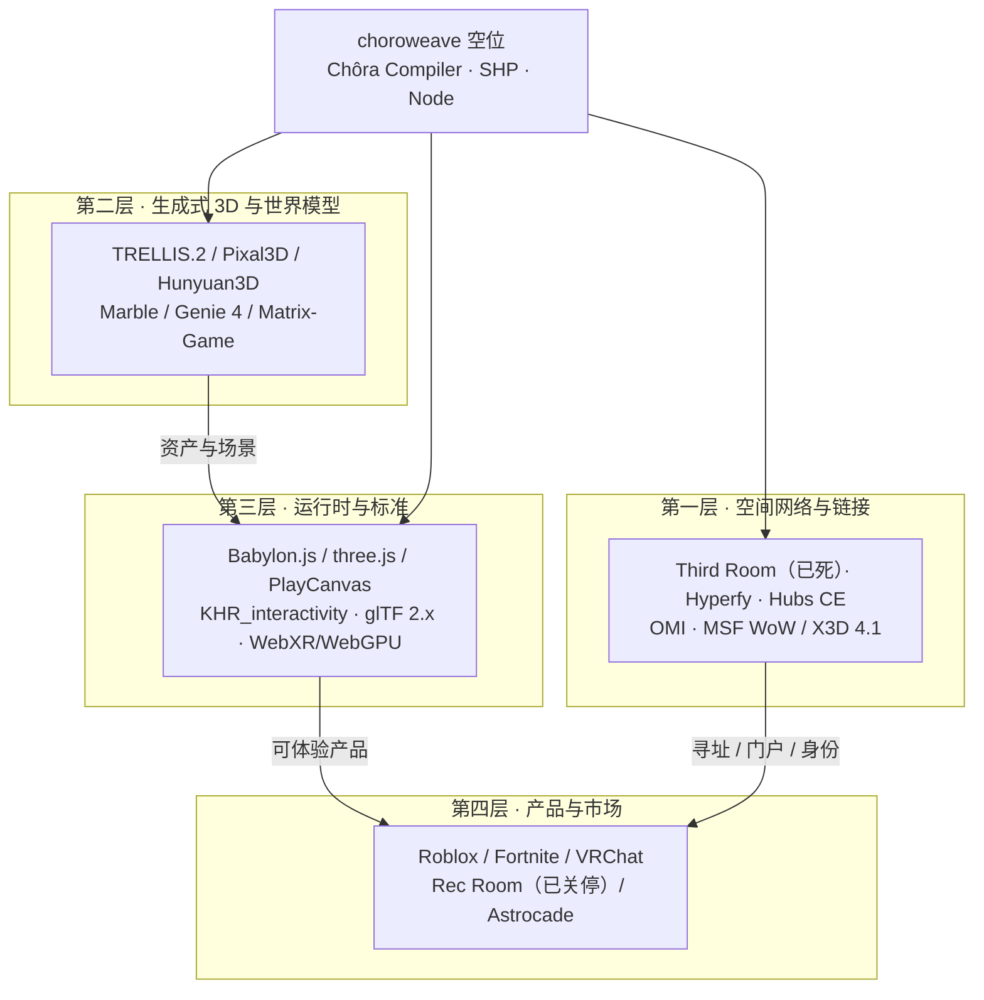

# choroweave 生态全景：四层地图、五个断层与 2026–2028 机会窗口（v0.1）

> **English (primary):** [`docs/en/01-landscape.md`](en/01-landscape.md) · 本页为中文版（Chinese version）。

> 状态：草案 · 全部数据 **截至 2026-11-07 核实**（GitHub 数据为当日 REST API 抓取；其余为规范正文/官方页面/权威第三方，逐条标注见 §7）
> 证据等级：**A** = 一手规范、官方文档、仓库元数据；**B** = 第三方实测或权威媒体报道；**C** = 工程判断（与 [`02-tech-selection.md`](02-tech-selection.md) 同一口径）
> 配套：[`02-tech-selection.md`](02-tech-selection.md)（ADR-01..12）、[`03-architecture.md`](03-architecture.md)、[`04-spatial-hyperlink-protocol.md`](04-spatial-hyperlink-protocol.md)、[`research/`](research/)（四份原始调研）
> 纪律：本文只提供生态证据与判断。**技术结论以 02 的 12 条 ADR 为准，本文不新增决策**；发现口径差异在 §8 显式列出。

## 0. 一页结论（先结论，后证据）

1. **这不是一个赛道，而是四层成熟度严重错配的生态。** 标准层刚刚拿到 ratified（`KHR_interactivity` 2026-08-28），实现层却只有 2 个 ratified 级实现；链接层有语义占位（MSF "Web of Worlds"/X3D 4.1 Anchor），但没有可运行协议；产品层规模仍在、单位经济已崩；生成层极强、但"生成结果→可玩世界"的装配层几乎空白。**choroweave 的位置在"装配层 + 链接层"，不在渲染器、也不在生成模型。**
2. **门户（Portal，俗称传送门）是标准真空，不是红海。** Third Room 的 `MX_portal` 已 DEPRECATED，OMI 的 `OMI_link` 已归档进 `Archived/`，OMI 至今没有 `OMI_portal`；MSF/X3D 只定义了 Anchor/Inline 语义，没有进入握手、信任、预取预算与一致性测试。**谁先交付"可验证的门户协议 + 参考实现"，谁就定义事实语义**（C）。
3. **生成能力在快速贬值，装配与验证在升值。** TRELLIS.2（4B，MIT）在 H100 上 1024³ 约 17 秒输出 PBR GLB；Marble 已按约 $1.20–1.28/世界计价；HY-World 2.0 权重开放。但 CEGame-Bench（2026-10）里 LLM 端到端做完整游戏只有 **16% 通关率**——缺的不是模型，是骨架、装配、可玩性契约与验证修复。
4. **中心化托管是这一代空间产品的主要死因。** Hubs（单一主体承担托管成本）、Spatial（托管与扩容成本）、Rec Room（UGC 抽成结构）先后失败；而 Hyperfy 的 fork/star 比高达 **0.38**，说明"自己部署一份"是真实需求。**静态 HTTPS 优先的节点（Node）+ 可选房间服务，是与 02 ADR 相容、且能自证成本的现实架构**（判断，C）。
5. **窗口是 2026–2028，且只有 12–24 个月的关键抢位期。** 四个条件第一次同时成立：标准刚 ratified 且实现稀缺、生成跨过成本阈值、Web 运行时/传输达标（WebTransport caniuse 92.37%）、平台层失败留下"跨域可携带"空位。窗口关闭信号：Roblox Reality/Everywhere 落地、Project Genie 走出美国并开放 API、OMI/Khronos 补上门户扩展、闭源 AI UGC 平台开始支持导出与跨平台链接。
6. **一句话定位（引用调研判断，C）[C2]：choroweave 不是另一个世界，而是世界之间的 DNS + HTTP。** 不是新引擎、不是新平台、不是新世界模型，而是**世界包的格式（World Bundle）+ 门户协议 + 可自托管节点 + 可验证一致性**。

**生态地图总览（判断，C；证据见 §2–§3）**

| 层 | 成熟度 | 活跃度 | 可复用性 | 一句话判断 |
|---|---|---|---|---|
| 空间网络与链接 | **低** | 低—中 | 中（零件高、平台低） | 语义已占位、实现空白；门户标准为真空 |
| 生成式 3D 与世界模型 | 资产高、可玩中低 | **极高** | 高（资产）、低（运行时） | 生成在贬值，装配与验证在升值 |
| 运行时与标准 | 标准高、实现窄 | 高（标准组织） | 高 | ratified ≠ 生态：仅 2 个 ratified 级实现 |
| 产品与市场 | 平台成熟、开放产品低 | 高（叙事负面） | 低（只有教训可复用） | 规模在，单位经济不在 |

> 结论：**不要把 choroweave 放进"又一个 3D 平台/引擎"的竞争格；放进"让世界可被寻址、可被进入、可被验证"的基础设施格。** 这正是 02 ADR-01/02/05/06/12 共同指向的位置。

## 1. 方法与口径

### 1.1 证据纪律

- 事实优先取规范正文、官方文档、GitHub REST API 元数据与厂商官方公告（A）；第三方实测/权威媒体仅作交叉印证（B）；基于事实的工程判断明确标 C，不冒充事实。
- 所有 star/fork/issue/提交日期为 **2026-11-07** 当日抓取；产品与市场数据标注原始统计口径与时点。
- 无法从一手来源确认的，写"未能核实"，不用于结论推导；本文的未核实项集中列在 §8.3。

### 1.2 状态口径（本文定义，C）[C1]

| 状态 | 判定标准 | 本文示例（截至 2026-11-07） |
|---|---|---|
| **活跃** | 近 90 天有提交/发布，且节奏与项目定位匹配 | LiveKit（2026-11-07 仍有提交）、Khronos glTF 生态 |
| **维护** | 近 12 个月有提交，但节奏低、issue 积压或仅安全/兼容修复 | Hubs 社区版（1,224 open issues，2026-10-29 仍有推送） |
| **停滞** | 6–12 个月无功能提交，或团队精力明显转移 | Hyperfy（main 最后 release 2025-12-18，仓库最后 push 2026-04-21） |
| **已死** | 核心仓 >24 个月无提交且无维护声明，或产品已关停 | Third Room（2023-08）、Webaverse（2022-12）、Rec Room（2026-06-01 停服） |

### 1.3 可复用性口径（1–5，C）

| 分值 | 含义 | 示例 |
|---|---|---|
| 5 | 可直接作为核心依赖 | Babylon.js（参考运行时）、TRELLIS.2（默认资产生成）、LiveKit（语音/数据） |
| 4 | 可直接依赖或作为次要依赖 | VRM/three-vrm、Colyseus、ATProto/DID 范式 |
| 3 | 可复用语义/片段，需适配或重写 | OMI 扩展语义、Hubs 的 Link UX、MSF WoW 语义 |
| 2 | 仅可借鉴设计，代码不可依赖 | Third Room 的 WebSG/MSC3815、Hyperfy 的沙箱模型 |
| 1 | 仅作历史参考 | Webaverse、JanusXR、Vircadia 开源线 |

## 2. 生态地图：四层、每层的"成熟度—活跃度—可复用性"

### 2.1 第一层：空间网络与链接

这一层回答四个问题：世界如何被**命名与发现**、门户如何**寻址**、传送（Traversal）如何**握手并延续身份**、多人会话如何**在场**。结论是：**概念被反复提出，工程实现几乎全部失败或停滞，标准语义刚被 MSF 命名。**（判断，C）

| 项目/协议 | 在层中的角色 | 判断（截至 2026-11） |
|---|---|---|
| Third Room + `MX_portal` | 最接近"Matrix 上的空间万维网"的完整尝试；`uri` 支持 http(s)/matrix: 的 glTF 门户 | 已死；`MX_portal` 已 DEPRECATED（建议改用 `OMI_link`），无 release [A8][A9] |
| Hyperfy v1/v2 | 唯一 shipped 的自托管 Web 世界引擎（Node + three.js + PhysX-WASM + LiveKit + VRM） | 停滞/低节奏维护；GPL-3.0；没有跨世界门户原语，`player.teleport` 仅世界内 [A10][A11] |
| Hubs 社区版 | 最成熟的"空间内链接"UX：Spoke 的 `Link` 元素即 portal，房间 URL 自动生成 Visit Room 卡片 | 维护；MPL-2.0；1,224 open issues；Link 只是 URL 跳转，无身份交接/状态携带 [A12][A13] |
| OMI | glTF 互操作词汇表（spawn_point / physics / seat / audio） | 维护但低动能；W3C Software & Document License；**无 `OMI_portal`**，`OMI_link` 已归档 [A6][A7] |
| MSF "Web of Worlds" / X3D 4.1 WoW Profile | "pages become places, links become portals"；Anchor（3D 超链接）+ Inline（外部场景） | 标准进行中；语义已占位，但无握手/信任/预取/测试；Threedy.io、Virginia Tech 在实现 [A5] |
| JanusXR / Webaverse | "网页即 3D 空间、由 portals 互联"的先驱 | 已死；JanusWeb 2018、janus-server 2023，Webaverse 2022 后转向 AI 工具（概念直系祖先，代码化石）[A33] |
| MatrixRTC / Matrix | 空间会话/在场模型（slot/membership + transport） | 活跃（产品 2026-10-22 落地）；厂商口径 50/200 人；**异步事件 DAG，不适合位姿同步** [A21][A41] |
| LiveKit / Colyseus / Nakama | 语音与数据通道、权威房间骨架、账号社交后端 | 活跃；LiveKit 22,075★、Apache-2.0；Colyseus 7,519★、MIT；Nakama 13,683★ [A23][A33] |
| DID / ATProto + `.well-known` | 身份与发现范式：DNS handle → DID → DID Document → 服务端点 | 成熟；`did:web` 与个人节点天然契合；RFC 8615 定义 `/.well-known/` [A26][A27] |
| IPFS / CID | 内容寻址与校验层 | 可用但不应作主寻址：CID 不是文件哈希，寻址不等于可用（需 pin/网关）[A47] |

**成熟度—活跃度—可复用性判断**

| 维度 | 评级 | 依据 |
|---|---|---|
| 成熟度 | **低** | 无 ratified 的空间链接扩展；门户标准真空；WoW/X3D 只有节点语义，没有协议工程件 |
| 活跃度 | **低—中** | 两个主要开源世界项目死亡/停滞；Hubs 维护、OMI 低动能；活跃的是 LiveKit/Colyseus/DID 等"零件" |
| 可复用性 | **中** | 零件 4–5（LiveKit、VRM、DID 范式），平台 1–2（Third Room/Webaverse/JanusXR 仅理念） |

> **choroweave 填哪一层**：`SHP`（Spatial Hyperlink Protocol，世界标识 + 门户 + 传送握手 + 能力协商）、`CHW_portal`（glTF 扩展）、`/.well-known/weave-node.json`（节点发现）、`WSP`（Weave Session Protocol，房间实时协议）。**不重写引擎，不发明新语言**——把 MSF/X3D 的 Anchor/Inline 语义工程化，并补齐它未定义的部分（ADR-05/06/07）。

### 2.2 第二层：生成式 3D 与世界模型

这一层回答：几何、材质、场景、视频画面从哪里来。结论是：**资产生成已跨过"够用"门槛，但"生成即入库/即出厂"不成立；世界模型是演示与视觉层，不是多人持久运行时。**（判断，C）

| 项目 | 在层中的角色 | 判断（截至 2026-11） |
|---|---|---|
| TRELLIS.2 / Pixal3D | 图→3D 资产生成：PBR GLB、任意拓扑、可 decimation | **第一梯队**：MIT，权重+代码+训练代码全开；1024³≈17s（H100）[A15][A16] |
| Hunyuan3D 2.1 / Omni / Part | 图→3D、部件分割与生成、bbox/骨架/点云控制 | 可用但许可有硬约束：非 OSI，EU/UK/KR 排除 + 1M MAU 条款；3.0/3.1/3.5 无公开权重 [A17] |
| Marble（World Labs） | 文/图→持久 3D 资产（SPZ splat + 碰撞网格 + 视觉网格） | 商业 API，按世界计价（约 $1.20–1.28/世界）；输出是**资产**不是运行时 [A18][A19] |
| Genie 4（DeepMind） | 实时生成式世界（研究预览） | 官方自认会话"几分钟"、多用户共享环境仍是"ongoing research challenge"；无持久权威状态 [A20] |
| Matrix-Game 4.0 | "引擎管玩法/物理 + 神经渲染管画面" | Apache-2.0 权重；RTX 5080 上 864×480 达 67 FPS；验证了引擎/模型分工 [A39] |
| HY-World 2.0 | 文/图→可导入引擎的 3D 世界（全景→3DGS→网格） | 权重开放但 Tencent 社区许可（EU/UK/KR 排除 + 1M MAU）；偏"看"不偏"玩" [A40] |
| SpatialLM | 实景扫描→结构化布局（墙/门窗/朝向包围盒） | 实用补位：把"真实空间"变成可重建布局，NeurIPS 2025 [A48] |
| Roblox Cube 3D / CubePart / 4D | 平台内部件化生成 + 脚本按生成尺寸重定向 | **关键工程范式**：功能契约（parts schema）先于生成，生成物才可动、可玩 [A45] |

**成熟度—活跃度—可复用性判断**

| 维度 | 评级 | 依据 |
|---|---|---|
| 成熟度 | **资产高、可玩中低** | 资产质量/许可/速度已达标；布局可行性、碰撞、绑定、玩法仍是工程活 |
| 活跃度 | **极高** | 模型与融资迭代密集；开源权重（TRELLIS.2/MIT、Matrix-Game/Apache-2.0）持续压低单价 |
| 可复用性 | **高（资产）/低（运行时）** | TRELLIS.2 5、Pixal3D 4、Marble 资产 3–4；Genie 4 / 视频世界模型 1–2（不可作状态权威） |

> **choroweave 填哪一层**：不是再训练一个生成模型，而是做"生成结果→可执行世界包"的**装配、可玩性契约与验证修复**（ADR-09）：骨架优先 + 部件 schema + L0 行为图 + 质检门。生成模型负责"看起来对"，Chôra Compiler 负责"确实可玩、可进入、可链接"。

### 2.3 第三层：运行时与标准

这一层回答：世界包用什么格式、由谁播放、如何跨引擎、如何联网。结论是：**标准层"上热下冷"——Khronos 刚 ratified 交互标准，但全球只有 2 个 ratified 级实现；多人、UI、脚本、链接都不在标准覆盖范围。**（判断，C）

| 标准/运行时 | 在层中的角色 | 判断（截至 2026-11） |
|---|---|---|
| `KHR_interactivity` | glTF 资产内对象行为（事件/变量/控制流/JSON Pointer） | **Ratified 2026-08-28**；仅单用户、无 UI、无任意脚本；图灵完备故需运行时限流 [A1][A2][A3] |
| glTF 2.0.1 / 2.1（计划） | 唯一多引擎/多工具消费的 3D 交付格式 | 2.1 未发布，计划 2026-11-17 Town Hall 宣讲多文件组合/外部引用/64-bit GLB [A24] |
| `KHR_gaussian_splatting` / SPZ / SOG | 3DGS 的 glTF 表示与传输格式 | splatting 已 ratified；SPZ 4 / SOG 为事实传输格式；流式 LOD 仍在 roadmap [A25][A46][A34] |
| `KHR_physics_*` / `OMI_physics_*` | 物理与碰撞标准 | 前者 Review Draft、后者 Stage 1 且仅 Godot 插件实现 → **不能依赖**，物理自带（ADR-10）[A25][A6] |
| Babylon.js | 通用 Web 引擎（WebGL2 + WebGPU + WebXR + Flow Graph） | **唯一 ratified 级 KHR_interactivity 通用引擎**（加载/执行/编辑器/无损导出）[A4][A42] |
| glTF-Sample-Viewer（UX3D） | 参考查看器 | 第二个 ratified 级实现；用于一致性回归，不是产品运行时 [A3] |
| three.js | 生态最大的 Web 渲染库 | **无 KHR_interactivity 执行器**；WebGPU+XR 仍是半成品（2026-04 才有 WebGL 回退）[A43] |
| PlayCanvas | WebGPU/3DGS 工具链（SuperSplat/SOG） | 无 KHR_interactivity；适合资产优化/3DGS 管线，不作主运行时 [A34] |
| WebXR / WebGPU | 沉浸式入口与渲染后端 | WebXR 非 Baseline（caniuse 78.02%）；WebGPU 桌面扩散但 **WebXR/WebGPU Binding 仍 Editor's Draft** [A44][B10] |
| WebTransport / WebRTC | 实时传输 | WebTransport W3C WD、caniuse 2026-10 约 92.37%；P2+ 用于位姿/事件，语音走 LiveKit [A35][B10] |
| Rapier | 物理引擎（Rust→WASM，Apache-2.0） | 包体/性能/维护适合 Web 与服务端同源；KHR_physics 未定前的现实选择（ADR-10）[A49] |

**成熟度—活跃度—可复用性判断**

| 维度 | 评级 | 依据 |
|---|---|---|
| 成熟度 | **标准高、实现窄** | ratified 规范齐备，但 KHR_interactivity 仅 2 个 ratified 级实现；多人/链接/UI 均无标准 |
| 活跃度 | **高** | Khronos 持续产出（interactivity、splatting、2.1 Town Hall、欧洲实体）；WebXR WG 慢于厂商方案 |
| 可复用性 | **高** | Babylon.js 5、Rapier 4、WebTransport 3、three.js 4（仅渲染/3DGS）；自研引擎 1–2（不做） |

> **choroweave 填哪一层**：`L0 KHR_interactivity`（对象行为）+ `Runtime Adapter`（场景/输入/状态白名单/门户生命周期）+ Babylon.js 9.x WebGL2-first（ADR-03/04）。**标准只承担"资产内行为"，世界规则、多人、门户由 SHP/WSP 承担。**

### 2.4 第四层：产品与市场

这一层回答：谁在赚钱、谁在死亡、需求侧是否成立。结论是：**规模仍在，平台税在崩；开放空间产品大面积死亡，AI UGC 高增长但变现为零；VR 硬件在收缩、智能眼镜在增长、Steam Frame 是唯一正向小变量。**（判断，C）

| 产品/市场信号 | 关键数据（截至 2026-11 核实） | 判断 |
|---|---|---|
| Roblox | Q3'26 DAU 1.38 亿（+12% QoQ）、时长近 340 亿小时、收入 $15.72 亿；bookings $17 亿（**-12% YoY**）、净亏 $2.30 亿；80% Top100 游戏用过 AI 工具 [A30][A50] | 平台层最强，但增长与变现背离；正把生成内化为资产层 |
| Fortnite / UEFN | 约 1.1–1.2 亿 MAU；UEFN 创作者累计分成 $10 亿；创作者岛屿占 47% 玩家时长（2026-05）[B11] | 创作者接管时长，平台退成结算/发现层 → 对"协议层"是结构性利好 |
| Minecraft / VRChat | Minecraft MAU 1.55 亿 [B12]；VRChat MAU >100 万、峰值 CCU 158,192、25 万+ 社区、创作者分成最高 50% [B5] | 证明"小 MAU + 高 ARPU + 强社区"可活；世界间跳转已被大量使用，但锁在中心服务器 |
| Rec Room | 1.5 亿累计玩家、$3.5B 峰值估值、付费用户 <2%；UGC 收入平台仅留 ~30¢/美元（第一方 ~70¢）；**2026-06-01 永久停服** [A29] | 最重要失败样本：UGC 越成功越亏 = 抽成模型错了 |
| Meta Horizon Worlds | 移动端 4,500 万累计下载、消费者总支出仅 $1.1 百万；MAU <20 万、DAU 低谷 <900（媒体口径）；VR 版 2026-03 宣布关停又撤回 [B13] | 资本不能替代 PMF；"通用社交世界"没有需求 |
| Hubs / Spatial | Hubs 2024-05-31 关停（11.6 万头像 / 21.6 万场景 / ~1000 万人次）；Spatial 创作者平台 2025-07-27 终止，官方称托管与扩容成本"找不到可持续模型" [A32][B6] | Web-first 与开放多人 3D 的两个尸检：**单一主体承担托管成本必死** |
| Decentraland | 平台仍运营；MANA 约 $0.089、较 ATH ~$5.9 跌 >98% [B14]；旧 Unity 客户端 2026-06 归档 [A33] | 金融化先于体验 → 迭代动机被替代 |
| Astrocade / Bitmagic | Astrocade：$56M 融资、8 个月 2,000 万参与用户、5M MAU（Naavik）、无公开变现；生成约 10 分钟、发行排期可长达一周。Bitmagic GDK（2026-08-27）面向 coding agent，`verify` 真浏览器试玩 + 一键托管 [A37][B4][A38] | 需求真实、留存与变现存疑；闭源平台/工具链，缺"可携带 + 可互联" |
| 硬件与入口 | 2025 年头显出货预计 **-42.8%**；Vision Pro 全年 4.5 万台；Quest 前三季度 170 万台（-16%）；智能眼镜 +211.2%；Steam Frame 2026-09-15 发布、首月 SteamVR 份额 5.49% [B2][B3][A36] | **Web-first 是唯一有数据支撑的默认入口**；VR 是可选项，不是主战场 |

**成熟度—活跃度—可复用性判断**

| 维度 | 评级 | 依据 |
|---|---|---|
| 成熟度 | **平台成熟、开放产品低** | 头部平台占据生态位；开放空间产品连续死亡；AI UGC 尚在"demo 聚合"阶段 |
| 活跃度 | **高但叙事负面** | 用户规模/融资/游玩量都在增长；"元宇宙"标签成为负资产，中心化平台收入承压 |
| 可复用性 | **低** | 平台不可复用；可复用的是教训（单位经济/托管成本/身份锁定）与需求信号（自托管、轻入口） |

> **choroweave 填哪一层**：不与平台正面竞争，做平台的**上游（生成）与下游（分发/寻址）**：把世界包做得可被任意平台/引擎消费，把节点做得可被个人/社区自托管（ADR-01/05/08/12；另见 [`08-open-source-strategy.md`](08-open-source-strategy.md)）。

## 3. 关键项目事实卡（15 张，覆盖四层）

> 卡内"可复用性"为本文 1–5 评分（C）；状态按 §1.2 口径；证据编号对应 §7。所有 URL 访问日期均为 2026-11-07。

### C01 · Third Room —— 最完整的设计，最彻底的停摆
- **状态**：**已死**（核心仓最后提交 2023-07-11，最后 push 2023-08-30；3 年+ 零提交、零 release、91 个 open issue）[A8][A33]
- **许可证**：Apache-2.0 [A8]
- **最后提交/发布**：2023-07-11（PR #648）；无 release [A8]
- **关键事实**：656★ / 70 fork / 91 open issues；three.js + bitECS + Rapier(WASM) + Matrix(hydrogen/Olm) + 自研 WebSG（glTF 镜像 API + WASM 沙箱）；联网押在 MSC3401（主分支无该提案文件），MSC3815 "Worlds" 仍是 WIP 草案 [A8]
- **与 choroweave 的关系**：设计参考——WebSG 的"glTF 镜像 + 沙箱"、MSC3815 的"世界=房间+状态事件"、`MX_portal` 的 `uri` 形状；**不可作底座**（ADR-04/12）[A9]
- **可复用性**：**2/5**（理念 4、代码 1）
- **证据**：<https://github.com/matrix-org/thirdroom> · <https://github.com/matrix-org/thirdroom/blob/main/docs/gltf/MX_portal/README.md>

### C02 · Hyperfy v1/v2 —— 唯一 shipped 的自托管 Web 世界，但 GPL-3.0
- **状态**：**停滞（低节奏维护）**（main 最后 release v0.16.0 = 2025-12-18；dev 分支最后活动/仓库最后 push 2026-04-21；团队精力转向 `firebolt`）[A10][A33]
- **许可证**：**GPL-3.0**（已核验 LICENSE 文本）[A10]
- **最后提交/发布**：v0.16.0（2025-12-18）；仓库最后 push 2026-04-21 [A10]
- **关键事实**：310★ / 117 fork / 30 open issues；单 Node 进程同时做权威服务器 + 客户端资源服务；WebSocket + msgpack、PhysX(WASM)、SES 沙箱、LiveKit 语音、VRM 头像、`.hyp` 世界包；App 只能改状态/发事件，**没有跨世界门户原语**（`player.teleport` 仅世界内）[A10][A11][A28]
- **与 choroweave 的关系**：路线 A（松耦合宿主）的 demo 候选；**不 fork、不链接进 Apache-2.0 参考实现**（ADR-04/12）；其 fork/star=0.38 是"自托管需求真实存在"的关键证据（调研 01 口径：唯一同时具备 app 脚本/物理/VRM/语音的 shipped 自托管 Web 世界引擎）
- **可复用性**：**4/5 作宿主 / 2/5 作代码库**
- **证据**：<https://github.com/hyperfy-xyz/hyperfy> · <https://docs.hyperfy.xyz/docs/scripts/>

### C03 · Mozilla Hubs 社区版 —— 维护中，但 issue 积压
- **状态**：**维护**（master 最后提交 2026-08-23；仓库 2026-10-29 仍有推送；社区版部署脚本 v2.1.1 = 2026-09-08）[A12][A14]
- **许可证**：**MPL-2.0**（文件级 copyleft，可 fork）[A12]
- **最后提交/发布**：master 2026-08-23；CE 脚本 v2.1.1（2026-09-08）[A12][A14]
- **关键事实**：2,223★ / 1,389 fork / **1,224 open issues**；A-Frame + three.js + Spoke 编辑器 + Blender add-on；后端 Reticulum（Phoenix/Elixir 重栈）；Spoke 的 `Link` 元素就是官方口径的 **portal**（URL 跳转 + Visit Room 卡片）[A12][A13]
- **与 choroweave 的关系**：可 fork 客户端的参考（MPL 友好）、已上线的"空间内超链接"UX 先例；但**只是 URL 跳转**，没有身份交接/状态携带/协议 → 正是 SHP 要补的部分；Elixir 重栈不适合小团队自托管
- **可复用性**：**3/5**
- **证据**：<https://github.com/Hubs-Foundation/hubs> · <https://docs.hubsfoundation.org/creators-linking-rooms>

### C04 · OMI —— 标准在推进，但恰恰没有"门户"
- **状态**：**维护但低动能**（`gltf-extensions` 最后提交 2026-09-21；组织主仓最后提交 2025-10-01；扩展仓库 58★/组织 329★）[A6][A33]
- **许可证**：W3C Software & Document License [A6]
- **最后提交/发布**：2026-09-21（`OMI_environment_sky` 修复）[A6]
- **关键事实**：Stage 流程 0–5；`OMI_seat` 为 Stage 2（最高）；`OMI_physics_*`、`OMI_spawn_point` 为 Stage 1；`OMI_link` Stage 1 且已移入 `Archived/`；**不存在 `OMI_portal`**；实际实现基本只有 Godot 插件 [A6][A7]
- **与 choroweave 的关系**：`CHW_portal` 字段形状应兼容 `MX_portal`/`OMI_link` 的 `uri` 直觉；出生点/物理/座位语义优先复用 OMI 子集；门户必须自研，并按 OMI Stage 1 提交（P4 标准路线）
- **可复用性**：**3/5**（语义可复用，无 portal、无运行时）
- **证据**：<https://github.com/omigroup/gltf-extensions> · <https://github.com/omigroup/gltf-extensions/blob/main/extensions/2.0/Archived/OMI_link/README.md>

### C05 · MSF "Web of Worlds" / X3D 4.1 WoW Profile —— 语义已占位，工程仍空白
- **状态**：**标准进行中**（2026 白皮书 + Web3D 博客 2026-07-12；Threedy.io / Virginia Tech 实现中；ISMAR 2026 XWORLDS 已有《The Web of Worlds》论文）[A5][B7]
- **许可证**：标准文本（Web3D Consortium / MSF）；**文本许可未在本次核实中单列**
- **最后活动**：2026-07-12 官方博客；2026 ISMAR 论文 [A5][B7]
- **关键事实**：口号 "pages become places, links become portals"；X3D 4.1 WoW Profile 明确含 **Anchor（3D hyperlinks）** 与 **Inline（external scenes）**；但**没有**定义进入握手、身份延续、能力协商、预取预算、失败回滚与一致性测试
- **与 choroweave 的关系**：SHP 的语义对标物（ADR-06）——**映射 Anchor/Inline，而不是另造语言**；SHP 的增量价值正是补齐 WoW 缺失的握手/信任/预算/测试
- **可复用性**：**3/5**（语义与术语；无实现可依赖）
- **证据**：<https://www.web3d.org/new/blog/how-web-worlds-x3dweb3d-and-metaverse-standards-forum-tie-together> · <https://websites.fraunhofer.de/xworlds26/2026_ISMAR_TheWebofWorlds-TowardsAReferentialArchitectureforOpenSpatialWorlds.pdf>

### C06 · KHR_interactivity —— 2026-08-28 ratified，但明确"仅单用户"
- **状态**：**活跃（标准已 ratified）**（Khronos 2026-10-13 研讨会确认 "ratification on August 28, 2026"；规范正文 Status: "Complete, Ratified"；2026-11-07 复核）[A1][A2][A3]
- **许可证**：Khronos 规范（免费公开；**文本许可条款未在本次核实中单列**）
- **最后提交/发布**：规范 ratified 2026-08-28；新闻稿 2026-07-16；研讨会 2026-10-13 [A1][A2][A3]
- **关键事实**：行为图 = 数据流 + 控制流 + 事件/变量 + `pointer/*`（JSON Pointer 读写 glTF Object Model）；图灵完备，需运行时限流。**规范原文**："This extension is for single user experiences only and does not deal with any of the complexity involved in multi-user networked experiences."；不支持 UI、不支持任意脚本。ratified 级实现仅 **Babylon.js + glTF-Sample-Viewer（UX3D）**；three.js/PlayCanvas 无执行器；Godot 仅伴生 `KHR_node_visibility`；Unity 仅导出（UnityGLTF）；Needle 运行时 2026-07 仍是 roadmap [A1][A3][A4]
- **与 choroweave 的关系**：L0 对象行为层的唯一合理标准（ADR-03）；**世界规则/多人/门户必须自研**——这正是 SHP/WSP 的存在理由
- **可复用性**：**4/5**（资产内行为标准；生态窄、不能承载世界逻辑）
- **证据**：<https://github.com/KhronosGroup/glTF/tree/main/extensions/2.0/Khronos/KHR_interactivity> · <https://www.khronos.org/events/practical-introduction-to-interactivity-in-gltf>

### C07 · Babylon.js —— 唯一 ratified 级通用引擎
- **状态**：**活跃**（2026-11 KHR_interactivity 加载/校验/执行/Flow Graph/无损导出文档持续可用；具体最后 release 号/日期未能核实）[A4][A42]
- **许可证**：**Apache-2.0**（含专利授权，商业宿主友好）[A4]
- **最后提交/发布**：文档与仓库持续更新（2026-11 核实）；**最后 release 日期未能核实**
- **关键事实**：WebGL2 + WebGPU 双后端；WebXR 成熟；Flow Graph 可视化；`GetKHRInteractivityImportResult` 严格校验；未知扩展操作保留为 typed no-op；WebGPU-XR 仍 experimental，且无法在场景创建后从 WebGPU 切回 WebGL [A4][A42]
- **与 choroweave 的关系**：P0–P4 主运行时（ADR-04）；其"唯一 ratified 级通用引擎"地位是选型关键；**在 Babylon 之上做 Runtime Adapter**，保持 3 个月可换 three.js 适配器的抽象度
- **可复用性**：**5/5**
- **证据**：<https://github.com/BabylonJS/Documentation/blob/master/content/features/featuresDeepDive/importers/glTF/khrInteractivity.md> · <https://github.com/BabylonJS/Documentation/blob/master/content/setup/support/webGPU.md>

### C08 · three.js —— 生态最大，但没有 KHR_interactivity 执行器
- **状态**：**活跃**（渲染库持续迭代；WebGPU+XR 仍是半成品：2026-04 PR #33497 才把"WebGPU 下 XR 直接抛错"改为自动回退 WebGL；2026-03 PR #33154 仍在重构 XR framebuffer）[A43]
- **许可证**：MIT（生态通行；本次未逐条核验仓库 LICENSE，标待核）
- **最后提交/发布**：最后相关活动 2026-04（PR #33497）；**具体 release 日期未能核实** [A43]
- **关键事实**：生态最大、示例/人才最多；**无官方 `KHR_interactivity` 执行器**（社区有实验性双向映射，成熟度未核实）；WebGPU-XR 不是生产路径；3DGS/后处理实验快（Spark 亦基于 three.js）
- **与 choroweave 的关系**：**不作主运行时**；仅 3DGS/嵌入支线（ADR-04）。重要含义：不能把 three.js 当"通用查看器"兜底——它播不了 KHR_interactivity 行为图
- **可复用性**：**4/5**（渲染/3DGS 支线）；作为主运行时 **1/5**
- **证据**：<https://github.com/mrdoob/three.js/pull/33497> · <https://github.com/mrdoob/three.js/pull/33154>

### C09 · PlayCanvas —— 3DGS 工具链强，但没有行为图运行时
- **状态**：**活跃**（WebGPU 自 1.62 起支持；2026-09 SuperSplat 整体重建在 WebGPU 上、支持流式 LOD；具体最后 release 日期未能核实）[A34]
- **许可证**：开源引擎（通行 MIT；**本次未逐条核验 LICENSE，标待核**）
- **最后提交/发布**：SuperSplat 2026-09 重建；**最后 release 日期未能核实** [A34]
- **关键事实**：SOG / Streamed SOG 是 3DGS 事实传输格式（比 PLY 小 15–20×，WebP 图集 + 分块）；SuperSplat 可编辑/导出；**未见 `KHR_interactivity` 支持**
- **与 choroweave 的关系**：资产优化与 3DGS 管线（ADR-04/11）；不是运行时候选；SOG 可作为 P3 视觉层的传输格式备选
- **可复用性**：**3/5**（资产工具链）；作为运行时 **1/5**
- **证据**：<https://developer.playcanvas.com/user-manual/supersplat/editor/import-export/>

### C10 · TRELLIS.2 / Pixal3D —— MIT 的资产层第一梯队
- **状态**：**活跃**（TRELLIS.2 2025-12 发布 4B 模型；Pixal3D SIGGRAPH 2026；权重/代码/训练代码开放）[A15][A16]
- **许可证**：**MIT**（TRELLIS.2 权重+代码+训练代码；Pixal3D 亦 MIT，但 HF 元数据另标 `extra_gated_eu_disallowed: true`，部署前需核查）[A15][A16]
- **最后提交/发布**：TRELLIS.2 2025-12；Pixal3D 2026 [A15][A16]
- **关键事实**：TRELLIS.2：≥24GB VRAM；H100 上 512³≈3s / 1024³≈17s / 1536³≈60s；输出 PBR 四通道 GLB（base/rough/metal/opacity），可 decimation 到百万面级；支持开放曲面/非流形/内部结构；训练集为 Objaverse-XL（上游资产许可混杂，**行业性未解风险，判断 C**）。Pixal3D：像素对齐"接近重建级"几何 + PBR [A15][A16]
- **与 choroweave 的关系**：默认资产生成 provider（ADR-09）；`@choroweave/provider-trellis`；**必须配"生成→质检→LOD/碰撞/UV 修复→入库"流水线**，不可"生成即入库"
- **可复用性**：**5/5**（默认资产模型）/ **4/5**（Pixal3D 参考图重建）
- **证据**：<https://github.com/microsoft/TRELLIS.2> · <https://huggingface.co/TencentARC/Pixal3D>

### C11 · Hunyuan3D —— 非 OSI 许可，默认不能做全球分发依赖
- **状态**：**活跃**（2.1/Omni/Part 开源；3.0/3.1/3.5 为腾讯云托管服务、无公开权重）[A17]
- **许可证**：**Tencent Hunyuan 3D Community License（非 OSI）**：EU/UK/KR 不适用；发布日 MAU >100 万需另行授权；HY-World 2.0 同构社区许可 [A17]
- **最后提交/发布**：Hunyuan3D-2.1 2025-06-13；Omni 2025-09-25；Part 2025-09-23 [A17]
- **关键事实**：2.1（3.3B 形状 + 2B PBR 绘色）；Omni 支持 bbox/骨架/点云/体素控制信号；Part 做部件分割+生成；3.x 云服务支持 8K PBR、最高 150 万面，但无权重 [A17]
- **与 choroweave 的关系**：**仅可选 provider、不作默认分发依赖**（ADR-09）：地域排除与 MAU 条款和"个人节点联邦、全球用户"冲突；在 provider 层隔离许可，并在 Space Spec 记录部署地域
- **可复用性**：**3/5**（能力可用，许可硬约束）
- **证据**：<https://github.com/Tencent-Hunyuan/Hunyuan3D-2.1> · <https://github.com/Tencent-Hunyuan/Hunyuan3D-2.1/blob/main/LICENSE>

### C12 · Marble / Genie 4 —— 世界模型不是运行时
- **状态**：Marble **活跃（商业 API）**（1.0/1.1/1.1 Plus；API 2026-01；1.1 2026-04；输出持久 3D 资产）；Genie 4 **研究预览**（2026-10-27 trusted testers）[A18][A19][A20][B9]
- **许可证**：Marble 商业 API 条款（闭源）；Genie 4 闭源研究预览 [A18][A20]
- **最后提交/发布**：Marble 1.1（2026-04）、定价页 2026-04-03；Genie 4 预览 2026-10-27 [A18][B9]
- **关键事实**：Marble 输出 = **持久资产**（2M splats + 10–20 万面碰撞网格 + 60 万面视觉网格 + 2560×1280 全景），不是可运营世界；定价约 $1.20–1.28/世界（Draft ~$0.12–0.20、Plus 最高 ~$2.48）；母体 World Labs 于 2026-09-28 被 AMD 宣布收购（预计年底完成，待监管）。Genie 4 官方限制："几分钟"会话、多用户/共享环境是"ongoing research challenge"、会漂移；无持久权威状态 [A18][A19][A20][B8][B9]
- **与 choroweave 的关系**：**只作内容生成与视觉层，不作状态权威**（ADR-11）；Marble 输出形态（splat + collider + visual mesh）正是"预生成 3DGS 背景层"的可消费资产；API 供应商锁定/收购风险 → 不作核心依赖
- **可复用性**：**3/5**（Marble 资产层）/ **1–2/5**（Genie 运行时不可用）
- **证据**：<https://docs.worldlabs.ai/marble/models> · <https://docs.worldlabs.ai/marble/export/specs> · <https://deepmind.google/models/genie/>

### C13 · Matrix / LiveKit / WebTransport —— 三件套，各归其位
- **状态**：LiveKit **活跃**（2026-11-07 仍有提交，22,075★）；MatrixRTC **产品落地**（Element 2026-10-22 公告，规范正文合并排期未核实）；WebTransport **标准推进**（W3C WD；Baseline 2026，caniuse 2026-10 约 92.37%）[A21][A23][A35][A41][B10]
- **许可证**：Matrix 规范 Apache-2.0、参考实现 AGPL-3.0（据调研 01；本次未逐条复核许可文件）；LiveKit Apache-2.0；WebTransport 为浏览器能力（非代码许可）[A21][A23]
- **最后提交/发布**：LiveKit 2026-11-07；MatrixRTC 落地 2026-10-22；WebTransport Baseline 2026-03 [A23][A41][A35]
- **关键事实**：MSC4143 定义 slot/membership + applications + transports；MSC4195 定义 LiveKit 多 SFU 发布/订阅；厂商口径容量约 50 人（ESS 社区/Synapse）到 200 人（ESS Pro），非第三方压测。Matrix 是持久、联邦复制、最终一致的事件 DAG → 适合"世界是什么"，不适合"这一帧某人在哪"。LiveKit 已被 Hyperfy、Decentraland、Element Call 验证；WebTransport 支持 HTTP/3 多流 + 不可靠数据报 [A21][A22][A23][A41][B10]
- **与 choroweave 的关系**：ADR-07——P0–P1 WebSocket 房间服；P2+ WebTransport/WebRTC DataChannel + LiveKit 语音；**Matrix 仅可选社交桥，不承载位姿**
- **可复用性**：LiveKit **5/5**、WebTransport **3/5**（预留抽象）、MatrixRTC 概念 **3/5**（不进实现）
- **证据**：<https://github.com/livekit/livekit> · <https://developer.mozilla.org/en-US/docs/Web/API/WebTransport_API> · <https://github.com/matrix-org/matrix-spec-proposals/blob/main/proposals/4143-matrix-rtc.md>

### C14 · Webaverse / JanusXR —— 链接层的失败与化石
- **状态**：**已死**（Webaverse 最后 push 2022-12-20，域名 301 到 upstreet.ai；JanusWeb 最后提交 2018-05-30、janus-server 2023-08-22）[A33]
- **许可证**：Webaverse MIT；JanusWeb/janus-server MIT [A33]
- **最后提交/发布**：2022-12-20（Webaverse）；2018-05-30 / 2023-08-22（JanusXR）[A33]
- **关键事实**：Webaverse 376★；JanusWeb 17★、janus-server 80★；JanusXR 官网仍自称"由 portals 互联的 3D webspaces"，是**概念上最接近 choroweave 的直系祖先**；Webaverse 2023-02 被盗 $4M USDC、随后关闭（媒体口径，B）[B15]；Vircadia 已转型为"游戏反应层"（PostgreSQL 世界状态）[A51]
- **与 choroweave 的关系**：负资产清单——"门户互联"不是新想法，2015–2018 就有人做过；choroweave 的代差必须来自**编译管线 + 可验证协议 + 自托管成本结构**，不是概念本身
- **可复用性**：**1/5**（仅历史与叙事参考）
- **证据**：<https://github.com/webaverse/app> · <https://www.janusxr.org/>

### C15 · Astrocade / Bitmagic —— AI UGC 与 agent-first 工具的真实温度
- **状态**：**活跃**（Astrocade $56M 融资、8 个月 2,000 万参与用户；Bitmagic GDK 2026-08-27 发布）[A37][A38]
- **许可证**：闭源商业平台/工具链 [A37][A38]
- **最后提交/发布**：Astrocade 2026-05-05；Bitmagic GDK 2026-08-27 [A37][A38]
- **关键事实**：Astrocade 5M MAU、7.5 万创作者、月 1.4 亿次游玩（Naavik，B）；生成约 10 分钟、迭代约 2 分钟、**发行排期可长达一周**；**未公布任何虚拟货币/内购/订阅**，被批"游戏 demo 聚合体、操作笨拙、进程深度有限"。Bitmagic：TS 引擎源码 vendor、`bitmagic verify` 在真实浏览器试玩+截图回传、一条命令托管（默认私有、可站内发现）、多人/排行榜由平台承载 [A37][B4][A38]
- **与 choroweave 的关系**：需求侧最强证据（"自然语言→可玩"有真实需求）与竞争警示（平台把生成+托管+分发做全）；choroweave 的差异化只能是**可携带 + 可互联 + 可自托管**（研究判断，C）
- **可复用性**：**1/5**（产品不可复用）；其"验证-修复闭环"与"agent-first 工作流"可借鉴 **3/5**
- **证据**：<https://www.astrocade.com/blog/astrocade-raises-56m-funding> · <https://bitmagic.ai/news/bitmagic-gdk/>

## 4. 五个断层：证据与 choroweave 的填补位置

| 断层 | 证据强度 | choroweave 的填补物 | 阶段 | 对应 ADR |
|---|---|---|---|---|
| ① 空间网络缺内容工具 | A（停更/无生成管线） | Chôra Compiler + Spatial-DSL + 资产 provider | P1 | ADR-01/02/09 |
| ② 生成缺可玩性与载体 | A/B（16% 通关、demo 聚合） | 骨架优先 + 部件 schema + L0 行为图 + 验证修复 | P1 | ADR-03/09 |
| ③ 标准缺多人 + 链接 | A（规范单用户、无 portal） | SHP + `CHW_portal` + WSP + 节点发现 | P0–P2 | ADR-05/06/07 |
| ④ 市场缺可持续单位经济 | A/B（Rec Room/Spatial/Hubs 尸检） | 静态优先 Node + 自托管 + 不做交易抽成 | P0/P2 | ADR-05/12 |
| ⑤ 开源缺可验证一致性 | A（仅 2 实现、无门户套件） | `weave-check` 一致性套件 + `CHW_*` 规范 | P0 | ADR-12 |

### 4.1 断层一：空间网络缺内容工具

**判断（C）**：这一层有"世界引擎"、有"查看器"、有"标准词汇"，但没有"把意图变成可进入世界"的工具链。开源世界的创作仍等于写代码 + 手工摆场景。

**证据（A/B）**：
- Third Room 死后，最完整的开源尝试只剩设计文档；Hubs 的 Spoke 是手工编辑器，社区节奏慢（1,224 open issues）[A8][A12]。
- Hyperfy 的 App 需要写 JS 跑在 SES 沙箱里，`.hyp` 包需要专门工具；**没有生成式创作入口** [A10][A11]。
- JanusXR/Webaverse 证明"网页即空间"概念存在，但代码已成化石 [A33]。
- Astrocade/Bitmagic 证明需求真实，但一个是闭源平台、一个是闭源工具链 → **开源侧的工具链空位成立** [A37][A38]。

**choroweave 填哪一层**：Chôra Compiler（世界编译器，`@choroweave/compiler`）——意图→Spatial-DSL（空间 DSL，编译器内部 IR）→确定性装配→World Bundle；P1 退出条件是"20 条评测提示词中 ≥70% 产出可玩世界"（见 [`internal/writing-spec.md`](internal/writing-spec.md) §3）。

### 4.2 断层二：生成缺可玩性与载体

**判断（C）**：生成模型把"看起来对"做到了，"确实可玩"仍缺三件东西：功能契约（parts schema）、行为载体（可执行世界包）、验证闭环（自动试玩/质检）。

**证据（A/B）**：
- CEGame-Bench（2026-10）：五个生产引擎、平均 295 步/65M tokens，**仅 16% 的运行能通关**；工程师+编码 agent 的参考实现接近满分 [B1]。
- Astrocade 被 Naavik 批为"游戏 demo 的聚合体、操作笨拙、进程深度有限"，且发行排期可长达一周 [B4]。
- Marble 输出是资产（splat + 碰撞网格 + 视觉网格），要导入 Unreal/Unity/Blender 才可运营；Genie 4 会话仅"几分钟"且无多用户共享环境 [A18][A20]。
- TRELLIS.2 生成物"视觉正确"优先，拓扑/UV/绑定不可直接用于动画；Roblox CubePart/4D 用 parts schema + 脚本重定向解决"可动/可玩"，是正向证据 [A15][A45]。

**choroweave 填哪一层**：ADR-09 的"骨架优先 + 部件化 + L0 行为图 + 验证-修复循环"；产物是 World Bundle（glb + `KHR_interactivity` + `CHW_*` + `world.json`）。生成模型只是 provider，可玩性由编译器保证。

### 4.3 断层三：标准缺多人 + 链接

**判断（C）**：这是五断层里最硬、也最可验证的一条：交互标准刚 ratified，但**恰恰把"多人"和"链接"排除在外**；门户标准在 OMI 归档、在 Third Room deprecated、在 MSF 只有语义。

**证据（A）**：
- `KHR_interactivity` 规范原文："This extension is for **single user experiences only** and does not deal with any of the complexity involved in multi-user networked experiences."；不支持 UI、不支持任意脚本 [A1][A2]。
- OMI 至今无 `OMI_portal`；`OMI_link` Stage 1 且已归档；Third Room `MX_portal` 已 DEPRECATED [A6][A7][A9]。
- `KHR_physics_*` 仍是 Review Draft；glTF 2.1 的"外部引用/多文件组合"仍是 Proposal/Town Hall 议题（2026-11-17）[A24][A25]。
- MSF WoW/X3D 4.1 只定义 Anchor/Inline 语义，无进入握手/信任/预取/回滚/一致性测试；Hubs 的"portal"只是 URL 跳转 [A5][A13]。
- VRChat 的 World 链接 + Portal 证明交互范式已被用户理解，但锁在中心服务器 → 缺的是"跨运营方"的协议 [B5]。

**choroweave 填哪一层**：SHP（HTTPS 世界标识 + `world.json` + `/.well-known/weave-node.json` 节点发现 + 门户 `CHW_portal` + 传送握手 + 能力协商/失败回滚）、WSP（房间实时）。对齐 WoW/X3D Anchor 语义，补齐其未定义工程件（ADR-05/06/07；协议细节见 [`04-spatial-hyperlink-protocol.md`](04-spatial-hyperlink-protocol.md)）。

### 4.4 断层四：市场缺可持续单位经济

**判断（C）**：这一代空间产品的死因不是"用户不够"，而是"托管成本 + 抽成结构"不可持续。谁承担中心化托管，谁就在规模扩张时亏损扩大。

**证据（A/B）**：
- Rec Room：1.5 亿累计玩家、$3.5B 峰值估值、付费用户 <2%；第一方道具留 ~70¢/美元，UGC 道具扣平台费+分成后仅留 ~30¢/美元，UGC 收入 +70% 反而稀释毛利；2026-06-01 停服 [A29]。
- Spatial 创作者平台 2025-07-27 终止，官方原话：托管与扩容成本持续上升，"没有找到可持续模型" [B6]。
- Hubs 2024-05-31 关停，单一主体承担全部托管成本；关停前 11.6 万头像/21.6 万场景/近 1000 万人次 [A32][A14]。
- Horizon Worlds 移动端 4,500 万下载 vs 消费者总支出 $1.1 百万 → 下载≠使用≠付费 [B13]。
- 对照：Roblox Q3'26 DAU +12% QoQ，但 bookings -12% YoY → 平台层也在承压 [A30]；Hyperfy fork/star=0.38 → 自托管需求真实 [A10][A33]。

**choroweave 填哪一层**：Node 的"静态 HTTPS 优先 + 房间服务可选增强"（P0 即可纯静态托管世界）；成本随世界扩散分摊到个人/社区节点；商业化放在托管、企业私有部署、支持合同与捐赠，**不做交易抽成**（ADR-05/12；另见 [`08-open-source-strategy.md`](08-open-source-strategy.md)）。

### 4.5 断层五：开源缺可验证一致性

**判断（C）**：开源阵营并不缺"项目"，缺的是"可验证的兼容性"。没有一致性套件，协议采用度无法度量，生态会退化成互不连通的 fork 孤岛。

**证据（A）**：
- `KHR_interactivity` ratified 级实现只有 Babylon.js + glTF-Sample-Viewer 两个；three.js/PlayCanvas/Godot 都不执行行为图 [A3][A4]。
- OMI 的 Stage 2 要求"完整 JSON Schema + 至少一个实现 + 样例资产"，但最高只到 `OMI_seat`；物理扩展实际只有 Godot 插件 [A6]。
- Hyperfy fork/star 0.38，每一个 fork 都是孤岛；Hubs 积压 1,224 issues → 开源"能部署"不等于"能互联" [A10][A12][A33]。
- MSF WoW/X3D Profile 没有配套测试套件；门户语义（Anchor/Inline）无法自动验证 [A5]。
- 02 ADR-12 已把 `weave-check` 定义为核心资产：验证 `world.json`、glTF、行为图、门户、预算与安全策略。

**choroweave 填哪一层**：`@choroweave/check`（`weave-check`）——P0 即交付；一致性套件是协议的"护城河"，不是附属工具。**任何声称兼容 SHP 的实现都必须能跑通它**（ADR-12）[C3]。

## 5. 机会窗口：为什么是 2026–2028

### 5.1 四个条件第一次同时成立

1. **标准刚 ratified，生态尚未填满**：`KHR_interactivity` 2026-08-28 才 ratified，到 2026-11 只有 2 个 ratified 级实现；`KHR_gaussian_splatting` 也刚 ratified。**标准红利"刚到账、尚未兑现"**——2026-11 是押注窗口成本最低的时点 [A1][A2][A25]。
2. **生成成本跨过阈值**：TRELLIS.2（MIT）1024³≈17s；Marble 约 $1.20–1.28/世界；HY-World 2.0 权重开放。生成质量的竞争已白热化，**"生成之后怎么办"反而无人做** [A15][A18][A40]。
3. **Web 运行时与传输达标**：Babylon.js 双后端 + WebXR；WebTransport 2026-03 起 Baseline、caniuse 约 92.37%；WebGPU 全局可用率 86.83%（caniuse 2026-10）。**"浏览器即开即玩"第一次在工程上可行** [A42][A35][B10]。
4. **平台层失败留下空位**：Hubs/Spatial/Rec Room 的死亡证明中心化托管不可持续；而 Hyperfy 的自托管需求与 VRChat 的"世界巡游"行为证明需求在。**"可携带 + 可互联 + 可自托管"的位置是空的** [A32][B6][A29][A10][B5]。

**为什么不是更早**：2023–2025 时 `KHR_interactivity` 未 ratified、TRELLIS.2 未发布、WebTransport 未 Baseline、VR 市场还在高位，四条件不成立。
**为什么不是更晚**：2029 年后标准生态成熟、平台补齐跨世界链接、生成成本归零，空位会被填掉；**关键抢位期只有 12–24 个月**（研究判断，C）。

### 5.2 贬值中的红利 vs 升值中的红利

| 方向 | 红利 | 证据 | 判断（C） |
|---|---|---|---|
| 贬值 | 生成模型质量/单价 | TRELLIS.2 MIT、HY-World 2.0 开放权重、Marble 按世界计价 [A15][A40][A18] | 质量会商品化，不能作护城河 |
| 贬值 | 世界模型演示/视频效果 | Genie 3→4 仅 14 个月；演示强但会话短、无多用户 [A20][B9] | 演示不构成产品壁垒 |
| 贬值 | "元宇宙"标签 | Hubs/Rec Room/Horizon/Decentraland 的负面叙事 [A32][A29][B13] | 对外沟通应避免该词，改用"空间寻址/3D 分发" |
| 贬值 | 单一引擎渲染能力 | Babylon/three/PlayCanvas 都强，且 WebGL2 保底 [A4][A43][A34] | 渲染不是差异化 |
| 贬值 | 中心化平台规模 | Roblox bookings -12% YoY；Rec Room 规模最大仍死 [A30][A29] | 规模不等于单位经济 |
| 升值 | 寻址/门户协议 | 无 ratified 链接扩展；OMI_link 归档；WoW 只有语义 [A6][A7][A5] | 协议空位 |
| 升值 | 一致性验证 | 仅 2 个 ratified 级实现；门户无测试套件 [A3][A5] | `weave-check` 是护城河 |
| 升值 | 发现/索引 | Hyperfy fork 孤岛；无跨节点世界索引 [A10][A33] | 分发层空位 |
| 升值 | 自托管成本结构 | Hubs/Spatial 死因；fork/star 0.38 [A32][B6][A10] | 个人节点是可持续单位 |
| 升值 | 身份与可携带 | 平台身份锁定；DID/`did:web` 可用 [A27][A26] | 跨节点身份交接是刚需 |
| 升值 | 生成后装配/质检 | CEGame-Bench 16%；资产→可玩缺口 [B1][A15] | Chôra Compiler 的价值所在 |
| 升值 | 许可与 provenance | Hunyuan 地域/MAU 条款；Marble 供应商锁定 [A17][A18][B8] | 可验证许可元数据是信任基础设施 |

### 5.3 哪些窗口会关闭

| 关闭信号 | 预计窗口 | 对 choroweave 的影响 |
|---|---|---|
| Roblox Reality GA + "Roblox Everywhere" | 2026 年底–2027 初 | 生成+分发被平台内化；"可携带"叙事被平台部分吸收 [A31] |
| Project Genie 走出美国、开放 API | 2027 | "生成世界"成为消费功能而非托管服务 [A20] |
| OMI/Khronos/MSF 出现门户扩展并 ratified | 2027–2028 | 语义先发红利消失，只能做一致性实现（仍可，但议价力下降）[A5][A6] |
| Astrocade/Bitmagic 等支持导出/跨平台链接 | 2027 | "可携带"成为闭源平台卖点，空位收窄 [A37][A38] |
| Steam Frame / Apple 生态捆绑跨设备入口 | 2027–2028 | 平台顺手做寻址；Web-first 的中立性受挑战 [A36][B3] |

**窗口成立的三个前提（判断，C）**：① 不在 P1 前承诺多人大世界；② 不把生成模型当核心依赖；③ P0 先交付"两个节点 + 一扇门 + `weave-check`"的可验证闭环。任一前提失守，窗口判断不成立。

## 6. 与 02 的 ADR 一一呼应（不另立结论）

> 本表只回指证据；决策与措辞以 [`02-tech-selection.md`](02-tech-selection.md) 为准。若本文与 02 冲突，以 02 为准并在合稿时修正本文。

| ADR | 决策（摘要） | 本文对应证据 | 呼应结论 |
|---|---|---|---|
| ADR-01 | 独立孵化；与 tacitweave 以 ISS 契约衔接 | 上游（glTF/KHR/Babylon/生成模型）均独立版本化；生态碎片化 [A1][A24][A15] | 独立仓库可独立演进，不合并 |
| ADR-02 | World Bundle = glTF + `KHR_interactivity` + `CHW_*` + `world.json` | glTF 是唯一多引擎消费格式；无 ratified 门户扩展 [A24][A25][A6] | 用标准产物 + 厂商扩展，不用私有格式 |
| ADR-03 | L0/L1/L2 三层逻辑 | `KHR_interactivity` 仅单用户、无 UI/脚本 [A1] | L0 只做对象行为；L1/L2 由 choroweave 承担 |
| ADR-04 | Babylon.js 9.x，WebGL2-first；不 fork Hyperfy | 唯一 ratified 级通用引擎；three.js 无执行器；Hyperfy GPL+停滞 [A4][A43][A10] | 押 Babylon，不押 three.js，不 fork |
| ADR-05 | 世界标识 = HTTPS URL；内容 SHA-256 寻址 + CDN | RFC 8615、ATProto/DID；CID 不保证可用 [A26][A27][A33] | URL 主名 + CID 校验层 |
| ADR-06 | SHP 对齐 MSF WoW + `CHW_portal`；不等待 OMI | WoW/X3D Anchor/Inline；OMI 无 portal、OMI_link 归档 [A5][A6][A7] | 轻量 profile + 门户握手，而非新语言 |
| ADR-07 | WS（P0–P1）→ WebTransport/WebRTC + LiveKit（P2+）；Matrix 仅社交桥 | MatrixRTC 50/200 人、事件 DAG；WebTransport 92.37% [A21][A41][A35][B10] | 实时层自建，Matrix 不承载位姿 |
| ADR-08 | Passkey/OIDC → `did:web`；无区块链 | 平台身份锁定；`did:web` 可自托管 [A27][A26] | 域名即身份，可搬家 |
| ADR-09 | 骨架优先 + TRELLIS.2 默认；Hunyuan3D 可选 | CEGame-Bench 16%；TRELLIS.2 MIT；Hunyuan 非 OSI [B1][A15][A17] | 编译器保证可玩，生成模型做 provider |
| ADR-10 | Rapier + OMI physics 子集 + `CHW_collider`；KHR_physics 不依赖 | KHR_physics Review Draft；OMI physics Stage 1、仅 Godot [A25][A6] | 物理自带，标准兜底语义 |
| ADR-11 | 世界模型/3DGS 不作运行时，3DGS 排 P3 | Genie 4 限制；Marble 输出资产；SPZ 流式未完成 [A20][A19][A46] | 视觉增强，不作状态权威 |
| ADR-12 | Apache-2.0/CC-BY-4.0/CC0；`weave-check` 为核心 | GPL 风险；仅 2 实现；OMI Stage 2 要求实现+样例 [A10][A3][A6] | 护城河是一致性与采用，不是代码 |

## 7. 来源表（复用四份调研 URL，A/B/C 分级）

> 完整来源清单见 [`research/01`](research/01-spatial-web-platforms.md)、[`research/02`](research/02-generative-3d-and-agents.md)、[`research/03`](research/03-runtime-standards.md)、[`research/04`](research/04-products-market-prior-art.md) 的 §来源；下表仅列本文直接引用者。全部访问日期 2026-11-07。

**A 级（一手：规范/官方文档/仓库元数据/官方公告）**

| 编号 | 来源 | URL |
|---|---|---|
| A1 | Khronos glTF `KHR_interactivity` 规范正文（Status: Complete, Ratified；单用户声明） | <https://github.com/KhronosGroup/glTF/tree/main/extensions/2.0/Khronos/KHR_interactivity> |
| A2 | Khronos 新闻稿（2026-07-16，提交批准） | <https://www.khronos.org/news/press/gltf-interactivity-extension-submitted-for-ratification> |
| A3 | Khronos 研讨会（2026-10-13；"ratification on August 28, 2026"；前两个独立实现） | <https://www.khronos.org/events/practical-introduction-to-interactivity-in-gltf> |
| A4 | Babylon.js 官方文档 `KHR_interactivity`（加载/执行/编辑器/无损导出） | <https://github.com/BabylonJS/Documentation/blob/master/content/features/featuresDeepDive/importers/glTF/khrInteractivity.md> |
| A5 | Web3D/MSF "Web of Worlds" 官方博客（2026-07-12；X3D 4.1 WoW Anchor/Inline） | <https://www.web3d.org/new/blog/how-web-worlds-x3dweb3d-and-metaverse-standards-forum-tie-together> |
| A6 | OMI `gltf-extensions` 仓库与扩展索引（Stage 流程、无 portal） | <https://github.com/omigroup/gltf-extensions> |
| A7 | OMI `Archived/OMI_link`（Stage 1，已归档） | <https://github.com/omigroup/gltf-extensions/blob/main/extensions/2.0/Archived/OMI_link/README.md> |
| A8 | Third Room 仓库/README（656★、Apache-2.0、最后提交 2023-07-11、push 2023-08-30、91 issues） | <https://github.com/matrix-org/thirdroom> |
| A9 | Third Room `MX_portal`（DEPRECATED） | <https://github.com/matrix-org/thirdroom/blob/main/docs/gltf/MX_portal/README.md> |
| A10 | Hyperfy 仓库（310★、GPL-3.0、v0.16.0 2025-12-18、最后 push 2026-04-21） | <https://github.com/hyperfy-xyz/hyperfy> |
| A11 | Hyperfy 脚本/World/Player 文档（SES 沙箱、无门户原语） | <https://docs.hyperfy.xyz/docs/scripts/> |
| A12 | Hubs 社区版仓库（2,223★、MPL-2.0、1,224 issues、最后提交 2026-08-23） | <https://github.com/Hubs-Foundation/hubs> |
| A13 | Hubs "Linking Hubs Rooms"（Spoke Link = portal） | <https://docs.hubsfoundation.org/creators-linking-rooms> |
| A14 | Hubs Foundation 2024 年终回顾（社区接手） | <https://hubsfoundation.org/posts/505/2024-year-end-recap-and-announcements/> |
| A15 | `microsoft/TRELLIS.2`（MIT、4B、H100 时延） | <https://github.com/microsoft/TRELLIS.2> |
| A16 | Pixal3D HF 卡（MIT、SIGGRAPH 2026、EU gating 元数据） | <https://huggingface.co/TencentARC/Pixal3D> |
| A17 | Hunyuan3D-2.1 仓库与 LICENSE（EU/UK/KR 排除 + 1M MAU） | <https://github.com/Tencent-Hunyuan/Hunyuan3D-2.1/blob/main/LICENSE> |
| A18 | Marble 模型与定价 | <https://docs.worldlabs.ai/marble/models> |
| A19 | Marble 导出规格（splat/碰撞/视觉网格） | <https://docs.worldlabs.ai/marble/export/specs> |
| A20 | Genie 4 官方页（含 Limitations） | <https://deepmind.google/models/genie/> |
| A21 | MSC4143 MatrixRTC 框架 | <https://github.com/matrix-org/matrix-spec-proposals/blob/main/proposals/4143-matrix-rtc.md> |
| A22 | MSC4195 LiveKit transport | <https://github.com/matrix-org/matrix-spec-proposals/blob/main/proposals/4195-matrixrtc-livekit.md> |
| A23 | LiveKit 仓库（22,075★、Apache-2.0、2026-11-07 提交） | <https://github.com/livekit/livekit> |
| A24 | glTF 2.1 Town Hall（计划 2026-11-17；多文件组合/64-bit GLB） | <https://www.khronos.org/events/gltf-2.1-town-hall> |
| A25 | Khronos glTF 扩展注册表（Ratified/Review Draft 列表） | <https://github.com/KhronosGroup/glTF/blob/main/extensions/README.md> |
| A26 | RFC 8615 Well-Known URIs | <https://www.rfc-editor.org/rfc/rfc8615.html> |
| A27 | AT Protocol Identity（handle→DID→DID Document） | <https://atproto.com/guides/identity> |
| A28 | Hyperfy 自托管文档（Fly.io/VPS 等） | <https://docs.hyperfy.xyz/hosting/self/> |
| A29 | Rec Room 官方停服公告 | <https://blog.recroom.com/posts/schools-out-for-rec-room> |
| A30 | Roblox Q3 2026 股东信（SEC 8-K 附件 99.1，2026-10-29） | <http://archive.fast-edgar.com/20261029/AVZRB22COZ22S25Z2MTQ2MZ2OOMNZ22IZ282/ex991-q32026earningsshar.htm> |
| A31 | Roblox Newsroom：Roblox Reality 与 AI 团队（2026-06-03） | <https://about.roblox.com/newsroom/2026/06/pioneering-ai-founders-join-to-accelerate-roblox-reality-vision> |
| A32 | Mozilla Hubs 结束支持公告（2024-02-15） | <https://support.mozilla.com/en-US/kb/end-support-mozilla-hubs> |
| A33 | GitHub REST API 元数据（2026-11-07 抓取；含 Third Room/Hyperfy/Hubs/OMI/Webaverse/JanusXR/Vircadia 等） | <https://api.github.com> |
| A34 | PlayCanvas SuperSplat/SOG 格式文档 | <https://developer.playcanvas.com/user-manual/supersplat/editor/import-export/> |
| A35 | MDN WebTransport API（Baseline 2026） | <https://developer.mozilla.org/en-US/docs/Web/API/WebTransport_API> |
| A36 | Steam Frame 官方发布（2026-09-15） | <https://store.steampowered.com/news/group/45479024/view/692020124159311887> |
| A37 | Astrocade 融资官方博客（2026-05-05） | <https://www.astrocade.com/blog/astrocade-raises-56m-funding> |
| A38 | Bitmagic GDK 发布（2026-08-27） | <https://bitmagic.ai/news/bitmagic-gdk/> |
| A39 | Matrix-Game 4.0 仓库（Apache-2.0 权重、67 FPS） | <https://github.com/SkyworkAI/Matrix-Game> |
| A40 | HY-World 2.0 仓库（Tencent 社区许可） | <https://github.com/Tencent-Hunyuan/HY-World-2.0> |
| A41 | Element MatrixRTC 公告（2026-10-22） | <https://element.io/blog/operator-i-need-an-exit-from-big-tech-calls/> |
| A42 | Babylon.js WebGPU 文档（WebGPU-XR experimental） | <https://github.com/BabylonJS/Documentation/blob/master/content/setup/support/webGPU.md> |
| A43 | three.js PR #33497（WebGPU-XR 回退）与 PR #33154（framebuffer 重构） | <https://github.com/mrdoob/three.js/pull/33497> · <https://github.com/mrdoob/three.js/pull/33154> |
| A44 | gpuweb Implementation Status（WebGPU 浏览器矩阵） | <https://github.com/gpuweb/gpuweb/wiki/Implementation-Status> |
| A45 | Roblox Newsroom：Cube/4D 生成（2026-02） | <https://about.roblox.com/newsroom/2026/02/accelerating-creation-powered-roblox-cube-foundation-model> |
| A46 | Niantic SPZ 4（2026-05-05；基准与 v5 流式 roadmap） | <https://nianticspatial.com/blog/spz4> |
| A47 | IPFS 文档：Content Identifiers（"CIDs are not file hashes"） | <https://docs.ipfs.tech/concepts/content-addressing/> |
| A48 | SpatialLM 仓库（点云→结构化布局） | <https://github.com/manycore-research/SpatialLM> |
| A49 | Rapier 官网（WASM/JS、确定性、SIMD/并行） | <https://rapier.rs/> |
| A50 | Roblox Q3 2026 财报电话会记录（AI 工具使用率等口径，2026-10-30） | <https://www.fool.com/earnings/call-transcripts/2026/10/30/roblox-rblx-q3-2026-earnings-call-transcript/> |
| A51 | Vircadia 官网（2026-11-07 访问；"The reactivity layer for games"） | <https://vircadia.com/> |

**B 级（第三方实测/权威媒体/数据商）**

| 编号 | 来源 | URL |
|---|---|---|
| B1 | CEGame-Bench（arXiv 2610.26098，2026-10；16% 通关率） | <https://arxiv.org/abs/2610.26098> |
| B2 | IDC 头显出货数据（经 The Register 转述，2026-01-02） | <https://assets.theregister.com/2026/01/02/apple_vision_pro_meta_quest_sales_drop/> |
| B3 | Steam 硬件调查 Steam Frame 份额（经 moguravr 转述，2026-10） | <https://www.moguravr.com/steam-frame-steam-hardware-survey-5th/> |
| B4 | Naavik 对 Astrocade 的分析 | <https://naavik.co/ai-gaming/astrocades-56m-raise-and-ugc-platforms-ai-enabled-future/> |
| B5 | Sensor Tower VRChat 数据（经 moguravr 转述，2026-02） | <https://www.moguravr.com/vrchat-japan-visitor-market-share-2025/> |
| B6 | Spatial 创作者平台终止（UploadVR 转述官方声明，2025） | <https://www.uploadvr.com/spatial-is-discontinuing-its-creator-platform-in-july/> |
| B7 | ISMAR 2026 XWORLDS《The Web of Worlds》论文 | <https://websites.fraunhofer.de/xworlds26/2026_ISMAR_TheWebofWorlds-TowardsAReferentialArchitectureforOpenSpatialWorlds.pdf> |
| B8 | AMD 收购 World Labs（Yahoo Finance，2026-09/10） | <https://finance.yahoo.com/technology/ai/articles/amd-just-bought-research-defines-174221101.html> |
| B9 | Genie 4 预览报道（TechCrunch，2026-10-27） | <https://techcrunch.com/2026/10/27/googles-genie-4-world-model-adds-audio-more-realistic-worlds-and-real-time-steering/> |
| B10 | caniuse（2026-10 数据）：WebTransport 约 92.37%、WebGPU 约 86.83%、WebXR 约 78.02% | <https://caniuse.com/webtransport> · <https://caniuse.com/webgpu> · <https://caniuse.com/webxr> |
| B11 | Axis Intelligence《Fortnite Statistics 2026》（2026-07-07；MAU 与 UEFN 数据） | <https://axis-intelligence.com/fortnite-statistics/> |
| B12 | Host Havoc《How Many People Play Minecraft (2026)》（引微软高管与财报电话会） | <https://hosthavoc.com/en-GB/blog/minecraft-statistics> |
| B13 | Appfigures 数据（经 17173 转述，2026-03-20；Horizon Worlds 移动端） | <https://news.17173.com/content/03202026/120415362.shtml> |
| B14 | CoinGlass · MANA 行情（2026-11） | <https://www.coinglass.com/ja/currencies/MANA/historical-data> |
| B15 | Tokenhell《Webaverse 被盗 $4M》（2023-02） | <https://tokenhell.com/game-engine-developer-webaverse-suffers-a-major-hack/> |

**C 级（工程判断/战略推理，本文标注处为 C）**

| 编号 | 判断 | 依据 |
|---|---|---|
| C1 | 四层划分、状态口径、可复用性评分、机会窗口与关闭信号 | 本文基于 A/B 事实的综合判断，与 02 ADR 一致 |
| C2 | "choroweave 不是另一个世界，而是世界之间的 DNS + HTTP" | 调研 04 §5 的战略结论（判断，非事实） |
| C3 | SHP 应先交付"可验证门户 + 一致性套件"而非发明新语言 | 02 ADR-06/12 与本文 §4.3/§4.5 的推论 |

## 8. 自查：与 02 的偏差及未核实项

### 8.1 自查结果

- **术语一致**：世界/空间/世界包/世界描述符/节点/门户/传送/房间/节点能力/ISS/Spatial-DSL/Chôra Compiler/`weave-check` 均按 [`internal/writing-spec.md`](internal/writing-spec.md) §1 使用；术语统一用"门户"（首次出现注明俗称"传送门"）。
- **ADR 一致**：§6 逐一回指 ADR-01..12，未新增决策；所有"判断"均标注 C，未冒充事实。
- **数字口径**：所有 GitHub 数据为 2026-11-07 抓取；产品/市场数据标注原始统计口径与时点；未能核实项见 §8.3。
- **链接正确**：§7 全部 URL 取自四份调研来源表；正文用编号引用，未引入未核实外链。内部相对链接指向交付树中的 02/03/04/08 与 `research/`；其中 03/04/08 由并行角色交付，合稿时需复核可达性。

### 8.2 与 02 的偏差（均为口径细化，无实质冲突）

| # | 02 的表述 | 本文的精确化 | 是否改变结论 |
|---|---|---|---|
| 1 | ADR-04 "Babylon.js 是唯一 ratified 级通用引擎" | ratified 级实现严格说有两个（Babylon.js + glTF-Sample-Viewer/UX3D）；Babylon 是唯一"通用引擎 + 编辑器 + 无损导出"的实现 | 否，ADR-04 不变 |
| 2 | 02 §5 "Third Room 核心仓 2023-08 后无提交" | 精确为：最后提交 2023-07-11、最后 push 2023-08-30、无 release | 否，仍判"已死" |
| 3 | 02 §5 "Hyperfy 主仓 GPL-3.0 且 2026-04 后停更" | 精确为：main 分支最后 release v0.16.0 = 2025-12-18；dev 分支/仓库最后 push 2026-04-21；团队仍活跃于 `firebolt`。本文状态记"停滞（低节奏维护）" | 否，ADR-04 "不 fork"不变 |
| 4 | ADR-06 "SHP 补足 WoW 未定义的握手/信任/预取" | WoW/X3D 4.1 只给 Anchor/Inline 语义，未给进入握手、身份延续、能力协商、预取预算、失败回滚、一致性测试——SHP 的工程范围比 02 一段话更大（至少 6 个工程件） | 否，方向不变，但 04/05 需按此排期 |
| 5 | 02 §5 "three.js 仅 3DGS/嵌入支线" | 本文进一步指出：three.js **无 KHR_interactivity 执行器**，因此不能当"可播放查看器"兜底；"轻量查看器"只能用于纯静态/3DGS 内容 | 否，ADR-04 不变，但对外表述需更精确 |

### 8.3 未能核实清单（不用于关键结论）

- Babylon.js / three.js / PlayCanvas 的最后 release 号与日期（本文只记录"2026-11 仍活跃/相关 PR 日期"）。
- PlayCanvas 引擎仓库的 LICENSE 文件（本文标"通行 MIT、待核"）。
- MSF 白皮书 / X3D 4.1 WoW Profile 的文本许可证。
- `KHR_interactivity` 规范文本的许可证条款（规范免费公开，未逐条核对）。
- MatrixRTC 在 `spec.matrix.org` 正文的合并排期；50/200 人为厂商口径，无第三方压测。
- 官方未披露的运营数据（VRChat/Hyperfy/Hubs 等的托管世界数与月活）与部分二手市场数字（Horizon Worlds 的 MAU/DAU 为媒体转述）。
- 部分项目的 star 数本轮未逐条采集（Babylon.js / three.js / PlayCanvas / TRELLIS.2 / Hunyuan3D / Marble / Genie 4 / Astrocade / Bitmagic），本文不引用这些未采集数字。
- H100 租用价格（本文未用于本文件成本结论；生成成本引用 02/调研 02 的工程估算）。

> 完成时间：2026-11-07。若后续核实推翻上述口径，应在合稿时更新本文件并在 §8.2 追加记录，不得静默修改 ADR。
