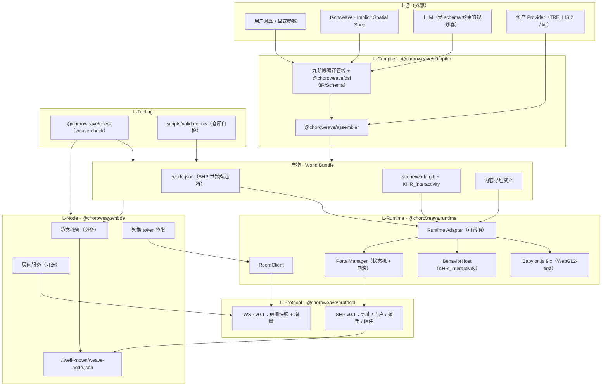
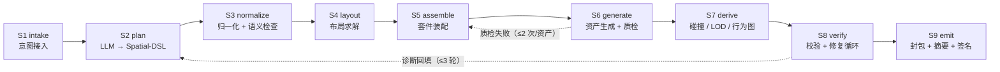
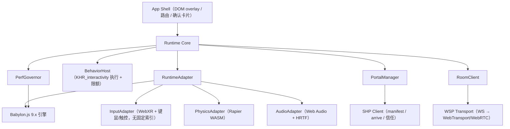
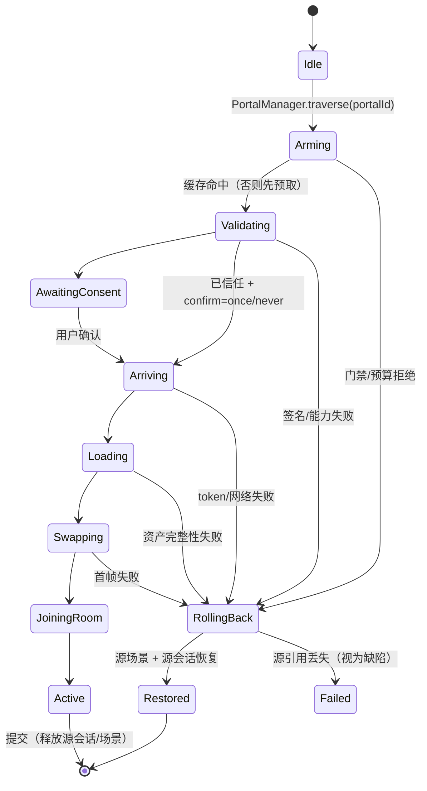

# choroweave 系统架构（v0.1）
> **English (primary):** [`docs/en/03-architecture.md`](en/03-architecture.md) · 本页为中文版（Chinese version）。
> 状态：草案 · 截至 **2026-11-07** · 代码许可证 Apache-2.0 · 面向实现团队与外部贡献者
> 依据：[`02-tech-selection.md`](02-tech-selection.md) 的 13 条 ADR、[`04-spatial-hyperlink-protocol.md`](04-spatial-hyperlink-protocol.md)（SHP）、[`research/`](research/) 四份调研。
> 本文所有 `CHW_*` 扩展与 `world.json` 字段以 [`04`](04-spatial-hyperlink-protocol.md) 与 [`schemas/`](../schemas/) 为准；三者不一致时视为缺陷。

---

## 1. 一页概览

choroweave 的架构目标只有一句话：**让"意图 → 可玩世界 → 可链接的世界网络"这条链路，每一段都由开放、可替换、可验证的组件承担。** 明确不做（与 02 一致）：封闭平台、3A 引擎、VR 硬件/BCI、链上资产、P1-P2 的 3DGS/世界模型运行时。

| 层 | 组件 | 依赖的外部标准 | 我们自研的部分 | 对应 ADR |
|---|---|---|---|---|
| **L-Compiler** | Chôra Compiler | glTF 2.0、`KHR_interactivity`、JSON Schema | 九阶段管线、Spatial-DSL、确定性装配、验证修复循环 | ADR-09 |
| **L-Protocol** | SHP / WSP | HTTPS、RFC 8615、JCS/Ed25519、glTF 扩展机制 | `world.json`、`CHW_*`、进入握手、能力协商、房间同步白名单 | ADR-02/05/06/07 |
| **L-Runtime** | Reference Runtime | Babylon.js 9.x、WebXR、Rapier、Web Audio | Runtime Adapter、行为图宿主、门户生命周期、性能治理 | ADR-04 |
| **L-Node** | Node | Node.js、WebSocket、SQLite、静态 HTTP | 静态托管布局、房间服务、短期 token、纯静态降级 | ADR-07 |
| **L-Tooling** | `weave-check` / CLI | JSON Schema、glTF Validator | 一致性套件、`validate.mjs` 仓库自检 | ADR-12 |

### 1.1 分层架构图


---

## 2. 设计约束（先把约束写死，再谈实现）

| 约束 | 内容 | 来源 |
|---|---|---|
| C1 | 产物必须是 **glTF 2.0 + `KHR_interactivity` + `CHW_*`**，不许私有场景格式 | ADR-02/03 |
| C2 | 世界标识必须是 **HTTPS URL**；`weave://` 仅别名 | ADR-05 |
| C3 | 参考运行时 **Babylon.js 9.x**，**WebGL2 必保底**，WebGPU 特性增强；不 fork Hyperfy | ADR-04 |
| C4 | 逻辑三层 **L0/L1/L2**；L0 不支持多人与 UI（规范明确排除），多人/门户/世界规则自研 | ADR-03 |
| C5 | 实时层 **WebSocket（P0-P1）→ WebTransport/WebRTC（P2+）**；Matrix 不承载位姿 | ADR-07 |
| C6 | 资产生成默认 **TRELLIS.2（MIT）**；Hunyuan3D 仅可选 provider（地域/MAU 限制） | ADR-09 |
| C7 | 身份 **Passkey/OIDC → did:web**；无区块链 | ADR-08 |
| C8 | 代码 Apache-2.0 / 规范 CC-BY-4.0 / 示例 CC0-CC-BY；一致性套件是治理核心 | ADR-12 |
| C9 | Studio 无需服务端：**纯静态 HTTPS 托管即可运行世界**；房间服务可选 | ADR-06 第 5 条 |
| C10 | 面向 Quest 3 的预算写入引擎启动检查（≤30–50 万三角形、50–80 draw calls/帧） | ADR-04、调研 03 §3.5 |

---

## 3. 编译管线（九阶段）

### 3.1 总览



**两段式原则**（ADR-09）：LLM **只**产出受 JSON Schema 约束的 Spatial-DSL；布局、装配、碰撞、LOD、行为图、校验全部由确定性代码完成。LLM 不生成二进制、不写引擎代码、不决定坐标。

### 3.2 阶段契约

| # | 阶段 | 输入 | 输出（IR） | 失败处理 | 确定性 |
|---|---|---|---|---|---|
| S1 | `intake` | 自然语言意图、显式参数、ISS 快照、预算/分级、部署区域 | `IntentEnvelope`（prompt + iss + constraints + compilerVersion + locale；seed 随后派生） | 参数冲突 → `DSL_SEMANTIC_INVALID`；缺失 → 默认值 + WARN | 高（纯函数） |
| S2 | `plan` | `IntentEnvelope` + 套件目录摘要 + 风格包 | `SpatialDSL`（通过 `schemas/spatial-dsl.schema.json`） | 首次 schema 失败 → 结构化诊断回填重试（≤3）；仍失败 → 降级模板世界 | **低**（LLM 非确定）；记录 `model/provider/promptHash` |
| S3 | `normalize` | `SpatialDSL` | `NormalizedDSL`（单位米、Y-up、ID 唯一、坐标在包围盒内、预算合法） | `DSL_SCHEMA_INVALID` / `DSL_SEMANTIC_INVALID`（致命） | 高 |
| S4 | `layout` | `NormalizedDSL` | `LayoutIR`（骨架网格、门窗、可达性图、导航网格、出生点） | 不可达/穿模 → `LAYOUT_UNREACHABLE` → 回 S2 修复 | 高（种子化程序化 + 约束求解） |
| S5 | `assemble` | `LayoutIR` + 套件库索引 + parts 清单 | `AssemblyIR`（实例、变换、材质绑定、`AssetRequest[]`） | 套件版本不匹配 → `ASSET_QC_FAILED`；缺套件 → 用代理几何 | 高 |
| S6 | `generate` | `AssetRequest[]` | `AssetRecord[]`（内容寻址 glb/贴图/音频 + provenance + 质检报告） | provider 超时/失败 → 重试 ≤2 → 套件替代；质检不过 → 拒绝入库 | 中（同 provider+seed 可复现；跨版本不保证） |
| S7 | `derive` | `AssemblyIR` + `AssetRecord[]` + 交互声明 | `DerivedIR`（碰撞体、LOD 链、`KHR_interactivity` 图、`CHW_portal`/`CHW_collider`/`CHW_logic`、导航） | 图不合法 → `GRAPH_INVALID`；碰撞失败 → 包围盒兜底 | 高 |
| S8 | `verify` | `DerivedIR` + 全部资产 | `VerificationReport`（Schema、glTF Validator、`strictValidation`、可达性、预算、安全、许可） | 失败 → 诊断回填（≤3 轮）→ 模板世界 | 高 |
| S9 | `emit` | 通过校验的 IR | **World Bundle**（`world.json` + `scene/world.glb` + `assets/` + `preview/` + `source/` + `LICENSE`） | 原子写临时目录 → 校验后 rename；永不发布半成品 | 高（固定 `SOURCE_DATE_EPOCH` 时逐字节可复现） |

### 3.3 确定性模型

编译器承诺的"确定性"分三级，避免把 LLM 的非确定性混入构建可复现性：

| 级别 | 承诺 | 保证方式 | 验证 |
|---|---|---|---|
| **R0 构建可复现** | 同一 `NormalizedDSL` + `seed` + 编译器版本 + provider 清单 → **逐字节相同**的 bundle | 所有随机性来自种子化 PRNG（`splitmix64` 计数器式，禁止 `Math.random`/`Date.now`）；JSON 输出排序键、浮点定点化；`generatedAt` 取自 `SOURCE_DATE_EPOCH` | `weave-check --repro`：两次编译比较 `bundleDigest` |
| **R1 规划可重放** | 同一 NL 意图不保证同一 DSL；但记录 DSL 快照后可 R0 重放 | `provenance.model.{provider,name,promptHash}` + `source/world.dsl.json` 随包发布 | 从 `source/` 重编译 = 原 bundle |
| **R2 资产语义等价** | provider 升级后视觉可不同，但**接口与预算不变** | `provider` + `model` + `version` + `params` 写入 provenance；缓存键含 provider 摘要 | 资产质检门 + 预算校验 |

**种子与摘要**：

- `seed` 缺省时取 `uint64(sha256(JCS({prompt, iss, constraints, compiler, compilerVersion}))[0..8])`（在 seed 确定前计算，避免自指）；一旦写入 `world.dsl.json` 即冻结。
- `inputHash = sha256(JCS({prompt, iss, constraints, compiler, compilerVersion, seed}))`（UTF-8 JCS，与 SHP §8.1 同一规范化）。
- `assetDigest = sha256(file bytes)`；`bundleDigest = sha256(⋃ sorted("sha256  <relative path>\n"))`；`compileId = sha256(inputHash ‖ compilerVersion ‖ providerManifestDigest)`（只写入构建日志，避免自指）。
- 时间戳、主机名、绝对路径、locale 依赖项一律不得进入 bundle 内容（否则 R0 失败）。

### 3.4 失败处理与修复循环

**可恢复**（schema 错、布局不可达、预算超限、图不合法）：结构化诊断 `{code, stage, path, message, hint}` 回填 S2，最多 **3 轮**。**可降级**（provider 不可用、资产失败、交互无法编译）：套件替代 / 禁用交互，记 `WARN` 与 `degraded[]`。**致命**（许可/安全/校验 3 轮失败）：终止并输出报告与草稿（`--keep-draft`），不产出 bundle。兜底 `templates/room-basic`（纯套件、单房间 + 一扇门）保证"永远有一个可玩产物"。

诊断码命名空间：`DSL_*`（S1-S3）、`LAYOUT_*`（S4）、`ASSET_*`（S5-S6）、`GRAPH_*`（S7）、`BUDGET_*` / `VERIFY_*`（S8）、`EMIT_*`（S9）。CLI 退出码：`0` 成功、`1` 校验失败、`2` 输入错误、`3` provider 不可用、`4` 内部错误。

### 3.5 编译成本（工程估算，沿用调研 02 §4.2）

| 档位 | 内容 | GPU 时间 | API 费用 | 总耗时 | 人工兜底 |
|---|---|---|---|---|---|
| Draft | 布局 + 20–40 个 512³ 资产 | ≈3–6 GPU·分钟 | ≈$0.2–0.6 | 5–10 分钟 | 无 |
| Standard | 布局 + 60–120 个 1024³ 资产 + 碰撞/LOD | ≈30–60 GPU·分钟 | ≈$2–6 | 20–40 分钟 | 抽检 10–20% |
| Hero | + 英雄资产 + 重拓扑/绑定/灯光 | 2–6 GPU·小时 | ≈$10–30 | 2–6 小时 | 必须 |

> 每空间 $0.5–8 是 02 的工程估算（C 级），不含人工；必须用 P1 评测集持续实测，不能当承诺。

---

## 4. World Bundle

### 4.1 目录结构

```
pixel-rooftop/
├── world.json                 # 世界描述符（唯一入口，SHP 定义；见 04 §5）
├── scene/
│   └── world.glb              # glTF 2.0 + KHR_interactivity 图 + CHW_* 扩展
├── assets/<sha256>.{glb,ogg,ktx2}   # 内容寻址；示例用逻辑名 + sha256 字段
├── preview/portal-neon-alley.webp   # 门户预览卡（≤256 KiB）
├── source/world.dsl.json            # 可选：源 IR（审计/重建；不参与运行时）
└── LICENSE                          # 内容许可证全文
```

**不变量**：`world.json` 是唯一入口；所有运行时需要的二进制都从它可达；bundle 内只用相对路径；构建是"临时目录 → 全量校验 → 原子 rename"。

### 4.2 字段

字段表、类型、必填性与语义**以 [`04 §5`](04-spatial-hyperlink-protocol.md) 为唯一权威**，此处不复制，避免双份定义漂移。`world.json` 顶层 = **13 个必填 + 5 个可选**（`description`/`updatedAt`/`portals`/`bundleDigest`/`signature`）。要点：

- `entry.scene` → `scene/*.glb`；`entry.interactivity = "KHR_interactivity"`；`spawn.node` 映射 `OMI_spawn_point`。
- `capabilities.sync.whitelist` 用"命名指针"（`/nodes/{radio}/translation`），线上增量用解析后的 glTF Object Model JSON Pointer。
- `portals[]` 与场景内 `CHW_portal` 同构；`perf.budget` ≤ 编译器 `budget`；`moderation.rating` ≥ 意图/ISS 下限；`signature` 可选（未签名 = unverified 降级）。
- `CHW_avatar` 仅 P2 启用（声明头像格式与骨骼约定），P0-P1 不引入头像扩展。

### 4.3 完整性与摘要

| 摘要 | 计算范围 | 用途 |
|---|---|---|
| `assets[].sha256` | 单个资产文件字节 | 加载前校验；缓存键 |
| `entry.sha256` | `scene/world.glb` | 场景完整性（构建后写入） |
| `bundleDigest` | 全部文件按 `sha256  <path>\n` 排序拼接 | 整包校准、`weave-check --repro` |
| `signature.value` | `world.json` 去掉 `signature` 的 JCS 字节 | 作者承诺（含门户与资产摘要） |

### 4.4 旗舰示例：`pixel-rooftop`

[`examples/pixel-rooftop/`](../examples/pixel-rooftop/)（P1 旗舰 demo，也是 `weave-check` 的回归样本）：

| 项 | 值 |
|---|---|
| 实体 / parts | **14 个实体 / 29 个语义 parts**（parts 一等字段：桌面、桌腿、坐垫、收音机身/旋钮/喇叭/天线、门框/门板/把手…） |
| 交互 | **5 条**：`play_lofi`（点击收音机播放 Lo-Fi）、`toggle_string_lights`、`preview_neon_alley`（门前 2.5m 预取）、`enter_neon_alley`、`ambient_hum` |
| 门户 | **1 个**：北墙 `neon_door` → `https://hana.example/worlds/neon-alley/world.json`（`handoff: cross-instance`） |
| 预算 | 18 万三角形 / 60 draw calls / 240 MB 纹理 / 首包 6.2 MB（XR-Mid 档内） |
| 产物 | 示例仓库只含清单与 DSL 源（`world.json`、`world.dsl.json`、README）；glb/音频/WebP 由编译器生成，不随方案仓库分发 |

示例的 `world.json` 已用演示用 ed25519 密钥签名（私钥签发后即丢弃），`scripts/validate.mjs` 会验签——这是"签名可机读"的最小可执行证明。

---

## 5. 运行时架构

### 5.1 模块



**Runtime Adapter** 的价值：场景加载、输入抽象、状态白名单、门户生命周期、化身/网络接口全部经它转发；目标"3 个月内可替换为 three.js 适配器"（ADR-04）。Babylon 只出现在 Adapter 之内。

### 5.2 主循环

XR 会话内用 `XRSession.requestAnimationFrame`，桌面用 `requestAnimationFrame`；渲染不得放到 Worker（WebGL 上下文在主线程；WebGPU OffscreenCanvas 的 XR 绑定未标准化）。

| 顺序 | 步骤 | 频率 | 预算（72Hz / 13.9ms） |
|---|---|---|---|
| 1 | 输入采样（XR input sources 全量遍历，不假设索引 0/1）+ 网络排空/插值 | 每帧 | 0.8ms |
| 2 | 固定步物理（60Hz，累加器，单帧最多 2 步） | 60Hz | 1.5ms |
| 3 | 行为图步进 + 动画/骨骼采样 | 每帧 | 2.0ms |
| 4 | 门户状态机 tick（仅过渡期） | 每帧 | 0.4ms |
| 5 | 渲染提交 | 每帧 | 8.0ms |
| 6 | UI overlay / 性能采样 | 每帧 | 0.4ms |
| — | 余量（含渲染抖动） | — | 0.8ms |

PerfGovernor：进入 XR 前跑一次预算体检；运行中掉帧 >10% 持续 2s → 降级（关阴影级联 → 降 LOD → 降内部分辨率 → 降后处理），并向宿主上报 `perf_tier_change`。

### 5.3 门户切换状态机（含回滚）

SHP 的九阶段在运行时是一台显式状态机（完整状态图与失败矩阵见 [`04 §7`](04-spatial-hyperlink-protocol.md)，此处只给运行时实现约束）：



**实现不变量**（P1 必须自动化测试）：

1. 源场景根、源房间会话（挂起 ≤10s）、本地化身状态在目标 `Active` 且稳定 ≥1 帧前**不得释放**。
2. `Swapping` 必须是单帧原子提交：同一帧内停止源模拟 → 切换 active root → 启动目标模拟；不得出现"两套世界同时 tick"。
3. 回滚目标 ≤300ms（热）/ ≤1000ms（冷）；恢复相机姿态与交互焦点，不回出生点。
4. `JoiningRoom` 失败不触发回滚（目标世界已可用）——降级为单人本地模式，提示"多人暂不可用"。
5. 过渡期禁止接受第二次 `traverse`（返回 `E_BUSY`）。

### 5.4 WSP 房间协议（v0.1）

WSP = Weave Session Protocol，跑在 WebSocket 二进制帧（P0-P1；P2+ 由 `RoomClient` 的 Transport 接口切换 WebTransport/WebRTC，WS 保留为控制面）。编码为 CBOR（RFC 8949），P0 允许 `?encoding=json` 调试降级。

| 消息 | 方向 | 载荷要点 |
|---|---|---|
| `hello` | C→S | `{wsp:"0.1", token, caps, avatar}`；token 只进首帧，不进 URL |
| `welcome` | S→C | `{sessionId, roomId, tick, rateHz:15, snapshot}` |
| `snapshot` | S→C | `{tick, entities:[{id, owner, kind:"avatar"\|"object", p[3], q[4], anim, props:{pointer:value}}]}` |
| `delta` | 双向 | `{tick, ops:[{op:"set"\|"remove"\|"spawn"\|"despawn", id, path?, value?}]}` |
| `event` | 双向 | `{tick, name, source, payload}`；L1 模块与 `CHW_logic` 事件 |
| `ping`/`pong`、`bye` | 双向 | 5s 心跳、15s 超时；关闭码 `1008` 策略/`1011` 服务端错误 |

**同步白名单**：只有 `world.json.capabilities.sync.whitelist` 中解析出的 Object Model pointer 可被网络写入；服务端对白名单外的 `set` 直接丢弃并计数（`sync_rejected_pointer_total`），客户端同样丢弃。化身位姿由服务端权威（客户端预测 + 100ms 插值 + 最多 150ms 外推）。世界对象默认由场景/行为图本地权威，席位、灯光、可交互状态等声明式属性才走白名单。

**20 人容量假设（C 级工程估算，P2 压测校准）**：

| 指标 | 估算 | 说明 |
|---|---|---|
| 房间人数 | 20 | 与 P2 退出条件（20 人稳定 30 分钟）一致；`maxPlayers` 上限 64 但不承诺 |
| tick | 15Hz | 化身位姿 + 白名单属性 |
| 下行 | ≈20×15×600B ≈ **180 KB/s** + 快照 1 次/s（≈4 KB） | 单房间，含广播开销 |
| 上行 | ≈20×15×200B ≈ **60 KB/s** | 客户端输入/位置 |
| 服务端 | 1 vCPU / 512 MB 可跑 1 房间；2 vCPU 节点约 10 个活跃房间 | 无物理服务端；房间内状态在内存，SQLite 只存注册/撤销 |
| 30 分钟稳定性 | 目标：丢失连接 ≤1%、回滚 0、内存增长 <5% | 需 P2 真实设备压测 |

### 5.5 渲染策略

- **WebGL2 默认**；`navigator.gpu` 存在且非 XR 会话时可启用 WebGPU（桌面预览、后处理、P3 的 3DGS）。XR 会话内默认 WebGL2（WebXR/WebGPU Binding 仍是 Editor's Draft，Babylon WebGPU-XR 自标 experimental）。
- 压缩三件套默认开启：`KHR_draco_mesh_compression`（几何）、`KHR_texture_basisu`（KTX2）、`EXT_meshopt_compression`（缓冲）。
- LOD 用自研分块树（`MSFT_lod` 是 vendor 扩展）；物理用 Rapier（WASM），碰撞体自动生成 + `CHW_collider` 兜底（`KHR_physics_*` 仍是 Review Draft）；3DGS 仅 P3 视觉增强，不进状态机。

---

## 6. 节点架构

### 6.1 三种部署形态

| 形态 | 内容 | 能做什么 | 不能做什么 |
|---|---|---|---|
| **Static**（必备） | 纯静态 HTTPS：`world.json` + glb + 资产 + 可选 `/.well-known/weave-node.json` | 单人进入、门户跳转（本地换场景）、预览、`weave-check` | 多人、身份交接、服务端权威状态 |
| **Static + Room** | 增加房间服务（WSP）+ 短期 token | 多人共在、门户穿越后继续在目标房间 | 无 arrive 端点时的跨节点身份连续性 |
| **Full Node** | 增加 `/portal/arrive`、身份桥、撤销列表、发现索引 | 完整 SHP：ring/allowlist/private 门禁、carry、跨节点手递手 | 不承诺 7×24 托管 SLA（自托管优先） |

### 6.2 静态托管布局与响应头

```
https://<host>/.well-known/weave-node.json    # 可选；缺失 = 纯静态节点
https://<host>/worlds/<slug>/world.json      # 世界入口（唯一 ID）
https://<host>/worlds/<slug>/{scene,assets,preview}/…
```

| 响应头 | 值 | 理由 |
|---|---|---|
| `Cache-Control`（内容寻址资产） | `public, max-age=31536000, immutable` | 摘要即版本，永不失效 |
| `Cache-Control`（`world.json`/节点文档） | `public, max-age=300` / `600` | 可更新 + ETag |
| `ETag` | `"<bundleDigest>"` / `"<sha256>"` | 304 省流量 |
| `Access-Control-Allow-Origin` | `*`（只读资源） | 跨节点加载；凭据类端点不用 `*` |
| `Cross-Origin-Resource-Policy` | `cross-origin` | 允许跨源加载 glb/ktx2 |
| `COOP`/`COEP` | 可选 `same-origin` + `require-corp` | 启用 WASM 多线程/SharedArrayBuffer 时（头显浏览器支持未核实） |
| `Content-Security-Policy` | `default-src 'self'; connect-src 'self' https: wss:` | 禁止资产/数据注入脚本 |

### 6.3 房间服务

- 单 Node 进程：`ws` 升级 → 校验 token → 分配 room（按 `worldId` + 房间实例）→ 内存状态机；15Hz tick、快照 1 次/s + 增量；每房间 20 人、每连接 32 KiB/帧、120 消息/s；SQLite 只存世界注册/撤销/计数，房间状态不落盘。
- 权威性：房间服务只权威**在线状态**（谁在、位姿、白名单属性）；世界几何与行为图由客户端加载同一 bundle 各自执行，逻辑以 L0 行为图 + L1 模块确定性规则为准。
- 扩展：单节点纵向扩容 → 按房间分片（consistent hash）→ P3 引入区域中继；不把实时消息塞进 Matrix（ADR-07）。

### 6.4 鉴权：短期 token

| 项 | 规定 |
|---|---|
| 签发 | `POST /portal/arrive`（或 `/session`）成功后签发；节点私钥 ed25519 签名（推荐）或对称 HMAC（实现简单但不跨节点验证） |
| 形状 | `{v:"0.1", sub, worldId, roomId, disclosure, caps[], spawn, iat, exp, jti}` |
| 有效期 | **≤120s**，单次使用；房间断开后 token 作废 |
| 传递 | 只在 WSP `hello` 首帧；不写 URL、不写 `localStorage`、不写 cookie |
| 校验 | 签名 + `exp`/`iat` 时钟窗（±120s）+ `jti` 去重 + `worldId/roomId` 绑定 + 能力子集 |
| 撤销 | 房间踢出 → `jti` 加入短期黑名单（10 分钟）；节点密钥撤销走发现文档 |

### 6.5 纯静态降级模式

| 功能 | Static | +Room | Full |
|---|---|---|---|
| 进入世界 | ✅ | ✅ | ✅ |
| 门户跳转（`cross-instance` 本地换场景） | ✅ | ✅ | ✅ |
| 签名校验 / unverified 标识 | ✅（客户端） | ✅ | ✅ |
| 多人共在 | ❌（单人） | ✅ | ✅ |
| 身份交接（carry） | ❌ | ❌（可伪名进房） | ✅ |
| ring/allowlist/private 门禁 | ❌（视为 open） | 部分（token 绑定） | ✅ |
| `weave-check` 协议用例 | 全部静态用例 | + 房间用例 | 全部 |

---

## 7. 接口定义（TS 类型级伪代码，不要求可编译）

```ts
// ── @choroweave/compiler ────────────────────────────────────────────
export interface CompileRequest {
  intent: { prompt: string; iss?: IssSnapshot; constraints: DslConstraints };
  worldId: string;                 // https://.../world.json
  seed?: bigint;                   // 缺省由意图信封摘要派生（在 inputHash 之前）
  tier: "draft" | "standard" | "hero";
  region?: "eu" | "uk" | "kr" | "other";   // 许可证按部署地域分流（调研 02 §4.4）
  offline?: { dsl?: SpatialDSL };  // R1 重放
}
export interface CompileResult {
  status: "ok" | "degraded" | "failed";
  bundle?: { dir: string; bundleDigest: string; worldManifest: WorldManifest };
  report: VerificationReport;      // 含 diagnostics[] 与 degraded[]
  compileId: string;
}
export interface Compiler {
  compile(req: CompileRequest): Promise<CompileResult>;
  verify(bundleDir: string): Promise<VerificationReport>;   // weave-check 入口
}

// ── @choroweave/runtime ─────────────────────────────────────────────
export interface RuntimeAdapter {
  loadScene(bundle: WorldBundle): Promise<SceneHandle>;     // 校验 → 解析 → 绑定
  unloadScene(h: SceneHandle): void;                        // 只有 PortalManager 可调
  setActive(h: SceneHandle): void;                          // 单帧原子切换
  getActive(): SceneHandle | null;
  input(): InputSnapshot;                                   // 无固定 inputSource 索引
  physics: PhysicsFacade;                                   // Rapier 封装
  audio: AudioFacade;
}
export interface PortalManager {
  traverse(portalId: string, gesture: UserGesture): Promise<TraversalResult>;
  cancel(): void;
  prefetch(portalId: string, reason: "gaze" | "proximity" | "manual"): void;
  state(): TraversalState;                                  // Idle…Committing
  on(event: "rollback" | "commit" | "degraded", cb: (e: TraversalEvent) => void): void;
}
export interface RoomClient {
  connect(token: SessionToken, transport?: "websocket" | "webtransport" | "webrtc"): Promise<void>;
  applyDelta(op: DeltaOp): void;                            // 必须过白名单
  sendAvatar(p: Pose, anim: AnimState): void;               // 15Hz
  sendEvent(name: string, payload: unknown): void;          // L1 / CHW_logic
  disconnect(code?: number): void;
}
export interface BehaviorHost {
  loadGraphs(scene: SceneHandle): void;
  step(dtMs: number): void;                                 // 受 nodeBudget/steps 限额
  emit(event: { name: string; sourcePointer?: string }): void;
}

// ── @choroweave/protocol ────────────────────────────────────────────
export interface ManifestClient {
  resolve(worldId: string): Promise<ResolvedWorld>;         // 缓存 + ETag + 预算
  verifyTrust(m: WorldManifest): TrustDecision;             // 签名/门禁/撤销
  negotiate(world: WorldManifest, node: NodeDoc, rt: RuntimeCapabilities): CapabilitySet;
}
```

调用边界的硬规则：`compile()` 不接触网络运行时；`PortalManager` 不直接解析 glTF；`RoomClient` 不直接改 Babylon 节点（必须经白名单 → `applyDelta` → 状态映射层）。

---

## 8. 与 tacitweave 的 ISS 契约

### 8.1 边界

tacitweave 负责"懂你"（从行为提炼隐性偏好），choroweave 负责"实现与串门"。**独立仓库、独立发布、只共享一份可版本化 JSON 契约**（ADR-01）：`schemas/implicit-spatial-spec.schema.json`。choroweave 不依赖 tacitweave 的代码/模型；ISS 缺失、过期或低置信时必须退化。

### 8.2 ISS → Spatial-DSL 映射

| ISS `preferences[].key` | DSL 落点 | 规则（v0.1） |
|---|---|---|
| `lighting` | `space.environment.ambientLight` + 灯光实体 | `warm-dim`→(#e0b080, 0.5)；`cool-bright`→(#cfe6ff, 0.9)；`neutral`→(#ffffff, 0.6)；未知值忽略 |
| `palette` | `world.style.palette`、`style.pixelated` | 与风格包取交集；冲突时显式意图优先 |
| `acoustic` | `space.environment.audio` + 音频实体 | `lofi`/`city-ambience` 映射到套件音轨族；无匹配则默认静音 |
| `clutter` | 实体数量预算 | `low`×0.7、`medium`×1.0、`high`×1.3（不超过硬预算） |
| `scale` | `space.dimensions` | 乘数 0.8–1.25，再夹到套件尺寸步进 |
| `privacy` / `socialDensity` | 门禁建议 + `budget.maxPlayers` | `low`→8、`medium`→20、`high`→32；只作建议，最终由用户与节点策略决定 |
| `motion` | `constraints.accessibility` | 含 `reducedMotion` 时禁自动相机运动/强视差 |
| `timeOfDay` | `space.environment.timeOfDay` | 枚举直通 |

`ISS.constraints`：`accessibility[]` → `intent.constraints.accessibility`（**硬约束**）；`budgetUSD` → 选档（draft/standard）；`platform[]` → 运行时候选档位与首包预算；`ratingMax` → 内容分级上限。`ISS.avoid[]` → **硬排除**（如"避免冷白荧光"则永不选择该光型），除非用户显式覆盖并二次确认。

### 8.3 版本、隐私与失败处理

- **版本**：契约独立 semver；按 major 匹配、minor 向前兼容；未知 ISS key 忽略。**隐私**：`privacy.shareWithNode=false` 时 ISS 只在本地参与编译，发给 LLM/节点的只有派生后的 DSL 参数。
- **审计**：`world.dsl.json.intent.iss` 保存**快照**（含 `integrity`），`provenance.inputHash` 覆盖它 → 可复现"当时为什么这样生成"。
- **失败**：ISS 过期（`expiresAt`）→ 置信度视为 0，仅用于 A/B 排序；`confidence < 0.4` → 只能影响候选排序，不能覆盖显式意图；ISS 损坏 → WARN + 使用默认偏好档案，**不阻断编译**。

---

## 9. 性能预算

### 9.1 设备档位（沿用 02 / 调研 03 §3.5、§4.4）

| 档位 | 设备 | 三角形/帧 | Draw calls | 纹理显存 | 首包 | 单空间 | 目标帧率 |
|---|---|---|---|---|---|---|---|
| XR-Low | Pico 4 / Quest 2 | 20–30 万 | 40–60 | ≤300 MB | ≤5 MB | ≤15 MB | 72 Hz |
| **XR-Mid** | **Quest 3** | **30–50 万** | **50–80** | **≤400 MB** | **≤8 MB** | **≤30 MB** | **72–90 Hz** |
| XR-Apple | visionOS Safari | 50–80 万（估） | 60–100 | 未核实 | ≤8 MB | ≤30 MB | 90 Hz |
| Desktop | PC/笔记本 | 200–500 万 | 200–500 | ≤2 GB | ≤15 MB | ≤80 MB | 60 fps |
| 3DGS 附加 | Quest 3（P3） | — | — | — | — | 100–300 万 splat | 72 Hz |

> XR 档位是 Meta 官方原生预算（≤150 draw calls、<100 万三角形、500–700 MB 纹理）上乘 **0.5–0.7** 的工程折减，**非官方数据**；visionOS/3DGS 必须实机标定。浏览器 WebXR 还要承担 Chromium GPU 进程、JS 主线程与合成器开销。

### 9.2 启动检查（引擎入口）

1. 探测 `navigator.gpu`/`XRSession`/`deviceMemory`/`effectiveType`/`Save-Data`；读取 `world.json.perf.budget` 与节点 `limits`，超限则拒绝加载并给出可读原因。
2. 建立 `PerfGovernor` 采样环（帧时间 p95、draw calls、三角形、纹理内存），超预算 2s → 分级降质；门户切换用独立预算（04 §7.3）：热 <1.5s / 冷 <5s，超时按失败矩阵回滚。

### 9.3 内存与网络

| 项 | 目标 |
|---|---|
| JS/WASM 堆（XR） | ≤300 MB |
| 纹理 | ≤400 MB（Quest 3 档），KTX2 + ASTC；超限降 mip/分辨率 |
| 预取缓存 | 桌面 256 MB / XR 96 MB LRU（04 §9.2）；房间下行 ~180 KB/s @20 人 |

---

## 10. 安全边界

信任边界（自外向内）：**不可信** = 第三方资产、`world.json`、外部节点响应、房间内他人消息；**最小化受信** = 编译器（离线沙箱）、Runtime Adapter + 白名单、Babylon、房间服务权威状态。所有跨越边界的输入都必须"先校验、再解析、后限额"。

| 边界 | 威胁 | 措施 |
|---|---|---|
| **不可信资产** | 恶意 glb、图炸弹、路径穿越、超大纹理 | 摘要校验 → 尺寸/面数上限 → glTF Validator + `KHR_interactivity` 严格校验 → 行为图节点数/单帧步数限额 → 禁止资产内 JS → 解压上限 |
| **UGC 逻辑** | 用户逻辑逃逸、任意网络/文件访问 | L0 = 数据驱动行为图（无宿主 API）；L1 = 官方参数化模块；L2 = P3 能力沙箱 WASM（仅白名单 API：读房间状态、发事件、改声明属性） |
| **跨节点** | 伪造世界、钓鱼门户、身份伪造 | SHP 签名/门禁/未验证降级（04 §8、§13）；目标只允许 HTTPS；无手势不传送 |
| **网络层** | 位姿作弊、状态污染、消息洪泛 | 服务端权威在线状态；同步白名单；速率/帧大小限制；token 单次 + 短 TTL |
| **节点运营** | 日志泄露、DoS 放大、SSRF（预取私有 IP） | 遥测最小化；仅允许预取声明域；禁止私有网段；CSP/CORS 收紧 |
| **浏览器/隐私** | 指纹、第三方像素、跨站追踪 | 默认匿名会话；ISS 不上传；无第三方 DOM 资源；披露等级逐门升级 |

---

## 11. monorepo 结构与里程碑映射

### 11.1 目录

```
choroweave/
├─ packages/
│  ├─ dsl/                @choroweave/dsl          # Spatial-DSL AST/Schema/校验
│  ├─ compiler/           @choroweave/compiler     # 九阶段管线 + CLI
│  ├─ assembler/          @choroweave/assembler    # glb 装配、碰撞、LOD、行为图生成
│  ├─ provider-kit/       @choroweave/provider-kit
│  ├─ provider-trellis/   @choroweave/provider-trellis
│  ├─ provider-hunyuan/   @choroweave/provider-hunyuan   # 可选，默认不启用
│  ├─ runtime/            @choroweave/runtime      # Babylon 封装、行为图宿主、门户切换
│  ├─ node/               @choroweave/node         # 静态托管 + 房间服务 + 发现
│  ├─ protocol/           @choroweave/protocol     # SHP/WSP 类型与编解码
│  └─ check/              @choroweave/check        # weave-check CLI
├─ schemas/                                        # 发布用 JSON Schema（本文档目录）
├─ examples/pixel-rooftop/                         # 旗舰示例 + 回归样本
├─ examples/cliff-tavern/                          # P2 showcase（规划）
├─ examples/dungeon-puzzle/                        # P3 showcase（规划）
├─ scripts/validate.mjs                            # 仓库自检（零依赖）
├─ apps/playground/                                # 浏览器入口（参考实现 UI）
├─ templates/room-basic/                           # 兜底模板世界
└─ rfcs/                                           # RFC 流程与协议变更
```

`weave-check`（协议一致性）与 `scripts/validate.mjs`（本仓库自检）分工不同：前者验证"任意声称兼容 SHP 的实现"，后者验证"这套方案仓库自身"（schema/示例/链接/ADR 一致性），CI 两者都跑。

### 11.2 P0-P4 映射

| 阶段 | 时间 | 交付的架构切片 | 退出条件 |
|---|---|---|---|
| **P0** 协议验证 | M0-M2 | `protocol`（SHP 类型）、`node`（静态 + 最小房间）、手工两个世界 + 一扇门、`check` 静态用例；**无 AI** | 两个自托管节点可互跳；`weave-check` 可验证 |
| **P1** 编译器 MVP | M2-M6 | `dsl`/`compiler`/`assembler`/`provider-kit`/`provider-trellis`；runtime 单人 + 门户；`pixel-rooftop` 落地 | 20 条评测 ≥70% 可玩；热切换 <1.5s |
| **P2** 多人网络 | M6-M12 | `runtime` 房间客户端 + 化身 + 门户穿越；`node` 房间服务/arrive/token；规范 v0.5 | 20 人房间稳定 30 分钟；跨节点串门 demo |
| **P3** 生态与智能体 | M12-M18 | L2 沙箱 WASM、Agent 接待（ISS 常驻）、3DGS 视觉层、发现索引 | 100 个公开世界 / 10 个第三方节点 |
| **P4** 沉浸与标准化 | M18-M24 | WebXR 深度适配、visionOS 双轨（`<model>`/Immersive API 降级）、协议 v1.0、治理移交 | Quest 3 原生 72fps；3 个第三方引擎可播放 |

---

## 12. 未决问题

1. Quest/Pico 浏览器 WebGPU 默认状态与版本（决定 XR 内能否用 WebGPU；季度复核）。
2. 头显浏览器是否支持 COOP/COEP（决定 WASM 物理能否多线程）。
3. visionOS 对 Hit Test/Anchors/Depth/Lighting 的逐项支持（决定苹果入口的交互降级）；VRM 在 Babylon 的加载方案（P2 头像）。
4. LiveKit/WebTransport 在头显浏览器的 RTT/CPU（P2 压测）；glTF 2.1 外部引用（2026-11-17 Town Hall）与 `CHW_portal.target` 的合并路径。

---

## 13. 与 `02-tech-selection.md` 的偏差

| 项 | 02 的表述 | 本文的处理 | 性质 |
|---|---|---|---|
| 九阶段管线 | ADR-09 描述"两段式编译 + 验证修复循环"，未拆阶段 | 拆成 S1-S9 并定义每个阶段的输入/输出/失败/确定性级别 | 细化，不改变 ADR-09 |
| 确定性 | 02 要求"确定性装配" | 明确 R0/R1/R2 三级：LLM 不承诺确定，DSL→bundle 逐字节可复现（固定 `SOURCE_DATE_EPOCH`） | 补充约定 |
| WSP | 02/写作规范只给"WebSocket 二进制、快照+增量、白名单 JSON Pointer" | 定义消息集、CBOR 编码、15Hz、20 人容量估算（C 级） | 新增工程细节 |
| `CHW_logic` | 写作规范称"能力声明" | 用它声明可同步属性/事件（`sync.whitelist` 的 `/extensions/CHW_logic/props/*` 来源） | 语义细化 |
| 房间服务能力 | 02 说"WebSocket 房间服 20 人以内" | 明确 20 人、1 vCPU 单房间、SQLite 仅存注册/撤销 | 细化 |
| Render 后端 | 02 已定 WebGL2-first | 未改；补充"XR 会话内默认 WebGL2"的实现约束 | 一致 |
| 预算表 | 02 已给四档 | 原样引用，未新增未经核实数字 | 一致 |

无 ADR 级冲突；本文未引入新的技术押注。

---

## 14. 参考

- [02 技术选型](02-tech-selection.md)（ADR-01…13）· [04 SHP v0.1](04-spatial-hyperlink-protocol.md)（`world.json` / `CHW_portal` / 握手 / 信任 / 一致性用例）
- [调研 01 空间网络](research/01-spatial-web-platforms.md) · [02 生成式 3D](research/02-generative-3d-and-agents.md) · [03 运行时标准](research/03-runtime-standards.md) · [04 产品与失败先例](research/04-products-market-prior-art.md)
- Schemas：[`spatial-dsl`](../schemas/spatial-dsl.schema.json) · [`world-manifest`](../schemas/world-manifest.schema.json) · [`implicit-spatial-spec`](../schemas/implicit-spatial-spec.schema.json)
- 示例：[`examples/pixel-rooftop/`](../examples/pixel-rooftop/)
