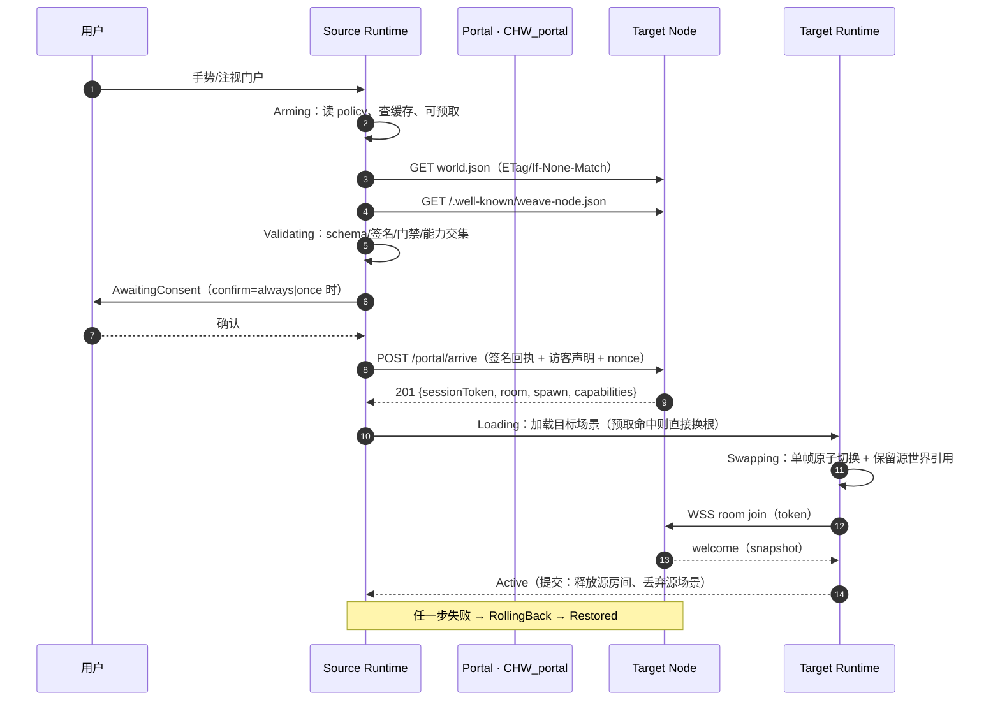
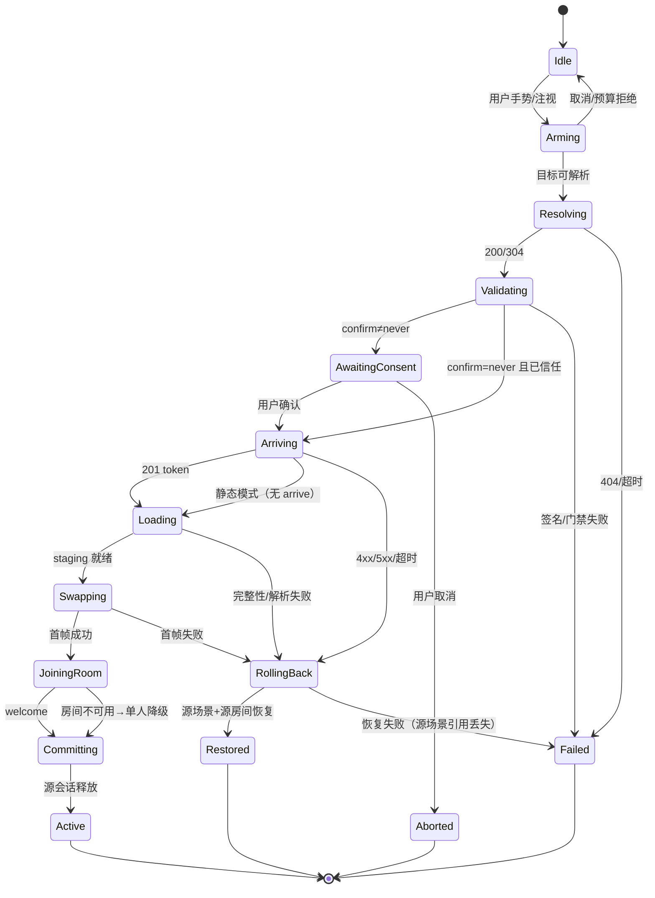

# choroweave Spatial Hyperlink Protocol（SHP）v0.1 草案

> **English (primary):** [`docs/en/04-spatial-hyperlink-protocol.md`](en/04-spatial-hyperlink-protocol.md) · 本页为中文版（Chinese version）。

> 状态：**v0.1 release candidate（候选冻结，基线 `p0-rc3` / runtime `95f12d8`；外部验证完成后才宣告最终冻结）** · 规范许可证：CC-BY-4.0 · 实现：应用/运行时 AGPL-3.0-or-later；Schema/一致性套件 Apache-2.0
> 范围：世界描述符（`world.json`）、世界寻址与节点发现、门户扩展 `CHW_portal`、进入握手（Traversal）、信任/签名、预取预算、访客身份与门禁、版本兼容，以及一致性测试清单。
> 配套：[`02-tech-selection.md`](02-tech-selection.md)（ADR-01…14）、[`03-architecture.md`](03-architecture.md)（运行时与节点落地）、[`research/`](research/)（证据）。
> 对齐对象：**MSF "Web of Worlds"**（*pages become places, links become portals*）与 **X3D 4.1 WoW Profile** 的 `Anchor`（3D 超链接）与 `Inline`（外部场景）；SHP 只补它们未定义的**握手、信任、预取、回滚**。截至 2026-11 核实：OMI 无 portal 扩展（`OMI_link` 已归档，`OMI_spawn_point` 仍 Stage 1），glTF 无 ratified 的空间链接扩展（A）。

---

## 1. 定位：SHP 是什么，不是什么

| | 内容 |
|---|---|
| **是** | 一层"空间超链接"的 **profile + 握手**：用 HTTPS URL 标识世界，用 `world.json` 描述世界，用 `CHW_portal` 在 glTF 场景里表达门户，用一次明确阶段化的握手完成"带身份与信任判断的跳转"。 |
| **不是** | 不是新的场景格式（场景 = glTF 2.0 + `KHR_interactivity` + `CHW_*`）；不是新的寻址体系（不发明 `weave://` 主标识，不依赖链上/内容寻址做"可用性"）；不是多人实时协议（那是 WSP，见 03 §5）；不是世界逻辑语言（那是 L0/L1/L2 三层，见 02 ADR-03 与 03 §2 C4/§10）。 |
| **最小可工作形态** | 一台纯静态 HTTPS 服务器 + 一个 `world.json` + 一个 glb。**无服务端、无房间、无签名校验也能进入世界**；房间服务、签名、预取是可选增强。 |
| **版本策略** | 本文冻结 v0.1 的**字段名与语义**；实现可以只做子集，但 MUST 通过 `weave-check` 对应等级的用例（§12）。 |

**三条设计公理**（与 ADR-05/06 一致）：

1. **可点击性优先**：世界地址必须能出现在聊天工具、邮件、名片、二维码里。HTTPS URL 是唯一满足这一点的标识。
2. **失败要可回滚**：传送是一次"事务"，不是一次导航。任何一步失败都必须回到原世界，且不丢本地状态。
3. **信任要可表达**：世界是否签名、作者是谁、目标节点是否被允许，必须是**可机读的数据**，而不是客户端的硬编码名单。

---

## 2. 设计原则

| 原则 | 含义 | 落地条款 |
|---|---|---|
| **Web-native** | 只用 HTTP 语义（缓存、CORS、ETag、Range、状态码）与 `/.well-known`；不要求专属端口、专属 scheme、专属证书体系。 | §4、§9 |
| **优雅降级** | 未知扩展忽略而不是报错；不支持 `CHW_portal` 的查看器把门户当普通装饰物；没有房间服务时退化为单人本地会话。 | §6.2、§7.6、§11 |
| **能力协商** | 世界声明"需要什么"，节点声明"支持什么"，运行时取交集；不满足 MUST 级能力时在进入前给出明确原因与替代动作。 | §4.2、§7.2 |
| **最小披露** | 默认匿名；身份披露是逐门（per-gate）升级的，不是账号系统的副产品。 | §8.4 |
| **用户手势边界** | 跨源自动传送必须由用户显式手势触发；任何"看不见目的地的立即跳转"都禁止。 | §6.2、§13 |
| **可静态验证** | 一份 `world.json` + 场景文件即可离线跑完 `weave-check` 的 SHP 用例，不需要服务端。 | §12 |

**SHP 补的空白 vs 已有标准**：

| 能力 | 已有标准/先例 | SHP 的处理 |
|---|---|---|
| 场景描述 | glTF 2.0、`KHR_interactivity`（2026-08-28 ratified） | 直接复用；SHP 不定义场景格式。 |
| 3D 超链接语义 | X3D 4.1 WoW `Anchor`、MSF "Web of Worlds" | 语义对齐；`CHW_portal` 是它的 glTF 侧最小承载。 |
| 外部场景装载 | X3D `Inline`；glTF 2.1 外部引用（仍 Proposal，2026-11 Town Hall） | v0.1 用"门户 + 显式握手"实现，字段设计预留与 glTF 2.1 合并（§11）。 |
| 出生点 | `OMI_spawn_point`（Stage 1） | `spawn.node` / `anchor.spawnNode` 直接映射其"节点变换即出生点"语义。 |
| 对象行为触发 | `KHR_interactivity` + `KHR_node_selectability` | 门户触发绑定到行为图事件；无执行器的读者退化为 host 直读 `trigger`。 |
| 空间链接清单 | `OMI_link`（已归档，无 schema） | `CHW_portal` 提供 schema、握手与信任层；`target` 只允许 HTTPS。 |
| 节点发现 | RFC 8615 `.well-known`、Matrix/ATProto 实践 | `/.well-known/weave-node.json`（§4.2）。 |
| 进入握手/信任/预取/回滚 | **无公开标准** | **SHP 的正文**（§7、§8、§9）。 |

---

## 3. 与既有关键标准的映射

| 既有概念 | 对应 SHP 元素 | 说明 |
|---|---|---|
| X3D WoW `Anchor.url` | `CHW_portal.target.url` | 仅允许 `https://`；不支持 `http://`、`matrix:`、`ipfs://` 作为主标识。 |
| X3D WoW `Anchor.description` | `CHW_portal.title` / `world.json.title` | 用于预览卡片；渲染前必须转义。 |
| X3D WoW `Inline`（外部场景） | `world.json.entry` + `portal.preview` | 预览=轻量 Inline；真正进入仍走握手。 |
| `OMI_spawn_point` | `world.json.spawn.node`、`CHW_portal.anchor.spawnNode` | 目标世界内带该扩展的节点优先；否则用 `position`/`rotationY` 兜底。 |
| `KHR_interactivity` 事件 | `CHW_portal` 触发 | 门户节点 SHOULD 同时具备 `KHR_node_selectability`；图内用 `event/onSelect` 触发 `CHW/traverse` 扩展操作（未知操作 no-op，见 §6.2）。 |
| MSF "Web of Worlds" | 整体设计目标 | 本草案定位为"WoW 的一个可实现 profile"。 |
| Hubs 房间链接（已上线先例） | 预览卡 + 一键进入 | 借鉴 UX；SHP 额外补身份交接、能力协商、回滚与门禁。 |
| Roblox `TeleportService` | `handoff` + `carry` 语义 | 只在 Roblox 云内有效；SHP 把它变成跨域可协商字段。 |

---

## 4. 世界标识与节点发现

### 4.1 世界标识（World ID）

- **规范形式**：`https://<host>/<path>/world.json`，即**世界描述符的绝对 URL**。世界 ID 就是它的 URL（ADR-05）。
- **规范化**：去掉 fragment 与默认端口；查询串不参与 ID 语义（可用于 CDN 变体，但 MUST 不影响内容）；写入 `world.json.id` 的规范形式 SHOULD 等于分发 URL（不一致时 `weave-check` 给 WARN，节点按 URL 归一化后比较）。
- **别名**：`weave://<host>/<path>` 仅作可注册语法糖，解析规则为"补 `https://` + 追加 `/world.json`"；不允许作为主标识出现在 `world.json` 中。
- **内容地址**：`world.json` 的修订可用摘要引用——`?rev=<sha256>` 或节点响应头 `ETag: "<sha256>"`。资产用 SHA-256 内容寻址（§8.2），但**可用性由 HTTPS 托管方保证，不依赖 pin 服务**。
- **不变量**：世界 ID 不得包含凭据（`user:pass@`）、不得使用非 443 端口做默认形态、不得指向本地网络地址（`localhost`、私有 IP 段）——这些在握手前就会被拒绝。

### 4.2 节点发现：`/.well-known/weave-node.json`

节点是托管世界与房间服务的自部署实例。发现文档放在 `https://<host>/.well-known/weave-node.json`（RFC 8615 保留前缀）。

| 字段 | 类型 | 必填 | 说明 |
|---|---|---|---|
| `schemaVersion` | `"0.1"` | ✓ | 结构版本。 |
| `nodeId` | `https://` URL 或 `did:web:` | ✓ | 节点稳定标识；用于握手回执与撤销列表。 |
| `name` | string | ✓ | 展示名（渲染前转义）。 |
| `operator` | object | ✓ | `{name, url, contact}`；contact 为 abuse/安全联系。 |
| `protocol` | object | ✓ | `{name:"SHP", versions:["0.1"], default:"0.1"}`；`versions` 为支持版本，`default` 为新会话默认版本。 |
| `capabilities` | object | ✓ | `{roomService: bool, transport: ["websocket","webrtc","webtransport"], identity: ["anonymous","passkey","oidc","did:web"], preview: bool, arrive: bool}`。 |
| `identity_endpoint` | `https://` URL | ○ | 身份桥/`did:web` 文档入口；缺失 = 仅支持匿名/伪名会话。 |
| `endpoints` | object | ✓ | `{arrive?, session?, room?, preview?, revocation?}`，全部为 HTTPS/WSS 绝对 URL；缺省即该能力不可用。 |
| `worlds` | array | ○ | 可选世界索引 `[{url, title, updatedAt, sha256}]`，供发现页/搜索；不是权威清单。 |
| `trust` | object | ✓ | `{policy: "open"\|"ring"\|"allowlist"\|"private", ring?: {depth, roots[]}, allowlist?: [domains/DIDs], requireSignature: bool}`。 |
| `limits` | object | ✓ | `{maxRoomPlayers, maxPrefetchBytes, maxTraversalPerMin, maxAssetBytes, maxMessageBytes}`；客户端 MUST 尊重更小值。 |
| `keys` | array | ○ | `[{keyId, jwk:{kty,crv,x}, purpose, validFrom, validUntil}]`；轮换与撤销用。 |
| `updatedAt` | date-time | ✓ | 文档时间；缓存 TTL 默认 600s。 |
| `signature` | object | ○ | 节点对 JCS 规范化的本文件（排除 signature）签名，格式同 §8.1。 |

发现流程：URL → 取 scheme+host → 并行取 `/.well-known/weave-node.json` 与目标 `world.json` → 校验 → 能力取交集。**节点文档缺失不阻塞进入**：按"纯静态节点"处理（`arrive=false`、`roomService=false`）。

---

## 5. `world.json` 字段定义

`world.json` 是 World Bundle 的唯一入口清单。JSON Schema：`schemas/world-manifest.schema.json`（draft 2020-12）。**读者 MUST 忽略未知字段**（前向兼容），schema 的 `additionalProperties: false` 只约束写作者/校验器。

### 5.1 顶层字段

| 字段 | 类型 | 必填 | 说明 |
|---|---|---|---|
| `schemaVersion` | `"0.1"` | ✓ | 清单结构版本；minor 递增只允许附加字段。 |
| `id` | `https://` URL | ✓ | 规范世界标识（§4.1）。 |
| `title` | string(1..120) | ✓ | 标题；渲染前转义。 |
| `description` | string(≤2000) | ○ | 摘要；不参与信任判定。 |
| `author` | object | ✓ | `{name, url?, did?, jwk?}`；`jwk` 为 ed25519 公钥（JWK/OKP），签名验证用。 |
| `license` | SPDX string | ✓ | 内容许可证；示例默认 `CC0-1.0`/`CC-BY-4.0`（ADR-12）。 |
| `createdAt` | date-time | ✓ | 首次发布。 |
| `updatedAt` | date-time | ○ | 最近修订。 |
| `protocol` | `{name:"SHP", version:"0.1"}` | ✓ | 本世界实现的 SHP 版本。 |
| `entry` | object | ✓ | `{scene, format:"gltf-2.0", interactivity:"KHR_interactivity", sha256?}`；`scene` 为 bundle 内相对路径（`scene/*.glb`），`sha256` 仅在构建完成后出现。 |
| `spawn` | object | ✓ | `{node, position:[x,y,z], rotationY?}`；`node` 映射 `OMI_spawn_point` 节点名。 |
| `assets` | array | ✓ | 外部资产清单（§5.2），可为空数组。 |
| `capabilities` | object | ✓ | 能力声明（§5.3）。 |
| `portals` | array | ○ | 门户清单（§5.4），须与场景内 `CHW_portal` 一一对应。 |
| `perf` | object | ✓ | `{budget:{triangles, drawCalls, textureMB, firstByteKB}, measured?:{device, fps, triangles?, drawCalls?}}`。 |
| `moderation` | object | ✓ | `{rating:"general"\|"teen"\|"mature", allowGuests, policyUrl?, reportUrl?}`。 |
| `bundleDigest` | object | ○ | `{alg:"sha256", value}`；**仅在实际 bundle 构建后**写入（对所有文件按 `sha256  <相对路径>\n` 排序拼接后的摘要）。 |
| `signature` | object | ○ | 作者 ed25519 签名（§8.1）；缺省 = 未验证世界（§8.3）。 |

### 5.2 `assets[]`

| 字段 | 类型 | 必填 | 说明 |
|---|---|---|---|
| `id` | slug | ✓ | bundle 内资产标识（小写字母开头）。 |
| `path` | `assets/...` | ✓ | 相对路径；建议 `assets/<sha256>.<ext>` 以便 CDN 长缓存。 |
| `sha256` | 64 hex | ✓ | 文件内容摘要；加载后 MUST 校验。 |
| `bytes` | int | ✓ | 字节数；用于预取预算与 Range 规划。 |
| `mime` | enum | ✓ | `model/gltf-binary` / `image/ktx2` / `image/webp` / `image/png` / `audio/ogg` / `audio/mpeg` / `application/wasm`。 |
| `license` | SPDX string | ○ | 资产级许可证；缺省继承世界 `license`。 |
| `provenance` | object | ○ | `{provider, model, version?, params?}`；生成资产必填（ADR-12）。 |

### 5.3 `capabilities`

| 字段 | 类型 | 必填 | 说明 |
|---|---|---|---|
| `interactivity.extension` | `"KHR_interactivity"` | ✓ | L0 对象行为层。 |
| `extensions` | enum[] | ✓ | `CHW_portal` / `CHW_collider` / `CHW_logic` / `CHW_avatar`；本 bundle 实际使用的扩展。 |
| `maxPlayers` | int(1..64) | ✓ | 世界设计容量（P0-P2 参考值 20，见 03 §5.4）。 |
| `audio` | `{spatial, music}` | ✓ | 是否需要空间音频/音乐层（自研 Web Audio + HRTF，`KHR_audio_graph` 仅 Proposal）。 |
| `avatar` | `{format:"gltf"\|"vrm", required}` | ✓ | 头像格式与是否必需；P0 用 glTF 人形替身，P2 评估 VRM。 |
| `sync.rateHz` | number(1..30) | ✓ | 世界状态同步频率（15 为默认）。 |
| `sync.whitelist` | string[] | ✓ | 可同步属性白名单。**线上增量使用解析后的 glTF Object Model JSON Pointer**（如 `/nodes/12/translation`）；清单里允许"命名指针" `/nodes/{radio}/translation`，加载场景时解析为节点索引。白名单之外的写入 MUST 被丢弃。 |

### 5.4 `portals[]`（与 `CHW_portal` 同构）

| 字段 | 类型 | 必填 | 说明 |
|---|---|---|---|
| `id` | slug | ✓ | 世界内唯一门户 ID。 |
| `entity` | slug | ✓ | 场景内承载扩展的节点名。 |
| `title` | string | ○ | 预览卡标题。 |
| `target` | object | ✓ | `{url: https://.../world.json, sha256?}`；`sha256` 为目标 bundle 摘要（内容寻址/降级预览用）。 |
| `anchor` | object | ✓ | `{spawnNode, position:[x,y,z], rotationY?}`；映射目标世界出生点。 |
| `handoff` | enum | ✓ | `same-instance` / `cross-instance` / `new-session`（§6.3）。 |
| `policy` | object | ✓ | `{confirm:"always"\|"once"\|"never", carry:["avatar"\|"inventory"\|"sessionState"], allowGuests:bool, prefetch:"none"\|"gaze"\|"proximity"\|"eager", maxPrefetchBytes?}`。 |
| `version` | `"0.1"` | ✓ | 门户扩展版本；未知版本按装饰物处理。 |
| `preview` | object | ○ | `{image:"preview/*.webp", sha256}`；图像 ≤256 KiB，建议 512×288。 |

---

## 6. 门户扩展 `CHW_portal`

### 6.1 挂载与形状

`CHW_portal` 是 glTF 2.0 **厂商扩展**（前缀 `CHW_`），挂在任意 `node` 上；语义为"与该节点交互会触发一次到目标世界的传送"。字段语义与 `world.json.portals[]` **同构**：扩展实例内省略 `id`/`entity`/`preview`（由所在节点与清单提供），JSON 形态：

```json
{
  "nodes": [{
    "name": "neon_door",
    "extensions": {
      "CHW_portal": {
        "version": "0.1",
        "target": { "url": "https://hana.example/worlds/neon-alley/world.json", "sha256": "…64 hex…" },
        "anchor": { "spawnNode": "spawn_default", "position": [0, 0, 2], "rotationY": 180 },
        "handoff": "cross-instance",
        "policy": { "confirm": "once", "carry": ["avatar"], "allowGuests": true,
                    "prefetch": "gaze", "maxPrefetchBytes": 8388608 }
      }
    }
  }]
}
```

不支持该扩展的查看器会**忽略它**，门户节点按普通网格渲染——符合"扩展即降级"的 glTF 哲学（ADR-06 第 5 条）。

### 6.2 触发绑定（`KHR_interactivity`）

| 模式 | 条件 | 行为 |
|---|---|---|
| **图模式（推荐）** | 场景有 `KHR_interactivity`，门户节点可被 select（`KHR_node_selectability`） | 行为图 `event/onSelect` → 扩展操作 `CHW/traverse`（参数为门户节点索引）→ 宿主调用 `PortalManager.traverse(portalId)`。不支持 `CHW/traverse` 的播放器按规范"未知扩展操作 no-op"降级为无动作。 |
| **直读模式** | 无行为图执行器 | host 读取 `CHW_portal`，对"可选中节点"按默认 `onSelect` 语义直接触发；仅作为参考运行时的兼容路径。 |
| **邻近触发** | `policy.prefetch ∈ {gaze, proximity}` | 只触发**预览/预取**，绝不自动传送。传送 MUST 由用户手势确认（`confirm: "never"` 也只豁免"已信任节点上的二次确认"）。 |

### 6.3 `handoff` 三模式

| 值 | 语义 | 何时用 | 状态携带 | 回滚成本 |
|---|---|---|---|---|
| `same-instance` | 同一运行时实例内原子切换场景根（同源/同节点或已预加载的跨域场景） | 同节点多世界、预加载完成的跨节点热切换 | 完整（同一 JS 上下文，保留局部状态） | 低（保留源场景引用即可） |
| `cross-instance` | 同一页面/new SPA 上下文装载目标场景；可能跨域、可能换节点 | 默认跨节点串门 | 受 `carry` 白名单限制（默认 avatar） | 中（保留源场景对象 + 源房间挂起 ≤10s） |
| `new-session` | 新标签页/新会话，SHP 只保证 URL 与描述符可解析 | 低信任、目标不提供 `arrive`、隐私模式 | 无（可传 URL fragment 提示） | 不适用（源会话不受影响） |

### 6.4 与 `OMI_spawn_point` 的映射

1. 目标世界 `spawn.node` 指向节点名；该节点带 `OMI_spawn_point` 时，以节点变换为出生位置/朝向。
2. 若目标场景无该扩展，使用 `spawn.position` 与 `spawn.rotationY`（默认 `[0,0,0]`/`0`）。
3. 门户侧 `anchor` 只作为**建议**：目标世界 MAY 忽略并回落到自己的 `spawn`；忽略时握手回执中返回实际 spawn（§7.5）。
4. 冲突规则：目标世界 `spawn` > 门户 `anchor` > 场景默认原点。任何情况下不得把玩家放进碰撞体内部。

---

## 7. 进入握手（Traversal）

### 7.1 参与者

`Source Runtime`（当前世界）· `Portal`（`CHW_portal` 节点）· `Target Node`（`/.well-known/weave-node.json`）· `Visitor`（访客身份：匿名/伪名/持久）。房间服务由目标节点提供，是可选的。

### 7.2 时序



### 7.3 阶段与超时预算

前提：HTTPS RTT ≤80ms，热路径 = 清单与场景壳已预取且在同一目标节点；预算为**工程估算（C 级）**，P1 实测校准（02 ADR-06 第 4 条：热切换 <1.5s、冷启动 <5s）。

| # | 阶段 | 输入 | 输出 | 热预算 | 冷预算 | 失败处理 |
|---|---|---|---|---|---|---|
| 1 | `Arming` | 门户、缓存、`policy` | 预取任务/取消句柄 | 0ms | 0ms | 无 |
| 2 | `Resolving` | target URL | `world.json`（可选 ETag 304） | 40ms | 300ms | 404/超时 → `Failed(NotFound/Timeout)`，可降级 static preview |
| 3 | `Validating` | 清单、节点文档、签名 | `TrustDecision` + `CapabilitySet` | 20ms | 120ms | 签名/门禁失败 → `Failed(Trust)`，不加载任何资产 |
| 4 | `AwaitingConsent` | 决定 + 来源域 | 用户确认 | 不计入（用户时间） | 不计入 | 取消 → `Aborted`（无副作用） |
| 5 | `Arriving` | 回执、nonce、访客声明 | `sessionToken`（≤120s，单次） | 150ms | 450ms | 4xx/5xx → `RollingBack`；无 arrive 端点 → 静态模式 |
| 6 | `Loading` | 场景/资产（缓存优先） | staging 场景根 | 700ms | 2600ms | 资产校验失败 → `Failed(Integrity)` |
| 7 | `Swapping` | staging 根、源世界引用 | 目标世界渲染首帧 | 150ms | 400ms | 首帧异常 → `RollingBack` |
| 8 | `JoiningRoom` | token、WSS | `welcome` + snapshot | 250ms | 700ms | 房间满/拒绝 → 降级单人本地模式 |
| 9 | `Committing` | Active 稳定 1 帧 | 释放源会话/场景 | 50ms | 150ms | 失败不回滚（已可用），仅上报 |

**阶段合计：热 ≈1.36s、冷 ≈4.72s**（不含用户确认）。实现需留 ≤5% 抖动余量，即热 ≤1.43s、冷 ≤4.96s，仍在 02 目标（热 <1.5s / 冷 <5s）内。

### 7.4 状态机



### 7.5 `POST /portal/arrive`（可选端点）

请求体（`application/json`，≤16 KiB）：

| 字段 | 必填 | 说明 |
|---|---|---|
| `shp` | ✓ | `"0.1"`。 |
| `from` | ✓ | `{worldId, nodeId?, portalId, receipt?}`；`receipt` 为源节点对本次访问的签名声明（可选）。 |
| `to` | ✓ | `{worldId, worldDigest?, spawnNode}`；`worldDigest` 用于内容校准。 |
| `visitor` | ✓ | `{disclosure:"anonymous"\|"pseudonymous"\|"persistent", did?, displayName?, assertion?}`；`assertion` 为 Passkey/OIDC 断言或 did:web 文档摘要。 |
| `handoff` | ✓ | 同 §6.3。 |
| `carry` | ✓ | 实际携带项，必须 ⊆ 门户 `policy.carry`。 |
| `state` | ○ | `{avatar?:{format,url,sha256}}` 等；目标节点 MUST 逐项校验后才接受。 |
| `nonce` | ✓ | 16–32 字节 base64url，单次使用。 |
| `requestedAt` | ✓ | date-time；与节点时钟偏差 >120s 拒绝。 |

响应 `201`：`{sessionToken, tokenExpiresAt, room:{endpoint, roomId}, spawn:{position, rotationY}, capabilities, arriveReceipt?}`。错误码：`E_WORLD_NOT_FOUND` · `E_WORLD_MISMATCH` · `E_SIGNATURE_INVALID` · `E_POLICY_DENIED` · `E_CAPABILITY_MISMATCH` · `E_RATE_LIMITED` · `E_ROOM_FULL` · `E_TOKEN_REPLAY` · `E_VERSION_UNSUPPORTED`。错误响应 MUST 不回显请求中的敏感字段。

### 7.6 失败矩阵与回滚

| 失败点 | 用户可见行为 | 回滚动作 | 数据保证 |
|---|---|---|---|
| 目标 404/超时 | toast + "稍后再试 / 查看预览" | 源世界不卸载 | 无状态变化 |
| 签名无效 | "未通过验证"、禁止继续 | 不加载目标资产 | 无 |
| 门禁拒绝 | 明确原因（未登录/不在 ring/需邀请） | 不发起 arrive | 不泄露目标内容 |
| arrive 4xx/5xx | 返回源世界 + 错误码 | 释放 staging、丢弃 token | 源房间保持/重连（≤10s 挂起） |
| 资产摘要不符 | "世界包损坏" | 丢弃已下载资产、恢复源场景 | 缓存不写入 |
| 首帧失败 | 恢复源场景 + 上报 | 源场景根重新激活 | 源世界本地状态保留 |
| 房间满 | 进入"单人预览"模式 | 不进入 Rollback（目标已可用） | 源会话已提交释放，不可回滚但可退出 |
| 提交阶段异常 | 目标世界继续可用 | 仅上报，不回滚 | 已 Active，源状态已快照到本地 |

**回滚不变量**：在目标世界 `Active` 且稳定渲染 ≥1 帧之前，**源场景引用、源房间会话、本地化身状态三者 MUST 同时保留**；任何破坏该不变量的实现视为不符合 SHP。回滚完成后必须恢复相机姿态与交互焦点，不得回到出生点。

---

## 8. 信任模型

### 8.1 签名（ed25519 + JCS）

- **算法**：Ed25519（RFC 8032）。公钥编码为 JWK `{kty:"OKP", crv:"Ed25519", x}`，放在 `author.jwk` 或节点发现文档的 `keys[]`；`keyId` 为 `did:web:` 或 `https://` URL。
- **规范化**：RFC 8785 JSON Canonicalization Scheme（JCS）。签名输入为"`world.json` 去掉 `signature` 字段后的 JCS 字节串"（UTF-8）。任何字段顺序、空白、Unicode 转义差异都不影响验签。
- **值**：`signature.value` = base64url(Ed25519(sig))；`canonicalization` 固定 `"RFC8785-JCS"`；`signedAt` 为可选时间戳（不参与验签）。
- **轮换**：`author.jwk` 变化的版本必须由旧密钥签名（链式），或由 `did:web` 文档声明的轮换记录背书；节点可缓存旧公钥但 MUST 记录首次见到的 `keyId→jwk` 映射（TOFU）并在冲突时告警。
- **撤销**：节点发现文档的 `endpoints.revocation` 返回 `{revokedKeyIds[], revokedWorlds[], updatedAt}`；客户端缓存 TTL 600s。撤销的世界 MUST 显示警告，且不可用于 carry。
- **签名覆盖范围**：整份清单（含 `portals`、`assets[].sha256`、`capabilities`）——因此**签名即承诺"我认可这些门户与这些资产摘要"**。

### 8.2 内容寻址与完整性

1. 每个资产在清单里声明 `sha256` 与 `bytes`；加载后先校验摘要，再进入解析器。
2. 入口场景 `entry.sha256`（构建后写入）与 `bundleDigest` 用于"整包校准"；缺省时只能逐资产校验（P0 手工世界）。
3. `entry.scene`、`assets[].path` MUST 为 bundle 内相对路径，禁止 `..`、绝对路径、URL 编码绕过。
4. `CHW_portal.target.sha256` 是**目标世界修订**的摘要：可用于"离线降级预览"（§9.4）与防止 DNS/CDN 层的版本混淆。
5. 内容寻址只做"校验层"：世界可用性仍由 HTTPS 托管方负责；不要求 IPFS/pin 服务。

### 8.3 信任门禁（Gate）

| 门禁 | 谁能进入 | 签名要求 | 最低身份披露 | 允许 carry | 默认确认 |
|---|---|---|---|---|---|
| `open` | 任何持 URL 者 | SHOULD | `anonymous` | 仅 `avatar`（未签名时禁用） | `once` |
| `ring` | 与节点运营者有 vouch 链的 DID/域（默认 depth=2） | MUST | `pseudonymous` | `avatar` | `once` |
| `allowlist` | 节点 `trust.allowlist` 显式列出的域/DID | MUST | `persistent` | `avatar` + `inventory` | `always`（首访） |
| `private` | 持单次邀请 token 并在 allowlist 内 | MUST | `persistent` | 全量 `carry` | `always` |

**未签名世界**（清单无 `signature`）：按 `unverified` 处理——顶部常驻标识、禁用 carry 与任何写入能力（只允许无状态浏览）、预取预算减半、不进入 ring 以上门禁。**验签失败 ≠ 可继续**：只有"无签名"允许降级，签名无效必须拒绝。

### 8.4 访客身份披露等级

| 等级 | 内容 | 默认场景 | 目标节点可见 |
|---|---|---|---|
| `anonymous` | 每次会话新生成的临时密钥对；node 只看到公钥与房间内伪名 | 浏览、低信任 | 会话公钥、房间内别名 |
| `pseudonymous` | 稳定伪名（域内 scope）+ 临时密钥；可跨会话但不可跨域关联 | 日常串门 | 伪名、房间内行为 |
| `persistent` | `did:web`（域名即身份）+ Passkey 断言；可验证的稳定 ID | ring/allowlist/private、社交与创作者场景 | DID、显示名、断言 |

规则：默认 `anonymous`；进入 `ring` 及以上门禁时才请求升级；升级必须由用户手势触发且展示"向谁披露什么"；ISS（见 03 §8）中的 `privacy.disclosure` 只作为默认建议，不得代用户做不可逆披露。

---

## 9. 预览与预取

### 9.1 触发

| 触发 | 条件 | 允许动作 | 默认预算 |
|---|---|---|---|
| `gaze` | 注视门户 ≥350ms、夹角 ≤18°、距离 ≤12m | 取 `world.json` + `preview` 图；按 `policy.prefetch` 决定是否取场景壳 | 清单 ≤64 KiB、图 ≤256 KiB |
| `proximity` | 距离 ≤3m 且停留 ≥800ms | 同上 + 场景壳（≤`policy.maxPrefetchBytes`） | 默认 ≤8 MiB |
| `manual` | 悬停/点击预览按钮 | 清单 + 预览图 | 同上 |
| `eager` | 清单允许且用户开启"预载相邻世界" | 清单 + 场景壳 | 受全局预算（§9.2）约束 |

`policy.prefetch: "none"` 时只允许 `manual`；`private` 门禁的世界**不预取**，直到用户确认进入。

### 9.2 预算

| 维度 | 默认上限 | 说明 |
|---|---|---|
| 单世界预取 | ≤ `policy.maxPrefetchBytes`（默认 8 MiB） | 含清单、预览图、场景壳；超限即停止，不"先下后砍"。 |
| 滚动窗口 | 5 分钟 ≤32 MiB 且 ≤8 个世界 | 防止浏览式 DoS 与流量账单失控。 |
| 缓存 | 桌面 ≤256 MiB / XR ≤96 MiB，LRU | 内容寻址资产按摘要去重；清单按 ETag 缓存 300s。 |
| 省流 | `Save-Data: on` 或 `effectiveType` 为 `2g/slow-2g` → 单世上限 1 MiB 且不预取场景壳 | 尊重用户网络状态。 |
| 取消 | 注视离开/移出邻近区/切换门户 → `AbortController.abort()` | 竞态用 generation 计数丢弃过期响应。 |

### 9.3 缓存键与新鲜度

- 资产：`sha256` 内容寻址 + `Cache-Control: public, max-age=31536000, immutable`。
- 清单：URL + `ETag`；TTL 300s，`stale-while-revalidate=60`。
- 节点文档：TTL 600s；签名密钥与撤销列表 TTL 600s（撤销可强制刷新）。
- 预览图：URL + `sha256`；TTL 86400s。

### 9.4 预览内容与降级

预览卡由清单生成：标题、作者、`license`、`moderation.rating`、能力徽章（多人/音频/XR）、首帧图（`preview` 或本地渲染的极低模壳）。目标不可达时，若本地缓存过 `CHW_portal.target.sha256` 对应修订，展示"上次已知内容"的**静态快照**（不可交互），并在卡片上标注"离线预览"。

---

## 10. 版本兼容与废弃

### 10.1 版本规则

- 版本三元组 `major.minor.patch`；wire 上只出现 `major.minor`。
- **同 major**：读者 `minor ≥` 世界 `minor` → 正常处理；读者 `minor <` 世界 `minor` → 忽略未知字段、按能力交集降级，并在控制台/WARN 级日志记录。
- **不同 major**：拒绝，返回 `E_VERSION_UNSUPPORTED`，并给出指向 `world.json` 的"升级提示"（不做自动迁移）。
- `schemaVersion` 与 `protocol.version` 独立演进：前者是清单结构，后者是握手语义。
- `CHW_portal.version` 未知 → 该节点作为普通装饰物（扩展忽略原则）。
- `weave-check --level=MUST` 只依赖 MUST 子集；新字段默认 MUST NOT 影响 MUST 用例结果。

### 10.2 废弃流程

1. 标记：在规范变更日志与 `weave-check` 中标记 `deprecated`（附替代字段与最早移除版本）。
2. 双版本窗口：至少跨 **2 个 minor**（≥12 个月）继续接受旧字段。
3. 升级告警：读者对废弃字段输出 `WARN`；写作者 MUST NOT 再产生旧字段。
4. 移除：只在 major 递增时移除；移除前 `weave-check --deprecation` 必须能在所有示例世界通过替代字段。

---

## 11. 与标准组织的演进路径

| 阶段 | 动作 | 目标 | 门槛 |
|---|---|---|---|
| v0.1（现在） | `CHW_portal` + SHP 草案 + 参考实现 + `weave-check` | 内部与最早 3 个节点可用 | P0：两个自托管节点互跳 |
| v0.5（P2） | 把 `CHW_portal` 的 JSON Schema 与握手文档提交 **OMI Stage 1**（W3C CG，需 CLA） | 获得跨实现评审 | 至少 2 个独立实现 + 样例资产 |
| v0.9（P3） | 向 **MSF Web of Worlds / Web3D** 提交"X3D Anchor↔CHW_portal 映射 + 握手 profile"文档 | 与 WoW 术语对齐、争取 profile 收录 | 3 个第三方引擎可播放 |
| v1.0（P4） | 与 **Khronos glTF** 对接：若 glTF 2.1 外部引用落地，把 `target`/`entry` 与外部引用语义合并；否则继续以扩展形式维护 | 空间链接进入主流格式 | 规范冻结 + 治理移交 |
| 持续 | 跟踪 glTF 2.1（2026-11-17 Town Hall）、`KHR_physics_*`（Review Draft）、`KHR_audio_graph`（Proposal） | 及时删除自研替代层 | 季度复核 |

**不等待策略**（ADR-06）：OMI Stage 3-5 与 Khronos 流程至少 1–2 年，SHP 先 ship、再标准化；标准化失败的降级路径是"厂商扩展 + 一致性套件"，不影响生态可用性。

---

## 12. 一致性测试用例（`weave-check`）

等级：**M** = MUST（不合规即不通过），**S** = SHOULD（警告）。

| ID | 等级 | 场景 | 期望 |
|---|---|---|---|
| WC-SHP-001 | M | 最小合法 `world.json`（仅必需字段 + 空 `assets`/`portals`） | schema 通过；可进入（无房间） |
| WC-SHP-002 | M | 清单含未知顶层字段与未知 `CHW_*` 扩展 | 读者忽略未知字段，进入不受影响（前向兼容） |
| WC-SHP-003 | S | `world.json.id` 与分发 URL 不一致 | 输出 WARN 并按 URL 归一化 |
| WC-SHP-004 | M | 正确签名 / 篡改任一字段 / 更换公钥 | 分别为：验证通过 / `E_SIGNATURE_INVALID` 拒绝 / `E_SIGNATURE_INVALID` 拒绝 |
| WC-SHP-005 | M | 字段顺序与空白不同的等价 JSON | JCS 规范化后签名一致（验证通过） |
| WC-SHP-006 | M | `CHW_portal` 五字段（`target/anchor/handoff/policy/version`）齐全 + 枚举合法 | 解析为门户；`weave-check` 报告目标可达性 |
| WC-SHP-007 | M | 无 `CHW_portal` 支持者加载场景 | 门户节点按普通网格渲染，不报错 |
| WC-SHP-008 | M | `target.url` 为 `http://`、`ipfs://`、`localhost` 或私有 IP | 拒绝作为可进入门户（M）；镜像/装饰可保留 |
| WC-SHP-009 | M | `target.sha256` 与实取清单摘要不符 | 拒绝进入 + `E_WORLD_MISMATCH`，不加载资产 |
| WC-SHP-010 | M | `handoff` 三值各跑一次热/冷路径 | 热 <1.5s、冷 <5s（P1 起），状态机不越级 |
| WC-SHP-011 | M | 目标 404 / 超时 / 签名无效 | 源世界保持可交互，无黑屏、相机姿态不变 |
| WC-SHP-012 | M | arrive token 重放（同 nonce 二次使用） | 第二次 `E_TOKEN_REPLAY`（或 401），不建房间 |
| WC-SHP-013 | M | token 过期后加入房间 | 拒绝；热路径刷新 token 或回滚，不静默进入 |
| WC-SHP-014 | M | 目标房间满（`maxPlayers` 已达上限） | 进入单人本地模式并提示，不整体失败 |
| WC-SHP-015 | M | 向白名单外的 JSON Pointer 写值 | 服务端丢弃并计数；客户端状态不被污染 |
| WC-SHP-016 | M | 预取累计超 8 MiB / 5 分钟超 32 MiB | 中止预取、不写入缓存、不阻塞正常进入 |
| WC-SHP-017 | M | `private` 世界无邀请访问 | 拒绝且**不泄露世界是否存在**（与 404 同形） |
| WC-SHP-018 | M | 未签名世界尝试 carry avatar/背包 | 拒绝 carry，仅允许无状态进入，显示未验证标识 |
| WC-SHP-019 | M | major 版本不兼容（`2.0` vs `0.1`） | `E_VERSION_UNSUPPORTED`，不部分解析 |
| WC-SHP-020 | M | 无用户手势的门户自动触发 | 不传送；仅允许预取/预览 |
| WC-SHP-021 | M | `title`/`description` 含 HTML/脚本 | 预览卡与 DOM 渲染为纯文本（转义） |
| WC-SHP-022 | S | 门户环 A→B→A→B…（预取或进入链） | 3 次后 WARN、8 次后阻断并提示 |

`weave-check` 的输出契约：每条用例 PASS/FAIL/SKIP + 规约条款号 + 证据（文件/字段/请求响应摘要），退出码 0/1；`--json` 供 CI 解析。

---

## 13. 安全威胁与缓解

| 威胁 | 攻击形态 | 缓解 |
|---|---|---|
| **门户钓鱼** | 用"免费皮肤/空投"标题与缩略图诱导进入仿冒世界；或自动传送 | 跨源首访强制确认（`confirm` 只可"减少"同源/已信任节点）；预览卡展示**规范化目标域**；无手势不传送；`unverified` 明显标识；禁止在 3D 场景内渲染可点击的 HTML 表单。 |
| **身份伪造** | 伪造 arrival receipt、DID、节点名 | ed25519 + JCS；`keyId` 必须与 `did:web` 域绑定且 TLS 校验；nonce/jti 单次；时钟偏差窗口 ≤120s；节点名以域名为准而非展示名。 |
| **资产投毒** | 恶意 glb/超量纹理/图炸弹/路径穿越 | 摘要校验 → 尺寸/面数/纹理上限 → glTF Validator + `KHR_interactivity` `strictValidation` → 行为图节点数与单帧步数限额；禁止执行资产内任意 JS；路径禁止 `..` 与 URL 编码绕过；解压炸弹上限（KTX2/Draco/meshopt 解压后 ≤ 声明预算的 2 倍）。 |
| **无限预取** | 海量门户诱导后台下载、消耗流量/电量 | §9.2 预算 + `Save-Data` + 取消/代际 + 缓存 dedupe；`private` 不预取；节点文档 `limits.maxPrefetchBytes` 只能收紧。 |
| **拒绝服务** | 房间消息洪泛、arrive 刷接口、超大帧、慢连接 | 帧 ≤32 KiB、客户端消息 ≤120 条/秒、arrive ≤6 次/分钟/IP + 指数退避；连接数/房间数限额；token 单次；心跳 5s/超时 15s；超出即 `close(1008)`。 |
| **重放/会话劫持** | 窃取 token 重放；跨站复用 | token ≤120s、单次、绑定 `worldId+roomId+disclosure`；`HttpOnly` 不适用（非 cookie），用内存传递；不写入 URL/localStorage。 |
| **确认疲劳/点击劫持** | 用大量确认训练用户无脑点"是" | 确认卡片固定位置、显示目标域名与信任等级；同一门禁同会话最多 1 次（`once`）；危险动作（private/carry inventory）永不批量确认。 |
| **隐私侧信道** | 预取探测内网/指纹；跨站追踪 | 仅允许预取声明过的目标域；禁止私有 IP/非 443；不发送第三方像素；DID 断言按披露等级最小化；ISS 的 `shareWithNode` 默认 false。 |
| **DNS 劫持 / did:web 失效** | 域被接管后换签名密钥 | 密钥固定（TOFU 告警）+ 撤销列表 + 签名链轮换；高价值世界建议双签（旧钥+新钥）。 |
| **世界包不可变性被绕过** | CDN 返回不同修订 | `target.sha256` + `bundleDigest` + 资产摘要三重校验；`immutable` 缓存仅对内容寻址路径启用。 |

---

## 14. 未决问题与"与 02 的偏差"

### 14.1 未决问题（P1 前需回答）

1. `ring` 的 vouch 数据结构与最小实现（复用 DID 文档还是节点自建社交图？）——P2 前给出。
2. `same-instance` 跨域场景能否共享 WebGL 上下文/纹理（决定热切换上限能否稳定 <1.5s）。
3. 撤销列表的聚合与分发（每个节点自建 vs MSF 社区目录）。
4. 房间服务的 token 格式：节点自签 ed25519（推荐）还是对称 HMAC（实现更简单但不可跨节点验证）。
5. 是否引入 `portal.policy.carry` 之外的状态胶囊（如"观展进度"）——需要先有 L1 模块规范。

### 14.2 与 `02-tech-selection.md` 的偏差

| 项 | 02 的表述 | 本文的处理 | 性质 |
|---|---|---|---|
| `CHW_portal` 字段 | ADR-06 列最小字段 `target/anchor/handoff/policy/version` | 字段名与语义保持；`policy` 内细分 `prefetch/maxPrefetchBytes`，`portal` 增加可选 `title/preview`；`world.json.portals[]` 与扩展同构 | 细化，不改变 ADR-06 |
| 签名强制性 | 02 提到"校验签名/能力"但未规定缺省行为 | 明确：签名可选；**无签名可降级为 unverified**，验签失败必须拒绝 | 补充约定 |
| 同步白名单 | 02 仅写"用 glTF Object Model 的 JSON Pointer" | 增加"命名指针"（`/nodes/{name}/...`）作为清单书写形式；**线上增量仍是标准 Object Model pointer** | 实现层细化 |
| 节点发现文档 | 02 只给出路径 `/.well-known/weave-node.json` | 本文定义字段表（§4.2） | 新增工程细节（C 级） |
| 超时预算 | 02 给出总目标（热 <1.5s / 冷 <5s） | 本文给出九阶段分解（C 级估算，P1 实测校准） | 新增，不改目标 |

无 ADR 级冲突。数字类内容均为工程估算并已标注，未引用未经核实的第三方指标。

---

## 15. 参考

- MSF "Web of Worlds" 与 X3D 4.1 WoW Profile：<https://www.web3d.org/new/blog/how-web-worlds-x3dweb3d-and-metaverse-standards-forum-tie-together>
- `KHR_interactivity` 规范（Status: Complete, Ratified；2026-08-28）：<https://github.com/KhronosGroup/glTF/tree/main/extensions/2.0/Khronos/KHR_interactivity>
- glTF 扩展注册表（OMI 各扩展阶段、`OMI_link` 归档）：<https://github.com/omigroup/gltf-extensions>
- RFC 8615（`.well-known` URI）：<https://www.rfc-editor.org/rfc/rfc8615>
- RFC 8785（JCS）：<https://www.rfc-editor.org/rfc/rfc8785>
- RFC 8032（EdDSA/Ed25519）：<https://www.rfc-editor.org/rfc/rfc8032>
- 四份调研：[`research/01`](research/01-spatial-web-platforms.md)（门户先例/身份/发现）、[`research/02`](research/02-generative-3d-and-agents.md)（资产与许可）、[`research/03`](research/03-runtime-standards.md)（标准状态/性能）、[`research/04`](research/04-products-market-prior-art.md)（市场与失败先例）。
