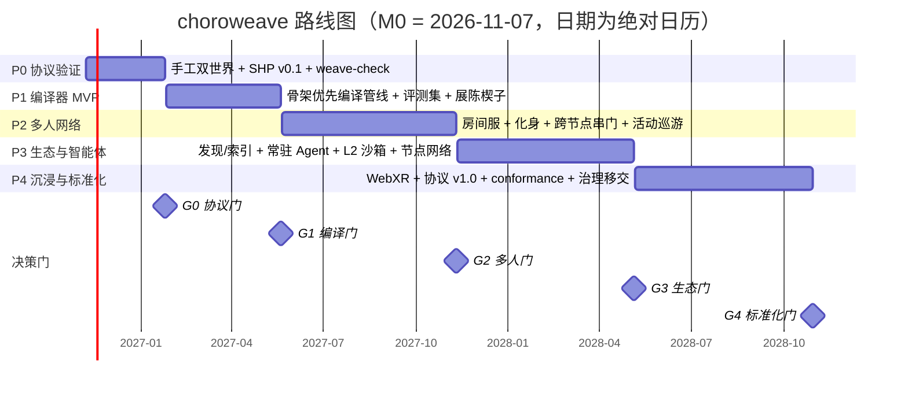

# choroweave 24 个月路线图（P0–P4）

> 状态：草案 v0.1 · 基线日 **2026-11-07 = M0** · 面向实现团队、资助方与社区
> 口径：阶段名（P0–P4）、模块名（`@choroweave/*`）、指标名与 [`internal/writing-spec.md`](internal/writing-spec.md)、[`02-tech-selection.md`](02-tech-selection.md) 完全一致；市场数字仅取自 [`research/04`](research/04-products-market-prior-art.md)，证据等级：**【官方】**=一手（A）/**【第三方】**=独立机构或数据商（B）/**【媒体转述】**=媒体转述（B–C，仅作交叉验证）；工程估算标 **（估算，C）**。
> 配套：[`06-mvp-spec.md`](06-mvp-spec.md)（P0+P1 可执行规格）、[`07-risks-compliance.md`](07-risks-compliance.md)（风险编号 `R-xx` 在本文件被引用）、[`08-open-source-strategy.md`](08-open-source-strategy.md)（社区/标准/商业化）。

---

## 0. 一页结论

1. **五阶段、四道门。** P0 证明"两个自托管节点 + 一扇门"（无 AI）；P1 证明"一句话 → 可玩世界"；P2 证明"真人在场 + 跨节点串门"；P3 证明"生态与常驻 Agent"；P4 交付 v1.0、WebXR 适配与治理移交。每阶段结束有 **G0–G4** 强制 Go/No-Go 门，未过门不进下一阶段。
2. **前 6 个月只做两件事。** 任何在 P1 之前的多人、Agent、3DGS、移动端投入都属于路线风险（见 [`02`](02-tech-selection.md) §5 与 [`research/04`](research/04-products-market-prior-art.md) §4.2 的八条教训）。
3. **产品楔子已定**（与 `00` 执行摘要一致）：P1 用 **"可寻址的展陈/作品集空间（3D link-in-bio）"** 获客、积累内容供给；P2 用 **"跨社区活动巡游（世界节点门户网络）"** 做留存与网络效应。**不做通用 3D 社交平台、不做 VR-first、不做 UGC 抽成平台。**
4. **资源两条情景**：3 人小队 **$45k–65k/月全成本**（24 个月约 **$1.1–1.6M**）；8–10 人团队 **$140k–200k/月**（24 个月约 **$3.4–4.8M**）。两者均为估算口径，含基础设施与模型调用。
5. **与 02 无实质冲突**；唯一需在 P1 门复核的是 `KHR_interactivity` 的跨引擎一致性与 Quest 浏览器 WebGPU/性能实测（02 §6 待决项），处理方式见本文 §8。

---

## 1. 路线图原则与口径

### 1.1 阶段定义（照抄 [`internal/writing-spec.md`](internal/writing-spec.md) §3，不得改名）

| 阶段 | 时间 | 一句话目标 | Exit Criteria（退出条件） | 门 |
|---|---|---|---|---|
| **P0** 协议验证 | M0–M2 | 手工造两个世界，用一扇门连起来；SHP v0.1 冻结 | 两个自托管节点可互跳；`weave-check` 可验证；无 AI 参与 | **G0** |
| **P1** 编译器 MVP | M2–M6 | 一句话生成单房间；可进入、可交互、可与另一世界互跳 | 20 条评测提示词中 ≥70% 产出可玩世界；热切换 < 1.5s | **G1** |
| **P2** 多人网络 | M6–M12 | 真人多人房间 + 门户穿越 + 自托管节点 + 化身 | 20 人房间稳定 30 分钟；跨节点串门 demo；规范 v0.5 | **G2** |
| **P3** 生态与智能体 | M12–M18 | 常驻 Agent、空间演化、社区节点网络 | 100 个公开世界 / 10 个第三方节点；Agent 接待 demo | **G3** |
| **P4** 沉浸与标准化 | M18–M24 | WebXR 深度适配、协议 v1.0、治理移交 | Quest 3 原生 72fps；3 个第三方引擎可播放；v1.0 发布 | **G4** |

### 1.2 五条不可协商的原则

1. **先协议后 AI。** P0 不接入任何生成模型；AI 的价值必须在协议可被验证之后才有意义（`internal/writing-spec.md` §3 注释）。
2. **先单人后多人。** 单机可玩是体验下限；联网是增强而非前提。这是对 IDC 2025 头显出货 **-42.8%**【第三方】与 Web 端可达性的直接回应。
3. **先自托管后托管。** 世界由节点运营者付费托管，协议方不兜底托管成本（Spatial 2025-07-27 关闭创作者平台、Mozilla Hubs 2024-05-31 关停的核心死因，见 [`research/04`](research/04-products-market-prior-art.md) §3.3）。成本模型见 [`07`](07-risks-compliance.md) §3。
4. **标准跟随，不自立语言。** 世界产物用 glTF 2.0 + `KHR_interactivity`（2026-08-28 ratified）+ `CHW_*` 扩展；链接语义对齐 MSF "Web of Worlds"/X3D 4.1 Anchor/Inline（[`research/04`](research/04-products-market-prior-art.md) §3.7）。不等待标准，也不另造一套空间语言。
5. **每阶段有可演示物。** 每个门都以"能在 10 分钟内被外部人亲手跑一遍"为验收形态，而不是以文档或幻灯片结项。

### 1.3 产品楔子（Lead 口径，与 `00` 一致）

| 阶段 | 楔子 | 为什么是它 | 不做什么 |
|---|---|---|---|
| **P1 获客/内容供给** | **可寻址的展陈/作品集空间（3D link-in-bio）**：一个 URL 一个空间，创作者把已有 GLB/作品布展，可被链接、可被嵌入、可放一扇指向他人空间的门 | 独立 3D 艺术家/小工作室"有资产、缺分发"；Spatial 退出（2025-07-27）与 Oncyber 现状留下空位【官方/媒体转述】；单人可用、天然需要跨域寻址[`research/04`](research/04-products-market-prior-art.md) §5 结论 4 | 不做通用社交世界；不做画廊平台抽成；不做订阅墙式模板商城 |
| **P2 留存/网络效应** | **跨社区活动巡游（世界节点门户网络）**：不同社区的活动空间通过标准入口互访，"今晚去 A 社区的放映厅、明天去 B 社区的天台" | VRChat 25 万+ 活跃社区 / MAU >100 万【官方 + 第三方】证明"小群 + 强关系"是留存单位；Hubs 的 Link 元素已证明"空间内门"可用但语义止于 URL 跳转[`research/01`](research/01-spatial-web-platforms.md) §3.5 | 不做世界巡游的中心化排期/票务垄断；不做跨平台强行互操作承诺 |

> 依据 [`research/04`](research/04-products-market-prior-art.md) §3.3："用户为**活动/玩法/事件**停留，不为空的空间停留"（Spatial 平台死亡而其旗下社交游戏 50 万+ DAU【媒体转述】）。展陈空间是"事件"的最小形态（一次布展 = 一次可传播的理由），巡游是"事件"的网络形态。

---

## 2. 24 个月甘特与决策门

| 门 | 时点 | Go 条件（全部满足） | No-Go / 降级动作 |
|---|---|---|---|
| **G0** | M2 / 2027-01 | 两节点互跳 10/10 成功；SHP v0.1 冻结（0 blocker）；`weave-check` 22/22 通过（[`04`](04-spatial-hyperlink-protocol.md) §12 全量用例）；全程 0 次生成模型调用；≥1 名外部开发者复现 | 缩范围为"单节点 + 内部门户"，SHP 降级为"单节点世界包规范"；**不扩编**，重估协议路线 |
| **G1** | M6 / 2027-05 | 20 条评测 ≥70% 可玩（`PR-20`）；热切换 p95 < 1.5s（`HHT`）；Desktop 60fps（`FT`）；2 条安全用例 100% 拒绝；`CPR` 100% | 50–70%：承诺改为"模板优先 + 生成增强"，目标下修至 50%，P1 顺延 1 个月，暂不进 P2；<50%：停止自研编译，转"套件 + Agent 工具链"（重大转向，需资助方签字） |
| **G2** | M12 / 2027-11 | 20 人房间稳定 30 分钟（`RS-30`）；一键自托管节点（`NBS`）由非作者跑通；跨节点串门 demo；规范 v0.5 冻结 | 稳定性不达标：退回 8 人房间 + 异步观演（录制回放），推迟 P3 常驻 Agent |
| **G3** | M18 / 2028-05 | 100 个公开世界 / 10 个第三方节点；`W1R` 次周回访率 ≥25%；Agent 接待 demo | 第三方节点 <5：停止"节点联邦"叙事，转"托管服务 + 单节点多世界"；P4 标准路线降级为"跟随 MSF"（不提交 conformance） |
| **G4** | M24 / 2028-10 | SHP v1.0 发布；Quest 3 `FT` p95 ≤13.9ms（72Hz）；3 个第三方运行时通过 conformance；治理章程签署 | 第三方 <3：v1.0 推迟一个季度并降级为"v0.9 stable"；治理移交延期，BDFL 继续 |

---

## 3. 阶段详解

> 每节格式：目标 → 工作流 → 交付物（模块级） → Exit Criteria（可测） → 依赖 → 主要风险 → KPI（3–5） → 决策门。

### 3.1 P0 协议验证（M0–M2，2026-11 → 2027-01）

**目标**：在没有 AI 的情况下，手工造两个世界 + 一扇门，把"世界描述符 / 寻址 / 门户 / 进入握手 / 节点发现 / 一致性验证"跑通并冻结为 SHP v0.1。P0 是"协议的正确性测试"，不是产品。

**工作流**
- W1 协议与 Schema：`world.json` v0.1、`CHW_portal`/`CHW_collider`/`CHW_logic` 字段冻结；SHP v0.1 文本 + 一致性用例清单（对齐 [`04`](04-spatial-hyperlink-protocol.md)）。
- W2 两个手工世界：`pixel-rooftop`（天台 + 收音机 + 墙上门）与 `pixel-night-market`（第二个世界，部署在另一个节点；**暂名，以 03 定稿为准**），全部由套件手工摆放，无生成模型。
- W3 参考运行时：Babylon.js 8.x 场景加载、第一人称漫游、输入抽象、门户切换状态机（预取 → 校验 → 确认 → 加入 → 切换 → 回滚）、WebGL2 默认。
- W4 节点与一致性：`@choroweave/node` 静态托管 + `/.well-known/weave-node.json` 发现 + 可选单房间 WSP v0.1 编解码（定义但不要求多人可用）；`@choroweave/check` 的 `world.json`/glTF/门户/预算校验。

**交付物**

| 交付物 | 归属包/文件 | 完成定义 |
|---|---|---|
| SHP v0.1（寻址、描述符、门户、握手、降级） | `docs/04` + `@choroweave/protocol` | 外部实现者仅凭文档可写出最小门户查看器 |
| `world.json` v0.1 Schema + `CHW_portal`/`CHW_collider`/`CHW_logic` | `schemas/`、`schemas/world-manifest.schema.json` | Schema 可校验两示例世界，0 error |
| 两个手工世界（跨两个自托管节点） | `examples/pixel-rooftop/`、`examples/pixel-night-market/` | 两节点可互跳，门的位置/朝向正确 |
| 进入/门户切换（P0 最小查看器） | `apps/playground`（P1 起正式化为 `@choroweave/runtime`，见 §8 对齐 1） | 热切换 p95 < 1.5s；目标离线有降级页 |
| 一致性套件 | `@choroweave/check`（`weave-check` CLI） | [`04`](04-spatial-hyperlink-protocol.md) §12 的 22 条用例全通过 |
| 节点发现与签名 | `@choroweave/node` + `@choroweave/protocol` | ed25519 签名验证；`weave-check` 覆盖 |
| P0 验收报告 | `docs/decisions/` | 含真人试跳录像与外部复现记录 |

**Exit Criteria（可测）**
1. 两个**不同域名/IP** 的自托管节点之间双向传送 10/10 成功（含 1 次目标重启后的重试成功）。
2. `weave-check` 22/22 通过；第三方（未参与开发）在 30 分钟内完成"克隆示例 → 本地起节点 → 跑 weave-check"。
3. `HHT` p50 ≤0.8s、p95 <1.5s（Desktop Chrome，局域网 + 公网各测 10 次）；`CST` p95 <5s。
4. **生成模型调用次数 = 0**（构建日志与 SBOM 可证明）。

**依赖**：[`02`](02-tech-selection.md) ADR-02/05/06/07/10；[`04`](04-spatial-hyperlink-protocol.md) 与 `schemas/` 定稿；`research/01` 的门户先例（`MX_portal`→`OMI_link`→归档）用于字段形状对齐。

**主要风险**：R-18 门户钓鱼/信任模型（P0 就必须定义白名单与安全 UI）；R-02 门户状态机复杂度；R-04 Quest 浏览器性能（P0 不做 XR 门禁，只做冒烟）；R-25 关键人依赖。

**KPI（3–5）**：`HHT` p95（<1.5s）、`CST` p95（<5s）、`CPR`（100%）、传送成功率（100%）、外部复现人数（≥1）。
**决策门**：**G0**（见表）。

### 3.2 P1 编译器 MVP（M2–M6，2027-01 → 2027-05）

**目标**：让"一句话 → 可玩世界"在受控范围内成立：LLM 只产出受 Schema 约束的 Spatial-DSL，确定性管线负责布局、装配、碰撞、LOD、行为图与校验。**这是产品的第一次对外承诺。**

**工作流**
- W1 意图层：`@choroweave/dsl`（AST + Schema + 语义校验）；tacitweave 的 **ISS** 作为可选输入（契约见 `03` §8），P1 只消费不生产。
- W2 骨架与装配：确定性布局求解（房间/墙体/门窗/灯光/可达性）+ 套件库 + `@choroweave/assembler`（glb 装配、碰撞凸包、LOD、材质烘焙、尺度归一）。
- W3 资产：`@choroweave/provider-trellis`（TRELLIS.2 MIT，默认）+ `@choroweave/provider-kit`（模块化套件，比例与碰撞的保证）；Hunyuan provider 仅作可选插件，默认关闭（R-07）。
- W4 玩法与验证：DSL 行为段 → L0 `KHR_interactivity` 行为图；验证-修复循环（Schema → 语义 → glTF Validator + Babylon `strictValidation` → 结构化诊断回填 ≤3 轮 → 模板降级）。
- W5 评测与发布：`eval/` 20 条提示词 + 自动指标 + 人工 rubric；npm 首发、示例世界、评测报告。

**交付物**：`@choroweave/dsl` v0.1、`@choroweave/compiler` v0.1（CLI：`choroweave build/preview/publish`）、`@choroweave/assembler` v0.1、`provider-trellis`/`provider-kit` v0.1、`@choroweave/check` 预算与可达性扩展、`eval/` 评测集与记录格式、`pixel-rooftop` 编译版（含手工基线对照）、P1 评测报告（公开发布）。

**Exit Criteria（可测）**
1. 20 条评测提示词中 **≥70%** 产出可玩世界（`PR-20` 定义见 §5.1：加权总分 ≥3.5 且 可玩性 ≥3 且 安全 ≥3）。
2. 编译产物通过 glTF Validator + `KHR_interactivity` strictValidation **100%**；行为图无未声明外部引用。
3. `HHT` p95 <1.5s（编译版世界 → `pixel-night-market`）；`CST` p95 <5s。
4. Standard 档 `CPW` ≤ **$8/世界**（与 `00` §8 一致；02 ADR-09 的工程估算区间 $0.5–8，口径见 [`07`](07-risks-compliance.md) §3）；耗时目标按 **draft ≤10 min / standard ≤20 min**（`00` §8 已按裁决同步；02 ADR-09 的 "standard 20–40 min" 是可行性估算，非交付目标）。
5. 安全用例（2/20）100% 拒绝或降级；世界包无任意 JS。

**依赖**：G0 通过；[`02`](02-tech-selection.md) ADR-09（骨架优先）、ADR-02/03/04；`provider-trellis` 的 MIT 许可审计；评测集人工评分者 ≥2 人。

**主要风险**：R-03 生成质量（CEGame-Bench 16% 通关率【官方】）；R-07 供应链许可；R-15 冷启动（编译器好了没人用）；R-06 成本超预期。

**KPI**：`PR-20`（≥70%）、`CPW`（≤$8）、首过率 `FPR`（≥60%）、评测稳定性（3 seed 极差 ≤1.0 分）、`HHT` p95。

**决策门**：**G1**（见表）。

### 3.3 P2 多人网络（M6–M12，2027-05 → 2027-11）

**目标**：真人在场：20 人房间、化身、语音、跨节点串门、事件巡游。**P2 是"网络效应"的第一次真实检验。**

**工作流**
- W1 实时层：`@choroweave/protocol` WSP v0.2（WebSocket 权威 + 抽象出 WebTransport/WebRTC 后端；**位姿 15Hz**（[`03`](03-architecture.md) §5.4 默认，可配置 10–20Hz）、快照 1 次/秒 + 增量、客户端插值）；LiveKit 语音（自托管，Apache-2.0）。
- W2 房间服与节点：`@choroweave/node` 房间服务 v0.1（20 CCU/房间，可选静态模式）；一键自托管（`docker compose up` 或 `npx @choroweave/node init`）；`/.well-known/weave-node.json` 能力协商升级。
- W3 化身与状态：`CHW_avatar` v0.1（glTF 人形替身，P2 评估 VRM/three-vrm 适配）；同步白名单（glTF Object Model JSON Pointer）；进入/离开/门户穿越时的状态交接。
- W4 巡游产品：活动世界模板（放映厅/展陈/夜市）+ 巡游 schedule 协议（P2 提案：节点侧 `/.well-known/weave-events.json`，**需经 04 的 RFC 流程**）；`pixel-night-market` 作为活动节点。
- W5 规范 v0.5：SHP v0.5（多人房间、能力协商、跨节点信任、废弃策略）+ conformance 用例扩到 80 条。

**交付物**：WSP v0.2 与 SHP v0.5、`@choroweave/node` 房间服 v0.1 + 一键自托管、`@choroweave/runtime` 多人适配、`CHW_avatar` v0.1、LiveKit 集成、跨节点串门 demo（三节点）、巡游活动模板、20 人压测报告。

**Exit Criteria（可测）**
1. 20 人房间连续 **30 分钟**稳定：非主动离开的用户掉线 ≤1 次/人，房间服无崩溃，`RS-30` 达标。
2. 跨节点串门 demo：`pixel-rooftop` → 第三方节点上的活动世界 → 返回；**同节点热切换 `HHT` p95 <1.2s**（对齐 `00` §8）、跨域热切换 <1.5s、冷路径 <2.5s；身份与化身外观延续。
3. 一键自托管：**未参与开发的 5 名测试者中 ≥3 人**在 30 分钟内完成部署且被其他节点访问（`NBS`）。
4. 规范 v0.5 冻结（0 blocker）；conformance 80 条通过率 100%（参考实现）。
5. 房间内同步白名单越权写入 = 0（安全用例）。

**依赖**：G1 通过；ADR-07/08；LiveKit 自托管压测；`research/01` 的 MatrixRTC slot/membership 概念模板（仅概念，不引入 Matrix）；`research/03` 的 WebTransport 92.37% caniuse（2026-10，B）。

**主要风险**：R-02 同步复杂度；R-04 头显浏览器性能；R-21 房间滥用；头显浏览器 WebTransport 支持未核实（`research/03` §5.2，需 P2 实测）。

**KPI**：`RS-30`、`NBS`（≥3/5）、跨节点串门成功率（≥95%）、`HHT` 跨域 p95、房间服单 CCU 成本（估算）。

**决策门**：**G2**（见表）。

### 3.4 P3 生态与智能体（M12–M18，2027-11 → 2028-05）

**目标**：从"能玩的 demo"变成"有人持续来、有人自己部署"的网络：发现层、常驻 Agent、空间演化、L2 沙箱、节点生态。

**工作流**
- W1 发现与索引：`choroweave/discover`（可选服务，非协议强制）：世界索引、标签、活动日历、节点健康；`world.json` 增加可选 `indexing` 声明（**P3 提案，需经 RFC**；04 v0.1 当前无此字段）。
- W2 常驻 Agent（节点侧）：Agent runtime（接待/导览/问答/活动主持）；L1 精选联网模块（五子棋/答题/钓鱼等参数化）；Agent 行为只能通过白名单 API 与 `CHW_logic` 声明的能力；对话与工具调用留审计日志。
- W3 空间演化：`world.json` 版本 diff + 增量发布 + 门户兼容（旧门指向新版本的迁移规则）；内容哈希与签名。
- W4 L2 能力沙箱 WASM：能力白名单（读房间状态/发自定义事件/改声明属性，JSON Pointer 表达），资源与指令配额；默认关闭，节点能力协商开启。
- W5 生态运营：3 个 showcase 世界、创作者计划（10 位首批）、模板/资产包、第三方节点扶持（10 个）。
- W6 视觉增强实验（不承诺）：3DGS 背景层（`KHR_gaussian_splatting` + SPZ/SOG）只作**预生成观感层**，不进运行时状态机；评估头显流式成本与收益（ADR-11）。

**交付物**：discover 服务 v0.1、Agent runtime v0.1 + 3 个官方 Agent 模块、空间演化（diff/迁移）、L2 沙箱 v0.1、模板 10 套/资产包 5 个、3 个 showcase 世界、创作者计划章程、1 个 3DGS 增强 showcase（实验）。

**Exit Criteria（可测）**
1. **100 个公开世界 / 10 个第三方节点**（第三方 = 非本项目成员控制的域名）；`weave-check` 通过率 ≥90%（第三方节点抽样）。
2. Agent 接待 demo：在 showcase 世界中连续 7 天接待，任务完成率 ≥60%（定义：访客提问被正确回答或导向，人工抽检 100 条）。
3. `W1R` 次周回访率 ≥25%（过去 7 天进入过至少 1 个世界的独立身份，在第 2 周再次进入；遥测 opt-in 统计）。
4. 空间演化：一个世界的 v2 发布后，旧门户 100% 正确迁移，无死链。
5. L2 沙箱越权调用 = 0（红队用例 ≥30 条）。

**依赖**：G2 通过；[`07`](07-risks-compliance.md) §5 威胁模型与 §6 内容治理在 P3 前落地；[`08`](08-open-source-strategy.md) 的社区冷启动计划；`research/04` §5 结论 2/5（发现层缺失是 Hyperfy 式孤岛的根因）。

**主要风险**：R-15 发现/冷启动；R-13 平台挤压（Roblox Everywhere / Astrocade / Bitmagic）；R-22 内容治理成本；R-26 社区运营人力。

**KPI**：公开世界数、第三方节点数、`W1R`、Agent 任务完成率、索引覆盖率（7 日内被索引的公开世界比例）。

**决策门**：**G3**（见表）。

### 3.5 P4 沉浸与标准化（M18–M24，2028-05 → 2028-10）

**目标**：把"能跑"变成"可被第三方实现"：WebXR 深度适配、SHP v1.0、conformance 生态、治理移交。

**工作流**
- W1 WebXR：Quest 3 72fps 预算落地（draw call/三角形/显存门禁进引擎启动检查）；visionOS Safari 双轨（WebXR 主 + `<model>`/Immersive API 增强降级路径，见 [`research/03`](research/03-runtime-standards.md) §3.3）；`XR-Low/Mid/Apple` 三档设备矩阵实测标定。
- W2 WebTransport 默认：WSP v1.0 传输层切换；WebRTC DataChannel 兜底；LiveKit 语音默认。
- W3 标准：SHP v1.0 冻结；`CHW_portal` 提交 OMI Stage 1（W3C CG）；与 MSF "Web of Worlds"/X3D 4.1 Anchor/Inline 的映射文档；Khronos glTF 社区提交（对齐 glTF 2.1 外部引用语义，见 [`research/03`](research/03-runtime-standards.md) §3.1.1）。
- W4 conformance 生态：`weave-check` 覆盖运行时/节点/门户/安全；发布 3 个第三方运行时通过的实现报告；`weave-check` npm 化。
- W5 治理移交：基金会/委员会章程、商标与规范版权安排、安全响应流程（`security.txt`）、BDFL 退出演练。

**交付物**：WebXR 适配器（Quest 3 / visionOS）、WSP v1.0、SHP v1.0、OMI Stage 1 提交稿、MSF/X3D 映射文档、conformance 报告（3 个第三方）、治理章程、安全审计报告 + SBOM。

**Exit Criteria（可测）**
1. **Quest 3 原生 72fps**：`FT` p95 ≤13.9ms，掉帧率 <5%（60 秒采样，XR 会话内默认 WebGL2）；`XR-Low` 档 72Hz 达标。
2. **3 个第三方引擎/运行时**能加载并播放 World Bundle（至少：glTF-Sample-Viewer 一致性、第三方 Web 查看器、一个非 Babylon 引擎），通过 `weave-check` conformance。
3. SHP v1.0 发布（CC-BY-4.0），0 blocker；废弃策略与兼容矩阵明确。
4. visionOS Safari 可进入同一世界（WebXR），且 `<model>` 降级路径可展示单资产世界。
5. 安全审计 0 高危未修复；SBOM（CycloneDX）随每个 release 发布。

**依赖**：G3 通过；[`07`](07-risks-compliance.md) §4 许可证/SBOM、§8 法律映射在 v1.0 前复审；[`08`](08-open-source-strategy.md) §4 标准路线与 §8 治理。

**主要风险**：R-05 WebGPU-XR 未标准化（明确 WebGL2 保底）；R-11 单元经济（P4 前需成本模型复核）；R-12 VR 需求不足（VR 只作可选入口）；R-24 BCI 伦理（P4 写"多模态输入"，不承诺 BCI）。

**KPI**：Quest 3 `FT` p95、第三方 conformance 通过数（=3）、`CPR`（≥95%）、外部贡献者数（≥15 人）、规范 blocker 数（=0）。

**决策门**：**G4**（见表）。

---

## 4. 资源情景与预算

> 两条情景均为**全成本口径**（人力 + 基础设施 + 模型调用 + 法务合规 + 差旅社区），单位美元，**估算（C）**；不含融资成本与市场投放。

### 4.1 情景 A：3 人小队（$45k–65k/月，24 个月约 $1.1–1.6M）

**人员画像**（3 名全职核心 + 0.5 设计/社区角色；两个 0.5 可合并计为 0.5–1 FTE，与 [`00`](00-executive-summary.md) §7 的"3 FTE + 0.5 设计/社区"为同一口径；成本含全部人力）：

| 角色 | 编制 | 职责 | 关键交付物 |
|---|---|---|---|
| 运行时/图形 | 1.0 | Babylon.js、WebXR、门户状态机、性能门禁 | P0 门户切换、P2 化身/多人适配、P4 72fps |
| 编译器/ML | 1.0 | Spatial-DSL、确定性装配、生成 provider、验证-修复循环 | P1 编译管线与评测集 |
| 协议/后端 | 1.0 | SHP/WSP、节点、房间服、安全与签名 | P0 节点/一致性、P2 房间服、P3 Agent 宿主 |
| 设计/技术美术（0.5） | 0.5 | 套件库、showcase 世界、可玩性调优 | 像素天台/夜市、模板与资产包 |
| 社区/产品（0.5） | 0.5 | 评测组织、创作者计划、文档与发布 | 评测报告、showcase、Discord/GitHub |

**成本分解（月，估算）**：人力 $39k–52k；基础设施（对象存储/CDN/CI/域名/测试设备）$2k–5k；模型调用与生成 GPU $0.5k–2k；法务/合规/许可审阅 $2k–4k；差旅/社区/活动 $1k–2k。合计 **$45k–65k/月**；24 个月约 **$1.1–1.6M**（含 P4 安全审计一次性支出的摊薄）。

**适用与代价**：能完成 P0–P2，P3 的发现层与 Agent 只能做"最小可用"；单点依赖高（R-25），一旦核心成员离开，P1/P2 至少延误 6–8 周。**建议**：用情景 A 跑到 G1，再按 G1 结果决定是否扩到情景 B。

### 4.2 情景 B：8–10 人团队（$140k–200k/月，24 个月约 $3.4–4.8M）

**人员画像**（在情景 A 基础上扩展）：

| 职能 | 编制 | 说明 |
|---|---|---|
| 运行时/图形 | 2.0 | 1 人 XR/性能，1 人场景图/渲染 |
| 编译器/ML | 2.0 | 1 人管线/装配，1 人生成 provider 与评测 |
| 协议/后端 | 2.0 | 1 人协议/一致性，1 人节点/房间服/运维 |
| 设计/技术美术 | 1.0 | 套件库、showcase、可玩性 |
| 社区/产品/运营 | 1.0 | 创作者计划、Discord/GitHub、发布 |
| 安全/合规（可外部） | 0.5–1.0 | 威胁模型、SBOM、内容治理、法务对接 |

**成本分解（月，估算）**：人力 $110k–160k；基础设施 $5k–12k；模型调用与生成 GPU $2k–8k；法务/合规/T&S/审计 $8k–15k；差旅/社区/活动 $3k–8k；工具/办公 $2k–5k。合计 **$140k–200k/月**；24 个月约 **$3.4–4.8M**。

**适用与代价**：可并行 P3 发现层、Agent、L2 沙箱与 P4 标准工作，能在 24 个月内交付 v1.0 与 3 个第三方 conformance；风险是组织膨胀快于产品市场契合（Meta Horizon Worlds 的教训：资本不能替代 PMF【官方/媒体转述】）。

> **成本驱动**（与 [`00`](00-executive-summary.md) §7 一致）：人力约 **70%**；GPU/模型调用 P1 期 **$2k–8k/月**，随世界生成量线性；基础设施（节点托管/CDN）**$500–3k/月**，随公开世界增长。**单位经济从 P1 第一天开始测量**：每世界生成成本目标 <$8（估算），每 1000 次访问的带宽成本必须低于 $1（推导见 [`07`](07-risks-compliance.md) §3.2）。

### 4.3 基础设施与模型调用的量级（估算）

| 项目 | 单价假设 | P1–P2 量级 | 备注 |
|---|---|---|---|
| 生成（Standard 档） | $2–6/世界（含 GPU 时间） | 评测/回归：20 条 × 3 seed × 6 周 ≈ 360 次生成 → $0.7k–2.2k/期 | 假设 H100 云价 $2–3/小时，**未逐一核价**；tacitweave 复用可摊薄 |
| 静态节点托管 | $1.3–6.5/世界/月（10 世界规模，估算） | 3 个 showcase + 2 个 demo 节点 ≈ $20–60/月 | 推导见 [`07`](07-risks-compliance.md) §3.2 |
| 房间服（开房世界） | $5–20/世界/月 | P2 压测期 3–5 个世界 ≈ $15–100/月 | 20 CCU 量级 CPU 主机 |
| 索引/发现服务 | $50–300/月 | P3 起 | 可先托管在对象存储 + 边缘函数 |
| CI（构建/校验/评测） | $100–500/月 | 全周期 | 评测跑 GPU 的占大头 |

> **红线**：任何"按会话实时神经渲染（3DGS/视频世界模型）"的默认路径都会把成本推高一个数量级以上（每会话 1 张消费级 GPU，见 [`research/02`](research/02-generative-3d-and-agents.md) §4.2），因此 P1–P3 不进入运行时（与 ADR-11 一致）。

---

## 5. KPI 仪表盘

### 5.1 指标字典（05/06/07/08 共用，口径唯一）

| ID | 指标 | 定义与公式 | 采集 | 阶段目标 |
|---|---|---|---|---|
| `HHT` | 门户热切换耗时 | 从用户确认传送到目标世界"可操作"（首帧 + 输入可用）的时间；p50/p95 | 本地基准脚本 + 遥测（opt-in） | P1 起：p95 <1.5s |
| `CST` | 冷启动耗时 | 打开世界 URL 到可操作；p50/p95 | 同上 | P0 起：p95 <5s |
| `PR-20` | 可玩率 | 20 条提示词中"rubric 加权总分 ≥3.5 且 可玩性 ≥3 且 安全 ≥3"的条数 ÷ 20 | 自动化 + 双人盲评 | P1 末 ≥70% |
| `CPR` | 一致性通过率 | `weave-check` 通过用例 ÷ 用例总数 | CI | P0 100%；P2 起 ≥95% |
| `RS-30` | 房间稳定性 | 20 人房间连续 30 分钟：非主动掉线次数、崩溃次数、p95 帧时 | 压测框架 | P2 末达标（掉线 ≤1 次/人、0 崩溃） |
| `NBS` | 节点自举成功率 | 未参与开发的测试者在 30 分钟内完成自托管并被其他节点访问的比例 | 人工测试记录 | P2 末 ≥3/5 |
| `W1R` | 次周回访率 | 过去 7 天进入过 ≥1 个世界的独立身份，第 2 周再次进入的比例 | 遥测（opt-in）+ 节点聚合 | P3 末 ≥25% |
| `FT` | 帧时 | 帧渲染时间 p95（毫秒）；72Hz 预算 13.9ms | 运行时探针 | P4 末 Quest 3 ≤13.9ms |
| `CPW` | 每世界生成成本 | Standard 档单世界均摊成本（USD） | 评测台账 | P1 ≤$8；P2 ≤$6；P3 ≤$4；P4 ≤$3 |
| `FPR` | 首过率 | 首次编译即通过全部校验的世界比例 | 评测台账 | P1 末 ≥60% |
| `XPR` | 外部采纳 | 通过 conformance 的第三方运行时/节点数 | 发布报告 | P4 末 ≥3 |

### 5.2 各阶段 KPI（3–5 个）

| 阶段 | KPI（目标） |
|---|---|
| P0 | `HHT` p95 <1.5s · `CST` p95 <5s · `CPR` 100% · 传送成功率 100% · 外部复现 ≥1 人 |
| P1 | `PR-20` ≥70% · `CPW` ≤$8 · `FPR` ≥60% · `HHT` p95 <1.5s · 评测稳定性（3 seed 极差 ≤1.0） |
| P2 | `RS-30` 达标（20 人 / 30 min）· `NBS` ≥3/5 · 跨节点串门成功率 ≥95% · `HHT` 同节点 <1.2s / 跨域 <2.5s · `PR-20` ≥85% |
| P3 | 公开世界 ≥100 / 第三方节点 ≥10 · `W1R` ≥25% · Agent 任务完成率 ≥60% · `PR-20` ≥90% · 索引覆盖率 ≥90% |
| P4 | `FT` Quest 3 p95 ≤13.9ms · `XPR` ≥3 · `CPR` ≥95% · `PR-20` ≥95% · 外部贡献者 ≥15 人 |

> 跨阶段演化与 [`00`](00-executive-summary.md) §8 对齐：公开世界/第三方节点 P1 3/0、P2 30/3、P3 100/10、P4 500/50；`W1R` P2 ≥15%、P3 ≥25%、P4 ≥35%；20 人房间稳定时长 P2 ≥30 min、P3 ≥60 min、P4 ≥120 min；通过 conformance 的第三方运行时 P3 2、P4 ≥3。每阶段只展示最能代表该阶段风险的 5 项，其余作为次级观测。

### 5.3 仪表盘纪律

- 所有数值标注**采集时间**与**样本量**；无法采集写"未采集"，不推算填补。
- 用户侧指标默认 **opt-in**、聚合上报、不可反查个人（见 [`07`](07-risks-compliance.md) §7 数据最小化）。
- 阶段 KPI 在门评审时冻结为快照，进入 `docs/decisions/` 存档；不得事后修改口径。

---

## 6. 与 06 的接口

### 6.1 关系定义

[`06-mvp-spec.md`](06-mvp-spec.md) 是**本文 P0+P1 的可执行规格**：本文定义"什么算完成"，06 定义"怎么做、怎么验、失败怎么办"。**指标名、门条件、设备预算以本文 §5 与 02 为准**；06 只允许细化，不允许另立口径。

### 6.2 映射表

| 本文（05）交付物/门 | 06 对应章节 | 验收载体 |
|---|---|---|
| P0 两个手工世界 + 门户 | 06 §3 P0 用户故事、§5 demo 剧本（S1–S12） | 逐步骤剧本 + 录像 |
| P0 `weave-check` | 06 §9.2 验收命令（P0 门） | `weave-check` CLI 输出 |
| P1 编译管线 | 06 §6 评测集（20 条提示词）与 rubric | `eval/` 记录 |
| P1 `PR-20` / `HHT` / `CPW` | 06 §6.2 通过判定、§7 性能与兼容验收表 | 评测台账 + 性能报告 |
| P1 产品楔子（展陈空间） | 06 §1.1 persona A、§4 P1 用户故事（US-P1-03/09/12） | persona 验收脚本 |
| P2 多人/巡游 | 06 §1.2 persona B（前置需求）、§5 S10–S11 | P2 压测报告 |

### 6.3 变更协议

1. 门条件、指标定义变更：**05 为唯一事实源**，需在本文变更记录登记，并同步 06/07/08。
2. 提示词、rubric、剧本步骤变更：**06 为事实源**，但不得改变 `PR-20` 的判定阈值（阈值在 05 §5.1）。
3. 任一文件修改后 48 小时内跑一次交叉链接与术语检查（见 [`internal/writing-spec.md`](internal/writing-spec.md) §6）。

---

## 7. 与 07、08 的接口（摘要）

| 文档 | 与本文的接口 | 交接点 |
|---|---|---|
| [`07-risks-compliance.md`](07-risks-compliance.md) | 风险编号 `R-xx` 在本文各阶段被引用；单元经济模型（07 §3）为本文 §4.3 与 G2/G3 门提供成本约束；P3 前必须落地威胁模型与内容治理 | G2 前完成 07 §5 威胁模型；G3 前完成 07 §6 内容治理 |
| [`08-open-source-strategy.md`](08-open-source-strategy.md) | P3 的创作者计划/showcase/节点扶持由 08 §5 定义；P4 的标准路线与治理移交由 08 §4/§8 定义；发布检查清单由 08 §9 提供 | G3 前发布社区冷启动计划；G4 前完成治理章程 |

---

## 8. 与 02 的一致性检查与偏差

| 检查项 | 结果 |
|---|---|
| 阶段名/时间/Exit Criteria | 与 `internal/writing-spec.md` §3 逐字一致；本文只在"可测口径"上量化，不改语义 |
| 模块名 | 与 `internal/writing-spec.md` §2 一致（`@choroweave/*`、`pixel-rooftop`） |
| 协议/扩展名 | SHP v0.1、WSP v0.1、`CHW_portal`/`CHW_collider`/`CHW_logic`/`CHW_avatar`（P2）一致 |
| 运行时/许可证 | Babylon.js 8.x、WebGL2-first、代码 Apache-2.0 / 规范 CC-BY-4.0 一致 |
| 性能预算 | 沿用 [`02`](02-tech-selection.md) §3 性能表与 [`research/03`](research/03-runtime-standards.md) §4.4；本文不新增设备档位 |
| **偏差 1** | 02 §6 的"Quest 浏览器 WebGPU 未核实"在 P2 门需要实测数据；本文把它列为 G2 的**前置证据**，但不作为门条件（避免不可控依赖） |
| **偏差 2** | `research/03` §4.6 的"12 个月路线建议"与本文 24 个月分阶段不同粒度；以本文为准，`research/03` 的建议作为 P0–P2 的内部工作序参考 |
| **偏差 3（已裁决）** | [`00`](00-executive-summary.md) §8 原写"标准世界生成耗时 ≤10 min"，与 02 ADR-09 的"standard 20–40 分钟"不一致。**裁决：`00` §8 改为分档 KPI——draft ≤10 min / standard ≤20 min（P1），成本 CPW ≤$8**；02 的 20–40 分钟保留为"可行性估算区间"，不作交付承诺。三处口径已统一 |
| **对齐 1** | [`03`](03-architecture.md) §11.2 把 `@choroweave/runtime` 的正式切片放在 P1；P0 的进入/门户由 `apps/playground` 最小查看器承担。本文 P0 交付物中的"参考运行时"应读作**该最小查看器**，P1 再正式化为 `runtime` 包 |
| **对齐 2** | WSP 位姿频率以 [`03`](03-architecture.md) §5.4 的 **15Hz** 为准（本文由 20Hz 修正）；20 人房间下行 ≈180 KB/s 的容量估算见 03 §5.4 |
| **对齐 3** | KPI 跨阶段演化（生态/留存/多人时长/conformance/成本）已与 `00` §8 逐项对齐；`00` §7 资源区间与本文件 §4 一致；楔子与 `00` §5 一致 |
| 待决 | 若 G1 触发降级（模板优先），需回写 02 §5"与原始设想的差异"一行，并在 00 执行摘要同步承诺口径 |

---

## 9. 附录

### 9.1 里程碑日历（M0 = 2026-11-07）

| 里程碑 | 日历 | 交付/门 |
|---|---|---|
| M0 | 2026-11 | 路线图冻结；P0 启动 |
| M1 | 2026-12 | 两手工世界成形；握手状态机 v0.1 |
| M2 | 2027-01 | **G0**：SHP v0.1 + weave-check + 双节点互跳 |
| M3 | 2027-02 | 骨架编译管线贯通（套件 + 布局） |
| M5 | 2027-04 | 评测集 20 条跑通；修复循环 ≤3 轮 |
| M6 | 2027-05 | **G1**：PR-20 ≥70% + HHT <1.5s |
| M9 | 2027-08 | 20 人房间压测；跨节点串门 demo |
| M12 | 2027-11 | **G2**：RS-30 + NBS + 规范 v0.5 |
| M15 | 2028-02 | discover v0.1；Agent runtime 雏形 |
| M18 | 2028-05 | **G3**：100 世界/10 节点/W1R ≥25% |
| M21 | 2028-08 | Quest 3 72fps；SHP v1.0 草案 |
| M24 | 2028-10 | **G4**：v1.0 + 3 个第三方 conformance + 治理移交 |

### 9.2 待决问题

1. P1 门若触发降级，产品对外承诺如何改写（关系到 00/README 与融资叙事）？
2. P3 的 discover 服务由项目自营还是交给第三方节点（协议强制 vs 可选）？——与 08 §7"不做中心化托管垄断"有边界张力。
3. P4 治理移交的对象：新基金会 vs 挂靠现有组织（如 MSF/W3C CG 成员路径），需在 G3 前定。
4. 小队情景下 P3 的 Agent 与发现层是否合并为一件事（"Agent 即索引"）以省人力？
