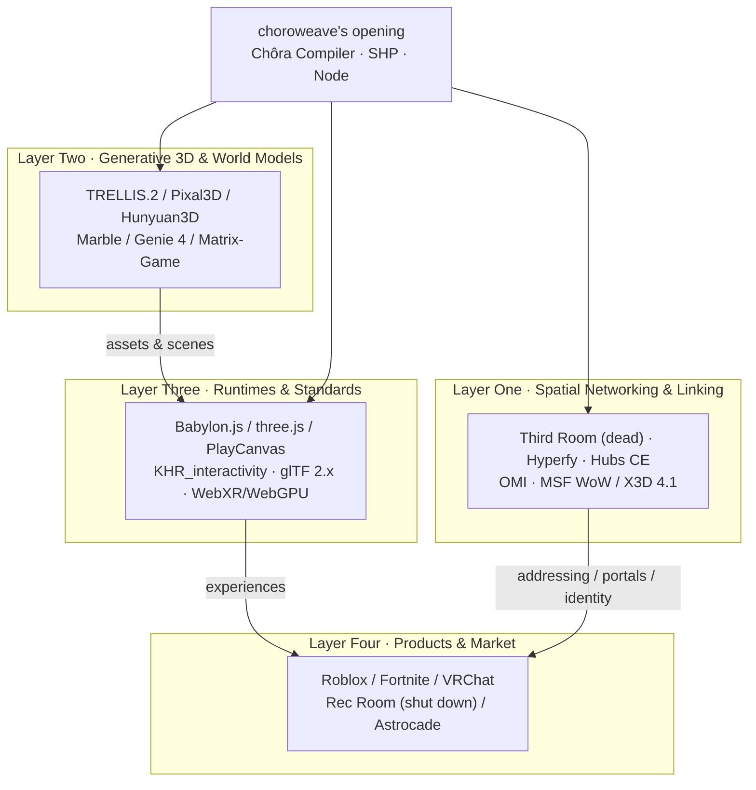

# choroweave Ecosystem Landscape: A Four-Layer Map, Five Gaps, and the 2026–2028 Opportunity Window (v0.1)

> Status: Draft · All data **verified as of 2026-11-07** (GitHub data captured that day via the REST API; everything else from specification text / official pages / authoritative third parties, itemized in §7)
> Evidence grades: **A** = first-hand specifications, official documentation, repository metadata; **B** = third-party measurement or authoritative media; **C** = engineering judgment (same rubric as [`02-tech-selection.md`](02-tech-selection.md))
> Companions: [`02-tech-selection.md`](02-tech-selection.md) (ADR-01..13), [`03-architecture.md`](03-architecture.md), [`04-spatial-hyperlink-protocol.md`](04-spatial-hyperlink-protocol.md), [`research/`](research/) (four original research reports (English translations; Chinese originals under `../research/`))
> Chinese version: [`../01-landscape.md`](../01-landscape.md)
> Discipline: this document provides ecosystem evidence and judgments only. **Technical conclusions follow the 13 ADRs in 02; this document introduces no new decisions**; any divergence in framing is listed explicitly in §8.

## 0. One-Page Conclusion (Conclusion First, Evidence After)

1. **This is not one track but an ecosystem in which four layers are severely mismatched in maturity.** The standards layer has just received a ratification (`KHR_interactivity`, 2026-08-28), yet the implementation layer has only 2 ratified-grade implementations; the linking layer has semantic placeholders (MSF "Web of Worlds"/X3D 4.1 Anchor) but no runnable protocol; the product layer still has scale but its unit economics have collapsed; the generation layer is extremely strong, but the assembly layer that turns "generated output → playable world" is almost empty. **choroweave's position is the assembly layer + linking layer, not the renderer and not the generative model.**
2. **The portal — colloquially, a teleport gate — is a standards vacuum, not a red ocean.** Third Room's `MX_portal` is DEPRECATED, OMI's `OMI_link` is archived into `Archived/`, and OMI still has no `OMI_portal`; MSF/X3D defines only Anchor/Inline semantics, with no entry handshake, trust, prefetch budget, or conformance tests. **Whoever first delivers a "verifiable portal protocol + reference implementation" defines the de facto semantics** (C).
3. **Generation capability is depreciating fast; assembly and validation are appreciating.** TRELLIS.2 (4B, MIT) outputs PBR GLB at 1024³ in about 17 seconds on an H100; Marble already prices at about $1.20–1.28/world; HY-World 2.0 weights are open. Yet in CEGame-Bench (2026-10) an LLM doing a complete game end to end achieves only a **16% completion rate** — what is missing is not a model but skeleton, assembly, a playability contract, and validation-and-repair.
4. **Centralized hosting is the main cause of death for this generation of spatial products.** Hubs (one entity bearing hosting costs), Spatial (hosting and scaling costs), and Rec Room (UGC revenue-share structure) failed one after another, while Hyperfy's fork/star ratio is as high as **0.38**, showing that "deploy your own copy" is real demand. **A static-HTTPS-first node + optional room service is a realistic architecture that is compatible with the ADRs in 02 and whose cost structure can be demonstrated** (judgment, C).
5. **The window is 2026–2028, with only a 12–24 month critical land-grab period.** Four conditions hold simultaneously for the first time: the standard was just ratified and implementations are scarce; generation crossed the cost threshold; web runtime/transport is ready (WebTransport caniuse 92.37%); platform-layer failures left a "cross-domain portability" vacancy. Window-closing signals: Roblox Reality/Everywhere landing, Project Genie leaving the US and opening its API, OMI/Khronos adding a portal extension, closed AI UGC platforms beginning to support export and cross-platform linking.
6. **One-sentence positioning (citing the research judgment, C) [C2]: choroweave is not another world but the DNS + HTTP between worlds.** Not a new engine, not a new platform, not a new world model, but **the World Bundle format + portal protocol + self-hostable node + verifiable conformance**.

**Ecosystem map overview (judgment, C; evidence in §2–§3)**

| Layer | Maturity | Activity | Reusability | One-line judgment |
|---|---|---|---|---|
| Spatial networking & linking | **Low** | Low–medium | Medium (parts high, platforms low) | Semantics staked out, implementation empty; portal standard is a vacuum |
| Generative 3D & world models | Assets high, playability low–medium | **Very high** | High (assets), low (runtime) | Generation depreciating; assembly and validation appreciating |
| Runtimes & standards | Standards high, implementations narrow | High (standards bodies) | High | Ratified ≠ ecosystem: only 2 ratified-grade implementations |
| Products & market | Platforms mature, open products low | High (negative narrative) | Low (only lessons reusable) | Scale remains, unit economics do not |

> Conclusion: **do not put choroweave in the competitive box of "yet another 3D platform/engine"; put it in the infrastructure box of "making worlds addressable, enterable, verifiable".** This is exactly the position that ADR-01/02/05/06/12 in 02 point to together.

## 1. Method and Rubric

### 1.1 Evidence discipline

- Facts are taken first from specification text, official documentation, GitHub REST API metadata, and vendor official announcements (A); third-party measurements/authoritative media serve only as cross-checks (B); engineering judgments based on facts are explicitly marked C and never passed off as facts.
- All star/fork/issue/commit dates were captured on **2026-11-07**; product and market data carry the original statistical scope and time point.
- Where a first-hand source could not confirm something, it is written as "not verified" and is not used to derive conclusions; unverified items are collected in §8.3.

### 1.2 Status rubric (defined here, C) [C1]

| Status | Criterion | Examples in this document (as of 2026-11-07) |
|---|---|---|
| **Active** | Commits/releases within the last 90 days, with a cadence matching the project's positioning | LiveKit (still committing on 2026-11-07), Khronos glTF ecosystem |
| **Maintained** | Commits within the last 12 months, but low cadence, issue backlog, or only security/compatibility fixes | Hubs CE (1,224 open issues, still pushed 2026-10-29) |
| **Stalled** | No feature commits for 6–12 months, or team focus clearly shifted | Hyperfy (last main release 2025-12-18, repo last push 2026-04-21) |
| **Dead** | Core repo with no commits for >24 months and no maintenance statement, or the product has shut down | Third Room (2023-08), Webaverse (2022-12), Rec Room (shutdown 2026-06-01) |

### 1.3 Reusability rubric (1–5, C)

| Score | Meaning | Examples |
|---|---|---|
| 5 | Usable directly as a core dependency | Babylon.js (reference runtime), TRELLIS.2 (default asset generation), LiveKit (voice/data) |
| 4 | Usable directly or as a secondary dependency | VRM/three-vrm, Colyseus, ATProto/DID paradigm |
| 3 | Reusable semantics/fragments, requiring adaptation or rewrite | OMI extension semantics, Hubs Link UX, MSF WoW semantics |
| 2 | Design reference only, code not dependable | Third Room's WebSG/MSC3815, Hyperfy's sandbox model |
| 1 | Historical reference only | Webaverse, JanusXR, Vircadia open-source line |

## 2. Ecosystem Map: Four Layers, Each with "Maturity–Activity–Reusability"

### 2.1 Layer One: Spatial Networking & Linking

This layer answers four questions: how worlds are **named and discovered**, how portals are **addressed**, how traversal **performs a handshake and preserves identity**, and and how multi-user sessions **establish presence**. Conclusion: **the concept has been proposed repeatedly, almost all engineering implementations have failed or stalled, and the standard semantics have just been named by MSF.** (judgment, C)

| Project/protocol | Role in the layer | Judgment (as of 2026-11) |
|---|---|---|
| Third Room + `MX_portal` | The most complete attempt at a "spatial World Wide Web on Matrix"; `uri` supports http(s)/matrix: glTF portals | Dead; `MX_portal` DEPRECATED (suggested to switch to `OMI_link`), no release [A8][A9] |
| Hyperfy v1/v2 | The only shipped self-hosted web world engine (Node + three.js + PhysX-WASM + LiveKit + VRM) | Stalled/low-cadence maintenance; GPL-3.0; no cross-world portal primitive, `player.teleport` is intra-world only [A10][A11] |
| Hubs Community Edition | The most mature "in-space linking" UX: Spoke's `Link` element is the portal; a room URL automatically generates a Visit Room card | Maintained; MPL-2.0; 1,224 open issues; Link is only a URL jump, with no identity handover or state carry-over [A12][A13] |
| OMI | glTF interop vocabulary (spawn_point / physics / seat / audio) | Maintained but low momentum; W3C Software & Document License; **no `OMI_portal`**, `OMI_link` archived [A6][A7] |
| MSF "Web of Worlds" / X3D 4.1 WoW Profile | "pages become places, links become portals"; Anchor (3D hyperlinks) + Inline (external scenes) | Standard in progress; semantics placed, but no handshake/trust/prefetch/tests; Threedy.io and Virginia Tech are implementing [A5] |
| JanusXR / Webaverse | Pioneers of "the web as 3D space, interconnected by portals" | Dead; JanusWeb 2018, janus-server 2023, Webaverse pivoted to AI tools after 2022 (direct conceptual ancestor, code fossil) [A33] |
| MatrixRTC / Matrix | Spatial session/presence model (slot/membership + transport) | Active (product landed 2026-10-22); vendor figures 50/200 people; **asynchronous event DAG, unsuitable for pose sync** [A21][A41] |
| LiveKit / Colyseus / Nakama | Voice and data channels, authoritative room skeleton, account/social backend | Active; LiveKit 22,075★, Apache-2.0; Colyseus 7,519★, MIT; Nakama 13,683★ [A23][A33] |
| DID / ATProto + `.well-known` | Identity and discovery paradigm: DNS handle → DID → DID Document → service endpoint | Mature; `did:web` fits personal nodes naturally; RFC 8615 defines `/.well-known/` [A26][A27] |
| IPFS / CID | Content-addressing and verification layer | Usable but should not be primary addressing: a CID is not a file hash, and addressing does not equal availability (requires pinning/gateway) [A47] |

**Maturity–activity–reusability judgment**

| Dimension | Rating | Basis |
|---|---|---|
| Maturity | **Low** | No ratified spatial linking extension; portal standard vacuum; WoW/X3D has only node semantics, no protocol engineering artifacts |
| Activity | **Low–medium** | Two major open-source world projects dead/stalled; Hubs maintained, OMI low momentum; what is active are "parts" such as LiveKit/Colyseus/DID |
| Reusability | **Medium** | Parts 4–5 (LiveKit, VRM, DID paradigm), platforms 1–2 (Third Room/Webaverse/JanusXR ideas only) |

> **Which layer choroweave fills**: `SHP` (Spatial Hyperlink Protocol: world identity + portal + traversal handshake + capability negotiation), `CHW_portal` (glTF extension), `/.well-known/weave-node.json` (node discovery), `WSP` (Weave Session Protocol, room realtime protocol). **No engine rewrite, no new language** — engineer the Anchor/Inline semantics of MSF/X3D and fill in what they leave undefined (ADR-05/06/07).

### 2.2 Layer Two: Generative 3D & World Models

This layer answers: where geometry, materials, scenes, and video frames come from. Conclusion: **asset generation has crossed the "good enough" threshold, but "generate and ship" does not hold; world models are a demo and visual layer, not a multi-user persistent runtime.** (judgment, C)

| Project | Role in the layer | Judgment (as of 2026-11) |
|---|---|---|
| TRELLIS.2 / Pixal3D | Image→3D asset generation: PBR GLB, arbitrary topology, decimation-capable | **Top tier**: MIT; weights + code + training code fully open; 1024³≈17s (H100) [A15][A16] |
| Hunyuan3D 2.1 / Omni / Part | Image→3D, part segmentation and generation, bbox/skeleton/point-cloud control | Usable but license has hard constraints: non-OSI, EU/UK/KR exclusion + 1M MAU clause; 3.0/3.1/3.5 have no public weights [A17] |
| Marble (World Labs) | Text/image→persistent 3D assets (SPZ splat + collision mesh + visual mesh) | Commercial API, priced per world (about $1.20–1.28/world); output is **assets**, not a runtime [A18][A19] |
| Genie 4 (DeepMind) | Real-time generative world (research preview) | Officially admits sessions last "a few minutes"; shared multi-user environments remain an "ongoing research challenge"; no persistent authoritative state [A20] |
| Matrix-Game 4.0 | "Engine handles gameplay/physics + neural rendering handles pixels" | Apache-2.0 weights; 67 FPS at 864×480 on an RTX 5080; validates the engine/model division of labor [A39] |
| HY-World 2.0 | Text/image→3D worlds importable into engines (panorama→3DGS→mesh) | Weights open but under the Tencent community license (EU/UK/KR exclusion + 1M MAU); leans "watch" rather than "play" [A40] |
| SpatialLM | Real-scene scan→structured layout (walls/doors/windows/oriented boxes) | Practical complement: turns "real spaces" into reconstructable layouts, NeurIPS 2025 [A48] |
| Roblox Cube 3D / CubePart / 4D | Platform-internal componentized generation + scripts retargeted to generated dimensions | **Key engineering paradigm**: the functional contract (parts schema) precedes generation, so generated output can move and be played [A45] |

**Maturity–activity–reusability judgment**

| Dimension | Rating | Basis |
|---|---|---|
| Maturity | **Assets high, playability low–medium** | Asset quality/licensing/speed have met the bar; layout feasibility, collision, rigging, gameplay remain engineering work |
| Activity | **Very high** | Dense model and funding iterations; open weights (TRELLIS.2/MIT, Matrix-Game/Apache-2.0) keep pushing unit prices down |
| Reusability | **High (assets)/low (runtime)** | TRELLIS.2 5, Pixal3D 4, Marble assets 3–4; Genie 4 / video world models 1–2 (cannot be the authority on state) |

> **Which layer choroweave fills**: not another generative model, but the **assembly, playability contract, and validation-and-repair** that turn "generated output → executable World Bundle" (ADR-09): skeleton-first + parts schema + L0 behavior graph + quality gate. Generative models own "looks right"; the Chôra Compiler owns "actually playable, enterable, linkable".

### 2.3 Layer Three: Runtimes & Standards

This layer answers: what format world bundles use, who plays them, how to cross engines, and how to network. Conclusion: **the standards layer is "hot on top, cold below" — Khronos has just ratified an interaction standard, but there are only 2 ratified-grade implementations worldwide; multiplayer, UI, scripting, and linking are all outside the standard's coverage.** (judgment, C)

| Standard/runtime | Role in the layer | Judgment (as of 2026-11) |
|---|---|---|
| `KHR_interactivity` | Object behavior inside glTF assets (events/variables/control flow/JSON Pointer) | **Ratified 2026-08-28**; single-user only, no UI, no arbitrary scripting; Turing-complete, hence runtime throttling needed [A1][A2][A3] |
| glTF 2.0.1 / 2.1 (planned) | The only 3D delivery format consumed by multiple engines/tools | 2.1 unreleased; plans a 2026-11-17 Town Hall covering multi-file composition/external references/64-bit GLB [A24] |
| `KHR_gaussian_splatting` / SPZ / SOG | glTF representation and transport formats for 3DGS | splatting ratified; SPZ 4 / SOG are de facto transport formats; streamed LOD still on the roadmap [A25][A46][A34] |
| `KHR_physics_*` / `OMI_physics_*` | Physics and collision standards | The former is a Review Draft; the latter is Stage 1 and only implemented by a Godot plugin → **cannot depend on it**; ship our own physics (ADR-10) [A25][A6] |
| Babylon.js | General web engine (WebGL2 + WebGPU + WebXR + Flow Graph) | **The only ratified-grade KHR_interactivity general engine** (load/execute/editor/lossless export) [A4][A42] |
| glTF-Sample-Viewer (UX3D) | Reference viewer | The second ratified-grade implementation; used for conformance regression, not as a product runtime [A3] |
| three.js | The largest web rendering library ecosystem | **No KHR_interactivity executor**; WebGPU+XR still half-finished (WebGL fallback only arrived in 2026-04) [A43] |
| PlayCanvas | WebGPU/3DGS toolchain (SuperSplat/SOG) | No KHR_interactivity; good for asset optimization/3DGS pipeline, not as the main runtime [A34] |
| WebXR / WebGPU | Immersive entry point and rendering backend | WebXR not Baseline (caniuse 78.02%); WebGPU spreading on desktop but **WebXR/WebGPU Binding still Editor's Draft** [A44][B10] |
| WebTransport / WebRTC | Realtime transport | WebTransport W3C WD, caniuse about 92.37% as of 2026-10; P2+ for poses/events, voice via LiveKit [A35][B10] |
| Rapier | Physics engine (Rust→WASM, Apache-2.0) | Bundle size/performance/maintenance suit web and server sharing one source; the realistic choice until KHR_physics settles (ADR-10) [A49] |

**Maturity–activity–reusability judgment**

| Dimension | Rating | Basis |
|---|---|---|
| Maturity | **Standards high, implementations narrow** | ratified specs are complete, but KHR_interactivity has only 2 ratified-grade implementations; multiplayer/linking/UI have no standard |
| Activity | **High** | Khronos keeps producing (interactivity, splatting, 2.1 Town Hall, European entity); WebXR WG slower than vendor solutions |
| Reusability | **High** | Babylon.js 5, Rapier 4, WebTransport 3, three.js 4 (rendering/3DGS only); in-house engine 1–2 (not doing it) |

> **Which layer choroweave fills**: `L0 KHR_interactivity` (object behavior) + `Runtime Adapter` (scene/input/state whitelist/portal lifecycle) + Babylon.js 9.x WebGL2-first (ADR-03/04). **The standard only covers "behavior inside an asset"; world rules, multiplayer, and portals are carried by SHP/WSP.**

### 2.4 Layer Four: Products & Market

This layer answers: who is making money, who is dying, and whether demand-side demand holds. Conclusion: **scale remains but the platform tax is collapsing; open spatial products are dying en masse; AI UGC is growing fast but monetizes at zero; VR hardware is contracting, smart glasses are growing, and Steam Frame is the only positive small variable.** (judgment, C)

| Product/market signal | Key data (verified as of 2026-11) | Judgment |
|---|---|---|
| Roblox | Q3'26 DAU 138 million (+12% QoQ), hours near 34 billion, revenue $1.572 billion; bookings $1.7 billion (**-12% YoY**), net loss $230 million; 80% of Top100 games have used AI tools [A30][A50] | Strongest platform layer, but growth and monetization diverge; internalizing generation as an asset layer |
| Fortnite / UEFN | About 110–120 million MAU; UEFN creators have earned $1 billion cumulatively; creator islands account for 47% of player hours (2026-05) [B11] | Creators take over hours while the platform recedes into settlement/discovery → structurally positive for a "protocol layer" |
| Minecraft / VRChat | Minecraft MAU 155 million [B12]; VRChat MAU >1 million, peak CCU 158,192, 250k+ communities, creator revenue share up to 50% [B5] | Proves "small MAU + high ARPU + strong community" can survive; world-to-world jumps are heavily used but locked to central servers |
| Rec Room | 150 million cumulative players, $3.5B peak valuation, paying users <2%; on UGC revenue the platform keeps only ~30¢ per dollar (first-party ~70¢); **permanently shut down 2026-06-01** [A29] | The most important failure sample: the more successful UGC, the more it lost = the revenue-share model was wrong |
| Meta Horizon Worlds | 45 million cumulative mobile downloads, total consumer spend only $1.1 million; MAU <200k, DAU trough <900 (media figures); VR version announced shutdown 2026-03 then reversed [B13] | Capital cannot substitute for PMF; "general social worlds" have no demand |
| Hubs / Spatial | Hubs shut down 2024-05-31 (116k avatars / 216k scenes / ~10 million visits); Spatial's creator platform ended 2025-07-27, with the company saying hosting and scaling costs "could not find a sustainable model" [A32][B6] | Two autopsies of web-first and open multi-user 3D: **a single entity bearing hosting costs is doomed** |
| Decentraland | Platform still operating; MANA about $0.089, down >98% from an ATH of ~$5.9 [B14]; legacy Unity client archived 2026-06 [A33] | Financialization preceded experience → iteration incentives were displaced |
| Astrocade / Bitmagic | Astrocade: $56M raised, 20 million participating users in 8 months, 5M MAU (Naavik), no public monetization; generation about 10 minutes, publishing queues up to a week. Bitmagic GDK (2026-08-27) targets coding agents, `verify` real-browser playtest + one-click hosting [A37][B4][A38] | Real demand, but retention and monetization are in doubt; closed platforms/toolchains lack "portable + interconnectable" |
| Hardware and entry points | 2025 headset shipments expected **-42.8%**; Vision Pro 45 thousand units for the year; Quest 1.7 million units over the first three quarters (-16%); smart glasses +211.2%; Steam Frame released 2026-09-15, 5.49% SteamVR share in its first month [B2][B3][A36] | **Web-first is the only data-supported default entry point**; VR is optional, not the main battlefield |

**Maturity–activity–reusability judgment**

| Dimension | Rating | Basis |
|---|---|---|
| Maturity | **Platforms mature, open products low** | Leading platforms occupy the ecological niches; open spatial products die in succession; AI UGC is still in a "demo aggregation" phase |
| Activity | **High but the narrative is negative** | User scale/funding/playtime are all growing; the "metaverse" label has become a liability, and centralized platform revenue is under pressure |
| Reusability | **Low** | Platforms are not reusable; what is reusable are lessons (unit economics/hosting costs/identity lock-in) and demand signals (self-hosting, light entry points) |

> **Which layer choroweave fills**: do not compete head-on with platforms; be their **upstream (generation) and downstream (distribution/addressing)**: make world bundles consumable by any platform/engine, and make nodes self-hostable by individuals/communities (ADR-01/05/08/12; see also [`08-open-source-strategy.md`](08-open-source-strategy.md)).

## 3. Key Project Fact Cards (15, Covering All Four Layers)

> "Reusability" inside the cards is this document's 1–5 score (C); status follows §1.2; evidence IDs correspond to §7. All URLs were accessed on 2026-11-07.

### C01 · Third Room — the most complete design, the most thorough shutdown
- **Status**: **Dead** (core repo last commit 2023-07-11, last push 2023-08-30; 3+ years with zero commits, zero releases, 91 open issues) [A8][A33]
- **License**: Apache-2.0 [A8]
- **Last commit/release**: 2023-07-11 (PR #648); no release [A8]
- **Key facts**: 656★ / 70 forks / 91 open issues; three.js + bitECS + Rapier (WASM) + Matrix (hydrogen/Olm) + in-house WebSG (glTF mirror API + WASM sandbox); networking bet on MSC3401 (no proposal file on main), MSC3815 "Worlds" still a WIP draft [A8]
- **Relationship to choroweave**: design reference — WebSG's "glTF mirror + sandbox", MSC3815's "world = room + state events", `MX_portal`'s `uri` shape; **not usable as a foundation** (ADR-04/12) [A9]
- **Reusability**: **2/5** (ideas 4, code 1)
- **Evidence**: <https://github.com/matrix-org/thirdroom> · <https://github.com/matrix-org/thirdroom/blob/main/docs/gltf/MX_portal/README.md>

### C02 · Hyperfy v1/v2 — the only shipped self-hosted web world, but GPL-3.0
- **Status**: **Stalled (low-cadence maintenance)** (main last release v0.16.0 = 2025-12-18; dev branch last activity/repo last push 2026-04-21; team focus shifted to `firebolt`) [A10][A33]
- **License**: **GPL-3.0** (LICENSE text verified) [A10]
- **Last commit/release**: v0.16.0 (2025-12-18); repo last push 2026-04-21 [A10]
- **Key facts**: 310★ / 117 forks / 30 open issues; a single Node process is both authoritative server and client asset server; WebSocket + msgpack, PhysX (WASM), SES sandbox, LiveKit voice, VRM avatars, `.hyp` world bundles; apps can only mutate state/emit events, and there is **no cross-world portal primitive** (`player.teleport` is intra-world) [A10][A11][A28]
- **Relationship to choroweave**: demo candidate for route A (loosely coupled host); **do not fork, do not link into the Apache-2.0 reference implementation** (ADR-04/12); its fork/star=0.38 is key evidence that "self-hosting demand is real" (research 01 rubric: the only shipped self-hosted web world engine that simultaneously has app scripts/physics/VRM/voice)
- **Reusability**: **4/5 as a host / 2/5 as a codebase**
- **Evidence**: <https://github.com/hyperfy-xyz/hyperfy> · <https://docs.hyperfy.xyz/docs/scripts/>

### C03 · Mozilla Hubs Community Edition — maintained, but with an issue backlog
- **Status**: **Maintained** (master last commit 2026-08-23; repo still pushed 2026-10-29; CE deploy scripts v2.1.1 = 2026-09-08) [A12][A14]
- **License**: **MPL-2.0** (file-level copyleft, forkable) [A12]
- **Last commit/release**: master 2026-08-23; CE scripts v2.1.1 (2026-09-08) [A12][A14]
- **Key facts**: 2,223★ / 1,389 forks / **1,224 open issues**; A-Frame + three.js + Spoke editor + Blender add-on; backend Reticulum (Phoenix/Elixir heavy stack); Spoke's `Link` element is the official **portal** (URL jump + Visit Room card) [A12][A13]
- **Relationship to choroweave**: a forkable client reference (MPL-friendly), a shipped precedent for "in-space hyperlinks"; but it is **only a URL jump**, with no identity handover/state carry-over/protocol → exactly what SHP adds; the Elixir heavy stack is unsuitable for small-team self-hosting
- **Reusability**: **3/5**
- **Evidence**: <https://github.com/Hubs-Foundation/hubs> · <https://docs.hubsfoundation.org/creators-linking-rooms>

### C04 · OMI — the standard is progressing, but it precisely lacks a "portal"
- **Status**: **Maintained but low momentum** (`gltf-extensions` last commit 2026-09-21; org main repo last commit 2025-10-01; extensions repo 58★/org 329★) [A6][A33]
- **License**: W3C Software & Document License [A6]
- **Last commit/release**: 2026-09-21 (`OMI_environment_sky` fix) [A6]
- **Key facts**: Stage process 0–5; `OMI_seat` at Stage 2 (highest); `OMI_physics_*`, `OMI_spawn_point` at Stage 1; `OMI_link` Stage 1 and moved into `Archived/`; **no `OMI_portal` exists**; actual implementation is basically only a Godot plugin [A6][A7]
- **Relationship to choroweave**: `CHW_portal` field shapes should be compatible with the `uri` intuition of `MX_portal`/`OMI_link`; reuse the OMI subset first for spawn/physics/seat semantics; the portal must be built in-house and submitted as OMI Stage 1 (P4 standards route)
- **Reusability**: **3/5** (semantics reusable, no portal, no runtime)
- **Evidence**: <https://github.com/omigroup/gltf-extensions> · <https://github.com/omigroup/gltf-extensions/blob/main/extensions/2.0/Archived/OMI_link/README.md>

### C05 · MSF "Web of Worlds" / X3D 4.1 WoW Profile — semantics staked out, engineering still empty
- **Status**: **Standard in progress** (2026 whitepaper + Web3D blog 2026-07-12; Threedy.io / Virginia Tech implementing; ISMAR 2026 XWORLDS already has the "The Web of Worlds" paper) [A5][B7]
- **License**: standard text (Web3D Consortium / MSF); **text license not separately verified in this round**
- **Last activity**: 2026-07-12 official blog; 2026 ISMAR paper [A5][B7]
- **Key facts**: slogan "pages become places, links become portals"; the X3D 4.1 WoW Profile explicitly includes **Anchor (3D hyperlinks)** and **Inline (external scenes)**; but it does **not** define entry handshake, identity continuity, capability negotiation, prefetch budget, failure rollback, or conformance tests
- **Relationship to choroweave**: SHP's semantic reference (ADR-06) — **map Anchor/Inline rather than invent a language**; SHP's incremental value is precisely the handshake/trust/budget/tests WoW lacks
- **Reusability**: **3/5** (semantics and terminology; no implementation to depend on)
- **Evidence**: <https://www.web3d.org/new/blog/how-web-worlds-x3dweb3d-and-metaverse-standards-forum-tie-together> · <https://websites.fraunhofer.de/xworlds26/2026_ISMAR_TheWebofWorlds-TowardsAReferentialArchitectureforOpenSpatialWorlds.pdf>

### C06 · KHR_interactivity — ratified 2026-08-28, but explicitly "single-user only"
- **Status**: **Active (standard ratified)** (Khronos 2026-10-13 webinar confirms "ratification on August 28, 2026"; spec Status: "Complete, Ratified"; rechecked 2026-11-07) [A1][A2][A3]
- **License**: Khronos spec (free and public; **text license terms not separately verified in this round**)
- **Last commit/release**: spec ratified 2026-08-28; press release 2026-07-16; webinar 2026-10-13 [A1][A2][A3]
- **Key facts**: behavior graph = data flow + control flow + events/variables + `pointer/*` (JSON Pointer reads/writes to the glTF Object Model); Turing-complete, needs runtime throttling. **Spec text**: "This extension is for single user experiences only and does not deal with any of the complexity involved in multi-user networked experiences."; no UI support, no arbitrary scripting. Ratified-grade implementations are only **Babylon.js + glTF-Sample-Viewer (UX3D)**; three.js/PlayCanvas have no executor; Godot only bundles `KHR_node_visibility`; Unity only exports (UnityGLTF); Needle runtime still roadmap as of 2026-07 [A1][A3][A4]
- **Relationship to choroweave**: the only reasonable standard for the L0 object-behavior layer (ADR-03); **world rules/multiplayer/portals must be built in-house** — precisely why SHP/WSP exists
- **Reusability**: **4/5** (asset-internal behavior standard; narrow ecosystem, cannot carry world logic)
- **Evidence**: <https://github.com/KhronosGroup/glTF/tree/main/extensions/2.0/Khronos/KHR_interactivity> · <https://www.khronos.org/events/practical-introduction-to-interactivity-in-gltf>

### C07 · Babylon.js — the only ratified-grade general engine
- **Status**: **Active** (as of 2026-11 the KHR_interactivity load/validate/execute/Flow Graph/lossless export docs remain available; the exact last release number/date was not verified) [A4][A42]
- **License**: **Apache-2.0** (includes patent grant, commercial-host friendly) [A4]
- **Last commit/release**: docs and repo continuously updated (verified 2026-11); **last release date not verified**
- **Key facts**: WebGL2 + WebGPU dual backend; mature WebXR; Flow Graph visualization; `GetKHRInteractivityImportResult` strict validation; unknown extension operations preserved as typed no-ops; WebGPU-XR still experimental, and it cannot switch back from WebGPU to WebGL after scene creation [A4][A42]
- **Relationship to choroweave**: primary runtime for P0–P4 (ADR-04); its "only ratified-grade general engine" status is the key selection factor; **build a Runtime Adapter on top of Babylon**, keeping the abstraction thin enough that a three.js adapter is a 3-month effort
- **Reusability**: **5/5**
- **Evidence**: <https://github.com/BabylonJS/Documentation/blob/master/content/features/featuresDeepDive/importers/glTF/khrInteractivity.md> · <https://github.com/BabylonJS/Documentation/blob/master/content/setup/support/webGPU.md>

### C08 · three.js — the largest ecosystem, but no KHR_interactivity executor
- **Status**: **Active** (the rendering library iterates continuously; WebGPU+XR still half-finished: only PR #33497 in 2026-04 changed "XR under WebGPU throws" to automatic WebGL fallback; PR #33154 in 2026-03 was still refactoring XR framebuffers) [A43]
- **License**: MIT (ecosystem standard; repo LICENSE not verified line by line this round, marked pending)
- **Last commit/release**: last related activity 2026-04 (PR #33497); **specific release date not verified** [A43]
- **Key facts**: largest ecosystem, most examples/talent; **no official `KHR_interactivity` executor** (community experimental bidirectional mapping, maturity unverified); WebGPU-XR is not a production path; 3DGS/post-processing experiments are fast (Spark is also based on three.js)
- **Relationship to choroweave**: **not the main runtime**; only a 3DGS/embedding side track (ADR-04). Important implication: three.js cannot serve as a "general viewer" fallback — it cannot play KHR_interactivity behavior graphs
- **Reusability**: **4/5** (rendering/3DGS side track); as main runtime **1/5**
- **Evidence**: <https://github.com/mrdoob/three.js/pull/33497> · <https://github.com/mrdoob/three.js/pull/33154>

### C09 · PlayCanvas — strong 3DGS toolchain, but no behavior-graph runtime
- **Status**: **Active** (WebGPU supported since 1.62; 2026-09 SuperSplat rebuilt entirely on WebGPU with streamed LOD; exact last release date not verified) [A34]
- **License**: open-source engine (conventionally MIT; **LICENSE not verified line by line this round, marked pending**)
- **Last commit/release**: SuperSplat rebuilt 2026-09; **last release date not verified** [A34]
- **Key facts**: SOG / Streamed SOG are de facto 3DGS transport formats (15–20× smaller than PLY, WebP atlases + chunks); SuperSplat can edit/export; **no `KHR_interactivity` support found**
- **Relationship to choroweave**: asset optimization and 3DGS pipeline (ADR-04/11); not a runtime candidate; SOG can be a transport-format option for the P3 visual layer
- **Reusability**: **3/5** (asset toolchain); as runtime **1/5**
- **Evidence**: <https://developer.playcanvas.com/user-manual/supersplat/editor/import-export/>

### C10 · TRELLIS.2 / Pixal3D — the MIT top tier of the asset layer
- **Status**: **Active** (TRELLIS.2 released a 4B model 2025-12; Pixal3D SIGGRAPH 2026; weights/code/training code open) [A15][A16]
- **License**: **MIT** (TRELLIS.2 weights+code+training code; Pixal3D also MIT, but HF metadata separately marks `extra_gated_eu_disallowed: true`, verify before deployment) [A15][A16]
- **Last commit/release**: TRELLIS.2 2025-12; Pixal3D 2026 [A15][A16]
- **Key facts**: TRELLIS.2: ≥24GB VRAM; on H100 512³≈3s / 1024³≈17s / 1536³≈60s; outputs PBR four-channel GLB (base/rough/metal/opacity), decimatable to million-triangle scale; supports open surfaces/non-manifold/interior structure; training set is Objaverse-XL (upstream asset licenses mixed, **an industry-wide unresolved risk, judgment C**). Pixal3D: pixel-aligned "near-reconstruction-grade" geometry + PBR [A15][A16]
- **Relationship to choroweave**: default asset-generation provider (ADR-09); `@choroweave/provider-trellis`; **must have a "generate→QC→LOD/collision/UV repair→ingest" pipeline**, never "generate and ship"
- **Reusability**: **5/5** (default asset model) / **4/5** (Pixal3D reference-image reconstruction)
- **Evidence**: <https://github.com/microsoft/TRELLIS.2> · <https://huggingface.co/TencentARC/Pixal3D>

### C11 · Hunyuan3D — non-OSI license; not a global distribution dependency by default
- **Status**: **Active** (2.1/Omni/Part open source; 3.0/3.1/3.5 are Tencent Cloud hosted services with no public weights) [A17]
- **License**: **Tencent Hunyuan 3D Community License (non-OSI)**: not applicable in EU/UK/KR; MAU >1 million at release date requires separate authorization; HY-World 2.0 uses the same community license [A17]
- **Last commit/release**: Hunyuan3D-2.1 2025-06-13; Omni 2025-09-25; Part 2025-09-23 [A17]
- **Key facts**: 2.1 (3.3B shape + 2B PBR painting); Omni supports bbox/skeleton/point-cloud/voxel control signals; Part does part segmentation+generation; 3.x cloud service supports 8K PBR up to 1.5 million triangles, but no weights [A17]
- **Relationship to choroweave**: **optional provider only, not a default distribution dependency** (ADR-09): regional exclusions and the MAU clause conflict with "personal-node federation, global users"; isolate the license at the provider layer and record deployment regions in the Space Spec
- **Reusability**: **3/5** (capability usable, license hard-constrained)
- **Evidence**: <https://github.com/Tencent-Hunyuan/Hunyuan3D-2.1> · <https://github.com/Tencent-Hunyuan/Hunyuan3D-2.1/blob/main/LICENSE>

### C12 · Marble / Genie 4 — world models are not runtimes
- **Status**: Marble **Active (commercial API)** (1.0/1.1/1.1 Plus; API 2026-01; 1.1 2026-04; outputs persistent 3D assets); Genie 4 **research preview** (2026-10-27 trusted testers) [A18][A19][A20][B9]
- **License**: Marble commercial API terms (closed source); Genie 4 closed-source research preview [A18][A20]
- **Last commit/release**: Marble 1.1 (2026-04), pricing page 2026-04-03; Genie 4 preview 2026-10-27 [A18][B9]
- **Key facts**: Marble output = **persistent assets** (2M splats + 100–200k-triangle collision mesh + 600k-triangle visual mesh + 2560×1280 panorama), not an operable world; pricing about $1.20–1.28/world (Draft ~$0.12–0.20, Plus up to ~$2.48); AMD announced the acquisition of parent company World Labs on 2026-09-28 (expected to close by year-end, pending regulatory approval). Genie 4 official limitations: "a few minutes" sessions, multi-user/shared environments remain an "ongoing research challenge", drift; no persistent authoritative state [A18][A19][A20][B8][B9]
- **Relationship to choroweave**: **content generation and visual layer only, never the authority on state** (ADR-11); Marble's output shape (splat + collider + visual mesh) is exactly a consumable asset for a "pre-generated 3DGS background layer"; API vendor lock-in/acquisition risk → not a core dependency
- **Reusability**: **3/5** (Marble asset layer) / **1–2/5** (Genie runtime unusable)
- **Evidence**: <https://docs.worldlabs.ai/marble/models> · <https://docs.worldlabs.ai/marble/export/specs> · <https://deepmind.google/models/genie/>

### C13 · Matrix / LiveKit / WebTransport — three pieces, each in its place
- **Status**: LiveKit **Active** (still committing 2026-11-07, 22,075★); MatrixRTC **product landed** (Element announcement 2026-10-22, spec text merge schedule unverified); WebTransport **standard progressing** (W3C WD; Baseline 2026, caniuse about 92.37% as of 2026-10) [A21][A23][A35][A41][B10]
- **License**: Matrix spec Apache-2.0, reference implementation AGPL-3.0 (per research 01; license files not rechecked this round); LiveKit Apache-2.0; WebTransport is a browser capability (not a code license) [A21][A23]
- **Last commit/release**: LiveKit 2026-11-07; MatrixRTC landed 2026-10-22; WebTransport Baseline 2026-03 [A23][A41][A35]
- **Key facts**: MSC4143 defines slot/membership + applications + transports; MSC4195 defines LiveKit multi-SFU publish/subscribe; vendor figures put capacity at about 50 people (ESS Community/Synapse) to 200 (ESS Pro), not third-party load tests. Matrix is a persistent, federated-replicated, eventually consistent event DAG → suits "what the world is", not "where someone is this frame". LiveKit has been validated by Hyperfy, Decentraland, Element Call; WebTransport supports HTTP/3 multiplexing + unreliable datagrams [A21][A22][A23][A41][B10]
- **Relationship to choroweave**: ADR-07 — P0–P1 WebSocket room server; P2+ WebTransport/WebRTC DataChannel + LiveKit voice; **Matrix is only an optional social bridge, and does not carry poses**
- **Reusability**: LiveKit **5/5**, WebTransport **3/5** (abstraction reserved), MatrixRTC concept **3/5** (not entering the implementation)
- **Evidence**: <https://github.com/livekit/livekit> · <https://developer.mozilla.org/en-US/docs/Web/API/WebTransport_API> · <https://github.com/matrix-org/matrix-spec-proposals/blob/main/proposals/4143-matrix-rtc.md>

### C14 · Webaverse / JanusXR — the linking layer's failures and fossils
- **Status**: **Dead** (Webaverse last push 2022-12-20, domain 301s to upstreet.ai; JanusWeb last commit 2018-05-30, janus-server 2023-08-22) [A33]
- **License**: Webaverse MIT; JanusWeb/janus-server MIT [A33]
- **Last commit/release**: 2022-12-20 (Webaverse); 2018-05-30 / 2023-08-22 (JanusXR) [A33]
- **Key facts**: Webaverse 376★; JanusWeb 17★, janus-server 80★; the JanusXR website still calls itself "3D webspaces interconnected by portals", the **direct conceptual ancestor closest to choroweave**; Webaverse was hacked for $4M USDC in 2023-02 and shut down afterwards (media, B) [B15]; Vircadia has pivoted into a "game reactivity layer" (PostgreSQL world state) [A51]
- **Relationship to choroweave**: negative-asset checklist — "portal interconnection" is not a new idea; people did it in 2015–2018; choroweave's generational leap must come from the **compiler pipeline + verifiable protocol + self-hosting cost structure**, not the concept itself
- **Reusability**: **1/5** (history and narrative reference only)
- **Evidence**: <https://github.com/webaverse/app> · <https://www.janusxr.org/>

### C15 · Astrocade / Bitmagic — the real temperature of AI UGC and agent-first tools
- **Status**: **Active** (Astrocade $56M raised, 20 million participating users in 8 months; Bitmagic GDK released 2026-08-27) [A37][A38]
- **License**: closed-source commercial platform/toolchain [A37][A38]
- **Last commit/release**: Astrocade 2026-05-05; Bitmagic GDK 2026-08-27 [A37][A38]
- **Key facts**: Astrocade 5M MAU, 75k creators, 140 million plays per month (Naavik, B); generation about 10 minutes, iteration about 2 minutes, **publishing queues up to a week**; **no virtual currency/in-app purchase/subscription announced**, criticized as "a game demo aggregator, clumsy controls, limited progression depth". Bitmagic: TS engine source vendored, `bitmagic verify` playtests + screenshot feedback in a real browser, one-command hosting (private by default, discoverable in-site), multiplayer/leaderboards carried by the platform [A37][B4][A38]
- **Relationship to choroweave**: strongest demand-side evidence ("natural language → playable" has real demand) and competitive warning (the platform does generation + hosting + distribution end to end); choroweave's differentiation can only be **portable + interconnectable + self-hostable** (research judgment, C)
- **Reusability**: **1/5** (product not reusable); its "validate-repair loop" and "agent-first workflow" are worth borrowing **3/5**
- **Evidence**: <https://www.astrocade.com/blog/astrocade-raises-56m-funding> · <https://bitmagic.ai/news/bitmagic-gdk/>

## 4. Five Gaps: Evidence and Where choroweave Fills Them

| Gap | Evidence strength | What choroweave fills it with | Phase | Corresponding ADR |
|---|---|---|---|---|
| ① Spatial networking lacks content tools | A (stalled/no generation pipeline) | Chôra Compiler + Spatial-DSL + asset provider | P1 | ADR-01/02/09 |
| ② Generation lacks playability and a carrier | A/B (16% completion, demo aggregation) | Skeleton-first + parts schema + L0 behavior graph + validate-repair | P1 | ADR-03/09 |
| ③ Standards lack multiplayer + linking | A (spec is single-user, no portal) | SHP + `CHW_portal` + WSP + node discovery | P0–P2 | ADR-05/06/07 |
| ④ Market lacks sustainable unit economics | A/B (Rec Room/Spatial/Hubs autopsies) | Static-first node + self-hosting + no transaction fees | P0/P2 | ADR-05/12 |
| ⑤ Open source lacks verifiable conformance | A (only 2 implementations, no portal suite) | `weave-check` conformance suite + `CHW_*` specs | P0 | ADR-12 |

### 4.1 Gap One: Spatial networking lacks content tools

**Judgment (C)**: this layer has "world engines", "viewers", and "standard vocabulary", but no toolchain that turns intent into an enterable world. Creating an open-source world still means writing code and placing scenes by hand.

**Evidence (A/B)**:
- After Third Room died, the most complete open-source attempt is only design docs; Hubs' Spoke is a manual editor with a slow community cadence (1,224 open issues) [A8][A12].
- Hyperfy apps require writing JS running in a SES sandbox, and `.hyp` bundles need dedicated tools; **there is no generative creation entry point** [A10][A11].
- JanusXR/Webaverse proved the "web as space" concept exists, but the code is a fossil [A33].
- Astrocade/Bitmagic prove demand is real, but one is a closed platform and the other a closed toolchain → **the open-source toolchain vacancy holds** [A37][A38].

**Which layer choroweave fills**: Chôra Compiler (the world compiler, `@choroweave/compiler`) — intent→Spatial-DSL (the spatial DSL, the compiler's internal IR)→deterministic assembly→World Bundle; the P1 exit criterion is "≥70% of 20 evaluation prompts produce playable worlds" (see [`06-mvp-spec.md`](06-mvp-spec.md) §6).

### 4.2 Gap Two: Generation lacks playability and a carrier

**Judgment (C)**: generative models have achieved "looks right"; "actually playable" still lacks three things: a functional contract (parts schema), a behavior carrier (executable world bundle), and a validation loop (automated playtest/QC).

**Evidence (A/B)**:
- CEGame-Bench (2026-10): five production engines, 295 steps / 65M tokens on average, **only 16% of runs complete the game**; the engineer+coding-agent reference implementation is near full marks [B1].
- Astrocade was criticized by Naavik as "a game demo aggregator with clumsy controls and limited progression depth", with publishing queues up to a week [B4].
- Marble output is assets (splat + collision mesh + visual mesh) that must be imported into Unreal/Unity/Blender to operate; Genie 4 sessions last only "a few minutes" and have no multi-user shared environment [A18][A20].
- TRELLIS.2 output prioritizes "visual correctness"; topology/UV/rigging cannot be used directly for animation; Roblox CubePart/4D uses parts schema + script retargeting to solve "movable/playable", which is positive evidence [A15][A45].

**Which layer choroweave fills**: ADR-09's "skeleton-first + componentization + L0 behavior graph + validate-repair loop"; the artifact is the World Bundle (glb + `KHR_interactivity` + `CHW_*` + `world.json`). Generative models are only providers; playability is guaranteed by the compiler.

### 4.3 Gap Three: Standards lack multiplayer + linking

**Judgment (C)**: this is the hardest and most verifiable of the five gaps: the interaction standard was just ratified, but **it precisely excludes "multiplayer" and "linking"**; the portal standard is archived in OMI, deprecated in Third Room, and semantic-only in MSF.

**Evidence (A)**:
- `KHR_interactivity` spec text: "This extension is for **single user experiences only** and does not deal with any of the complexity involved in multi-user networked experiences."; no UI support, no arbitrary scripting [A1][A2].
- OMI still has no `OMI_portal`; `OMI_link` is Stage 1 and archived; Third Room's `MX_portal` is DEPRECATED [A6][A7][A9].
- `KHR_physics_*` is still a Review Draft; glTF 2.1's "external references/multi-file composition" remains a Proposal/Town Hall topic (2026-11-17) [A24][A25].
- MSF WoW/X3D 4.1 defines only Anchor/Inline semantics, with no entry handshake/trust/prefetch/rollback/conformance tests; Hubs' "portal" is only a URL jump [A5][A13].
- VRChat's World links + Portal prove the interaction paradigm is already understood by users, but it is locked to central servers → what is missing is a protocol **between operators** [B5].

**Which layer choroweave fills**: SHP (HTTPS world identity + `world.json` + `/.well-known/weave-node.json` node discovery + portal `CHW_portal` + traversal handshake + capability negotiation/failure rollback), WSP (room realtime). It aligns with WoW/X3D Anchor semantics and fills in the undefined engineering artifacts (ADR-05/06/07; protocol details in [`04-spatial-hyperlink-protocol.md`](04-spatial-hyperlink-protocol.md)).

### 4.4 Gap Four: Market lacks sustainable unit economics

**Judgment (C)**: the cause of death for this generation of spatial products is not "not enough users" but unsustainable "hosting costs + revenue-share structure". Whoever bears centralized hosting sees losses grow as scale grows.

**Evidence (A/B)**:
- Rec Room: 150 million cumulative players, $3.5B peak valuation, paying users <2%; first-party items keep ~70¢ per dollar, UGC items keep only ~30¢ after platform fees + revenue share; UGC revenue +70% actually diluted gross margin; shut down 2026-06-01 [A29].
- Spatial's creator platform ended 2025-07-27; the company said hosting and scaling costs kept rising and "no sustainable model was found" [B6].
- Hubs shut down 2024-05-31, with a single entity bearing all hosting costs; before shutdown 116k avatars/216k scenes/nearly 10 million visits [A32][A14].
- Horizon Worlds mobile 45 million downloads vs $1.1 million total consumer spend → downloads ≠ usage ≠ payment [B13].
- Contrast: Roblox Q3'26 DAU +12% QoQ, but bookings -12% YoY → the platform layer is under pressure too [A30]; Hyperfy fork/star=0.38 → self-hosting demand is real [A10][A33].

**Which layer choroweave fills**: the Node's "static HTTPS first + optional room-service enhancement" (P0 can host worlds purely statically); costs spread with world distribution to individual/community nodes; commercialization sits in hosting, enterprise private deployment, support contracts and donations, **with no transaction fees** (ADR-05/12; see also [`08-open-source-strategy.md`](08-open-source-strategy.md)).

### 4.5 Gap Five: Open source lacks verifiable conformance

**Judgment (C)**: the open-source camp does not lack "projects"; it lacks "verifiable compatibility". Without a conformance suite, protocol adoption cannot be measured, and the ecosystem degrades into disconnected fork islands.

**Evidence (A)**:
- `KHR_interactivity` has only two ratified-grade implementations: Babylon.js + glTF-Sample-Viewer; three.js/PlayCanvas/Godot do not execute behavior graphs [A3][A4].
- OMI's Stage 2 requires "a complete JSON Schema + at least one implementation + sample assets", but the highest reached is `OMI_seat`; physics extensions are actually only a Godot plugin [A6].
- Hyperfy fork/star 0.38 — every fork is an island; Hubs has a backlog of 1,224 issues → open-source "deployable" does not equal "interconnectable" [A10][A12][A33].
- The MSF WoW/X3D Profile has no accompanying test suite; portal semantics (Anchor/Inline) cannot be verified automatically [A5].
- ADR-12 in 02 already defines `weave-check` as a core asset: it validates `world.json`, glTF, behavior graph, portal, budget, and security policy.

**Which layer choroweave fills**: `@choroweave/check` (`weave-check`) — delivered at P0; the conformance suite is the protocol's "moat", not an accessory tool. **Any implementation claiming SHP compatibility must be able to pass it** (ADR-12) [C3].

## 5. Opportunity Window: Why 2026–2028

### 5.1 Four Conditions Hold Simultaneously for the First Time

1. **The standard was just ratified and the ecosystem is not yet filled**: `KHR_interactivity` was only ratified on 2026-08-28, and by 2026-11 there are only 2 ratified-grade implementations; `KHR_gaussian_splatting` was also just ratified. **The standards dividend has "just arrived and is not yet cashed in"** — 2026-11 is the lowest-cost moment to place the bet [A1][A2][A25].
2. **Generation cost crossed the threshold**: TRELLIS.2 (MIT) 1024³≈17s; Marble about $1.20–1.28/world; HY-World 2.0 weights open. Competition on generation quality is white-hot, while **"what to do after generation" is left undone** [A15][A18][A40].
3. **Web runtime and transport are ready**: Babylon.js dual backend + WebXR; WebTransport Baseline since 2026-03, caniuse about 92.37%; WebGPU global availability 86.83% (caniuse 2026-10). **"Open the browser and play" is engineering-feasible for the first time** [A42][A35][B10].
4. **Platform-layer failures left a vacancy**: the deaths of Hubs/Spatial/Rec Room prove centralized hosting is unsustainable; Hyperfy's self-hosting demand and VRChat's "world touring" behavior prove demand exists. **The "portable + interconnectable + self-hostable" position is empty** [A32][B6][A29][A10][B5].

**Why not earlier**: in 2023–2025 `KHR_interactivity` was not ratified, TRELLIS.2 was unreleased, WebTransport was not Baseline, and the VR market was still at a high — the four conditions did not hold.
**Why not later**: after 2029 the standards ecosystem matures, platforms fill in cross-world links, and generation costs approach zero; the vacancy will be filled. **The critical land-grab period is only 12–24 months** (research judgment, C).

### 5.2 Depreciating Dividends vs Appreciating Dividends

| Direction | Dividend | Evidence | Judgment (C) |
|---|---|---|---|
| Depreciating | Generative model quality/unit price | TRELLIS.2 MIT, HY-World 2.0 open weights, Marble per-world pricing [A15][A40][A18] | Quality will be commoditized; cannot be a moat |
| Depreciating | World-model demos/video effects | Genie 3→4 in only 14 months; strong demos but short sessions, no multiplayer [A20][B9] | Demos do not constitute a product barrier |
| Depreciating | The "metaverse" label | Negative narratives around Hubs/Rec Room/Horizon/Decentraland [A32][A29][B13] | External communication should avoid the word; use "spatial addressing/3D distribution" |
| Depreciating | Single-engine rendering capability | Babylon/three/PlayCanvas are all strong, with WebGL2 as the floor [A4][A43][A34] | Rendering is not differentiation |
| Depreciating | Centralized platform scale | Roblox bookings -12% YoY; Rec Room was the largest and still died [A30][A29] | Scale does not equal unit economics |
| Appreciating | Addressing/portal protocol | No ratified linking extension; OMI_link archived; WoW has semantics only [A6][A7][A5] | Protocol vacancy |
| Appreciating | Conformance verification | Only 2 ratified-grade implementations; no portal test suite [A3][A5] | `weave-check` is the moat |
| Appreciating | Discovery/indexing | Hyperfy fork islands; no cross-node world index [A10][A33] | Distribution layer vacancy |
| Appreciating | Self-hosting cost structure | Hubs/Spatial cause of death; fork/star 0.38 [A32][B6][A10] | Personal nodes are the sustainable unit |
| Appreciating | Identity and portability | Platform identity lock-in; DID/`did:web` available [A27][A26] | Cross-node identity handover is a hard requirement |
| Appreciating | Post-generation assembly/QC | CEGame-Bench 16%; asset→playable gap [B1][A15] | Where the Chôra Compiler's value lies |
| Appreciating | Licensing and provenance | Hunyuan regional/MAU clauses; Marble vendor lock-in [A17][A18][B8] | Verifiable license metadata is trust infrastructure |

### 5.3 Which Windows Will Close

| Closing signal | Expected window | Impact on choroweave |
|---|---|---|
| Roblox Reality GA + "Roblox Everywhere" | End of 2026–early 2027 | Generation+distribution internalized by platforms; the "portable" narrative partly absorbed [A31] |
| Project Genie leaving the US, opening its API | 2027 | "Generating worlds" becomes a consumer feature rather than a hosting service [A20] |
| OMI/Khronos/MSF ship a portal extension and ratify it | 2027–2028 | The semantic first-mover dividend disappears; only conformance implementations remain (still possible, but bargaining power drops) [A5][A6] |
| Astrocade/Bitmagic etc. support export/cross-platform linking | 2027 | "Portable" becomes a closed-platform selling point; the vacancy narrows [A37][A38] |
| Steam Frame / Apple ecosystem bundling cross-device entry points | 2027–2028 | Platforms do addressing as a side effect; Web-first neutrality is challenged [A36][B3] |

**Three preconditions for the window (judgment, C)**: ① do not promise large multiplayer worlds before P1; ② do not make generative models a core dependency; ③ P0 first delivers the verifiable loop of "two nodes + one portal + `weave-check`". If any precondition fails, the window judgment does not hold.

## 6. One-to-One Echo of the ADRs in 02 (No Separate Conclusions)

> This table only points back to evidence; decisions and wording follow [`02-tech-selection.md`](02-tech-selection.md). If this document conflicts with 02, 02 prevails, and this document is corrected during consolidation.

| ADR | Decision (summary) | Corresponding evidence here | Echo conclusion |
|---|---|---|---|
| ADR-01 | Independent incubation; ISS contract with tacitweave | Upstream (glTF/KHR/Babylon/generative models) all version independently; ecosystem fragmentation [A1][A24][A15] | The independent repo can evolve independently; do not merge |
| ADR-02 | World Bundle = glTF + `KHR_interactivity` + `CHW_*` + `world.json` | glTF is the only format consumed by multiple engines; no ratified portal extension [A24][A25][A6] | Use standard artifacts + vendor extensions, not proprietary formats |
| ADR-03 | L0/L1/L2 three-layer logic | `KHR_interactivity` single-user only, no UI/scripting [A1] | L0 does object behavior only; L1/L2 carried by choroweave |
| ADR-04 | Babylon.js 9.x, WebGL2-first; do not fork Hyperfy | The only ratified-grade general engine; three.js has no executor; Hyperfy GPL + stalled [A4][A43][A10] | Bet on Babylon, not three.js, no fork |
| ADR-05 | World identity = HTTPS URL; content SHA-256 addressing + CDN | RFC 8615, ATProto/DID; CID does not guarantee availability [A26][A27][A33] | URL primary name + CID verification layer |
| ADR-06 | SHP aligns with MSF WoW + `CHW_portal`; do not wait for OMI | WoW/X3D Anchor/Inline; OMI has no portal, OMI_link archived [A5][A6][A7] | Lightweight profile + portal handshake, not a new language |
| ADR-07 | WS (P0–P1) → WebTransport/WebRTC + LiveKit (P2+); Matrix social bridge only | MatrixRTC 50/200 people, event DAG; WebTransport 92.37% [A21][A41][A35][B10] | Build the realtime layer ourselves; Matrix does not carry poses |
| ADR-08 | Passkey/OIDC → `did:web`; no blockchain | Platform identity lock-in; `did:web` self-hostable [A27][A26] | Domain is identity; portable |
| ADR-09 | Skeleton-first + TRELLIS.2 default; Hunyuan3D optional | CEGame-Bench 16%; TRELLIS.2 MIT; Hunyuan non-OSI [B1][A15][A17] | Compiler guarantees playability; generative models are providers |
| ADR-10 | Rapier + OMI physics subset + `CHW_collider`; do not depend on KHR_physics | KHR_physics Review Draft; OMI physics Stage 1, Godot only [A25][A6] | Ship our own physics; standard as fallback semantics |
| ADR-11 | World models/3DGS are not a runtime; 3DGS scheduled P3 | Genie 4 limits; Marble outputs assets; SPZ streaming incomplete [A20][A19][A46] | Visual enhancement, never the authority on state |
| ADR-12 | Apache-2.0/CC-BY-4.0/CC0; `weave-check` as core | GPL risk; only 2 implementations; OMI Stage 2 requires implementation + samples [A10][A3][A6] | The moat is conformance and adoption, not code |

## 7. Source Table (Reusing the Four Research URL Sets, A/B/C Grading)

> The complete source lists are in the §Sources of [`research/01`](research/01-spatial-web-platforms.md), [`research/02`](research/02-generative-3d-and-agents.md), [`research/03`](research/03-runtime-standards.md), and [`research/04`](research/04-products-market-prior-art.md) (research English translations; Chinese originals under `../research/`); the table below lists only those directly cited here. All accessed 2026-11-07.

**Grade A (first-hand: specifications/official docs/repo metadata/official announcements)**

| ID | Source | URL |
|---|---|---|
| A1 | Khronos glTF `KHR_interactivity` spec text (Status: Complete, Ratified; single-user statement) | <https://github.com/KhronosGroup/glTF/tree/main/extensions/2.0/Khronos/KHR_interactivity> |
| A2 | Khronos press release (2026-07-16, submitted for ratification) | <https://www.khronos.org/news/press/gltf-interactivity-extension-submitted-for-ratification> |
| A3 | Khronos webinar (2026-10-13; "ratification on August 28, 2026"; first two independent implementations) | <https://www.khronos.org/events/practical-introduction-to-interactivity-in-gltf> |
| A4 | Babylon.js official `KHR_interactivity` docs (load/execute/editor/lossless export) | <https://github.com/BabylonJS/Documentation/blob/master/content/features/featuresDeepDive/importers/glTF/khrInteractivity.md> |
| A5 | Web3D/MSF "Web of Worlds" official blog (2026-07-12; X3D 4.1 WoW Anchor/Inline) | <https://www.web3d.org/new/blog/how-web-worlds-x3dweb3d-and-metaverse-standards-forum-tie-together> |
| A6 | OMI `gltf-extensions` repo and extension index (Stage process, no portal) | <https://github.com/omigroup/gltf-extensions> |
| A7 | OMI `Archived/OMI_link` (Stage 1, archived) | <https://github.com/omigroup/gltf-extensions/blob/main/extensions/2.0/Archived/OMI_link/README.md> |
| A8 | Third Room repo/README (656★, Apache-2.0, last commit 2023-07-11, push 2023-08-30, 91 issues) | <https://github.com/matrix-org/thirdroom> |
| A9 | Third Room `MX_portal` (DEPRECATED) | <https://github.com/matrix-org/thirdroom/blob/main/docs/gltf/MX_portal/README.md> |
| A10 | Hyperfy repo (310★, GPL-3.0, v0.16.0 2025-12-18, last push 2026-04-21) | <https://github.com/hyperfy-xyz/hyperfy> |
| A11 | Hyperfy scripts/World/Player docs (SES sandbox, no portal primitive) | <https://docs.hyperfy.xyz/docs/scripts/> |
| A12 | Hubs Community Edition repo (2,223★, MPL-2.0, 1,224 issues, last commit 2026-08-23) | <https://github.com/Hubs-Foundation/hubs> |
| A13 | Hubs "Linking Hubs Rooms" (Spoke Link = portal) | <https://docs.hubsfoundation.org/creators-linking-rooms> |
| A14 | Hubs Foundation 2024 year-end recap (community takeover) | <https://hubsfoundation.org/posts/505/2024-year-end-recap-and-announcements/> |
| A15 | `microsoft/TRELLIS.2` (MIT, 4B, H100 latency) | <https://github.com/microsoft/TRELLIS.2> |
| A16 | Pixal3D HF card (MIT, SIGGRAPH 2026, EU gating metadata) | <https://huggingface.co/TencentARC/Pixal3D> |
| A17 | Hunyuan3D-2.1 repo and LICENSE (EU/UK/KR exclusion + 1M MAU) | <https://github.com/Tencent-Hunyuan/Hunyuan3D-2.1/blob/main/LICENSE> |
| A18 | Marble models and pricing | <https://docs.worldlabs.ai/marble/models> |
| A19 | Marble export specs (splat/collision/visual mesh) | <https://docs.worldlabs.ai/marble/export/specs> |
| A20 | Genie 4 official page (incl. Limitations) | <https://deepmind.google/models/genie/> |
| A21 | MSC4143 MatrixRTC framework | <https://github.com/matrix-org/matrix-spec-proposals/blob/main/proposals/4143-matrix-rtc.md> |
| A22 | MSC4195 LiveKit transport | <https://github.com/matrix-org/matrix-spec-proposals/blob/main/proposals/4195-matrixrtc-livekit.md> |
| A23 | LiveKit repo (22,075★, Apache-2.0, committed 2026-11-07) | <https://github.com/livekit/livekit> |
| A24 | glTF 2.1 Town Hall (planned 2026-11-17; multi-file composition/64-bit GLB) | <https://www.khronos.org/events/gltf-2.1-town-hall> |
| A25 | Khronos glTF extension registry (Ratified/Review Draft list) | <https://github.com/KhronosGroup/glTF/blob/main/extensions/README.md> |
| A26 | RFC 8615 Well-Known URIs | <https://www.rfc-editor.org/rfc/rfc8615.html> |
| A27 | AT Protocol Identity (handle→DID→DID Document) | <https://atproto.com/guides/identity> |
| A28 | Hyperfy self-hosting docs (Fly.io/VPS etc.) | <https://docs.hyperfy.xyz/hosting/self/> |
| A29 | Rec Room official shutdown announcement | <https://blog.recroom.com/posts/schools-out-for-rec-room> |
| A30 | Roblox Q3 2026 shareholder letter (SEC 8-K Exhibit 99.1, 2026-10-29) | <http://archive.fast-edgar.com/20261029/AVZRB22COZ22S25Z2MTQ2MZ2OOMNZ22IZ282/ex991-q32026earningsshar.htm> |
| A31 | Roblox Newsroom: Roblox Reality and AI team (2026-06-03) | <https://about.roblox.com/newsroom/2026/06/pioneering-ai-founders-join-to-accelerate-roblox-reality-vision> |
| A32 | Mozilla Hubs end-of-support announcement (2024-02-15) | <https://support.mozilla.com/en-US/kb/end-support-mozilla-hubs> |
| A33 | GitHub REST API metadata (captured 2026-11-07; incl. Third Room/Hyperfy/Hubs/OMI/Webaverse/JanusXR/Vircadia etc.) | <https://api.github.com> |
| A34 | PlayCanvas SuperSplat/SOG format docs | <https://developer.playcanvas.com/user-manual/supersplat/editor/import-export/> |
| A35 | MDN WebTransport API (Baseline 2026) | <https://developer.mozilla.org/en-US/docs/Web/API/WebTransport_API> |
| A36 | Steam Frame official launch (2026-09-15) | <https://store.steampowered.com/news/group/45479024/view/692020124159311887> |
| A37 | Astrocade funding official blog (2026-05-05) | <https://www.astrocade.com/blog/astrocade-raises-56m-funding> |
| A38 | Bitmagic GDK release (2026-08-27) | <https://bitmagic.ai/news/bitmagic-gdk/> |
| A39 | Matrix-Game 4.0 repo (Apache-2.0 weights, 67 FPS) | <https://github.com/SkyworkAI/Matrix-Game> |
| A40 | HY-World 2.0 repo (Tencent community license) | <https://github.com/Tencent-Hunyuan/HY-World-2.0> |
| A41 | Element MatrixRTC announcement (2026-10-22) | <https://element.io/blog/operator-i-need-an-exit-from-big-tech-calls/> |
| A42 | Babylon.js WebGPU docs (WebGPU-XR experimental) | <https://github.com/BabylonJS/Documentation/blob/master/content/setup/support/webGPU.md> |
| A43 | three.js PR #33497 (WebGPU-XR fallback) and PR #33154 (framebuffer refactor) | <https://github.com/mrdoob/three.js/pull/33497> · <https://github.com/mrdoob/three.js/pull/33154> |
| A44 | gpuweb Implementation Status (WebGPU browser matrix) | <https://github.com/gpuweb/gpuweb/wiki/Implementation-Status> |
| A45 | Roblox Newsroom: Cube/4D generation (2026-02) | <https://about.roblox.com/newsroom/2026/02/accelerating-creation-powered-roblox-cube-foundation-model> |
| A46 | Niantic SPZ 4 (2026-05-05; benchmarks and v5 streaming roadmap) | <https://nianticspatial.com/blog/spz4> |
| A47 | IPFS docs: Content Identifiers ("CIDs are not file hashes") | <https://docs.ipfs.tech/concepts/content-addressing/> |
| A48 | SpatialLM repo (point cloud→structured layout) | <https://github.com/manycore-research/SpatialLM> |
| A49 | Rapier website (WASM/JS, determinism, SIMD/parallelism) | <https://rapier.rs/> |
| A50 | Roblox Q3 2026 earnings call transcript (AI tool usage etc., 2026-10-30) | <https://www.fool.com/earnings/call-transcripts/2026/10/30/roblox-rblx-q3-2026-earnings-call-transcript/> |
| A51 | Vircadia website (accessed 2026-11-07; "The reactivity layer for games") | <https://vircadia.com/> |

**Grade B (third-party measurement/authoritative media/data vendors)**

| ID | Source | URL |
|---|---|---|
| B1 | CEGame-Bench (arXiv 2610.26098, 2026-10; 16% completion rate) | <https://arxiv.org/abs/2610.26098> |
| B2 | IDC headset shipment data (via The Register, 2026-01-02) | <https://assets.theregister.com/2026/01/02/apple_vision_pro_meta_quest_sales_drop/> |
| B3 | Steam hardware survey Steam Frame share (via moguravr, 2026-10) | <https://www.moguravr.com/steam-frame-steam-hardware-survey-5th/> |
| B4 | Naavik analysis of Astrocade | <https://naavik.co/ai-gaming/astrocades-56m-raise-and-ugc-platforms-ai-enabled-future/> |
| B5 | Sensor Tower VRChat data (via moguravr, 2026-02) | <https://www.moguravr.com/vrchat-japan-visitor-market-share-2025/> |
| B6 | Spatial creator platform termination (UploadVR citing the official statement, 2025) | <https://www.uploadvr.com/spatial-is-discontinuing-its-creator-platform-in-july/> |
| B7 | ISMAR 2026 XWORLDS "The Web of Worlds" paper | <https://websites.fraunhofer.de/xworlds26/2026_ISMAR_TheWebofWorlds-TowardsAReferentialArchitectureforOpenSpatialWorlds.pdf> |
| B8 | AMD acquires World Labs (Yahoo Finance, 2026-09/10) | <https://finance.yahoo.com/technology/ai/articles/amd-just-bought-research-defines-174221101.html> |
| B9 | Genie 4 preview coverage (TechCrunch, 2026-10-27) | <https://techcrunch.com/2026/10/27/googles-genie-4-world-model-adds-audio-more-realistic-worlds-and-real-time-steering/> |
| B10 | caniuse (2026-10 data): WebTransport about 92.37%, WebGPU about 86.83%, WebXR about 78.02% | <https://caniuse.com/webtransport> · <https://caniuse.com/webgpu> · <https://caniuse.com/webxr> |
| B11 | Axis Intelligence "Fortnite Statistics 2026" (2026-07-07; MAU and UEFN data) | <https://axis-intelligence.com/fortnite-statistics/> |
| B12 | Host Havoc "How Many People Play Minecraft (2026)" (citing Microsoft executives and earnings calls) | <https://hosthavoc.com/en-GB/blog/minecraft-statistics> |
| B13 | Appfigures data (via 17173, 2026-03-20; Horizon Worlds mobile) | <https://news.17173.com/content/03202026/120415362.shtml> |
| B14 | CoinGlass · MANA market data (2026-11) | <https://www.coinglass.com/ja/currencies/MANA/historical-data> |
| B15 | Tokenhell "Webaverse hacked for $4M" (2023-02) | <https://tokenhell.com/game-engine-developer-webaverse-suffers-a-major-hack/> |

**Grade C (engineering judgment/strategic reasoning; marked C where used in this document)**

| ID | Judgment | Basis |
|---|---|---|
| C1 | The four-layer split, status rubric, reusability scores, opportunity window and closing signals | Comprehensive judgment based on A/B facts, consistent with the ADRs in 02 |
| C2 | "choroweave is not another world but the DNS + HTTP between worlds" | Strategic conclusion in research 04 §5 (a judgment, not a fact) |
| C3 | SHP should first deliver a "verifiable portal + conformance suite" rather than invent a new language | Inference from 02 ADR-06/12 and §4.3/§4.5 here |

## 8. Self-Check: Divergences from 02 and Unverified Items

### 8.1 Self-check results

- **Terminology consistent**: world/space/World Bundle/world manifest/node/portal/traversal/room/node capability/ISS/Spatial-DSL/Chôra Compiler/`weave-check` are used consistently with the established glossary; the term "portal" is used throughout (with the colloquial "teleport gate" noted at its first occurrence).
- **ADR consistent**: §6 points back to ADR-01..13 one by one, with no new decisions; all "judgments" are marked C and never passed off as facts.
- **Number rubric**: all GitHub data was captured on 2026-11-07; product/market data carry the original statistical scope and time point; unverified items are in §8.3.
- **Links correct**: all URLs in §7 are taken from the four research source tables; the body cites IDs and introduces no unverified external links. Internal relative links point to 02/03/04/08 in the delivery tree and to `research/`; 03/04/08 are delivered by parallel roles and link reachability must be rechecked during consolidation.

### 8.2 Divergences from 02 (all rubric refinements, no substantive conflict)

| # | Wording in 02 | This document's refinement | Does it change the conclusion? |
|---|---|---|---|
| 1 | ADR-04 "Babylon.js is the only ratified-grade general engine" | Strictly speaking there are two ratified-grade implementations (Babylon.js + glTF-Sample-Viewer/UX3D); Babylon is the only implementation that is "general engine + editor + lossless export" | No, ADR-04 unchanged |
| 2 | 02 §5 "Third Room core repo has no commits after 2023-08" | Precisely: last commit 2023-07-11, last push 2023-08-30, no release | No, still judged "dead" |
| 3 | 02 §5 "Hyperfy main repo GPL-3.0 and stopped updating after 2026-04" | Precisely: main branch last release v0.16.0 = 2025-12-18; dev branch/repo last push 2026-04-21; the team is still active on `firebolt`. This document records the status as "stalled (low-cadence maintenance)" | No, ADR-04 "no fork" unchanged |
| 4 | ADR-06 "SHP fills in WoW's undefined handshake/trust/prefetch" | WoW/X3D 4.1 gives only Anchor/Inline semantics, not entry handshake, identity continuity, capability negotiation, prefetch budget, failure rollback, or conformance testing — SHP's engineering scope is larger than one sentence in 02 (at least 6 engineering artifacts) | No, direction unchanged, but 04/05 must schedule accordingly |
| 5 | 02 §5 "three.js only for the 3DGS/embedding side track" | This document further notes: three.js **has no KHR_interactivity executor**, so it cannot be a "playable viewer" fallback; a "lightweight viewer" can only be used for pure static/3DGS content | No, ADR-04 unchanged, but external wording must be more precise |

### 8.3 Unverified list (not used for key conclusions)

- Last release numbers and dates of Babylon.js / three.js / PlayCanvas (this document records only "still active as of 2026-11 / dates of relevant PRs").
- The LICENSE file of the PlayCanvas engine repo (this document marks "conventionally MIT, pending verification").
- Text licenses of the MSF whitepaper / X3D 4.1 WoW Profile.
- License terms of the `KHR_interactivity` spec text (the spec is free and public; not checked line by line).
- The merge schedule of MatrixRTC into the `spec.matrix.org` text; 50/200 people are vendor figures, not third-party load tests.
- Operating data not disclosed officially (hosted world counts and MAU for VRChat/Hyperfy/Hubs etc.) and some secondary-market numbers (Horizon Worlds MAU/DAU are media paraphrases).
- Star counts of some projects were not collected one by one this round (Babylon.js / three.js / PlayCanvas / TRELLIS.2 / Hunyuan3D / Marble / Genie 4 / Astrocade / Bitmagic); this document does not cite those uncollected numbers.
- H100 rental pricing (not used for the cost conclusions in this file; generation costs cite the engineering estimates from 02/research 02).

> Completed: 2026-11-07. If later verification overturns the above rubrics, update this file during consolidation and append a record in §8.2; do not silently modify the ADRs.
