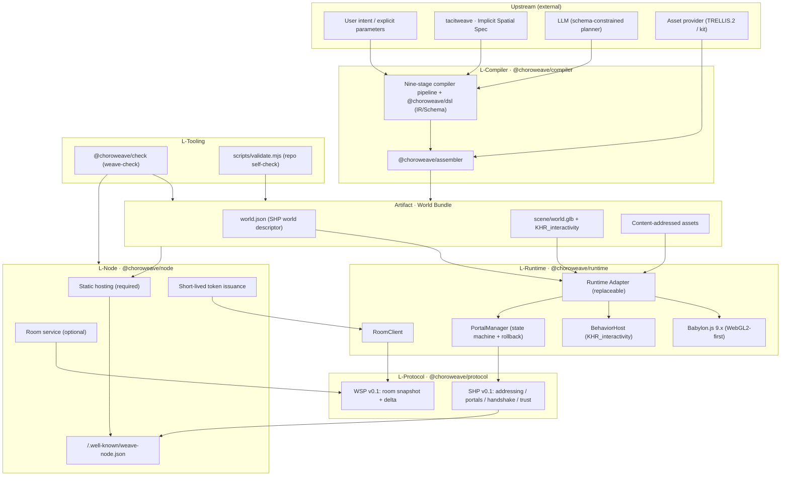
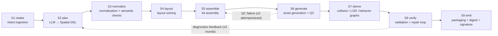
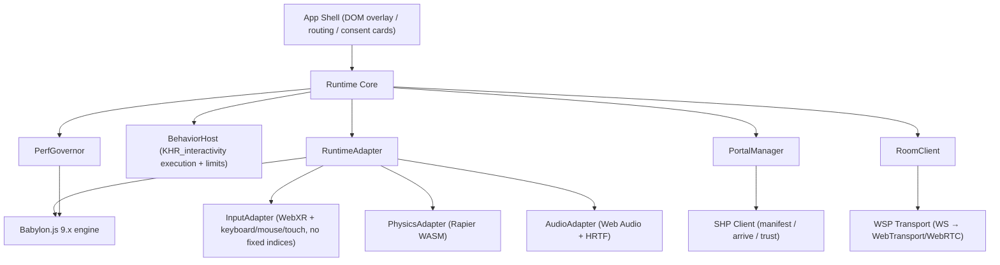
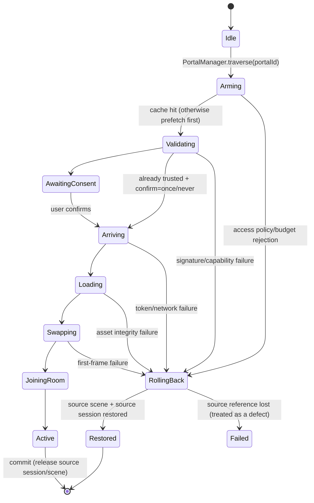

# choroweave System Architecture (v0.1)

> Status: draft · as of **2026-11-07** · code license Apache-2.0 · for the implementation team and external contributors
> Basis: the 12 ADRs in [`02-tech-selection.md`](02-tech-selection.md), [`04-spatial-hyperlink-protocol.md`](04-spatial-hyperlink-protocol.md) (SHP), and the four research reports in [`research/`](research/).
> All `CHW_*` extensions and `world.json` fields in this document defer to [`04`](04-spatial-hyperlink-protocol.md) and [`schemas/`](../../schemas/); any inconsistency among the three is a defect.
> Chinese version: [`../03-architecture.md`](../03-architecture.md)

---

## 1. One-page overview

The architectural goal of choroweave is one sentence: **make every segment of the chain "intent → playable world → linkable world network" carried by open, replaceable, verifiable components.** Explicitly out of scope (consistent with 02): a closed platform, a AAA engine, VR hardware/BCI, on-chain assets, and 3DGS/world-model runtimes during P1-P2.

| Layer | Component | External standards depended on | What we build | Related ADR |
|---|---|---|---|---|
| **L-Compiler** | Chôra Compiler | glTF 2.0, `KHR_interactivity`, JSON Schema | Nine-stage pipeline, Spatial-DSL, deterministic assembly, validate-and-repair loop | ADR-09 |
| **L-Protocol** | SHP / WSP | HTTPS, RFC 8615, JCS/Ed25519, glTF extension mechanism | `world.json`, `CHW_*`, entry handshake, capability negotiation, room sync whitelist | ADR-02/05/06/07 |
| **L-Runtime** | Reference Runtime | Babylon.js 9.x, WebXR, Rapier, Web Audio | Runtime Adapter, behavior-graph host, portal lifecycle, performance governance | ADR-04 |
| **L-Node** | Node | Node.js, WebSocket, SQLite, static HTTP | Static hosting layout, room service, short-lived token, pure-static degradation | ADR-07 |
| **L-Tooling** | `weave-check` / CLI | JSON Schema, glTF Validator | Conformance suite, `validate.mjs` repository self-check | ADR-12 |

### 1.1 Layered architecture diagram


---

## 2. Design constraints (fix the constraints before discussing implementation)

| Constraint | Content | Source |
|---|---|---|
| C1 | The artifact must be **glTF 2.0 + `KHR_interactivity` + `CHW_*`**; no private scene format | ADR-02/03 |
| C2 | World identity must be an **HTTPS URL**; `weave://` is an alias only | ADR-05 |
| C3 | Reference runtime **Babylon.js 9.x**, **WebGL2 as a guaranteed floor**, WebGPU as feature enhancement; do not fork Hyperfy | ADR-04 |
| C4 | Three logic layers **L0/L1/L2**; L0 does not support multiplayer or UI (explicitly excluded by the specification), multiplayer/portals/world rules are built in-house | ADR-03 |
| C5 | Real-time layer **WebSocket (P0-P1) → WebTransport/WebRTC (P2+)**; Matrix does not carry pose | ADR-07 |
| C6 | Asset generation defaults to **TRELLIS.2 (MIT)**; Hunyuan3D is an optional provider only (region/MAU restrictions) | ADR-09 |
| C7 | Identity **Passkey/OIDC → did:web**; no blockchain | ADR-08 |
| C8 | Code Apache-2.0 / specification CC-BY-4.0 / examples CC0-CC-BY; the conformance suite is the governance core | ADR-12 |
| C9 | Studio requires no server: **pure static HTTPS hosting is enough to run a world**; the room service is optional | ADR-06 item 5 |
| C10 | Quest 3 budgets are written into the engine startup check (≤300k–500k triangles, 50–80 draw calls/frame) | ADR-04, research 03 §3.5 |

---

## 3. Compiler pipeline (nine stages)

### 3.1 Overview



**The two-stage principle** (ADR-09): the LLM **only** produces a JSON-Schema-constrained Spatial-DSL; layout, assembly, collision, LOD, behavior graphs, and validation are all done by deterministic code. The LLM does not generate binaries, write engine code, or decide coordinates.

### 3.2 Stage contracts

| # | Stage | Input | Output (IR) | Failure handling | Determinism |
|---|---|---|---|---|---|
| S1 | `intake` | Natural-language intent, explicit parameters, ISS snapshot, budget/tier, deployment region | `IntentEnvelope` (prompt + iss + constraints + compilerVersion + locale; seed derived afterwards) | Parameter conflict → `DSL_SEMANTIC_INVALID`; missing → defaults + WARN | High (pure function) |
| S2 | `plan` | `IntentEnvelope` + kit catalog digest + style pack | `SpatialDSL` (validated against `schemas/spatial-dsl.schema.json`) | First schema failure → structured diagnostics feedback and retry (≤3); still failing → degrade to template world | **Low** (LLM is non-deterministic); record `model/provider/promptHash` |
| S3 | `normalize` | `SpatialDSL` | `NormalizedDSL` (meters, Y-up, unique IDs, coordinates inside the bounding box, legal budget) | `DSL_SCHEMA_INVALID` / `DSL_SEMANTIC_INVALID` (fatal) | High |
| S4 | `layout` | `NormalizedDSL` | `LayoutIR` (skeleton grid, doors/windows, reachability graph, navmesh, spawn points) | Unreachable/clipping → `LAYOUT_UNREACHABLE` → back to S2 for repair | High (seeded procedural + constraint solving) |
| S5 | `assemble` | `LayoutIR` + kit library index + parts manifest | `AssemblyIR` (instances, transforms, material bindings, `AssetRequest[]`) | Kit version mismatch → `ASSET_QC_FAILED`; missing kit → use proxy geometry | High |
| S6 | `generate` | `AssetRequest[]` | `AssetRecord[]` (content-addressed glb/textures/audio + provenance + QC report) | Provider timeout/failure → retry ≤2 → kit substitution; QC failure → refuse to ingest | Medium (reproducible for the same provider+seed; not guaranteed across versions) |
| S7 | `derive` | `AssemblyIR` + `AssetRecord[]` + interaction declarations | `DerivedIR` (colliders, LOD chains, `KHR_interactivity` graphs, `CHW_portal`/`CHW_collider`/`CHW_logic`, navigation) | Invalid graph → `GRAPH_INVALID`; collision failure → bounding-box fallback | High |
| S8 | `verify` | `DerivedIR` + all assets | `VerificationReport` (schema, glTF Validator, `strictValidation`, reachability, budget, security, licensing) | Failure → diagnostics feedback (≤3 rounds) → template world | High |
| S9 | `emit` | IR that passed validation | **World Bundle** (`world.json` + `scene/world.glb` + `assets/` + `preview/` + `source/` + `LICENSE`) | Atomic write to a temp directory → validate → rename; never publish a half-built artifact | High (byte-for-byte reproducible with a fixed `SOURCE_DATE_EPOCH`) |

### 3.3 Determinism model

The compiler's promise of "determinism" is split into three levels, so that LLM non-determinism is not mixed into build reproducibility:

| Level | Promise | How it is guaranteed | Verification |
|---|---|---|---|
| **R0 build reproducibility** | Same `NormalizedDSL` + `seed` + compiler version + provider manifest → **byte-identical** bundle | All randomness comes from a seeded PRNG (`splitmix64` counter-based; `Math.random`/`Date.now` forbidden); JSON output uses sorted keys and fixed-point floats; `generatedAt` comes from `SOURCE_DATE_EPOCH` | `weave-check --repro`: compile twice and compare `bundleDigest` |
| **R1 plan replayability** | The same NL intent does not guarantee the same DSL; but once a DSL snapshot is recorded, R0 replay works | `provenance.model.{provider,name,promptHash}` + `source/world.dsl.json` shipped with the bundle | Recompile from `source/` = the original bundle |
| **R2 asset semantic equivalence** | Visuals may differ after a provider upgrade, but **interfaces and budgets do not change** | `provider` + `model` + `version` + `params` written into provenance; cache keys include the provider digest | Asset QC gate + budget validation |

**Seed and digests**:

- When `seed` is omitted, take `uint64(sha256(JCS({prompt, iss, constraints, compiler, compilerVersion}))[0..8])` (computed before the seed is fixed, avoiding self-reference); once written into `world.dsl.json` it is frozen.
- `inputHash = sha256(JCS({prompt, iss, constraints, compiler, compilerVersion, seed}))` (UTF-8 JCS, the same canonicalization as SHP §8.1).
- `assetDigest = sha256(file bytes)`; `bundleDigest = sha256(⋃ sorted("sha256  <relative path>\n"))`; `compileId = sha256(inputHash ‖ compilerVersion ‖ providerManifestDigest)` (written to build logs only, avoiding self-reference).
- Timestamps, hostnames, absolute paths, and locale-dependent items must never enter bundle content (otherwise R0 fails).

### 3.4 Failure handling and the repair loop

**Recoverable** (schema error, unreachable layout, budget overrun, invalid graph): structured diagnostics `{code, stage, path, message, hint}` are fed back to S2, up to **3 rounds**. **Degradable** (provider unavailable, asset failure, interaction cannot compile): kit substitution / disable interaction, recording `WARN` and `degraded[]`. **Fatal** (licensing/security/three failed validation rounds): abort and emit a report plus draft (`--keep-draft`), producing no bundle. The fallback `templates/room-basic` (pure kits, a single room + one door) guarantees that "there is always a playable artifact".

Diagnostic code namespaces: `DSL_*` (S1-S3), `LAYOUT_*` (S4), `ASSET_*` (S5-S6), `GRAPH_*` (S7), `BUDGET_*` / `VERIFY_*` (S8), `EMIT_*` (S9). CLI exit codes: `0` success, `1` validation failure, `2` input error, `3` provider unavailable, `4` internal error.

### 3.5 Compilation cost (engineering estimate, following research 02 §4.2)

| Tier | Content | GPU time | API cost | Total time | Human fallback |
|---|---|---|---|---|---|
| Draft | Layout + 20–40 512³ assets | ≈3–6 GPU·min | ≈$0.2–0.6 | 5–10 min | None |
| Standard | Layout + 60–120 1024³ assets + collision/LOD | ≈30–60 GPU·min | ≈$2–6 | 20–40 min | 10–20% spot check |
| Hero | + hero assets + retopology/rigging/lighting | 2–6 GPU·h | ≈$10–30 | 2–6 h | Required |

> The $0.5–8 per space figure is the engineering estimate from 02 (grade C), excluding human labor; it must be measured continuously with the P1 evaluation set and cannot be treated as a commitment.

---

## 4. World Bundle

### 4.1 Directory structure

```
pixel-rooftop/
├── world.json                 # World descriptor (single entry point, defined by SHP; see 04 §5)
├── scene/
│   └── world.glb              # glTF 2.0 + KHR_interactivity graphs + CHW_* extensions
├── assets/<sha256>.{glb,ogg,ktx2}   # Content-addressed; examples use logical names + a sha256 field
├── preview/portal-neon-alley.webp   # Portal preview card (≤256 KiB)
├── source/world.dsl.json            # Optional: source IR (audit/rebuild; not used at runtime)
└── LICENSE                          # Full text of the content license
```

**Invariants**: `world.json` is the single entry point; every binary the runtime needs is reachable from it; only relative paths are used inside the bundle; the build is "temp directory → full validation → atomic rename".

### 4.2 Fields

The field table, types, requiredness, and semantics **defer solely to [`04 §5`](04-spatial-hyperlink-protocol.md)** and are not copied here, to avoid drift between duplicate definitions. `world.json` top level = **13 required + 5 optional** (`description`/`updatedAt`/`portals`/`bundleDigest`/`signature`). Key points:

- `entry.scene` → `scene/*.glb`; `entry.interactivity = "KHR_interactivity"`; `spawn.node` maps to `OMI_spawn_point`.
- `capabilities.sync.whitelist` uses "named pointers" (`/nodes/{radio}/translation`); on-the-wire deltas use resolved glTF Object Model JSON Pointers.
- `portals[]` is isomorphic with in-scene `CHW_portal`; `perf.budget` ≤ compiler `budget`; `moderation.rating` ≥ the intent/ISS floor; `signature` is optional (unsigned = degraded to unverified).
- `CHW_avatar` is enabled at P2 only (declaring avatar format and skeleton conventions); P0-P1 introduces no avatar extensions.

### 4.3 Integrity and digests

| Digest | Computed over | Purpose |
|---|---|---|
| `assets[].sha256` | Bytes of a single asset file | Pre-load verification; cache key |
| `entry.sha256` | `scene/world.glb` | Scene integrity (written after the build) |
| `bundleDigest` | All files, sorted and concatenated as `sha256  <path>\n` | Whole-bundle attestation, `weave-check --repro` |
| `signature.value` | JCS bytes of `world.json` minus `signature` | Author commitment (covering portals and asset digests) |

### 4.4 Flagship example: `pixel-rooftop`

[`examples/pixel-rooftop/`](../../examples/pixel-rooftop/) (P1 flagship demo, also a regression sample for `weave-check`):

| Item | Value |
|---|---|
| Entities / parts | **14 entities / 29 semantic parts** (parts as a first-class field: tabletop, table legs, cushion, radio body/knob/speaker/antenna, door frame/panel/handle…) |
| Interactions | **5**: `play_lofi` (click the radio to play Lo-Fi), `toggle_string_lights`, `preview_neon_alley` (prefetch 2.5 m before the door), `enter_neon_alley`, `ambient_hum` |
| Portals | **1**: north-wall `neon_door` → `https://hana.example/worlds/neon-alley/world.json` (`handoff: cross-instance`) |
| Budget | 180k triangles / 60 draw calls / 240 MB textures / 6.2 MB first payload (within the XR-Mid tier) |
| Artifact | The example repo contains only the manifest and the DSL source (`world.json`, `world.dsl.json`, README); glb/audio/WebP are produced by the compiler and are not distributed with the planning repo |

The example's `world.json` is already signed with a demo ed25519 key (the private key is discarded after signing), and `scripts/validate.mjs` verifies the signature — the minimal executable proof that "signatures are machine-readable".

---

## 5. Runtime architecture

### 5.1 Modules



**The value of the Runtime Adapter**: scene loading, input abstraction, state whitelisting, portal lifecycle, and avatar/network interfaces all pass through it; the goal is "replaceable with a three.js adapter within 3 months" (ADR-04). Babylon appears only inside the Adapter.

### 5.2 Main loop

Inside an XR session use `XRSession.requestAnimationFrame`; on desktop use `requestAnimationFrame`. Rendering must not be moved to a Worker (the WebGL context is on the main thread; WebGPU OffscreenCanvas XR binding is not standardized).

| Order | Step | Frequency | Budget (72 Hz / 13.9 ms) |
|---|---|---|---|
| 1 | Input sampling (iterate all XR input sources, never assume index 0/1) + network drain/interpolation | Every frame | 0.8 ms |
| 2 | Fixed-step physics (60 Hz, accumulator, at most 2 steps per frame) | 60 Hz | 1.5 ms |
| 3 | Behavior-graph stepping + animation/skeleton sampling | Every frame | 2.0 ms |
| 4 | Portal state-machine tick (transition periods only) | Every frame | 0.4 ms |
| 5 | Render submission | Every frame | 8.0 ms |
| 6 | UI overlay / performance sampling | Every frame | 0.4 ms |
| — | Headroom (including render jitter) | — | 0.8 ms |

PerfGovernor: run a budget health check once before entering XR; if the frame rate drops >10% for 2 s at runtime → degrade (disable shadow cascades → lower LOD → lower internal resolution → reduce post-processing) and report `perf_tier_change` to the host.

### 5.3 Portal traversal state machine (with rollback)

SHP's nine stages become an explicit state machine at runtime (the full state diagram and failure matrix are in [`04 §7`](04-spatial-hyperlink-protocol.md); only runtime implementation constraints are given here):



**Implementation invariants** (must be covered by automated tests at P1):

1. The source scene root, source room session (suspended ≤10 s), and local avatar state **must not be released** until the target is `Active` and stable for ≥1 frame.
2. `Swapping` must be a single-frame atomic commit: within the same frame, stop source simulation → switch active root → start target simulation; there must never be "two worlds ticking at once".
3. Rollback target ≤300 ms (warm) / ≤1000 ms (cold); restore camera pose and interaction focus, not the spawn point.
4. A `JoiningRoom` failure does not trigger rollback (the target world is already usable) — it degrades to single-player local mode with a "multiplayer temporarily unavailable" notice.
5. A second `traverse` must be rejected during a transition (returning `E_BUSY`).

### 5.4 WSP room protocol (v0.1)

WSP = Weave Session Protocol, running over WebSocket binary frames (P0-P1; from P2+ the `RoomClient` Transport interface switches to WebTransport/WebRTC, with WS retained as the control plane). Encoding is CBOR (RFC 8949); P0 allows a `?encoding=json` debugging downgrade.

| Message | Direction | Payload essentials |
|---|---|---|
| `hello` | C→S | `{wsp:"0.1", token, caps, avatar}`; the token goes only in the first frame, never in the URL |
| `welcome` | S→C | `{sessionId, roomId, tick, rateHz:15, snapshot}` |
| `snapshot` | S→C | `{tick, entities:[{id, owner, kind:"avatar"\|"object", p[3], q[4], anim, props:{pointer:value}}]}` |
| `delta` | bidirectional | `{tick, ops:[{op:"set"\|"remove"\|"spawn"\|"despawn", id, path?, value?}]}` |
| `event` | bidirectional | `{tick, name, source, payload}`; L1 module and `CHW_logic` events |
| `ping`/`pong`, `bye` | bidirectional | 5 s heartbeat, 15 s timeout; close codes `1008` policy / `1011` server error |

**Sync whitelist**: only Object Model pointers resolved from `world.json.capabilities.sync.whitelist` may be written over the network; the server drops and counts `set` operations outside the whitelist (`sync_rejected_pointer_total`), and clients drop them too. Avatar pose is server-authoritative (client prediction + 100 ms interpolation + at most 150 ms extrapolation). World objects are by default locally authoritative via the scene/behavior graph; only declarative properties such as seating, lighting, and interactive state go through the whitelist.

**20-person capacity assumptions (grade C engineering estimate, calibrated by P2 stress tests)**:

| Metric | Estimate | Notes |
|---|---|---|
| Room occupancy | 20 | Consistent with the P2 exit condition (20 people stable for 30 minutes); `maxPlayers` caps at 64 but is not promised |
| Tick | 15 Hz | Avatar pose + whitelisted properties |
| Downstream | ≈20×15×600 B ≈ **180 KB/s** + snapshot once per second (≈4 KB) | Single room, including broadcast overhead |
| Upstream | ≈20×15×200 B ≈ **60 KB/s** | Client input/position |
| Server | 1 vCPU / 512 MB runs 1 room; a 2 vCPU node runs about 10 active rooms | No server-side physics; in-room state is in memory, SQLite stores only registration/revocation |
| 30-minute stability | Targets: dropped connections ≤1%, rollbacks 0, memory growth <5% | Requires real-device stress testing at P2 |

### 5.5 Rendering strategy

- **WebGL2 by default**; WebGPU may be enabled when `navigator.gpu` exists and no XR session is active (desktop preview, post-processing, 3DGS at P3). WebGL2 is the default inside XR sessions (the WebXR/WebGPU Binding is still an Editor's Draft, and Babylon's WebGPU-XR is self-labeled experimental).
- The three compression workhorses are on by default: `KHR_draco_mesh_compression` (geometry), `KHR_texture_basisu` (KTX2), `EXT_meshopt_compression` (buffers).
- LOD uses an in-house chunked tree (`MSFT_lod` is a vendor extension); physics uses Rapier (WASM), with colliders auto-generated plus `CHW_collider` fallback (`KHR_physics_*` is still a Review Draft); 3DGS is visual enhancement at P3 only and never enters the state machine.

---

## 6. Node architecture

### 6.1 Three deployment forms

| Form | Content | Can do | Cannot do |
|---|---|---|---|
| **Static** (required) | Pure static HTTPS: `world.json` + glb + assets + optional `/.well-known/weave-node.json` | Single-user entry, portal jumps (local scene switch), preview, `weave-check` | Multiplayer, identity handoff, server-authoritative state |
| **Static + Room** | Adds a room service (WSP) + short-lived tokens | Multiplayer co-presence, continuing in the target room after portal traversal | Cross-node identity continuity when there is no arrive endpoint |
| **Full Node** | Adds `/portal/arrive`, identity bridge, revocation list, discovery index | Full SHP: ring/allowlist/private access policy, carry, cross-node handoff | No 7×24 hosting SLA promise (self-hosting first) |

### 6.2 Static hosting layout and response headers

```
https://<host>/.well-known/weave-node.json    # Optional; absent = pure static node
https://<host>/worlds/<slug>/world.json      # World entry (the unique ID)
https://<host>/worlds/<slug>/{scene,assets,preview}/…
```

| Response header | Value | Rationale |
|---|---|---|
| `Cache-Control` (content-addressed assets) | `public, max-age=31536000, immutable` | The digest is the version; never invalidated |
| `Cache-Control` (`world.json`/node document) | `public, max-age=300` / `600` | Updatable + ETag |
| `ETag` | `"<bundleDigest>"` / `"<sha256>"` | 304 saves bandwidth |
| `Access-Control-Allow-Origin` | `*` (read-only resources) | Cross-node loading; credential endpoints must not use `*` |
| `Cross-Origin-Resource-Policy` | `cross-origin` | Allow cross-origin loading of glb/ktx2 |
| `COOP`/`COEP` | optional `same-origin` + `require-corp` | When enabling WASM multithreading/SharedArrayBuffer (headset-browser support unverified) |
| `Content-Security-Policy` | `default-src 'self'; connect-src 'self' https: wss:` | Prevent asset/data script injection |

### 6.3 Room service

- Single Node process: `ws` upgrade → verify token → assign room (by `worldId` + room instance) → in-memory state machine; 15 Hz tick, snapshot once per second + deltas; 20 people per room, 32 KiB/frame per connection, 120 messages/s; SQLite stores only world registration/revocation/counters, room state is never persisted.
- Authority: the room service is authoritative only for **online state** (who is present, pose, whitelisted properties); world geometry and behavior graphs are loaded from the same bundle and executed locally by each client, with logic determined by L0 behavior graphs + deterministic L1 module rules.
- Scaling: single-node vertical scaling → room-based sharding (consistent hash) → regional relays at P3; do not stuff real-time messages into Matrix (ADR-07).

### 6.4 Authentication: short-lived tokens

| Item | Rule |
|---|---|
| Issuance | Issued after a successful `POST /portal/arrive` (or `/session`); signed with the node's ed25519 private key (recommended) or symmetric HMAC (simple to implement but not verifiable across nodes) |
| Shape | `{v:"0.1", sub, worldId, roomId, disclosure, caps[], spawn, iat, exp, jti}` |
| Lifetime | **≤120 s**, single use; the token is voided when the room connection drops |
| Transport | Only in the first WSP `hello` frame; never in the URL, `localStorage`, or cookies |
| Validation | Signature + `exp`/`iat` clock window (±120 s) + `jti` deduplication + `worldId/roomId` binding + capability subset |
| Revocation | Room kick → `jti` added to a short-lived blacklist (10 minutes); node key revocation goes through the discovery document |

### 6.5 Pure-static degradation mode

| Feature | Static | +Room | Full |
|---|---|---|---|
| Enter a world | ✅ | ✅ | ✅ |
| Portal jump (`cross-instance` local scene switch) | ✅ | ✅ | ✅ |
| Signature verification / unverified marking | ✅ (client) | ✅ | ✅ |
| Multiplayer co-presence | ❌ (single-player) | ✅ | ✅ |
| Identity handoff (carry) | ❌ | ❌ (may join under a pseudonym) | ✅ |
| ring/allowlist/private access policy | ❌ (treated as open) | Partial (token-bound) | ✅ |
| `weave-check` protocol cases | All static cases | + room cases | All |

---

## 7. Interface definitions (TS type-level pseudocode; not required to compile)

```ts
// ── @choroweave/compiler ────────────────────────────────────────────
export interface CompileRequest {
  intent: { prompt: string; iss?: IssSnapshot; constraints: DslConstraints };
  worldId: string;                 // https://.../world.json
  seed?: bigint;                   // default derived from the intent envelope digest (before inputHash)
  tier: "draft" | "standard" | "hero";
  region?: "eu" | "uk" | "kr" | "other";   // licensing routed by deployment region (research 02 §4.4)
  offline?: { dsl?: SpatialDSL };  // R1 replay
}
export interface CompileResult {
  status: "ok" | "degraded" | "failed";
  bundle?: { dir: string; bundleDigest: string; worldManifest: WorldManifest };
  report: VerificationReport;      // includes diagnostics[] and degraded[]
  compileId: string;
}
export interface Compiler {
  compile(req: CompileRequest): Promise<CompileResult>;
  verify(bundleDir: string): Promise<VerificationReport>;   // weave-check entry point
}

// ── @choroweave/runtime ─────────────────────────────────────────────
export interface RuntimeAdapter {
  loadScene(bundle: WorldBundle): Promise<SceneHandle>;     // verify → resolve → bind
  unloadScene(h: SceneHandle): void;                        // only PortalManager may call
  setActive(h: SceneHandle): void;                          // single-frame atomic switch
  getActive(): SceneHandle | null;
  input(): InputSnapshot;                                   // no fixed inputSource indices
  physics: PhysicsFacade;                                   // Rapier wrapper
  audio: AudioFacade;
}
export interface PortalManager {
  traverse(portalId: string, gesture: UserGesture): Promise<TraversalResult>;
  cancel(): void;
  prefetch(portalId: string, reason: "gaze" | "proximity" | "manual"): void;
  state(): TraversalState;                                  // Idle…Committing
  on(event: "rollback" | "commit" | "degraded", cb: (e: TraversalEvent) => void): void;
}
export interface RoomClient {
  connect(token: SessionToken, transport?: "websocket" | "webtransport" | "webrtc"): Promise<void>;
  applyDelta(op: DeltaOp): void;                            // must pass the whitelist
  sendAvatar(p: Pose, anim: AnimState): void;               // 15 Hz
  sendEvent(name: string, payload: unknown): void;          // L1 / CHW_logic
  disconnect(code?: number): void;
}
export interface BehaviorHost {
  loadGraphs(scene: SceneHandle): void;
  step(dtMs: number): void;                                 // subject to nodeBudget/steps limits
  emit(event: { name: string; sourcePointer?: string }): void;
}

// ── @choroweave/protocol ────────────────────────────────────────────
export interface ManifestClient {
  resolve(worldId: string): Promise<ResolvedWorld>;         // cache + ETag + budget
  verifyTrust(m: WorldManifest): TrustDecision;             // signature / access policy / revocation
  negotiate(world: WorldManifest, node: NodeDoc, rt: RuntimeCapabilities): CapabilitySet;
}
```

Hard rules for call boundaries: `compile()` never touches the network runtime; `PortalManager` never parses glTF directly; `RoomClient` never mutates Babylon nodes directly (it must go whitelist → `applyDelta` → state-mapping layer).

---

## 8. ISS contract with tacitweave

### 8.1 Boundary

tacitweave is responsible for "understanding you" (deriving implicit preferences from behavior), and choroweave for "implementing and visiting". **Separate repositories, separate releases, sharing only one versionable JSON contract** (ADR-01): `schemas/implicit-spatial-spec.schema.json`. choroweave does not depend on tacitweave's code/models; when ISS is missing, expired, or low-confidence it must degrade.

### 8.2 ISS → Spatial-DSL mapping

| ISS `preferences[].key` | DSL landing point | Rule (v0.1) |
|---|---|---|
| `lighting` | `space.environment.ambientLight` + light entities | `warm-dim`→(#e0b080, 0.5); `cool-bright`→(#cfe6ff, 0.9); `neutral`→(#ffffff, 0.6); unknown values ignored |
| `palette` | `world.style.palette`, `style.pixelated` | Intersect with the style pack; on conflict, explicit intent wins |
| `acoustic` | `space.environment.audio` + audio entities | `lofi`/`city-ambience` map to kit audio-track families; no match → muted by default |
| `clutter` | Entity count budget | `low`×0.7, `medium`×1.0, `high`×1.3 (never exceeding the hard budget) |
| `scale` | `space.dimensions` | Multiplier 0.8–1.25, then clamped to kit dimension increments |
| `privacy` / `socialDensity` | Access-policy suggestion + `budget.maxPlayers` | `low`→8, `medium`→20, `high`→32; advisory only, finally decided by the user and node policy |
| `motion` | `constraints.accessibility` | When `reducedMotion` is present, forbid automatic camera motion/strong parallax |
| `timeOfDay` | `space.environment.timeOfDay` | Enum passed through |

`ISS.constraints`: `accessibility[]` → `intent.constraints.accessibility` (**hard constraint**); `budgetUSD` → tier selection (draft/standard); `platform[]` → runtime candidate tier and first-payload budget; `ratingMax` → content-rating ceiling. `ISS.avoid[]` → **hard exclusion** (e.g. "avoid cold white fluorescent" means that light type is never chosen), unless the user explicitly overrides with a second confirmation.

### 8.3 Versioning, privacy, and failure handling

- **Versioning**: the contract has an independent semver; major matching, minor forward compatibility; unknown ISS keys are ignored. **Privacy**: when `privacy.shareWithNode=false`, ISS participates in compilation locally only, and only derived DSL parameters are sent to the LLM/node.
- **Audit**: `world.dsl.json.intent.iss` stores the **snapshot** (including `integrity`), and `provenance.inputHash` covers it → reproducibly answering "why was it generated this way at the time".
- **Failures**: ISS expired (`expiresAt`) → confidence treated as 0, used only for A/B ordering; `confidence < 0.4` → may only affect candidate ordering, not override explicit intent; ISS corrupted → WARN + use the default preference profile, **never blocking compilation**.

---

## 9. Performance budgets

### 9.1 Device tiers (following 02 / research 03 §3.5, §4.4)

| Tier | Device | Triangles/frame | Draw calls | Texture VRAM | First payload | Per space | Target frame rate |
|---|---|---|---|---|---|---|---|
| XR-Low | Pico 4 / Quest 2 | 200k–300k | 40–60 | ≤300 MB | ≤5 MB | ≤15 MB | 72 Hz |
| **XR-Mid** | **Quest 3** | **300k–500k** | **50–80** | **≤400 MB** | **≤8 MB** | **≤30 MB** | **72–90 Hz** |
| XR-Apple | visionOS Safari | 500k–800k (est.) | 60–100 | unverified | ≤8 MB | ≤30 MB | 90 Hz |
| Desktop | PC/laptop | 2M–5M | 200–500 | ≤2 GB | ≤15 MB | ≤80 MB | 60 fps |
| 3DGS add-on | Quest 3 (P3) | — | — | — | — | 1M–3M splats | 72 Hz |

> The XR tiers are engineering discounts of **0.5–0.7** applied to Meta's official native budgets (≤150 draw calls, <1M triangles, 500–700 MB textures), **not official data**; visionOS/3DGS must be calibrated on device. Browser WebXR also carries Chromium GPU-process, JS main-thread, and compositor overhead.

### 9.2 Startup check (engine entry)

1. Probe `navigator.gpu`/`XRSession`/`deviceMemory`/`effectiveType`/`Save-Data`; read `world.json.perf.budget` and the node `limits`, and refuse to load with a readable reason when they are exceeded.
2. Establish the `PerfGovernor` sampling ring (frame-time p95, draw calls, triangles, texture memory); over budget for 2 s → tiered quality reduction; portal traversal uses its own budget (04 §7.3): warm <1.5 s / cold <5 s, with timeouts rolled back per the failure matrix.

### 9.3 Memory and network

| Item | Target |
|---|---|
| JS/WASM heap (XR) | ≤300 MB |
| Textures | ≤400 MB (Quest 3 tier), KTX2 + ASTC; over budget → reduce mip/resolution |
| Prefetch cache | Desktop 256 MB / XR 96 MB LRU (04 §9.2); room downstream ~180 KB/s @20 people |

---

## 10. Security boundaries

Trust boundaries (outside in): **untrusted** = third-party assets, `world.json`, external node responses, messages from others in a room; **minimized trust** = the compiler (offline sandbox), Runtime Adapter + whitelist, Babylon, room-service authoritative state. All input crossing a boundary must "validate first, then parse, then limit".

| Boundary | Threat | Mitigation |
|---|---|---|
| **Untrusted assets** | Malicious glb, graph bombs, path traversal, oversized textures | Digest verification → size/face-count caps → glTF Validator + strict `KHR_interactivity` validation → behavior-graph node/frame-step limits → no JS inside assets → decompression caps |
| **UGC logic** | User logic escaping, arbitrary network/file access | L0 = data-driven behavior graphs (no host API); L1 = official parameterized modules; L2 = P3 capability-sandboxed WASM (whitelisted APIs only: read room state, emit events, modify declared properties) |
| **Cross-node** | Forged worlds, phishing portals, identity forgery | SHP signature/access policy/unverified degradation (04 §8, §13); targets must be HTTPS; no teleport without a gesture |
| **Network layer** | Pose cheating, state pollution, message flooding | Server-authoritative online state; sync whitelist; rate/frame-size limits; single-use tokens with a short TTL |
| **Node operations** | Log leakage, DoS amplification, SSRF (prefetching private IPs) | Telemetry minimization; prefetch only declared domains; forbid private network ranges; tighten CSP/CORS |
| **Browser/privacy** | Fingerprinting, third-party pixels, cross-site tracking | Anonymous sessions by default; ISS never uploaded; no third-party DOM resources; disclosure level escalated gate by gate |

---

## 11. monorepo structure and milestone mapping

### 11.1 Directories

```
choroweave/
├─ packages/
│  ├─ dsl/                @choroweave/dsl          # Spatial-DSL AST/Schema/validation
│  ├─ compiler/           @choroweave/compiler     # nine-stage pipeline + CLI
│  ├─ assembler/          @choroweave/assembler    # glb assembly, collision, LOD, behavior-graph generation
│  ├─ provider-kit/       @choroweave/provider-kit
│  ├─ provider-trellis/   @choroweave/provider-trellis
│  ├─ provider-hunyuan/   @choroweave/provider-hunyuan   # optional, disabled by default
│  ├─ runtime/            @choroweave/runtime      # Babylon wrapper, behavior-graph host, portal switching
│  ├─ node/               @choroweave/node         # static hosting + room service + discovery
│  ├─ protocol/           @choroweave/protocol     # SHP/WSP types and codecs
│  └─ check/              @choroweave/check        # weave-check CLI
├─ schemas/                                        # published JSON Schemas (this repo)
├─ examples/pixel-rooftop/                         # flagship example + regression sample
├─ examples/cliff-tavern/                          # P2 showcase (planned)
├─ examples/dungeon-puzzle/                        # P3 showcase (planned)
├─ scripts/validate.mjs                            # repo self-check (zero dependencies)
├─ apps/playground/                                # browser entry (reference implementation UI)
├─ templates/room-basic/                           # fallback template world
└─ rfcs/                                           # RFC process and protocol changes
```

`weave-check` (protocol conformance) and `scripts/validate.mjs` (repository self-check) have different jobs: the former validates "any implementation claiming SHP compatibility", the latter validates "this planning repository itself" (schema/examples/links/ADR consistency). CI runs both.

### 11.2 P0-P4 mapping

| Phase | Time | Architectural slice delivered | Exit condition |
|---|---|---|---|
| **P0** protocol validation | M0-M2 | `protocol` (SHP types), `node` (static + minimal room), two hand-built worlds + one door, `check` static cases; **no AI** | Two self-hosted nodes can jump to each other; `weave-check` can verify them |
| **P1** compiler MVP | M2-M6 | `dsl`/`compiler`/`assembler`/`provider-kit`/`provider-trellis`; runtime single-player + portals; `pixel-rooftop` landed | 20 eval prompts ≥70% playable; warm switch <1.5 s |
| **P2** multiplayer networking | M6-M12 | `runtime` room client + avatars + portal traversal; `node` room service/arrive/token; spec v0.5 | 20-person room stable for 30 minutes; cross-node visit demo |
| **P3** ecosystem and agents | M12-M18 | L2 sandboxed WASM, agent reception (ISS resident), 3DGS visual layer, discovery index | 100 public worlds / 10 third-party nodes |
| **P4** immersion and standardization | M18-M24 | Deep WebXR adaptation, visionOS dual track (`<model>`/Immersive API fallback), protocol v1.0, governance handover | Quest 3 native 72 fps; 3 third-party engines can play |

---

## 12. Open questions

1. Default WebGPU state and versions in Quest/Pico browsers (determines whether WebGPU is usable inside XR; quarterly review).
2. Whether headset browsers support COOP/COEP (determines whether WASM physics can be multithreaded).
3. visionOS per-item support for Hit Test/Anchors/Depth/Lighting (determines interaction degradation on the Apple entry); VRM loading approach in Babylon (P2 avatars).
4. LiveKit/WebTransport RTT/CPU in headset browsers (P2 stress testing); glTF 2.1 external references (2026-11-17 Town Hall) and the merge path with `CHW_portal.target`.

---

## 13. Deviations from `02-tech-selection.md`

| Item | 02's statement | Treatment here | Nature |
|---|---|---|---|
| Nine-stage pipeline | ADR-09 describes "two-stage compilation + validate-and-repair loop" without splitting stages | Split into S1-S9 with per-stage input/output/failure handling/determinism level | Refinement; does not change ADR-09 |
| Determinism | 02 requires "deterministic assembly" | Explicit R0/R1/R2 levels: the LLM makes no determinism promise; DSL→bundle is byte-for-byte reproducible (fixed `SOURCE_DATE_EPOCH`) | Added convention |
| WSP | 02 / the writing spec only give "WebSocket binary, snapshot + delta, whitelist JSON Pointer" | Defines the message set, CBOR encoding, 15 Hz, 20-person capacity estimate (grade C) | New engineering detail |
| `CHW_logic` | The writing spec calls it a "capability declaration" | Used to declare syncable properties/events (the `/extensions/CHW_logic/props/*` source of `sync.whitelist`) | Semantic refinement |
| Room-service capability | 02 says "WebSocket room server, within 20 people" | Specifies 20 people, 1 vCPU per room, SQLite storing only registration/revocation | Refinement |
| Render backend | 02 already fixed WebGL2-first | Unchanged; adds the implementation constraint "WebGL2 by default inside XR sessions" | Consistent |
| Budget table | 02 already provides four tiers | Quoted as-is, no unverified numbers added | Consistent |

No ADR-level conflicts; this document introduces no new technical bets.

---

## 14. References

- [02 Technology selection](02-tech-selection.md) (ADR-01…12) · [04 SHP v0.1](04-spatial-hyperlink-protocol.md) (`world.json` / `CHW_portal` / handshake / trust / conformance cases)
- [Research 01 spatial web platforms](research/01-spatial-web-platforms.md) · [02 generative 3D](research/02-generative-3d-and-agents.md) · [03 runtime standards](research/03-runtime-standards.md) · [04 products and failure precedents](research/04-products-market-prior-art.md)
- Schemas: [`spatial-dsl`](../../schemas/spatial-dsl.schema.json) · [`world-manifest`](../../schemas/world-manifest.schema.json) · [`implicit-spatial-spec`](../../schemas/implicit-spatial-spec.schema.json)
- Examples: [`examples/pixel-rooftop/`](../../examples/pixel-rooftop/)
