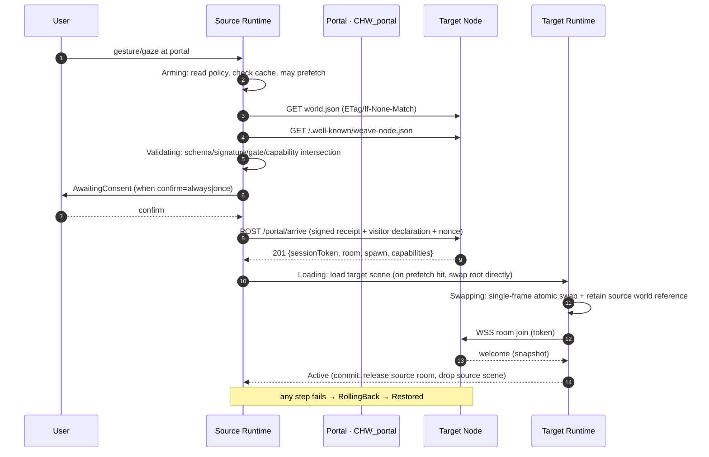
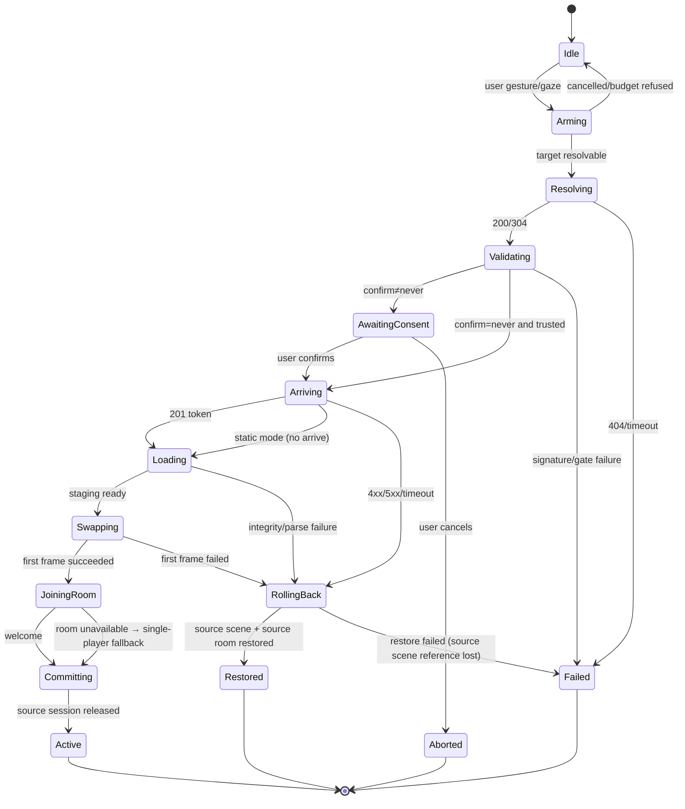

# choroweave Spatial Hyperlink Protocol (SHP) v0.1 Draft

> Status: **v0.1 release candidate** (candidate freeze at `p0-rc1` / runtime `95f12d8`; final freeze only after external validation) · Specification license: CC-BY-4.0 · Implementation: Apache-2.0
> Scope: world manifest (`world.json`), world addressing and node discovery, the `CHW_portal` extension, the traversal handshake, trust/signature, prefetch budget, visitor identity and gates, version compatibility, and the conformance test list.
> Companions: [`02-tech-selection.md`](02-tech-selection.md) (ADR-01…13), [`03-architecture.md`](03-architecture.md) (runtime and node implementation), [`research/`](research/) (evidence).
> Alignment targets: **MSF "Web of Worlds"** (*pages become places, links become portals*) and the **X3D 4.1 WoW Profile**'s `Anchor` (3D hyperlinks) and `Inline` (external scenes); SHP supplies only what they leave undefined: **handshake, trust, prefetch, rollback**. Verified as of 2026-11: OMI has no portal extension (`OMI_link` is archived, `OMI_spawn_point` is still Stage 1), and glTF has no ratified spatial-link extension (A).
> Chinese version: [`../04-spatial-hyperlink-protocol.md`](../04-spatial-hyperlink-protocol.md)

---

## 1. Positioning: what SHP is and is not

| | Content |
|---|---|
| **Is** | A **profile + handshake** layer for "spatial hyperlinks": worlds are identified by HTTPS URLs, described by `world.json`, and expressed as portals inside a glTF scene via `CHW_portal`; one explicitly staged handshake performs "a jump that carries identity and a trust decision". |
| **Is not** | Not a new scene format (a scene = glTF 2.0 + `KHR_interactivity` + `CHW_*`); not a new addressing system (no `weave://` primary identifier, and no reliance on on-chain or content addressing for "availability"); not a real-time multiplayer protocol (that is WSP, see 03 §5); not a world logic language (those are the L0/L1/L2 layers, see 02 ADR-03 and 03 §2 C4/§10). |
| **Minimum viable form** | One purely static HTTPS server + one `world.json` + one glb. **No server, no rooms, and even no signature verification are required to enter a world**; room service, signatures, and prefetch are optional enhancements. |
| **Version policy** | This document freezes the **field names and semantics** of v0.1; an implementation may ship only a subset, but it MUST pass the `weave-check` cases for the corresponding level (§12). |

**Three design axioms** (consistent with ADR-05/06):

1. **Clickability first**: a world address must be able to appear in chat tools, email, business cards, and QR codes. An HTTPS URL is the only identifier that satisfies this.
2. **Failures must be rollback-able**: traversal is a "transaction", not a navigation. A failure at any step must return to the source world without losing local state.
3. **Trust must be expressible**: whether a world is signed, who the author is, and whether a target node is permitted must be **machine-readable data**, not a hard-coded client allowlist.

---

## 2. Design principles

| Principle | Meaning | Normative clauses |
|---|---|---|
| **Web-native** | Use only HTTP semantics (caching, CORS, ETag, Range, status codes) and `/.well-known`; no dedicated port, dedicated scheme, or dedicated certificate system is required. | §4, §9 |
| **Graceful degradation** | Unknown extensions are ignored rather than treated as errors; viewers without `CHW_portal` support treat a portal as ordinary decoration; without a room service the session degrades to single-player local. | §6.2, §7.6, §11 |
| **Capability negotiation** | The world declares "what it needs", the node declares "what it supports", and the runtime takes the intersection; when a MUST-level capability is unmet, an explicit reason and alternative action are given before entry. | §4.2, §7.2 |
| **Minimal disclosure** | Anonymous by default; identity disclosure escalates per gate, not as a by-product of an account system. | §8.4 |
| **User-gesture boundary** | Cross-origin automatic traversal must be triggered by an explicit user gesture; any "instant jump whose destination cannot be seen" is prohibited. | §6.2, §13 |
| **Statically verifiable** | One `world.json` plus the scene file is enough to run the SHP cases of `weave-check` offline, with no server required. | §12 |

**Gaps SHP fills vs. existing standards**:

| Capability | Existing standard/precedent | SHP's handling |
|---|---|---|
| Scene description | glTF 2.0, `KHR_interactivity` (ratified 2026-08-28) | Reused directly; SHP does not define a scene format. |
| 3D hyperlink semantics | X3D 4.1 WoW `Anchor`, MSF "Web of Worlds" | Semantics aligned; `CHW_portal` is its minimal glTF-side carrier. |
| External scene loading | X3D `Inline`; glTF 2.1 external references (still a Proposal, 2026-11 Town Hall) | v0.1 implements it as "portal + explicit handshake", with field design reserved for merging with glTF 2.1 (§11). |
| Spawn point | `OMI_spawn_point` (Stage 1) | `spawn.node` / `anchor.spawnNode` map directly to its "node transform is the spawn point" semantics. |
| Object behavior triggering | `KHR_interactivity` + `KHR_node_selectability` | Portal triggering binds to behavior-graph events; readers without an executor degrade to the host reading `trigger` directly. |
| Spatial link manifest | `OMI_link` (archived, no schema) | `CHW_portal` provides the schema, handshake, and trust layer; `target` is restricted to HTTPS. |
| Node discovery | RFC 8615 `.well-known`, Matrix/ATProto practice | `/.well-known/weave-node.json` (§4.2). |
| Traversal handshake / trust / prefetch / rollback | **No public standard** | **The core of SHP** (§7, §8, §9). |

---

## 3. Mapping to existing key standards

| Existing concept | Corresponding SHP element | Notes |
|---|---|---|
| X3D WoW `Anchor.url` | `CHW_portal.target.url` | Only `https://` is allowed; `http://`, `matrix:`, and `ipfs://` are not supported as primary identifiers. |
| X3D WoW `Anchor.description` | `CHW_portal.title` / `world.json.title` | Used for the preview card; MUST be escaped before rendering. |
| X3D WoW `Inline` (external scene) | `world.json.entry` + `portal.preview` | Preview = a lightweight Inline; actually entering still goes through the handshake. |
| `OMI_spawn_point` | `world.json.spawn.node`, `CHW_portal.anchor.spawnNode` | A node carrying that extension in the target world takes priority; otherwise `position`/`rotationY` is the fallback. |
| `KHR_interactivity` events | `CHW_portal` trigger | A portal node SHOULD also carry `KHR_node_selectability`; inside the graph, `event/onSelect` triggers the `CHW/traverse` extension operation (unknown operations are no-ops, see §6.2). |
| MSF "Web of Worlds" | Overall design goal | This draft positions itself as "an implementable profile of WoW". |
| Hubs room links (shipped precedent) | Preview card + one-click entry | UX borrowed; SHP adds identity handoff, capability negotiation, rollback, and gates. |
| Roblox `TeleportService` | `handoff` + `carry` semantics | Valid only inside the Roblox cloud; SHP turns it into cross-domain negotiable fields. |

---

## 4. World identity and node discovery

### 4.1 World ID

- **Canonical form**: `https://<host>/<path>/world.json`, i.e. the **absolute URL of the world manifest**. A world ID is its URL (ADR-05).
- **Normalization**: strip the fragment and the default port; the query string does not participate in ID semantics (it may be used for CDN variants, but MUST NOT affect content); the canonical form written into `world.json.id` SHOULD equal the distribution URL (on mismatch `weave-check` emits a WARN, and nodes compare after URL normalization).
- **Aliases**: `weave://<host>/<path>` is registrable syntax sugar only, resolved as "prepend `https://` and append `/world.json`"; it MUST NOT appear in `world.json` as a primary identifier.
- **Content address**: a revision of `world.json` may be referenced by digest — `?rev=<sha256>` or the node response header `ETag: "<sha256>"`. Assets are content-addressed with SHA-256 (§8.2), but **availability is guaranteed by the HTTPS host and does not depend on a pinning service**.
- **Invariants**: a world ID must not contain credentials (`user:pass@`), must not use a non-443 port as its default form, and must not point at a local network address (`localhost`, private IP ranges) — these are rejected before the handshake.

### 4.2 Node discovery: `/.well-known/weave-node.json`

A node is a self-hosted instance that hosts worlds and a room service. The discovery document lives at `https://<host>/.well-known/weave-node.json` (an RFC 8615 reserved prefix).

| Field | Type | Required | Notes |
|---|---|---|---|
| `schemaVersion` | `"0.1"` | ✓ | Structure version. |
| `nodeId` | `https://` URL or `did:web:` | ✓ | Stable node identifier; used for handshake receipts and revocation lists. |
| `name` | string | ✓ | Display name (escaped before rendering). |
| `operator` | object | ✓ | `{name, url, contact}`; contact is the abuse/security contact. |
| `protocol` | object | ✓ | `{name:"SHP", versions:["0.1"], default:"0.1"}`; `versions` are supported versions, `default` is the version for new sessions. |
| `capabilities` | object | ✓ | `{roomService: bool, transport: ["websocket","webrtc","webtransport"], identity: ["anonymous","passkey","oidc","did:web"], preview: bool, arrive: bool}`. |
| `identity_endpoint` | `https://` URL | ○ | Identity bridge / `did:web` document entry; absent = only anonymous/pseudonymous sessions are supported. |
| `endpoints` | object | ✓ | `{arrive?, session?, room?, preview?, revocation?}`, all HTTPS/WSS absolute URLs; absence means that capability is unavailable. |
| `worlds` | array | ○ | Optional world index `[{url, title, updatedAt, sha256}]` for discovery pages/search; not an authoritative list. |
| `trust` | object | ✓ | `{policy: "open"\|"ring"\|"allowlist"\|"private", ring?: {depth, roots[]}, allowlist?: [domains/DIDs], requireSignature: bool}`. |
| `limits` | object | ✓ | `{maxRoomPlayers, maxPrefetchBytes, maxTraversalPerMin, maxAssetBytes, maxMessageBytes}`; clients MUST respect smaller values. |
| `keys` | array | ○ | `[{keyId, jwk:{kty,crv,x}, purpose, validFrom, validUntil}]`; for rotation and revocation. |
| `updatedAt` | date-time | ✓ | Document time; default cache TTL 600s. |
| `signature` | object | ○ | The node signs this file (excluding `signature`) over its JCS canonicalization, same format as §8.1. |

Discovery procedure: URL → take scheme+host → fetch `/.well-known/weave-node.json` and the target `world.json` in parallel → validate → intersect capabilities. **A missing node document does not block entry**: treat it as a "purely static node" (`arrive=false`, `roomService=false`).

---

## 5. `world.json` field definitions

`world.json` is the single entry manifest of a World Bundle. JSON Schema: `schemas/world-manifest.schema.json` (draft 2020-12). **Readers MUST ignore unknown fields** (forward compatibility); the schema's `additionalProperties: false` constrains authors/validators only.

### 5.1 Top-level fields

| Field | Type | Required | Notes |
|---|---|---|---|
| `schemaVersion` | `"0.1"` | ✓ | Manifest structure version; a minor bump may only add fields. |
| `id` | `https://` URL | ✓ | Canonical world identifier (§4.1). |
| `title` | string(1..120) | ✓ | Title; escaped before rendering. |
| `description` | string(≤2000) | ○ | Summary; does not participate in trust decisions. |
| `author` | object | ✓ | `{name, url?, did?, jwk?}`; `jwk` is the ed25519 public key (JWK/OKP), used for signature verification. |
| `license` | SPDX string | ✓ | Content license; examples default to `CC0-1.0`/`CC-BY-4.0` (ADR-12). |
| `createdAt` | date-time | ✓ | First publication. |
| `updatedAt` | date-time | ○ | Most recent revision. |
| `protocol` | `{name:"SHP", version:"0.1"}` | ✓ | The SHP version implemented by this world. |
| `entry` | object | ✓ | `{scene, format:"gltf-2.0", interactivity:"KHR_interactivity", sha256?}`; `scene` is a bundle-relative path (`scene/*.glb`), and `sha256` appears only after the build completes. |
| `spawn` | object | ✓ | `{node, position:[x,y,z], rotationY?}`; `node` maps to the `OMI_spawn_point` node name. |
| `assets` | array | ✓ | External asset manifest (§5.2); may be an empty array. |
| `capabilities` | object | ✓ | Capability declaration (§5.3). |
| `portals` | array | ○ | Portal manifest (§5.4); must correspond one-to-one with `CHW_portal` in the scene. |
| `perf` | object | ✓ | `{budget:{triangles, drawCalls, textureMB, firstByteKB}, measured?:{device, fps, triangles?, drawCalls?}}`. |
| `moderation` | object | ✓ | `{rating:"general"\|"teen"\|"mature", allowGuests, policyUrl?, reportUrl?}`. |
| `bundleDigest` | object | ○ | `{alg:"sha256", value}`; written **only after the actual bundle is built** (the digest of all files sorted and concatenated as `sha256  <relative path>\n`). |
| `signature` | object | ○ | Author ed25519 signature (§8.1); absent = unverified world (§8.3). |

### 5.2 `assets[]`

| Field | Type | Required | Notes |
|---|---|---|---|
| `id` | slug | ✓ | Asset identifier inside the bundle (starts with a lowercase letter). |
| `path` | `assets/...` | ✓ | Relative path; `assets/<sha256>.<ext>` is recommended for long-lived CDN caching. |
| `sha256` | 64 hex | ✓ | File content digest; MUST be verified after loading. |
| `bytes` | int | ✓ | Byte count; used for prefetch budgets and Range planning. |
| `mime` | enum | ✓ | `model/gltf-binary` / `image/ktx2` / `image/webp` / `image/png` / `audio/ogg` / `audio/mpeg` / `application/wasm`. |
| `license` | SPDX string | ○ | Asset-level license; absent inherits the world `license`. |
| `provenance` | object | ○ | `{provider, model, version?, params?}`; required for generated assets (ADR-12). |

### 5.3 `capabilities`

| Field | Type | Required | Notes |
|---|---|---|---|
| `interactivity.extension` | `"KHR_interactivity"` | ✓ | L0 object behavior layer. |
| `extensions` | enum[] | ✓ | `CHW_portal` / `CHW_collider` / `CHW_logic` / `CHW_avatar`; the extensions actually used by this bundle. |
| `maxPlayers` | int(1..64) | ✓ | Designed world capacity (P0-P2 reference value 20, see 03 §5.4). |
| `audio` | `{spatial, music}` | ✓ | Whether spatial audio / a music layer is required (in-house Web Audio + HRTF; `KHR_audio_graph` is only a Proposal). |
| `avatar` | `{format:"gltf"\|"vrm", required}` | ✓ | Avatar format and whether it is required; P0 uses a glTF humanoid stand-in, P2 evaluates VRM. |
| `sync.rateHz` | number(1..30) | ✓ | World state sync rate (15 is the default). |
| `sync.whitelist` | string[] | ✓ | Whitelist of synchronizable properties. **On the wire, deltas use resolved glTF Object Model JSON Pointers** (e.g. `/nodes/12/translation`); the manifest may use "named pointers" such as `/nodes/{radio}/translation`, resolved to node indices when the scene is loaded. Writes outside the whitelist MUST be dropped. |

### 5.4 `portals[]` (isomorphic to `CHW_portal`)

| Field | Type | Required | Notes |
|---|---|---|---|
| `id` | slug | ✓ | Unique portal ID within the world. |
| `entity` | slug | ✓ | Name of the node in the scene that carries the extension. |
| `title` | string | ○ | Preview card title. |
| `target` | object | ✓ | `{url: https://.../world.json, sha256?}`; `sha256` is the target bundle digest (for content addressing / degraded previews). |
| `anchor` | object | ✓ | `{spawnNode, position:[x,y,z], rotationY?}`; maps the target world's spawn point. |
| `handoff` | enum | ✓ | `same-instance` / `cross-instance` / `new-session` (§6.3). |
| `policy` | object | ✓ | `{confirm:"always"\|"once"\|"never", carry:["avatar"\|"inventory"\|"sessionState"], allowGuests:bool, prefetch:"none"\|"gaze"\|"proximity"\|"eager", maxPrefetchBytes?}`. |
| `version` | `"0.1"` | ✓ | Portal extension version; unknown versions are treated as decoration. |
| `preview` | object | ○ | `{image:"preview/*.webp", sha256}`; image ≤256 KiB, 512×288 recommended. |

---

## 6. The portal extension `CHW_portal`

### 6.1 Mounting and shape

`CHW_portal` is a glTF 2.0 **vendor extension** (prefix `CHW_`) attached to any `node`; its semantics are "interacting with this node triggers a traversal to the target world". Its fields are **isomorphic** to `world.json.portals[]`: inside an extension instance, `id`/`entity`/`preview` are omitted (supplied by the owning node and the manifest). JSON form:

```json
{
  "nodes": [{
    "name": "neon_door",
    "extensions": {
      "CHW_portal": {
        "version": "0.1",
        "target": { "url": "https://hana.example/worlds/neon-alley/world.json", "sha256": "…64 hex…" },
        "anchor": { "spawnNode": "spawn_default", "position": [0, 0, 2], "rotationY": 180 },
        "handoff": "cross-instance",
        "policy": { "confirm": "once", "carry": ["avatar"], "allowGuests": true,
                    "prefetch": "gaze", "maxPrefetchBytes": 8388608 }
      }
    }
  }]
}
```

Viewers without this extension **ignore it**, rendering the portal node as an ordinary mesh — consistent with the glTF philosophy of "extension as degradation" (ADR-06 item 5).

### 6.2 Trigger binding (`KHR_interactivity`)

| Mode | Condition | Behavior |
|---|---|---|
| **Graph mode (recommended)** | The scene has `KHR_interactivity` and the portal node is selectable (`KHR_node_selectability`) | Behavior graph `event/onSelect` → extension operation `CHW/traverse` (with the portal node index as argument) → the host calls `PortalManager.traverse(portalId)`. Players without `CHW/traverse` support fall back to no action, per the specification's "unknown extension operation is a no-op". |
| **Direct-read mode** | No behavior-graph executor | The host reads `CHW_portal` and triggers selectable nodes directly using default `onSelect` semantics; a compatibility path for the reference runtime only. |
| **Proximity trigger** | `policy.prefetch ∈ {gaze, proximity}` | Triggers **preview/prefetch only**, never automatic traversal. Traversal MUST be confirmed by a user gesture (`confirm: "never"` only waives the second confirmation on an already-trusted node). |

### 6.3 The three `handoff` modes

| Value | Semantics | When to use | State carried | Rollback cost |
|---|---|---|---|---|
| `same-instance` | Atomically switch the scene root within the same runtime instance (same-origin/same-node, or an already-preloaded cross-origin scene) | Multiple worlds on one node; preloaded cross-node hot swaps | Complete (same JS context, local state preserved) | Low (keep the source scene reference) |
| `cross-instance` | Load the target scene in the same page / a new SPA context; may cross origins, may change nodes | Default cross-node visiting | Limited by the `carry` whitelist (`avatar` by default) | Medium (keep the source scene object + source room suspended ≤10s) |
| `new-session` | New tab / new session; SHP only guarantees that the URL and manifest are parseable | Low trust, target does not offer `arrive`, private browsing | None (a URL fragment hint may be passed) | Not applicable (the source session is unaffected) |

### 6.4 Mapping to `OMI_spawn_point`

1. The target world's `spawn.node` names a node; when that node carries `OMI_spawn_point`, its node transform supplies the spawn position/orientation.
2. If the target scene lacks that extension, `spawn.position` and `spawn.rotationY` are used (defaults `[0,0,0]`/`0`).
3. The portal-side `anchor` is a **suggestion** only: the target world MAY ignore it and fall back to its own `spawn`; when ignored, the handshake receipt returns the actual spawn (§7.5).
4. Conflict rule: target world `spawn` > portal `anchor` > scene default origin. In no case may a player be placed inside a collider.

---

## 7. Traversal handshake

### 7.1 Participants

`Source Runtime` (current world) · `Portal` (`CHW_portal` node) · `Target Node` (`/.well-known/weave-node.json`) · `Visitor` (visitor identity: anonymous/pseudonymous/persistent). The room service is provided by the target node and is optional.

### 7.2 Sequence



### 7.3 Stages and timeout budget

Preconditions: HTTPS RTT ≤80ms; the hot path means the manifest and scene shell are already prefetched and on the same target node. The budgets are **engineering estimates (grade C)**, to be calibrated by P1 measurement (02 ADR-06 item 4: hot swap <1.5s, cold start <5s).

| # | Stage | Input | Output | Hot budget | Cold budget | Failure handling |
|---|---|---|---|---|---|---|
| 1 | `Arming` | Portal, cache, `policy` | Prefetch task / cancel handle | 0ms | 0ms | None |
| 2 | `Resolving` | target URL | `world.json` (optional ETag 304) | 40ms | 300ms | 404/timeout → `Failed(NotFound/Timeout)`, may degrade to static preview |
| 3 | `Validating` | Manifest, node document, signature | `TrustDecision` + `CapabilitySet` | 20ms | 120ms | Signature/gate failure → `Failed(Trust)`, no assets loaded |
| 4 | `AwaitingConsent` | Decision + source origin | User confirmation | Not counted (user time) | Not counted | Cancel → `Aborted` (no side effects) |
| 5 | `Arriving` | Receipt, nonce, visitor declaration | `sessionToken` (≤120s, single use) | 150ms | 450ms | 4xx/5xx → `RollingBack`; no arrive endpoint → static mode |
| 6 | `Loading` | Scene/assets (cache first) | staging scene root | 700ms | 2600ms | Asset verification failure → `Failed(Integrity)` |
| 7 | `Swapping` | staging root, source world reference | First rendered frame of target world | 150ms | 400ms | First-frame exception → `RollingBack` |
| 8 | `JoiningRoom` | token, WSS | `welcome` + snapshot | 250ms | 700ms | Room full/refused → degrade to single-player local mode |
| 9 | `Committing` | Active stable for 1 frame | Release source session/scene | 50ms | 150ms | Failure does not roll back (already usable), only reported |

**Stage totals: hot ≈1.36s, cold ≈4.72s** (excluding user confirmation). Implementations need ≤5% jitter headroom, i.e. hot ≤1.43s and cold ≤4.96s, still within the 02 targets (hot <1.5s / cold <5s).

### 7.4 State machine



### 7.5 `POST /portal/arrive` (optional endpoint)

Request body (`application/json`, ≤16 KiB):

| Field | Required | Notes |
|---|---|---|
| `shp` | ✓ | `"0.1"`. |
| `from` | ✓ | `{worldId, nodeId?, portalId, receipt?}`; `receipt` is the source node's signed statement about this visit (optional). |
| `to` | ✓ | `{worldId, worldDigest?, spawnNode}`; `worldDigest` is used for content calibration. |
| `visitor` | ✓ | `{disclosure:"anonymous"\|"pseudonymous"\|"persistent", did?, displayName?, assertion?}`; `assertion` is a Passkey/OIDC assertion or a did:web document digest. |
| `handoff` | ✓ | Same as §6.3. |
| `carry` | ✓ | Items actually carried; must be ⊆ the portal's `policy.carry`. |
| `state` | ○ | `{avatar?:{format,url,sha256}}` etc.; the target node MUST validate each item before accepting it. |
| `nonce` | ✓ | 16–32 byte base64url, single use. |
| `requestedAt` | ✓ | date-time; rejected when the offset from the node clock exceeds 120s. |

Response `201`: `{sessionToken, tokenExpiresAt, room:{endpoint, roomId}, spawn:{position, rotationY}, capabilities, arriveReceipt?}`. Error codes: `E_WORLD_NOT_FOUND` · `E_WORLD_MISMATCH` · `E_SIGNATURE_INVALID` · `E_POLICY_DENIED` · `E_CAPABILITY_MISMATCH` · `E_RATE_LIMITED` · `E_ROOM_FULL` · `E_TOKEN_REPLAY` · `E_VERSION_UNSUPPORTED`. Error responses MUST NOT echo sensitive fields from the request.

### 7.6 Failure matrix and rollback

| Failure point | User-visible behavior | Rollback action | Data guarantee |
|---|---|---|---|
| Target 404/timeout | toast + "try again later / view preview" | Source world is not unloaded | No state change |
| Invalid signature | "failed verification", entry blocked | No target assets loaded | None |
| Gate denied | Explicit reason (not signed in / not in ring / invite required) | No arrive issued | No target content leaked |
| arrive 4xx/5xx | Return to source world + error code | Release staging, discard token | Source room kept/reconnected (suspended ≤10s) |
| Asset digest mismatch | "world bundle corrupted" | Discard downloaded assets, restore source scene | Cache not written |
| First frame fails | Restore source scene + report | Reactivate the source scene root | Source world local state preserved |
| Room full | Enter "single-player preview" mode | No Rollback (target is already usable) | Source session was committed and released; not rollback-able, but exit is possible |
| Commit-stage exception | Target world remains usable | Report only, no rollback | Already Active; source state already snapshotted locally |

**Rollback invariant**: before the target world is `Active` and has rendered stably for ≥1 frame, **the source scene reference, the source room session, and the local avatar state MUST all be retained at the same time**; any implementation that breaks this invariant is non-conformant with SHP. After rollback completes, the camera pose and interaction focus must be restored — not reset to the spawn point.

---

## 8. Trust model

### 8.1 Signatures (ed25519 + JCS)

- **Algorithm**: Ed25519 (RFC 8032). Public keys are encoded as JWK `{kty:"OKP", crv:"Ed25519", x}`, placed in `author.jwk` or in the node discovery document's `keys[]`; `keyId` is a `did:web:` or `https://` URL.
- **Canonicalization**: RFC 8785 JSON Canonicalization Scheme (JCS). The signing input is "the JCS byte string (UTF-8) of `world.json` with the `signature` field removed". Differences in field order, whitespace, or Unicode escaping do not affect verification.
- **Value**: `signature.value` = base64url(Ed25519(sig)); `canonicalization` is fixed to `"RFC8785-JCS"`; `signedAt` is an optional timestamp (not part of verification).
- **Rotation**: a version whose `author.jwk` changes must be signed by the old key (chaining), or endorsed by a rotation record declared in the `did:web` document; a node may cache old public keys but MUST record the first-seen `keyId→jwk` mapping (TOFU) and warn on conflict.
- **Revocation**: the node discovery document's `endpoints.revocation` returns `{revokedKeyIds[], revokedWorlds[], updatedAt}`; clients cache it for TTL 600s. Revoked worlds MUST display a warning and must not be used for carry.
- **Signature coverage**: the entire manifest (including `portals`, `assets[].sha256`, `capabilities`) — therefore **a signature is a promise: "I endorse these portals and these asset digests"**.

### 8.2 Content addressing and integrity

1. Every asset declares `sha256` and `bytes` in the manifest; after loading, the digest is verified before the asset enters the parser.
2. The entry scene `entry.sha256` (written after the build) and `bundleDigest` are used for "whole-bundle calibration"; when absent, only per-asset verification is possible (P0 hand-built worlds).
3. `entry.scene` and `assets[].path` MUST be bundle-relative paths; `..`, absolute paths, and URL-encoding bypasses are prohibited.
4. `CHW_portal.target.sha256` is the digest of a **target world revision**: it enables "offline degraded preview" (§9.4) and prevents version confusion at the DNS/CDN layer.
5. Content addressing is a **verification layer only**: world availability remains the responsibility of the HTTPS host; IPFS/pinning services are not required.

### 8.3 Trust gates

| Gate | Who may enter | Signature requirement | Minimum identity disclosure | Carry allowed | Default confirmation |
|---|---|---|---|---|---|
| `open` | Anyone with the URL | SHOULD | `anonymous` | `avatar` only (disabled when unsigned) | `once` |
| `ring` | DIDs/domains with a vouch chain to the node operator (default depth=2) | MUST | `pseudonymous` | `avatar` | `once` |
| `allowlist` | Domains/DIDs explicitly listed in the node's `trust.allowlist` | MUST | `persistent` | `avatar` + `inventory` | `always` (first visit) |
| `private` | Holders of a single-use invite token who are also in the allowlist | MUST | `persistent` | Full `carry` | `always` |

**Unsigned worlds** (no `signature` in the manifest): treated as `unverified` — a persistent badge at the top, carry and all write capabilities disabled (stateless browsing only), prefetch budget halved, and no gate above ring may be entered. **Signature verification failure ≠ may continue**: only "no signature" permits degradation; an invalid signature must be rejected.

### 8.4 Visitor disclosure levels

| Level | Content | Default scenario | Visible to the target node |
|---|---|---|---|
| `anonymous` | A temporary key pair freshly generated per session; the node sees only the public key and an in-room pseudonym | Browsing, low trust | Session public key, in-room alias |
| `pseudonymous` | A stable pseudonym (domain-scoped) + a temporary key; persists across sessions but cannot be correlated across domains | Everyday visiting | Pseudonym, in-room behavior |
| `persistent` | `did:web` (the domain is the identity) + a Passkey assertion; a verifiable stable ID | ring/allowlist/private, social and creator scenarios | DID, display name, assertion |

Rules: default to `anonymous`; request an upgrade only when entering a ring-or-above gate; the upgrade must be triggered by a user gesture and must show "to whom, what is disclosed"; `privacy.disclosure` in the ISS (see 03 §8) is a default suggestion only and must not make irreversible disclosures on the user's behalf.

---

## 9. Preview and prefetch

### 9.1 Triggers

| Trigger | Condition | Permitted action | Default budget |
|---|---|---|---|
| `gaze` | Gaze on the portal ≥350ms, angle ≤18°, distance ≤12m | Fetch `world.json` + the `preview` image; whether to fetch the scene shell follows `policy.prefetch` | Manifest ≤64 KiB, image ≤256 KiB |
| `proximity` | Distance ≤3m and dwell ≥800ms | Same as above + scene shell (≤`policy.maxPrefetchBytes`) | Default ≤8 MiB |
| `manual` | Hover/click the preview button | Manifest + preview image | As above |
| `eager` | Manifest permits it and the user has enabled "preload adjacent worlds" | Manifest + scene shell | Bounded by the global budget (§9.2) |

With `policy.prefetch: "none"`, only `manual` is allowed; worlds behind a `private` gate are **never prefetched** until the user confirms entry.

### 9.2 Budgets

| Dimension | Default cap | Notes |
|---|---|---|
| Per-world prefetch | ≤ `policy.maxPrefetchBytes` (default 8 MiB) | Includes manifest, preview image, and scene shell; stop at the limit, never "download first, trim later". |
| Rolling window | 5 minutes: ≤32 MiB and ≤8 worlds | Prevents browsing-pattern DoS and runaway traffic bills. |
| Cache | Desktop ≤256 MiB / XR ≤96 MiB, LRU | Content-addressed assets deduplicated by digest; manifests cached by ETag for 300s. |
| Data saver | `Save-Data: on` or `effectiveType` of `2g/slow-2g` → per-world cap 1 MiB and no scene shell prefetch | Respect the user's network state. |
| Cancel | Gaze leaves / exits the proximity zone / switches portal → `AbortController.abort()` | Races are resolved by discarding stale responses via a generation counter. |

### 9.3 Cache keys and freshness

- Assets: `sha256` content addressing + `Cache-Control: public, max-age=31536000, immutable`.
- Manifests: URL + `ETag`; TTL 300s, `stale-while-revalidate=60`.
- Node documents: TTL 600s; signing keys and revocation lists TTL 600s (revocation may force a refresh).
- Preview images: URL + `sha256`; TTL 86400s.

### 9.4 Preview content and degradation

The preview card is generated from the manifest: title, author, `license`, `moderation.rating`, capability badges (multiplayer/audio/XR), and a first-frame image (`preview`, or a locally rendered ultra-low-poly shell). When the target is unreachable and the revision corresponding to `CHW_portal.target.sha256` has been cached locally, show a **static snapshot** of the "last known content" (non-interactive) and mark the card "offline preview".

---

## 10. Version compatibility and deprecation

### 10.1 Version rules

- Version triple `major.minor.patch`; only `major.minor` appears on the wire.
- **Same major**: reader `minor ≥` world `minor` → normal handling; reader `minor <` world `minor` → ignore unknown fields, degrade via capability intersection, and log at console/WARN level.
- **Different major**: reject, return `E_VERSION_UNSUPPORTED`, and provide an "upgrade hint" pointing at `world.json` (no automatic migration).
- `schemaVersion` and `protocol.version` evolve independently: the former is the manifest structure, the latter is handshake semantics.
- Unknown `CHW_portal.version` → that node becomes ordinary decoration (extension-ignoring principle).
- `weave-check --level=MUST` depends only on the MUST subset; new fields MUST NOT by default affect MUST case results.

### 10.2 Deprecation process

1. Mark: flag `deprecated` in the specification changelog and in `weave-check` (with the replacement field and the earliest removal version).
2. Dual-version window: keep accepting the old field for at least **2 minors** (≥12 months).
3. Upgrade warning: readers emit `WARN` for deprecated fields; writers MUST NOT produce old fields any more.
4. Removal: only on a major bump; before removal, `weave-check --deprecation` must pass on all example worlds using the replacement field.

---

## 11. Evolution path with standards bodies

| Phase | Action | Goal | Threshold |
|---|---|---|---|
| v0.1 (now) | `CHW_portal` + SHP draft + reference implementation + `weave-check` | Usable internally and by the first 3 nodes | P0: two self-hosted nodes can jump to each other |
| v0.5 (P2) | Submit the `CHW_portal` JSON Schema and handshake document to **OMI Stage 1** (W3C CG, CLA required) | Obtain cross-implementation review | At least 2 independent implementations + sample assets |
| v0.9 (P3) | Submit an "X3D Anchor↔CHW_portal mapping + handshake profile" document to **MSF Web of Worlds / Web3D** | Align terminology with WoW and seek profile inclusion | 3 third-party engines can play it |
| v1.0 (P4) | Engage **Khronos glTF**: if glTF 2.1 external references land, merge `target`/`entry` with external-reference semantics; otherwise keep maintaining it as an extension | Spatial links reach mainstream formats | Specification frozen + governance handover |
| Ongoing | Track glTF 2.1 (2026-11-17 Town Hall), `KHR_physics_*` (Review Draft), `KHR_audio_graph` (Proposal) | Remove in-house stopgaps promptly | Quarterly review |

**The "don't wait" strategy** (ADR-06): OMI Stage 3-5 and the Khronos process take at least 1–2 years; SHP ships first and standardizes later. The degraded path if standardization fails is "vendor extension + conformance suite", which does not affect ecosystem usability.

---

## 12. Conformance test cases (`weave-check`)

Levels: **M** = MUST (non-conformant if it fails), **S** = SHOULD (warning).

| ID | Level | Scenario | Expected |
|---|---|---|---|
| WC-SHP-001 | M | Minimal valid `world.json` (required fields only + empty `assets`/`portals`) | Schema passes; entry possible (no rooms) |
| WC-SHP-002 | M | Manifest with unknown top-level fields and unknown `CHW_*` extensions | Readers ignore unknown fields; entry unaffected (forward compatibility) |
| WC-SHP-003 | S | `world.json.id` inconsistent with the distribution URL | Emit WARN and normalize by URL |
| WC-SHP-004 | M | Correct signature / any field tampered / public key swapped | Respectively: verification passes / `E_SIGNATURE_INVALID` rejected / `E_SIGNATURE_INVALID` rejected |
| WC-SHP-005 | M | Equivalent JSON with different field order and whitespace | Signature matches after JCS canonicalization (verification passes) |
| WC-SHP-006 | M | `CHW_portal` has all five fields (`target/anchor/handoff/policy/version`) + legal enums | Parsed as a portal; `weave-check` reports target reachability |
| WC-SHP-007 | M | A non-supporter loads the scene without `CHW_portal` | Portal node renders as an ordinary mesh, no error |
| WC-SHP-008 | M | `target.url` is `http://`, `ipfs://`, `localhost`, or a private IP | Rejected as an enterable portal (M); mirrors/decoration may remain |
| WC-SHP-009 | M | `target.sha256` does not match the fetched manifest digest | Entry refused + `E_WORLD_MISMATCH`, no assets loaded |
| WC-SHP-010 | M | Each of the three `handoff` values run once on hot/cold paths | Hot <1.5s, cold <5s (from P1), state machine never skips stages |
| WC-SHP-011 | M | Target 404 / timeout / invalid signature | Source world stays interactive, no black screen, camera pose unchanged |
| WC-SHP-012 | M | arrive token replay (same nonce used twice) | Second attempt gets `E_TOKEN_REPLAY` (or 401), no room created |
| WC-SHP-013 | M | Join a room after the token expires | Rejected; the hot path refreshes the token or rolls back, never enters silently |
| WC-SHP-014 | M | Target room full (`maxPlayers` reached) | Enter single-player local mode with a notice, no overall failure |
| WC-SHP-015 | M | Write a value to a JSON Pointer outside the whitelist | Server drops it and counts it; client state is not polluted |
| WC-SHP-016 | M | Cumulative prefetch exceeds 8 MiB / 32 MiB over 5 minutes | Abort prefetch, write nothing to cache, do not block normal entry |
| WC-SHP-017 | M | Access a `private` world without an invite | Rejected and **does not leak whether the world exists** (indistinguishable from 404) |
| WC-SHP-018 | M | An unsigned world attempts to carry avatar/inventory | Carry refused; stateless entry only, with an unverified badge shown |
| WC-SHP-019 | M | Incompatible major version (`2.0` vs `0.1`) | `E_VERSION_UNSUPPORTED`, no partial parsing |
| WC-SHP-020 | M | A portal auto-triggers without a user gesture | No traversal; only prefetch/preview allowed |
| WC-SHP-021 | M | `title`/`description` contain HTML/scripts | Preview card and DOM render as plain text (escaped) |
| WC-SHP-022 | S | Portal cycle A→B→A→B… (prefetch or entry chain) | WARN after 3 cycles, block with explanation after 8 |

`weave-check` output contract: for each case PASS/FAIL/SKIP + specification clause number + evidence (file/field/request-response summary), exit code 0/1; `--json` for CI parsing.

---

## 13. Security threats and mitigations

| Threat | Attack form | Mitigation |
|---|---|---|
| **Portal phishing** | Lure users into a look-alike world using "free skin/airdrop" titles and thumbnails; or auto-traverse | Confirmation forced on first cross-origin visit (`confirm` may only "reduce" for same-origin/trusted nodes); the preview card shows the **normalized target domain**; no gesture, no traversal; `unverified` clearly badged; never render clickable HTML forms inside a 3D scene. |
| **Identity forgery** | Forge arrival receipts, DIDs, node names | ed25519 + JCS; `keyId` must be bound to the `did:web` domain and TLS-verified; nonce/jti single use; clock-skew window ≤120s; node names are judged by domain, not display name. |
| **Asset poisoning** | Malicious glb / oversized textures / image bombs / path traversal | Digest verification → size/triangle/texture caps → glTF Validator + `KHR_interactivity` `strictValidation` → behavior-graph node-count and per-frame step limits; no arbitrary JS execution from assets; paths reject `..` and URL-encoding bypasses; decompression-bomb caps (KTX2/Draco/meshopt decompressed ≤2× the declared budget). |
| **Unbounded prefetch** | A flood of portals induces background downloads, consuming traffic/battery | §9.2 budgets + `Save-Data` + cancel/generation + cache dedupe; `private` is never prefetched; the node document's `limits.maxPrefetchBytes` may only tighten. |
| **Denial of service** | Room message flooding, arrive endpoint hammering, oversized frames, slow connections | Frames ≤32 KiB, client messages ≤120/s, arrive ≤6/min/IP + exponential backoff; connection/room limits; single-use tokens; heartbeat 5s / timeout 15s; exceeding limits → `close(1008)`. |
| **Replay/session hijacking** | Steal a token and replay it; reuse it cross-site | Token ≤120s, single use, bound to `worldId+roomId+disclosure`; `HttpOnly` does not apply (not a cookie), pass in memory; never write to URL/localStorage. |
| **Confirmation fatigue/clickjacking** | Train users to click "yes" mindlessly with many confirmations | Confirmation cards at a fixed position, showing the target domain and trust level; at most 1 per gate per session (`once`); dangerous actions (private / carry inventory) are never batch-confirmed. |
| **Privacy side channels** | Prefetch probing of intranet/fingerprinting; cross-site tracking | Only prefetch declared target domains; private IPs/non-443 prohibited; no third-party pixels; DID assertions minimized per disclosure level; ISS `shareWithNode` defaults to false. |
| **DNS hijack / did:web failure** | Domain taken over and the signing key swapped | Key pinning (TOFU warning) + revocation lists + signature-chain rotation; dual signing (old + new key) recommended for high-value worlds. |
| **Bundle immutability bypass** | CDN returns a different revision | Triple verification: `target.sha256` + `bundleDigest` + asset digests; `immutable` caching enabled only for content-addressed paths. |

---

## 14. Open questions and "deviations from 02"

### 14.1 Open questions (to be answered before P1)

1. The vouch data structure and minimal implementation for `ring` (reuse DID documents, or a node-built social graph?) — due before P2.
2. Whether `same-instance` cross-origin scenes can share a WebGL context/textures (this decides whether the hot-swap ceiling can stay reliably <1.5s).
3. Aggregation and distribution of revocation lists (each node self-built vs. an MSF community directory).
4. Room service token format: node self-signed ed25519 (recommended) or symmetric HMAC (simpler to implement but not verifiable across nodes).
5. Whether to introduce state capsules beyond `portal.policy.carry` (e.g. "exhibition progress") — requires an L1 module specification first.

### 14.2 Deviations from `02-tech-selection.md`

| Item | Statement in 02 | Handling here | Nature |
|---|---|---|---|
| `CHW_portal` fields | ADR-06 lists the minimal fields `target/anchor/handoff/policy/version` | Field names and semantics preserved; `policy` gains `prefetch/maxPrefetchBytes`, `portal` gains optional `title/preview`; `world.json.portals[]` is isomorphic to the extension | Refinement; does not change ADR-06 |
| Signature mandatory-ness | 02 mentions "verify signature/capabilities" but does not specify the default behavior | Explicit: signatures are optional; **unsigned may degrade to unverified**, while a failed verification must be rejected | Added convention |
| Sync whitelist | 02 says only "use glTF Object Model JSON Pointers" | Adds "named pointers" (`/nodes/{name}/...`) as a manifest authoring form; **wire deltas remain standard Object Model pointers** | Implementation-level refinement |
| Node discovery document | 02 gives only the path `/.well-known/weave-node.json` | This document defines the field table (§4.2) | New engineering detail (grade C) |
| Timeout budget | 02 gives the overall targets (hot <1.5s / cold <5s) | This document gives a nine-stage breakdown (grade C estimates, calibrated by P1 measurement) | Added; targets unchanged |

No ADR-level conflicts. All numeric content is engineering estimation and is labeled as such; no unverified third-party metrics are cited.

---

## 15. References

- MSF "Web of Worlds" and the X3D 4.1 WoW Profile: <https://www.web3d.org/new/blog/how-web-worlds-x3dweb3d-and-metaverse-standards-forum-tie-together>
- `KHR_interactivity` specification (Status: Complete, Ratified; 2026-08-28): <https://github.com/KhronosGroup/glTF/tree/main/extensions/2.0/Khronos/KHR_interactivity>
- glTF extension registry (OMI extension stages, `OMI_link` archived): <https://github.com/omigroup/gltf-extensions>
- RFC 8615 (`.well-known` URIs): <https://www.rfc-editor.org/rfc/rfc8615>
- RFC 8785 (JCS): <https://www.rfc-editor.org/rfc/rfc8785>
- RFC 8032 (EdDSA/Ed25519): <https://www.rfc-editor.org/rfc/rfc8032>
- The four research documents: [`research/01`](research/01-spatial-web-platforms.md) (portal precedents/identity/discovery), [`research/02`](research/02-generative-3d-and-agents.md) (assets and licensing), [`research/03`](research/03-runtime-standards.md) (standards status/performance), [`research/04`](research/04-products-market-prior-art.md) (market and failure precedents).
