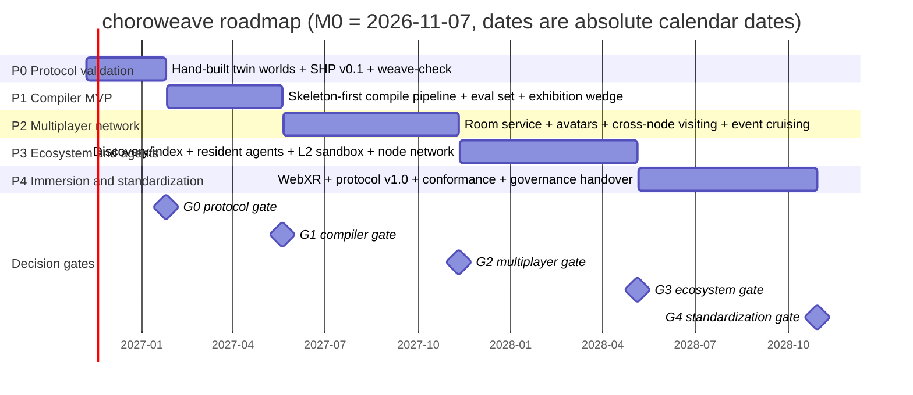

# choroweave 24-Month Roadmap (P0–P4)

> Status: Draft v0.1 · Baseline date **2026-11-07 = M0** · Audience: implementation team, funders, and community
> Conventions: stage names (P0–P4), module names (`@choroweave/*`), and metric names are fully consistent with the internal writing spec and [`02-tech-selection.md`](02-tech-selection.md); market figures are drawn only from [`research/04`](research/04-products-market-prior-art.md), with evidence grades: **[official]** = first-party (A) / **[third-party]** = independent institute or data vendor (B) / **[media report]** = media relay (B–C, used only for cross-validation); engineering estimates are marked **(estimate, C)**.
> Companions: [`06-mvp-spec.md`](06-mvp-spec.md) (executable specification for P0+P1), [`07-risks-compliance.md`](07-risks-compliance.md) (risk IDs `R-xx` are referenced in this document), [`08-open-source-strategy.md`](08-open-source-strategy.md) (community/standards/commercialization).
> Chinese version: [`../05-roadmap.md`](../05-roadmap.md)

---

## 0. One-page conclusion

1. **Five stages, four gates.** P0 proves "two self-hosted nodes + one door" (no AI); P1 proves "one sentence → a playable world"; P2 proves "real people present + cross-node visiting"; P3 proves "ecosystem and resident agents"; P4 delivers v1.0, WebXR adaptation, and governance handover. Each stage ends with a mandatory **G0–G4** Go/No-Go gate; no gate, no next stage.
2. **Only two things in the first 6 months.** Any investment in multiplayer, agents, 3DGS, or mobile before P1 is roadmap risk (see [`02`](02-tech-selection.md) §5 and the eight lessons in [`research/04`](research/04-products-market-prior-art.md) §4.2).
3. **The product wedge is fixed** (consistent with `00`'s executive summary): P1 uses **"addressable exhibition/portfolio spaces (3D link-in-bio)"** for acquisition and to accumulate content supply; P2 uses **"cross-community event cruising (a world-node portal network)"** for retention and network effects. **No general-purpose 3D social platform, no VR-first, no UGC revenue-share platform.**
4. **Two resourcing scenarios**: a 3-person squad at **$45k–65k/month fully loaded** (about **$1.1–1.6M** over 24 months); an 8–10 person team at **$140k–200k/month** (about **$3.4–4.8M** over 24 months). Both are estimates and include infrastructure and model calls.
5. **No substantive conflict with 02**; the only items to re-check at the P1 gate are `KHR_interactivity` cross-engine consistency and measured WebGPU/performance in the Quest browser (02 §6 pending items), handled per §8 of this document.

---

## 1. Roadmap principles and conventions

### 1.1 Stage definitions (copied verbatim from the internal writing spec §3; do not rename)

| Stage | Time | One-line goal | Exit Criteria | Gate |
|---|---|---|---|---|
| **P0** Protocol validation | M0–M2 | Hand-build two worlds and connect them with one door; freeze SHP v0.1 | Two self-hosted nodes can jump to each other; `weave-check` verifies; no AI involved | **G0** |
| **P1** Compiler MVP | M2–M6 | Generate a single room from one sentence; enterable, interactive, and able to jump to another world | ≥70% of 20 evaluation prompts produce a playable world; hot switch < 1.5s | **G1** |
| **P2** Multiplayer network | M6–M12 | Real-people multiplayer rooms + portal traversal + self-hosted nodes + avatars | 20-person room stable for 30 minutes; cross-node visiting demo; specification v0.5 | **G2** |
| **P3** Ecosystem and agents | M12–M18 | Resident agents, spatial evolution, community node network | 100 public worlds / 10 third-party nodes; agent reception demo | **G3** |
| **P4** Immersion and standardization | M18–M24 | Deep WebXR adaptation, protocol v1.0, governance handover | Quest 3 native 72fps; 3 third-party engines can play; v1.0 released | **G4** |

### 1.2 Five non-negotiable principles

1. **Protocol before AI.** P0 integrates no generative model; AI's value only becomes meaningful once the protocol can be verified (comment in the internal writing spec §3).
2. **Single-player before multiplayer.** Standalone playability is the experience floor; networking is an enhancement, not a prerequisite. This is a direct response to IDC 2025 headset shipments of **-42.8%** [third-party] and Web-side reachability.
3. **Self-hosting before hosting.** Worlds are hosted at the node operator's expense; the protocol party does not underwrite hosting costs (the core cause of death for Spatial's creator platform closure on 2025-07-27 and Mozilla Hubs' shutdown on 2024-05-31, see [`research/04`](research/04-products-market-prior-art.md) §3.3). Cost model in [`07`](07-risks-compliance.md) §3.
4. **Follow standards; do not invent a language.** World artifacts use glTF 2.0 + `KHR_interactivity` (ratified 2026-08-28) + `CHW_*` extensions; link semantics align with MSF "Web of Worlds"/X3D 4.1 Anchor/Inline ([`research/04`](research/04-products-market-prior-art.md) §3.7). Do not wait for standards, and do not build a separate spatial language.
5. **Every stage has something demonstrable.** Every gate is accepted as "an outsider can run it hands-on within 10 minutes", not closed out with documents or slides.

### 1.3 Product wedge (Lead framing, consistent with `00`)

| Stage | Wedge | Why this one | What we do not do |
|---|---|---|---|
| **P1 acquisition/content supply** | **Addressable exhibition/portfolio spaces (3D link-in-bio)**: one URL, one space; creators curate existing GLBs/works, which can be linked, embedded, and can host a door to someone else's space | Independent 3D artists/small studios "have assets but lack distribution"; Spatial's exit (2025-07-27) and Oncyber's current state leave a gap [official + media report]; usable by one person and inherently requires cross-domain addressing [`research/04`](research/04-products-market-prior-art.md) §5 conclusion 4 | No general-purpose social world; no gallery-platform revenue share; no subscription-walled template store |
| **P2 retention/network effects** | **Cross-community event cruising (world-node portal network)**: event spaces of different communities visit each other through standard entrances — "tonight the A community screening room, tomorrow the B community rooftop" | VRChat's 250k+ active communities / MAU >1M [official + third-party] prove that "small groups + strong ties" is the retention unit; Hubs' Link element already proved "in-space doors" work but their semantics stop at URL navigation [`research/01`](research/01-spatial-web-platforms.md) §3.5 | No centralized scheduling/ticketing monopoly over cruising; no forced cross-platform interoperability promises |

> Basis [`research/04`](research/04-products-market-prior-art.md) §3.3: "Users stay for **events/gameplay/happenings**, not for empty spaces" (the Spatial platform died while its social game under it had 500k+ DAU [media report]). An exhibition space is the smallest form of an "event" (one curation = one reason to spread); cruising is the networked form of "events".

---

## 2. 24-month Gantt and decision gates

| Gate | Timing | Go conditions (all must hold) | No-Go / degraded action |
|---|---|---|---|
| **G0** | M2 / 2027-01 | 10/10 successful jumps between two nodes; SHP v0.1 frozen (0 blockers); `weave-check` 22/22 passing ([`04`](04-spatial-hyperlink-protocol.md) §12 full case set); 0 generative-model calls throughout; ≥1 external developer reproduces it | Narrow scope to "single node + internal portal", degrade SHP to a "single-node world bundle specification"; **no headcount expansion**, re-evaluate the protocol route |
| **G1** | M6 / 2027-05 | ≥70% of 20 evaluations playable (`PR-20`); hot switch p95 < 1.5s (`HHT`); Desktop 60fps (`FT`); 2 security cases 100% rejected; `CPR` 100% | 50–70%: change the promise to "template-first + generation-enhanced", lower the target to 50%, delay P1 by 1 month, do not enter P2 yet; <50%: stop the in-house compiler, pivot to "suite + agent toolchain" (major pivot requiring funder sign-off) |
| **G2** | M12 / 2027-11 | 20-person room stable for 30 minutes (`RS-30`); one-click self-hosted node (`NBS`) completed by a non-author; cross-node visiting demo; specification v0.5 frozen | Stability not met: fall back to 8-person rooms + asynchronous viewing (recorded playback), postpone the P3 resident agent |
| **G3** | M18 / 2028-05 | 100 public worlds / 10 third-party nodes; `W1R` week-2 return rate ≥25%; agent reception demo | <5 third-party nodes: stop the "node federation" narrative, pivot to "hosted service + single node, multiple worlds"; degrade the P4 standards route to "follow MSF" (no conformance submission) |
| **G4** | M24 / 2028-10 | SHP v1.0 released; Quest 3 `FT` p95 ≤13.9ms (72Hz); 3 third-party runtimes pass conformance; governance charter signed | <3 third parties: delay v1.0 by one quarter and downgrade it to "v0.9 stable"; postpone governance handover, BDFL continues |

---

## 3. Stage details

> Format per section: goal → workstreams → deliverables (module level) → Exit Criteria (testable) → dependencies → main risks → KPIs (3–5) → decision gate.

### 3.1 P0 Protocol validation (M0–M2, 2026-11 → 2027-01)

**Goal**: with no AI, hand-build two worlds + one door, and run through and freeze "world manifest / addressing / portal / traversal handshake / node discovery / conformance verification" as SHP v0.1. P0 is "a correctness test of the protocol", not a product.

**Workstreams**
- W1 Protocol and schema: `world.json` v0.1; freeze fields for `CHW_portal`/`CHW_collider`/`CHW_logic`; SHP v0.1 text + conformance case list (aligned with [`04`](04-spatial-hyperlink-protocol.md)).
- W2 Two hand-built worlds: `pixel-rooftop` (rooftop + radio + door in the wall) and `pixel-night-market` (the second world, deployed on a different node; **working title, subject to 03's final naming**), all placed by hand with the suite, no generative model.
- W3 Reference runtime: Babylon.js 8.x scene loading, first-person roaming, input abstraction, portal-switch state machine (prefetch → validate → confirm → join → swap → rollback), WebGL2 by default.
- W4 Node and conformance: `@choroweave/node` static hosting + `/.well-known/weave-node.json` discovery + optional single-room WSP v0.1 codec (defined but multiplayer usage not required); `@choroweave/check` validation of `world.json`/glTF/portals/budgets.

**Deliverables**

| Deliverable | Owning package/file | Definition of done |
|---|---|---|
| SHP v0.1 (addressing, manifest, portal, handshake, degradation) | `docs/04` + `@choroweave/protocol` | An external implementer can write a minimal portal viewer from the documents alone |
| `world.json` v0.1 Schema + `CHW_portal`/`CHW_collider`/`CHW_logic` | `schemas/`, `schemas/world-manifest.schema.json` | Schema validates both example worlds with 0 errors |
| Two hand-built worlds (across two self-hosted nodes) | `examples/pixel-rooftop/`, `examples/pixel-night-market/` | The two nodes can jump to each other; door position/orientation correct |
| Entry/portal switching (P0 minimal viewer) | `apps/playground` (formalized as `@choroweave/runtime` from P1, see §8 alignment 1) | Hot switch p95 < 1.5s; degraded page when the target is offline |
| Conformance suite | `@choroweave/check` (`weave-check` CLI) | All 22 cases in [`04`](04-spatial-hyperlink-protocol.md) §12 pass |
| Node discovery and signing | `@choroweave/node` + `@choroweave/protocol` | ed25519 signature verification; covered by `weave-check` |
| P0 acceptance report | `docs/decisions/` | Includes video of human trial jumps and external reproduction record |

**Exit Criteria (testable)**
1. Bidirectional traversal between two self-hosted nodes on **different domains/IPs** succeeds 10/10 (including one successful retry after a target restart).
2. `weave-check` passes 22/22; a third party (not involved in development) completes "clone the example → start a local node → run weave-check" within 30 minutes.
3. `HHT` p50 ≤0.8s, p95 <1.5s (Desktop Chrome, 10 runs each on LAN + public internet); `CST` p95 <5s.
4. **Generative-model call count = 0** (provable from build logs and SBOM).

**Dependencies**: [`02`](02-tech-selection.md) ADR-02/05/06/07/10; [`04`](04-spatial-hyperlink-protocol.md) and `schemas/` finalized; `research/01`'s portal precedents (`MX_portal`→`OMI_link`→archived) for field-shape alignment.

**Main risks**: R-18 portal phishing/trust model (P0 must already define the allowlist and safe UI); R-02 portal state-machine complexity; R-04 Quest browser performance (P0 does no XR gating, only a smoke test); R-25 key-person dependency.

**KPIs (3–5)**: `HHT` p95 (<1.5s), `CST` p95 (<5s), `CPR` (100%), traversal success rate (100%), number of external reproductions (≥1).
**Decision gate**: **G0** (see table).

### 3.2 P1 Compiler MVP (M2–M6, 2027-01 → 2027-05)

**Goal**: make "one sentence → a playable world" hold within a controlled scope: the LLM produces only Schema-constrained Spatial-DSL, and a deterministic pipeline handles layout, assembly, collision, LOD, behavior graphs, and validation. **This is the product's first external promise.**

**Workstreams**
- W1 Intent layer: `@choroweave/dsl` (AST + Schema + semantic validation); tacitweave's **ISS** as an optional input (contract in `03` §8); P1 only consumes it, never produces it.
- W2 Skeleton and assembly: deterministic layout solving (rooms/walls/doors/windows/lighting/reachability) + suite library + `@choroweave/assembler` (glb assembly, collision hulls, LOD, material baking, scale normalization).
- W3 Assets: `@choroweave/provider-trellis` (TRELLIS.2, MIT, default) + `@choroweave/provider-kit` (modular suite, guaranteeing proportions and collision); the Hunyuan provider is an optional plugin only, off by default (R-07).
- W4 Gameplay and validation: DSL behavior section → L0 `KHR_interactivity` behavior graph; validate-repair loop (Schema → semantics → glTF Validator + Babylon `strictValidation` → structured diagnostics fed back for ≤3 rounds → template fallback).
- W5 Evaluation and release: `eval/` 20 prompts + automatic metrics + human rubric; first npm release, example worlds, evaluation report.

**Deliverables**: `@choroweave/dsl` v0.1, `@choroweave/compiler` v0.1 (CLI: `choroweave build/preview/publish`), `@choroweave/assembler` v0.1, `provider-trellis`/`provider-kit` v0.1, `@choroweave/check` budget and reachability extensions, `eval/` evaluation set and record format, compiled `pixel-rooftop` (with a hand-built baseline comparison), P1 evaluation report (published).

**Exit Criteria (testable)**
1. **≥70%** of the 20 evaluation prompts produce a playable world (`PR-20` defined in §5.1: weighted total ≥3.5 and playability ≥3 and safety ≥3).
2. Compiled output passes glTF Validator + `KHR_interactivity` strictValidation **100%**; behavior graphs have no undeclared external references.
3. `HHT` p95 <1.5s (compiled world → `pixel-night-market`); `CST` p95 <5s.
4. Standard tier `CPW` ≤ **$8/world** (consistent with `00` §8; 02 ADR-09's engineering estimate range is $0.5–8, see [`07`](07-risks-compliance.md) §3); time targets per **draft ≤10 min / standard ≤20 min** (`00` §8 has been synchronized per the ruling; 02 ADR-09's "standard 20–40 min" is a feasibility estimate, not a delivery target).
5. Security cases (2/20) 100% rejected or degraded; no arbitrary JS in world bundles.

**Dependencies**: G0 passed; [`02`](02-tech-selection.md) ADR-09 (skeleton-first), ADR-02/03/04; MIT license audit for `provider-trellis`; ≥2 human raters for the evaluation set.

**Main risks**: R-03 generation quality (CEGame-Bench 16% pass rate [official]); R-07 supply-chain licensing; R-15 cold start (a good compiler nobody uses); R-06 cost overrun.

**KPIs**: `PR-20` (≥70%), `CPW` (≤$8), first-pass rate `FPR` (≥60%), evaluation stability (3-seed range ≤1.0 points), `HHT` p95.

**Decision gate**: **G1** (see table).

### 3.3 P2 Multiplayer network (M6–M12, 2027-05 → 2027-11)

**Goal**: real people present: 20-person rooms, avatars, voice, cross-node visiting, event cruising. **P2 is the first real test of "network effects".**

**Workstreams**
- W1 Real-time layer: `@choroweave/protocol` WSP v0.2 (WebSocket authoritative + abstracted WebTransport/WebRTC backends; **poses at 15Hz** ([`03`](03-architecture.md) §5.4 default, configurable 10–20Hz), snapshot once per second + deltas, client interpolation); LiveKit voice (self-hosted, Apache-2.0).
- W2 Room service and node: `@choroweave/node` room service v0.1 (20 CCU/room, optional static mode); one-click self-hosting (`docker compose up` or `npx @choroweave/node init`); `/.well-known/weave-node.json` capability negotiation upgrade.
- W3 Avatars and state: `CHW_avatar` v0.1 (glTF humanoid stand-in; P2 evaluates VRM/three-vrm adaptation); sync whitelist (glTF Object Model JSON Pointers); state handoff on enter/leave/portal traversal.
- W4 Cruising product: event world templates (screening room/exhibition/night market) + a cruising schedule protocol (P2 proposal: node-side `/.well-known/weave-events.json`, **subject to 04's RFC process**); `pixel-night-market` as an event node.
- W5 Specification v0.5: SHP v0.5 (multiplayer rooms, capability negotiation, cross-node trust, deprecation policy) + conformance cases expanded to 80.

**Deliverables**: WSP v0.2 and SHP v0.5, `@choroweave/node` room service v0.1 + one-click self-hosting, `@choroweave/runtime` multiplayer adaptation, `CHW_avatar` v0.1, LiveKit integration, cross-node visiting demo (three nodes), cruising event template, 20-person load-test report.

**Exit Criteria (testable)**
1. A 20-person room is stable for **30 consecutive minutes**: users who did not leave voluntarily disconnect ≤1 time per person, no room-service crash, `RS-30` met.
2. Cross-node visiting demo: `pixel-rooftop` → an event world on a third-party node → return; **same-node hot switch `HHT` p95 <1.2s** (aligned with `00` §8), cross-domain hot switch <1.5s, cold path <2.5s; identity and avatar appearance persist.
3. One-click self-hosting: **≥3 of 5 testers not involved in development** complete deployment within 30 minutes and are reachable from other nodes (`NBS`).
4. Specification v0.5 frozen (0 blockers); conformance 80 cases at 100% pass rate (reference implementation).
5. Unauthorized writes outside the room sync whitelist = 0 (security case).

**Dependencies**: G1 passed; ADR-07/08; LiveKit self-hosted load testing; `research/01`'s MatrixRTC slot/membership concept template (concept only, Matrix not adopted); `research/03`'s WebTransport 92.37% caniuse (2026-10, B).

**Main risks**: R-02 sync complexity; R-04 headset browser performance; R-21 room abuse; unverified WebTransport support in headset browsers (`research/03` §5.2, needs P2 measurement).

**KPIs**: `RS-30`, `NBS` (≥3/5), cross-node visiting success rate (≥95%), `HHT` cross-domain p95, room-service cost per CCU (estimate).

**Decision gate**: **G2** (see table).

### 3.4 P3 Ecosystem and agents (M12–M18, 2027-11 → 2028-05)

**Goal**: go from "a playable demo" to "a network people keep visiting and deploy themselves": discovery layer, resident agents, spatial evolution, L2 sandbox, node ecosystem.

**Workstreams**
- W1 Discovery and indexing: `choroweave/discover` (optional service, not protocol-mandated): world index, tags, event calendar, node health; `world.json` gains an optional `indexing` declaration (**P3 proposal, subject to RFC**; 04 v0.1 currently has no such field).
- W2 Resident agents (node side): agent runtime (reception/guidance/Q&A/event hosting); L1 curated networked modules (gomoku/quiz/fishing and other parameterized ones); agent behavior only through whitelisted APIs and capabilities declared by `CHW_logic`; conversations and tool calls leave audit logs.
- W3 Spatial evolution: `world.json` version diff + incremental publishing + portal compatibility (migration rules for old doors pointing at new versions); content hashes and signatures.
- W4 L2 capability sandbox WASM: capability whitelist (read room state / emit custom events / modify declared properties, expressed with JSON Pointers), resource and instruction quotas; off by default, enabled via node capability negotiation.
- W5 Ecosystem operations: 3 showcase worlds, creator program (first 10), templates/asset packs, third-party node support (10).
- W6 Visual enhancement experiments (no commitment): 3DGS background layer (`KHR_gaussian_splatting` + SPZ/SOG) only as a **pre-generated look layer**, never entering the runtime state machine; evaluate headset streaming cost vs. benefit (ADR-11).

**Deliverables**: discover service v0.1, agent runtime v0.1 + 3 official agent modules, spatial evolution (diff/migration), L2 sandbox v0.1, 10 templates / 5 asset packs, 3 showcase worlds, creator program charter, 1 3DGS-enhanced showcase (experimental).

**Exit Criteria (testable)**
1. **100 public worlds / 10 third-party nodes** (third party = domains not controlled by project members); `weave-check` pass rate ≥90% (third-party node sample).
2. Agent reception demo: continuous 7-day reception in a showcase world, task completion rate ≥60% (definition: visitor questions answered or correctly routed; 100 manual spot checks).
3. `W1R` week-2 return rate ≥25% (distinct identities that entered ≥1 world in the past 7 days and entered again in week 2; opt-in telemetry).
4. Spatial evolution: after a world's v2 release, 100% of old portals migrate correctly, no dead links.
5. L2 sandbox privilege escalation = 0 (≥30 red-team cases).

**Dependencies**: G2 passed; [`07`](07-risks-compliance.md) §5 threat model and §6 content governance landed before P3; [`08`](08-open-source-strategy.md)'s community cold-start plan; `research/04` §5 conclusions 2/5 (a missing discovery layer is the root cause of Hyperfy-style islands).

**Main risks**: R-15 discovery/cold start; R-13 platform squeeze (Roblox Everywhere / Astrocade / Bitmagic); R-22 content governance cost; R-26 community operations staffing.

**KPIs**: public world count, third-party node count, `W1R`, agent task completion rate, index coverage (share of public worlds indexed within 7 days).

**Decision gate**: **G3** (see table).

### 3.5 P4 Immersion and standardization (M18–M24, 2028-05 → 2028-10)

**Goal**: turn "it runs" into "third parties can implement it": deep WebXR adaptation, SHP v1.0, conformance ecosystem, governance handover.

**Workstreams**
- W1 WebXR: land the Quest 3 72fps budget (draw call/triangle/VRAM gates become engine startup checks); visionOS Safari dual track (WebXR primary + `<model>`/Immersive API enhanced degraded path, see [`research/03`](research/03-runtime-standards.md) §3.3); measured calibration across the `XR-Low/Mid/Apple` three-tier device matrix.
- W2 WebTransport default: WSP v1.0 transport switch; WebRTC DataChannel fallback; LiveKit voice by default.
- W3 Standards: SHP v1.0 frozen; `CHW_portal` submitted to OMI Stage 1 (W3C CG); mapping document with MSF "Web of Worlds"/X3D 4.1 Anchor/Inline; Khronos glTF community submission (aligning with glTF 2.1 external-reference semantics, see [`research/03`](research/03-runtime-standards.md) §3.1.1).
- W4 Conformance ecosystem: `weave-check` covers runtime/node/portal/security; publish implementation reports from 3 third-party runtimes passing; `weave-check` on npm.
- W5 Governance handover: foundation/committee charter, trademark and specification copyright arrangements, security response process (`security.txt`), BDFL exit drill.

**Deliverables**: WebXR adapter (Quest 3 / visionOS), WSP v1.0, SHP v1.0, OMI Stage 1 submission draft, MSF/X3D mapping document, conformance report (3 third parties), governance charter, security audit report + SBOM.

**Exit Criteria (testable)**
1. **Quest 3 native 72fps**: `FT` p95 ≤13.9ms, frame-drop rate <5% (60-second sample, WebGL2 by default in XR sessions); the `XR-Low` tier meets 72Hz.
2. **3 third-party engines/runtimes** can load and play a World Bundle (at minimum: glTF-Sample-Viewer consistency, a third-party Web viewer, and one non-Babylon engine), passing `weave-check` conformance.
3. SHP v1.0 released (CC-BY-4.0), 0 blockers; deprecation policy and compatibility matrix explicit.
4. visionOS Safari can enter the same world (WebXR), and the `<model>` degraded path can display single-asset worlds.
5. Security audit: 0 unfixed high-severity issues; SBOM (CycloneDX) published with every release.

**Dependencies**: G3 passed; [`07`](07-risks-compliance.md) §4 licensing/SBOM and §8 legal mapping re-reviewed before v1.0; [`08`](08-open-source-strategy.md) §4 standards route and §8 governance.

**Main risks**: R-05 WebGPU-XR not standardized (WebGL2 explicitly the floor); R-11 unit economics (cost model review needed before P4); R-12 insufficient VR demand (VR as an optional entry only); R-24 BCI ethics (P4 writes "multimodal input", no BCI commitment).

**KPIs**: Quest 3 `FT` p95, third-party conformance passes (=3), `CPR` (≥95%), external contributors (≥15), specification blockers (=0).

**Decision gate**: **G4** (see table).

---

## 4. Resourcing scenarios and budget

> Both scenarios are **fully loaded** (people + infrastructure + model calls + legal/compliance + travel/community), in USD, **(estimate, C)**; excludes financing costs and marketing spend.

### 4.1 Scenario A: 3-person squad ($45k–65k/month, ~$1.1–1.6M over 24 months)

**Staffing profile** (3 full-time core + 0.5 design/community roles; the two 0.5s may be combined and counted as 0.5–1 FTE, the same basis as [`00`](00-executive-summary.md) §7's "3 FTE + 0.5 design/community"; costs include all personnel):

| Role | FTE | Responsibilities | Key deliverables |
|---|---|---|---|
| Runtime/graphics | 1.0 | Babylon.js, WebXR, portal state machine, performance gates | P0 portal switching, P2 avatars/multiplayer adaptation, P4 72fps |
| Compiler/ML | 1.0 | Spatial-DSL, deterministic assembly, generation providers, validate-repair loop | P1 compile pipeline and evaluation set |
| Protocol/backend | 1.0 | SHP/WSP, node, room service, security and signing | P0 node/conformance, P2 room service, P3 agent host |
| Design/technical art (0.5) | 0.5 | Suite library, showcase worlds, playability tuning | Pixel rooftop/night market, templates and asset packs |
| Community/product (0.5) | 0.5 | Evaluation organization, creator program, docs and releases | Evaluation report, showcase, Discord/GitHub |

**Cost breakdown (monthly, estimate)**: personnel $39k–52k; infrastructure (object storage/CDN/CI/domains/test devices) $2k–5k; model calls and generation GPUs $0.5k–2k; legal/compliance/license review $2k–4k; travel/community/events $1k–2k. Total **$45k–65k/month**; ~**$1.1–1.6M** over 24 months (including amortization of the one-off P4 security audit).

**Applicability and cost**: can complete P0–P2; P3's discovery layer and agents can only be "minimally viable"; high single-point dependency (R-25), and if a core member leaves, P1/P2 slip by at least 6–8 weeks. **Recommendation**: run scenario A through G1, then decide from the G1 result whether to expand to scenario B.

### 4.2 Scenario B: 8–10 person team ($140k–200k/month, ~$3.4–4.8M over 24 months)

**Staffing profile** (extending scenario A):

| Function | FTE | Notes |
|---|---|---|
| Runtime/graphics | 2.0 | 1 on XR/performance, 1 on scene graph/rendering |
| Compiler/ML | 2.0 | 1 on pipeline/assembly, 1 on generation providers and evaluation |
| Protocol/backend | 2.0 | 1 on protocol/conformance, 1 on node/room service/ops |
| Design/technical art | 1.0 | Suite library, showcase, playability |
| Community/product/operations | 1.0 | Creator program, Discord/GitHub, releases |
| Security/compliance (may be external) | 0.5–1.0 | Threat model, SBOM, content governance, legal liaison |

**Cost breakdown (monthly, estimate)**: personnel $110k–160k; infrastructure $5k–12k; model calls and generation GPUs $2k–8k; legal/compliance/T&S/audit $8k–15k; travel/community/events $3k–8k; tools/office $2k–5k. Total **$140k–200k/month**; ~**$3.4–4.8M** over 24 months.

**Applicability and cost**: can parallelize P3 discovery layer, agents, L2 sandbox, and P4 standards work, and can deliver v1.0 plus 3 third-party conformance passes within 24 months; the risk is that the organization grows faster than product-market fit (the Meta Horizon Worlds lesson: capital cannot substitute for PMF [official + media report]).

> **Cost drivers** (consistent with [`00`](00-executive-summary.md) §7): personnel about **70%**; GPU/model calls **$2k–8k/month** during P1, linear in world generation volume; infrastructure (node hosting/CDN) **$500–3k/month**, growing with public worlds. **Unit economics are measured from day one of P1**: per-world generation cost target <$8 (estimate), and bandwidth cost per 1000 visits must stay below $1 (derivation in [`07`](07-risks-compliance.md) §3.2).

### 4.3 Order-of-magnitude for infrastructure and model calls (estimate)

| Item | Unit price assumption | P1–P2 magnitude | Notes |
|---|---|---|---|
| Generation (Standard tier) | $2–6/world (including GPU time) | Evaluation/regression: 20 prompts × 3 seeds × 6 weeks ≈ 360 generations → $0.7k–2.2k/period | Assumes H100 cloud price $2–3/hour, **not individually price-checked**; tacitweave reuse amortizes it |
| Static node hosting | $1.3–6.5/world/month (at 10-world scale, estimate) | 3 showcase + 2 demo nodes ≈ $20–60/month | Derivation in [`07`](07-risks-compliance.md) §3.2 |
| Room service (worlds that open rooms) | $5–20/world/month | 3–5 worlds during P2 load testing ≈ $15–100/month | CPU host at the 20 CCU scale |
| Index/discovery service | $50–300/month | From P3 | Can start on object storage + edge functions |
| CI (build/validate/evaluate) | $100–500/month | Whole cycle | GPU evaluation runs dominate |

> **Red line**: any default path of "per-session real-time neural rendering (3DGS/video world models)" would raise costs by an order of magnitude or more (one consumer GPU per session, see [`research/02`](research/02-generative-3d-and-agents.md) §4.2), so P1–P3 do not put it in the runtime (consistent with ADR-11).

---

## 5. KPI dashboard

### 5.1 Metric dictionary (shared by 05/06/07/08; single definition)

| ID | Metric | Definition and formula | Collection | Stage target |
|---|---|---|---|---|
| `HHT` | Portal hot-switch time | Time from the user confirming traversal to the target world being "operable" (first frame + input available); p50/p95 | Local benchmark script + telemetry (opt-in) | From P1: p95 <1.5s |
| `CST` | Cold-start time | Opening the world URL until operable; p50/p95 | As above | From P0: p95 <5s |
| `PR-20` | Playability rate | Count of the 20 prompts with "rubric weighted total ≥3.5 and playability ≥3 and safety ≥3" ÷ 20 | Automation + two-person blind rating | ≥70% by end of P1 |
| `CPR` | Conformance pass rate | `weave-check` passing cases ÷ total cases | CI | P0 100%; from P2 ≥95% |
| `RS-30` | Room stability | 20-person room over 30 consecutive minutes: involuntary disconnects, crashes, p95 frame time | Load-test framework | Met by end of P2 (disconnects ≤1/person, 0 crashes) |
| `NBS` | Node bootstrap success | Share of testers not involved in development who complete self-hosting within 30 minutes and are reachable from other nodes | Manual test records | ≥3/5 by end of P2 |
| `W1R` | Week-2 return rate | Share of distinct identities that entered ≥1 world in the past 7 days and entered again in week 2 | Telemetry (opt-in) + node aggregation | ≥25% by end of P3 |
| `FT` | Frame time | Frame render time p95 (ms); 72Hz budget 13.9ms | Runtime probe | Quest 3 ≤13.9ms by end of P4 |
| `CPW` | Cost per world generated | Standard-tier amortized cost per world (USD) | Evaluation ledger | P1 ≤$8; P2 ≤$6; P3 ≤$4; P4 ≤$3 |
| `FPR` | First-pass rate | Share of worlds passing all validations on the first compile | Evaluation ledger | ≥60% by end of P1 |
| `XPR` | External adoption | Number of third-party runtimes/nodes passing conformance | Release reports | ≥3 by end of P4 |

### 5.2 KPIs per stage (3–5 each)

| Stage | KPIs (targets) |
|---|---|
| P0 | `HHT` p95 <1.5s · `CST` p95 <5s · `CPR` 100% · traversal success rate 100% · external reproduction ≥1 person |
| P1 | `PR-20` ≥70% · `CPW` ≤$8 · `FPR` ≥60% · `HHT` p95 <1.5s · evaluation stability (3-seed range ≤1.0) |
| P2 | `RS-30` met (20 people / 30 min) · `NBS` ≥3/5 · cross-node visiting success rate ≥95% · `HHT` same-node <1.2s / cross-domain <2.5s · `PR-20` ≥85% |
| P3 | Public worlds ≥100 / third-party nodes ≥10 · `W1R` ≥25% · agent task completion ≥60% · `PR-20` ≥90% · index coverage ≥90% |
| P4 | `FT` Quest 3 p95 ≤13.9ms · `XPR` ≥3 · `CPR` ≥95% · `PR-20` ≥95% · external contributors ≥15 |

> Cross-stage evolution aligns with [`00`](00-executive-summary.md) §8: public worlds / third-party nodes P1 3/0, P2 30/3, P3 100/10, P4 500/50; `W1R` P2 ≥15%, P3 ≥25%, P4 ≥35%; 20-person room stability duration P2 ≥30 min, P3 ≥60 min, P4 ≥120 min; third-party runtimes passing conformance P3 2, P4 ≥3. Each stage surfaces only the 5 metrics that best represent that stage's risk; the rest are secondary observations.

### 5.3 Dashboard discipline

- Every value is annotated with its **collection time** and **sample size**; when it cannot be collected, write "not collected" — do not extrapolate or fill in.
- User-side metrics are **opt-in** by default, reported in aggregate, and must not allow personal re-identification (see [`07`](07-risks-compliance.md) §7 data minimization).
- Stage KPIs are frozen as a snapshot at gate review and archived into [`docs/decisions/`](../decisions/README.md); definitions must not be changed retroactively.

---

## 6. Interface with 06

### 6.1 Relationship definition

[`06-mvp-spec.md`](06-mvp-spec.md) is **the executable specification for P0+P1 of this document**: this document defines "what counts as done", 06 defines "how to do it, how to verify it, what to do on failure". **Metric names, gate conditions, and device budgets follow this document §5 and 02**; 06 may refine but must not establish separate definitions.

### 6.2 Mapping table

| This document (05) deliverable/gate | Corresponding section in 06 | Acceptance vehicle |
|---|---|---|
| P0 two hand-built worlds + portal | 06 §3 P0 user stories, §5 demo scripts (S1–S12) | Step-by-step script + recording |
| P0 `weave-check` | 06 §9.2 acceptance command (P0 gate) | `weave-check` CLI output |
| P1 compile pipeline | 06 §6 evaluation set (20 prompts) and rubric | `eval/` records |
| P1 `PR-20` / `HHT` / `CPW` | 06 §6.2 pass criteria, §7 performance and compatibility acceptance table | Evaluation ledger + performance report |
| P1 product wedge (exhibition spaces) | 06 §1.1 persona A, §4 P1 user stories (US-P1-03/09/12) | Persona acceptance script |
| P2 multiplayer/cruising | 06 §1.2 persona B (prerequisites), §5 S10–S11 | P2 load-test report |

### 6.3 Change protocol

1. Gate conditions and metric definition changes: **05 is the single source of truth**; they must be recorded in this document's change log and synchronized to 06/07/08.
2. Prompt, rubric, and script-step changes: **06 is the source of truth**, but must not change the `PR-20` decision thresholds (thresholds live in 05 §5.1).
3. After any file change, run a cross-link and terminology check within 48 hours (see the internal writing spec §6).

---

## 7. Interfaces with 07 and 08 (summary)

| Document | Interface with this document | Handover point |
|---|---|---|
| [`07-risks-compliance.md`](07-risks-compliance.md) | Risk IDs `R-xx` are referenced throughout the stages here; the unit economics model (07 §3) provides cost constraints for §4.3 and the G2/G3 gates here; the threat model and content governance must land before P3 | Complete 07 §5 threat model before G2; complete 07 §6 content governance before G3 |
| [`08-open-source-strategy.md`](08-open-source-strategy.md) | P3's creator program/showcase/node support are defined by 08 §5; P4's standards route and governance handover are defined by 08 §4/§8; the release checklist comes from 08 §9 | Publish the community cold-start plan before G3; complete the governance charter before G4 |

---

## 8. Consistency check and deviations vs. 02

| Check item | Result |
|---|---|
| Stage names/timing/Exit Criteria | Verbatim identical to the internal writing spec §3; this document only quantifies the "testable" basis, without changing semantics |
| Module names | Consistent with the internal writing spec §2 (`@choroweave/*`, `pixel-rooftop`) |
| Protocol/extension names | SHP v0.1, WSP v0.1, `CHW_portal`/`CHW_collider`/`CHW_logic`/`CHW_avatar` (P2) consistent |
| Runtime/license | Babylon.js 8.x, WebGL2-first, code Apache-2.0 / specification CC-BY-4.0 consistent |
| Performance budget | Reuses [`02`](02-tech-selection.md) §3 performance table and [`research/03`](research/03-runtime-standards.md) §4.4; this document adds no device tiers |
| **Deviation 1** | 02 §6's "Quest browser WebGPU unverified" needs measured data at the P2 gate; this document lists it as **prerequisite evidence** for G2 but not a gate condition (avoiding an uncontrollable dependency) |
| **Deviation 2** | `research/03` §4.6's "12-month roadmap recommendation" differs in granularity from this document's 24-month staging; this document prevails, and `research/03`'s recommendation serves as an internal work-order reference for P0–P2 |
| **Deviation 3 (ruled)** | [`00`](00-executive-summary.md) §8 originally said "standard world generation time ≤10 min", inconsistent with 02 ADR-09's "standard 20–40 minutes". **Ruling: `00` §8 changed to tiered KPIs — draft ≤10 min / standard ≤20 min (P1), cost CPW ≤$8**; 02's 20–40 minutes is retained as a "feasibility estimate range" and is not a delivery commitment. All three places are now unified |
| **Alignment 1** | [`03`](03-architecture.md) §11.2 places the formal slice of `@choroweave/runtime` in P1; P0's entry/portal is handled by the `apps/playground` minimal viewer. The "reference runtime" in this document's P0 deliverables should be read as **that minimal viewer**, formalized into the `runtime` package in P1 |
| **Alignment 2** | WSP pose frequency follows [`03`](03-architecture.md) §5.4's **15Hz** (this document corrects it from 20Hz); the ≈180 KB/s downlink capacity estimate for a 20-person room is in 03 §5.4 |
| **Alignment 3** | KPI cross-stage evolution (ecosystem/retention/multiplayer duration/conformance/cost) has been aligned item by item with `00` §8; `00` §7's resource ranges are consistent with §4 here; the wedge is consistent with `00` §5 |
| Pending | If G1 triggers the degraded path (template-first), the line "differences from the original concept" in 02 §5 must be updated, and the promise wording synchronized in the 00 executive summary |

---

## 9. Appendix

### 9.1 Milestone calendar (M0 = 2026-11-07)

| Milestone | Calendar | Deliverable/gate |
|---|---|---|
| M0 | 2026-11 | Roadmap frozen; P0 starts |
| M1 | 2026-12 | Two hand-built worlds take shape; handshake state machine v0.1 |
| M2 | 2027-01 | **G0**: SHP v0.1 + weave-check + two-node mutual jumps |
| M3 | 2027-02 | Skeleton compile pipeline connected end to end (suite + layout) |
| M5 | 2027-04 | 20-prompt evaluation set runs; repair loop ≤3 rounds |
| M6 | 2027-05 | **G1**: PR-20 ≥70% + HHT <1.5s |
| M9 | 2027-08 | 20-person room load testing; cross-node visiting demo |
| M12 | 2027-11 | **G2**: RS-30 + NBS + specification v0.5 |
| M15 | 2028-02 | discover v0.1; agent runtime prototype |
| M18 | 2028-05 | **G3**: 100 worlds / 10 nodes / W1R ≥25% |
| M21 | 2028-08 | Quest 3 72fps; SHP v1.0 draft |
| M24 | 2028-10 | **G4**: v1.0 + 3 third-party conformance + governance handover |

### 9.2 Open questions

1. If the P1 gate triggers the degraded path, how should the external product promise be rewritten (this affects `00`, the [README](../../README.md), and the fundraising narrative)?
2. Should P3's discover service be run by the project or handed to third-party nodes (protocol-mandated vs. optional)? — this has boundary tension with 08 §7's "no centralized hosting monopoly".
3. The recipient of the P4 governance handover: a new foundation vs. affiliation with an existing organization (e.g. an MSF/W3C CG membership path) — must be decided before G3.
4. Under the small-squad scenario, should P3's agent and discovery layer be merged into one thing ("agent as index") to save staffing?
